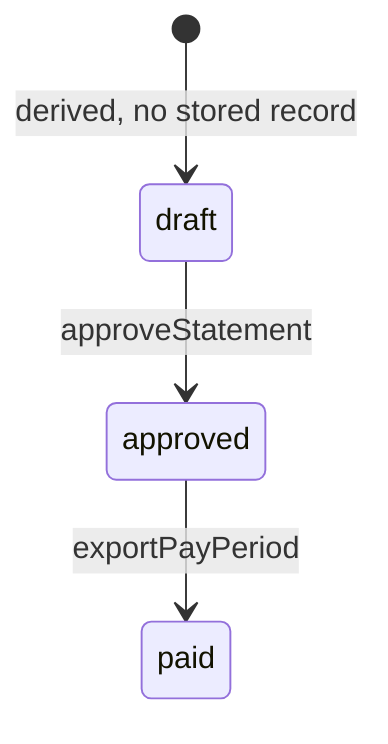
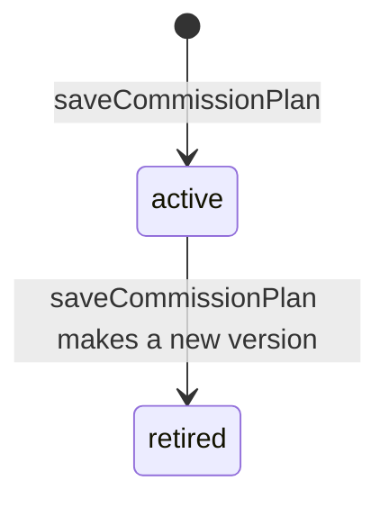
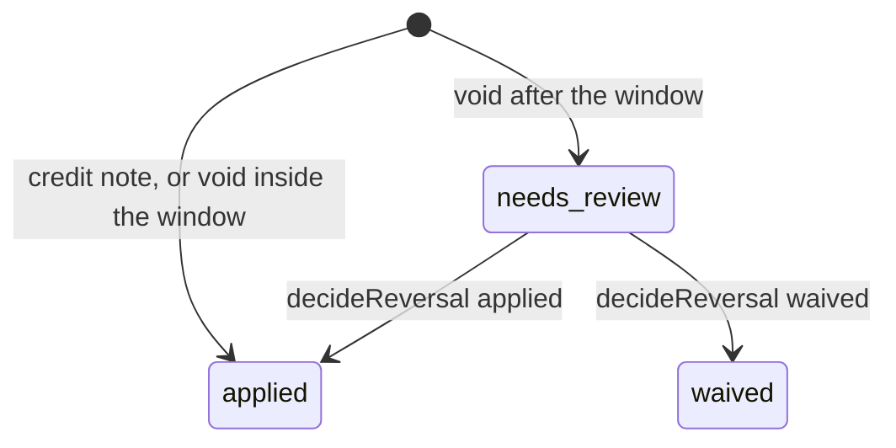

# Commissions

Written from the demo code, 2026-11-10.

## Purpose

Commissions pays sales staff on money collected. A confirmed customer payment produces commission lines under the rep's plan. Lines roll up into a monthly statement. HR approves the statement, and the payable amount joins the next pay period.

One calculation serves every screen: `commissionLines` in `packages/shared/src/hr/commission-plans.ts`. There is no Settings page for commissions, and `CompanySettings` has no commissions section.

| Screen | Route | Feature key | Component |
| --- | --- | --- | --- |
| Commissions: Statements, Plans, People on plans | `/hr/commissions` | `hr.commissions` | `apps/web/src/features/hr/commissions/commissions-page.tsx`, `statement-sheet.tsx`, `plan-form-dialog.tsx` |
| Sales, Team | `/sales?view=team` | `sales.team` | `apps/web/src/features/sales/team-table.tsx` |
| Commission split and Credit note, on an invoice | Update status menu | `sales.invoices` | `apps/web/src/features/invoices/update-status-menu.tsx`, `commission-split-dialog.tsx`, `credit-note-dialog.tsx` |
| My commission | `/my/commission` | `hr.portal` | `apps/web/src/features/my/my-commission.tsx` |

`hr.commissions` belongs to the Flooring Suite. The HR Suite has no Commissions page.

## Who uses it

Default roles come from `packages/shared/src/permissions/roles.ts`.

| Action | Permission key | Default roles | Enforced in |
| --- | --- | --- | --- |
| Read statements, plans, assignments, adjustments | `hr.commission.view` | Owner, HR manager | `listCommissionStatements` and `PRIVATE_COLLECTIONS` in `store.ts`; `apps/web/src/products/pages.ts` |
| Add or edit a plan, assign a plan | `hr.commission.manage` | Owner, HR manager | `saveCommissionPlan`, `assignPlan` in `apps/web/src/lib/api/demo/commission-actions.ts` |
| Approve a statement, accept or waive a reversal | `hr.commission.approve` | Owner, HR manager | `approveStatement`, `decideReversal` |
| Add a statement adjustment | `hr.commission.adjust` | Owner, HR manager | `addCommissionAdjustment` |
| Change an invoice's split | `hr.commission.manage` or `sales.invoice.edit` | Owner, Manager, Accountant, HR manager | `setCommissionSplit`; `update-status-menu.tsx` |
| Issue a credit note | `sales.invoice.void` | Owner, Manager, Accountant | `issueCreditNote`; `update-status-menu.tsx` |
| See Sales, Team and team commission | `sales.commission.view` | Owner, Manager, Accountant, Sales | `teamCommission`; `sales-page.tsx` |
| See margin on Sales, Team | `sales.margin.view_sensitive` | Owner, Manager, Accountant | `team-table.tsx` |
| Sign one's own plan | None. The assignment must belong to the signed-in user | Anyone on a plan who can see My commission | `acknowledgePlan` |
| See own statements in the portal | `hr.portal.view`, plus the visibility rule in `docs/product-spec/employee-portal.md` | All nine default roles | `myPortal` in `portal-actions.ts` |

`sales.commission.manage` is in the catalog and held only by Owner. No code reads it.

`listCommissionStatements` is not narrowed by data scope. `teamCommission` is: a viewer whose scope is not `all` sees their own user and the reps on invoices in their scope.

## Workflows and status rules

### `CommissionStatement.status`



| Transition | Function | Guards |
| --- | --- | --- |
| `draft` | `statementRows`, `commission-actions.ts` | A month with no stored record reads as `draft`. The UI shows Open, or To approve once the month has ended and it has lines |
| To `approved` | `approveStatement`, `commission-actions.ts` | Not the approver's own statement. Month has ended. Status is `draft`. No line in `needs_review`. Stores a `CommissionStatement` |
| To `paid` | `exportPayPeriod`, `pay-actions.ts` | The statement's `payPeriodId` is the exported period |

`approvePayPeriod` sets `payPeriodId` on approved statements that have none. `reopenPayPeriod` clears it. The status stays `approved`. No action returns a statement to `draft`.

### `CommissionPlan.status`



The type also allows `draft`. No screen sets it, because `PlanFormDialog` starts a plan as `active`. The Plans tab lists active plans only.

### `CommissionLine.reversalState`



`voidReversals` and `creditNoteReversals` set the state, in `packages/shared/src/hr/commission-plans.ts`. `decideReversal` stores the decision as a `CommissionAdjustment` with amount `0.00` and a `decides` value.

### Plan assignment and signature

HR assigns a plan from a date (`assignPlan`). The rep types their name to sign (`acknowledgePlan`). A new plan version clears the signature, so the rep signs again. Signing is simulated: a typed name stands in for an e-signature.

## Business rules

All functions below are in `packages/shared/src/hr/commission-plans.ts` unless a file is named.

1. **Advanced and earned (plan N-4).** The plan text says commission is advanced when the payment is confirmed and earned when the clawback window closes. `PlanFormDialog` and the portal's signing panel show this wording. In the code, every new line has `kind: "earned"` from the day of confirmation. Only `windowEndsOn` separates the two states, and it limits reversals. No field or screen labels a line as an advance.

2. **What produces commission.** `commissionLines`. An event is a payment with `status === "confirmed"`, or a `credit_applied` invoice adjustment, on an invoice that is not voided and not a return. The date is the following, and it sets the statement month:

   ```ts
   (p.reviewedAt ?? p.recordedAt).slice(0, 10)
   ```

   Events run oldest first. Events dated after today are skipped. If the invoice's first split rep has no plan on that date, there is no line.

3. **Commission base.** `baseOf` and `netInvoice`. `S`, `C` and `G` are the invoice's subtotal, cost and total, each minus its non-voided credit notes issued on or before the event date. The basis comes from the first split rep's plan.

   ```ts
   if (net.G.lte(0) || net.S.lte(0)) return dec(0);
   const K = minDec(collected, net.G);
   const revenue = roundMoney(K.times(net.S).dividedBy(net.G));
   if (plan.basis === "paid_revenue") return revenue;
   return maxDec(roundMoney(revenue.times(net.S.minus(net.C)).dividedBy(net.S)), 0);
   ```

   The cap stops an overpayment from earning. The base is cumulative per invoice. The event's `delta` is `base` minus the invoice's live base, and nothing happens when `delta` is 0 or less.

4. **Split between reps.** `splitOf` and `commissionLines`. Default is the sales rep at 100 percent.

   ```ts
   const share = i === split.length - 1 ? delta.minus(allocated) : roundMoney(pctOf(delta, s.pct));
   ```

   A rep with no plan on the date is skipped and gets no share.

   `setCommissionSplit` in `commission-actions.ts` allows at most two rows, needs shares summing to 100, and locks the split once a payment on the invoice is `confirmed`.

5. **Monthly tiers.** `commissionCurve`. Band edges are `pctOf(target, t.fromPctOfTarget)`. The target is `monthlyTargetOverride ?? monthlyTarget`. Default mode is marginal.

   ```ts
   if (plan.tierMode === "retroactive") {
     const reached = bands.filter((b) => amount.gte(b.from)).at(-1);
     return pctOf(amount, reached?.rate ?? plan.baseRatePct);
   }
   let total = pctOf(minDec(amount, bands[0]?.from ?? amount), plan.baseRatePct);
   bands.forEach((band, i) => {
     const top = bands[i + 1]?.from ?? amount;
     const inside = maxDec(minDec(amount, top).minus(band.from), 0);
     total = total.plus(pctOf(inside, band.rate));
   });
   ```

6. **Rounding on running totals.** `commissionLines`. `before` is the rep's credited base so far this month. `after = before + share`. A month therefore adds up whatever the payment order.

   ```ts
   const commission = roundMoney(commissionCurve(onPlan.plan, target, after)).minus(
     roundMoney(commissionCurve(onPlan.plan, target, before)),
   );
   ```

7. **Manager override.** `commissionLines`. When `overridePct > 0` and the rep has a manager with a user, the manager gets a line of kind `override`. It is flat, on top of the rep's commission, and does not count toward the manager's tier. The manager need not be on a plan.

   ```ts
   const override = roundMoney(pctOf(after, onPlan.plan.overridePct)).minus(
     roundMoney(pctOf(before, onPlan.plan.overridePct)),
   );
   ```

   `managerOf` in `commission-actions.ts` follows user, employee, `managerId`, then that employee's user.

8. **Clawback window.** `windowEndsOn = addDays(event.confirmedOn, onPlan.plan.clawbackDays)`. The seeded plans and the new-plan form use 90 days.

9. **A voided payment.** `commissionLines` and `voidReversals`.
   - While its month has no approved statement for a split rep, the payment simply stops counting. No reversal is made.
   - If the month is frozen, the payment stays in the calculation and a reversal line is added in the month of the void, for each earned and override line of that payment.
   - `voidedOn <= l.windowEndsOn` gives `applied`. Otherwise the state is the recorded decision, or `needs_review`.

10. **A credit note.** `creditNoteReversals`. `issueCreditNote` in `commission-actions.ts` creates it.
    - Credits run in date order. `fall` is the base still live on the invoice's earned lines, after what earlier credits took, minus `baseOf` recalculated with confirmed payments and the net invoice as of the credit date. A value of 0 or less stops.
    - `fall` is split like the sale: the first rep by percent, the last rep the rest.
    - Each rep's walk takes their lines newest first and stops at the first line whose window ended before `credit.issuedAt`.
    - For each line, `chunk = minDec(remaining, what is left on the line)`. Reversed commission is the whole line when the chunk uses it up. Otherwise:

    ```ts
    roundMoney(dec(line.commission).times(chunk).dividedBy(line.base))
    ```

    The reversal goes in the month of the credit note, always `applied`. Reversals never change a tier.

11. **The statement.** `statementChain`. Only `applied` reversals count. Months run oldest first, over the last 12 months (`statementRows`), and each month's carry feeds the next.

    ```ts
    const net = earned.plus(override).plus(reversal).plus(adjustment);
    const A = net.minus(carry);
    const D = dec(plan?.draw.kind && plan.draw.kind !== "none" ? plan.draw.monthlyAmount : 0);
    const payable = maxDec(D, A);
    const recoverable = plan?.draw.kind === "recoverable";
    const carryOut = recoverable ? maxDec(payable.minus(A), 0) : maxDec(A.negated(), 0);
    ```

    The plan for a month is the one in force on the 15th. `payable` is never negative, so a bad month cannot reduce base pay. It is the only figure the pay period reads.

12. **Adjustments.** `adjustmentProblem`. The amount needs at most two decimals and must not be zero. The reason needs at least 3 characters. A negative amount must name an invoice. `addCommissionAdjustment` refuses a month whose statement is not `draft`.

13. **Plan versions.** `saveCommissionPlan`, `commission-actions.ts`. A plan is edited in place unless a user assigned to it has a non-draft statement. Then the save makes a new plan with `version + 1`, `effectiveFrom` today, and retires the old one with `effectiveTo` yesterday. Open assignments end yesterday and move to the new version from today, with `acknowledgement: null`.

14. **Assignments.** `assignPlan`. A new assignment ends the person's open one the day before its start. An open assignment starting on or after the new date is deleted. `planOn` uses the assignment covering a given date.

15. **Signature.** `acknowledgePlan`. The typed name must equal the user's name, ignoring case and surrounding spaces. Commission accrues whether or not the plan is signed.

16. **Issuing a credit note.** `issueCreditNote`, `commission-actions.ts`. The invoice must be live. The amount must be above 0, and with earlier credits must not exceed the invoice subtotal. The number is `CR-` from 5001 up.

    ```ts
    const share = (field: "tax" | "cost") => roundMoney(dec(invoice[field]).times(amount).dividedBy(invoice.subtotal));
    ```

    It carries the invoice's `commissionSplit` and has `isReturn: true`, `creditForInvoiceId`, and `lines: []`. Sales documents and customer credit are in `docs/product-spec/sales.md`.

17. **Sales, Team reads the same lines.** `commissionTotals`, called by `teamCommission`. Lines count when `confirmedOn` is in the range. `paid` means the line's month has a `paid` statement. The other figures in the table come from `teamStats` in `packages/shared/src/commissions.ts`.

18. **A rep's own margin base (plan N-5).** `myPortal` returns the rep's lines, and `MyCommissionPage` shows the base per line, which is margin dollars on a margin plan. Cost and margin percent are not sent. `statementRows` does not mask base.

19. **Contract billings (plan K-10).** Commission uses the normal rules on the progress invoice.
    - `contractInvoice` in `packages/shared/src/contracts/documents.ts` sets `total = subtotal + tax - withheld + released`, so `G` is below `S` when retainage is held. With `K` capped at `G`, an invoice paid in full earns on the whole subtotal, including the retained amount, so commission comes early by the retained amount.
    - A release invoice has `gross: "0.00"` from `releaseRetainage`, so its subtotal is 0 and `baseOf` returns 0. A release earns nothing.
    - `cost` on the invoice is the sum of each line's share of estimated cost:

    ```ts
    dec(line.scheduledValue).isZero()
      ? "0.00"
      : moneyString(roundMoney(dec(line.estimatedCost).times(gross).dividedBy(line.scheduledValue)))
    ```

20. **Overtime on commission.** Statement lines feed the overtime true-up on a pay line. See rule 18 of `docs/product-spec/hr.md`.

## Entities and fields

### CommissionPlan (`packages/shared/src/types/hr.ts`)

| Field | Type | Notes |
| --- | --- | --- |
| `id`, `name` | string | |
| `version` | number | Starts at 1 |
| `status` | `draft`, `active`, `retired` | |
| `effectiveFrom`, `effectiveTo` | date, date or null | |
| `basis` | `paid_revenue`, `gross_margin` | |
| `baseRatePct` | decimal string | Written as 5, not 0.05 |
| `monthlyTarget` | money string | |
| `tierMode` | `marginal`, `retroactive` | |
| `tiers` | `{ fromPctOfTarget, ratePct }[]` | |
| `overridePct` | decimal string | |
| `draw` | `{ kind, monthlyAmount }` | Kind is `none`, `recoverable`, `non_recoverable`. The UI calls the last Guaranteed |
| `clawbackDays` | number | |

Seeded plans (`packages/shared/scripts/fixtures/hr-records.ts`): Showroom plan, Commercial margin plan, New rep plan. All are marginal, 90 days.

### CommissionAssignment

| Field | Type | Notes |
| --- | --- | --- |
| `id`, `userId`, `planId` | string | |
| `effectiveFrom`, `effectiveTo` | date, date or null | |
| `monthlyTargetOverride` | money string or null | |
| `acknowledgement` | `{ signedName, signedAt }` or null | Simulated signature |

### CommissionStatement

Stored only from approval onward. The figures are derived each time and are not stored.

| Field | Type | Notes |
| --- | --- | --- |
| `id`, `userId` | string | |
| `month` | `YYYY-MM` | |
| `status` | `draft`, `approved`, `paid` | |
| `approvedBy`, `approvedAt` | string or null | |
| `payPeriodId` | string or null | The run that paid it |

### CommissionAdjustment

| Field | Type | Notes |
| --- | --- | --- |
| `id`, `userId` | string | |
| `month` | `YYYY-MM` | |
| `amount` | money string | Signed. `0.00` when recording a decision |
| `invoiceId` | string or null | Required when negative |
| `reason`, `byName`, `at` | string | |
| `decides` | `{ lineId, outcome }` or null | HR's decision on a reversal |

### CommissionLine (computed, `packages/shared/src/hr/commission-plans.ts`)

| Field | Type | Notes |
| --- | --- | --- |
| `id` | string | `cl-`, `co-`, `rv-` or `rc-` prefix |
| `userId`, `month` | string | |
| `kind` | `earned`, `override`, `reversal` | |
| `invoiceId`, `sourceId` | string | The source is the payment or credit application |
| `subjectUserId` | string or null | The rep, on an override |
| `planId` | string | |
| `collected`, `base`, `commission` | money string | Void reversals keep a positive base and negate only commission |
| `confirmedOn`, `windowEndsOn` | date | |
| `reversalState` | `applied`, `needs_review`, `waived`, null | |

### Statement figures (`StatementFigures`, `CommissionStatementRow` in `apps/web/src/lib/api/contract.ts`)

`userId`, `month`, `earned`, `override`, `reversal`, `adjustment`, `net`, `carryIn`, `draw`, `payable`, `carryOut`, `lines`, `needsReview`, plus `statementId`, `name`, `status`, `approvedBy`, `approvedAt`, `payPeriodId`, `monthEnded`, `planName`.

### Invoice fields used here (`packages/shared/src/types/sales.ts`)

| Field | Type | Notes |
| --- | --- | --- |
| `commissionSplit` | `{ userId, pct }[]`, optional | At most two |
| `creditForInvoiceId` | string or null | On a credit note |
| `salesRepId` | string | Default recipient |

## Events and audit entries

| Event key | Recipients | Channels | Trigger |
| --- | --- | --- | --- |
| `commission.ready` | The rep whose statement was approved | Email and in-app. Marked `restricted`, so it is redacted in the Outbox for others | `approveStatement` |

| Action string | Category | Trigger |
| --- | --- | --- |
| `Approved commission statement` | data | `approveStatement` |
| `Adjusted commission statement` | data | `addCommissionAdjustment` |
| `Accepted commission reversal`, `Waived commission reversal` | data | `decideReversal` |
| `Added commission plan`, `Edited commission plan` | data | `saveCommissionPlan` |
| `Published new version of commission plan` | data | `saveCommissionPlan` |
| `Assigned commission plan` | data | `assignPlan` |
| `Signed commission plan` | data | `acknowledgePlan` |
| `Changed commission split` | data | `setCommissionSplit` |
| `Issued credit note` | data | `issueCreditNote` |

## Emails

No real email is sent. `notify` writes an Outbox row.

| Event key | Subject | Notes |
| --- | --- | --- |
| `commission.ready` | `Your commission statement for {{ statement.month }} is ready` | The message carries no amounts. Link goes to `/my/commission` |

## Reports

| Output | Source | Who |
| --- | --- | --- |
| Sales, Team CSV, `commissions` | `DataTable` in `team-table.tsx`, from `teamStats`. The margin column is left out without `sales.margin.view_sensitive` | `sales.commission.view` |
| Statements CSV, `commission-<month>` | `DataTable` in `commissions-page.tsx` | `hr.commission.view` |
| People on plans CSV, `commission-plans-assigned` | `DataTable` in `commissions-page.tsx` | `hr.commission.view` |
| Pay period lines and summary CSV | `commissionPay`, in `docs/product-spec/hr.md` | `hr.payroll.view`, `hr.payroll.export` |

## Edge cases and known limits

- **The signature is simulated.** A typed name stands in for an e-signature. No signed copy is kept.
- **A rep with hidden commission cannot sign.** The signing panel is inside My commission. When a person's commission is hidden, which is the company default, the page is absent and `acknowledgePlan` is not reachable. The comment in `visibilityFor` says a rep on a plan still signs, but the code does not do that.
- **An unsigned plan changes nothing.** Lines and statements run without a signature. HR sees a Not signed pill on People on plans. There is no alert on HR Home.
- **"Approved means frozen" holds only in part.** Statement figures are derived on every read. Approval stops new adjustments, makes voids reverse, and blocks a second approval. A back-dated `assignPlan` can still change an approved month's derived figures, and the carry chain restarts at zero at the start of the 12-month window.
- **Credit notes differ from ADR 0025.**
  - `collected` counts confirmed payments only, not credit applied.
  - Override lines are not reversed by a credit note.
- **Team totals include all line states.** `commissionTotals` sums every line in the range, including reversals in `needs_review` or `waived`. Statements count only `applied`.
- **Base is not masked for HR.** Anyone with `hr.commission.view` sees the base on margin plans without `sales.margin.view_sensitive`. The rep's own view is the N-5 exception.
- **A line with zero estimated cost.** `costShare` is `0.00`, so a margin plan pays on the full gross of that billing.
- **`decideReversal` does not check the line or month.** It records the decision for the id it is given.
- **`setCommissionSplit` takes either permission.** The store's `assertCan` passes on any one key.
- **Legal review.** The advance wording, reversal outside the window, negative adjustments and draw recovery need counsel before real use, as ADR 0025 records. Only federal and California rules were researched.
