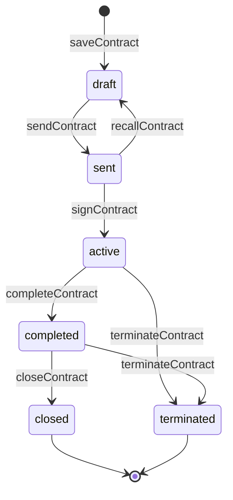
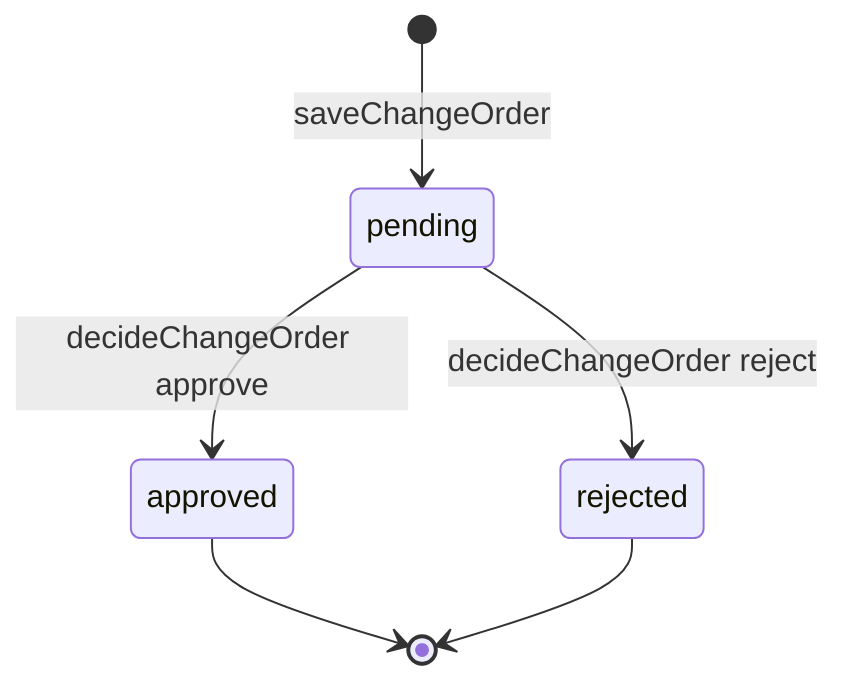
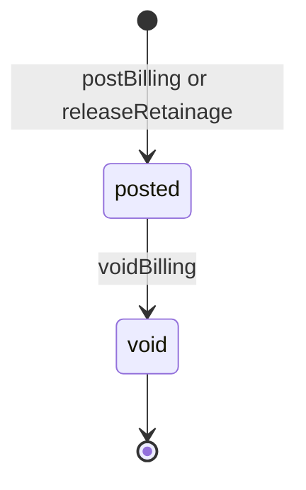
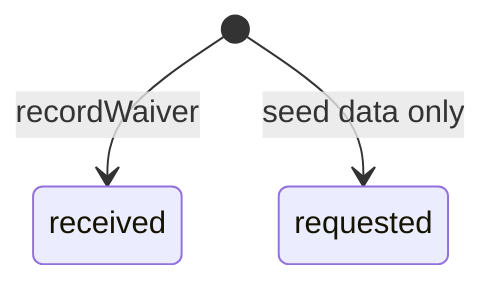
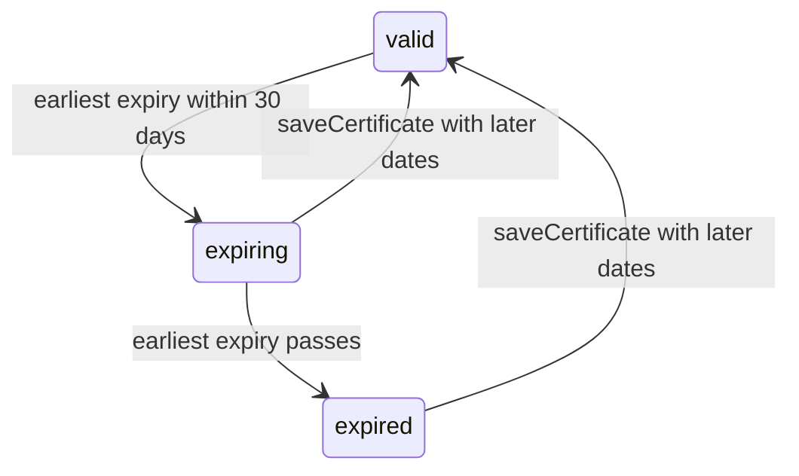

# Contracts

Written from the demo code, 2026-11-10.

## Purpose

Contracts records agreements with other companies and bills them in stages. It replaces Installation in the Flooring Suite menu.

A contract has a direction and a kind.

| Direction | Other company | Each billing raises |
| --- | --- | --- |
| `customer` | A customer the business bills (`customerId`) | One `Invoice` |
| `subcontractor` | A supplier who bills the business (`supplierId`) | One `Bill`, with no purchase order or receipts |

| Kind | What it holds | What the screen offers |
| --- | --- | --- |
| `project` | Value, schedule of values, retainage, tax treatment | Billing, retainage release, change orders, lien waivers, Mark completed |
| `master` | Terms only. Value and retainage are forced to zero and lines are dropped in `saveContract` | Terms panel and Renew |

Screens are `/contracts` (list) and `/contracts/[id]` (one contract). A dashboard widget shows the main figures. The feature keys are `contracts.register`, `contracts.billing` and `contracts.compliance`, in `packages/shared/src/features.ts`. Product is `flooring`. Module is `contracts`, which is on for Summit and Keystone and off for Harbor (`packages/shared/scripts/fixtures/companies.ts`).

Each flooring company has five seeded contracts (`packages/shared/scripts/fixtures/contracts.ts`): CTR-1001 customer project, active; CTR-1002 customer project, completed; CTR-1003 customer master, active; CTR-1004 subcontract, active; CTR-1005 subcontract, sent.

Two things are simulated. **Signatures are simulated:** a person at the company types the signer's name, and no signing provider is involved. **No real email is sent:** messages become rows in the Outbox.

## Who uses it

A person's real access is role permissions, limited by the company ceiling and enabled modules (CLAUDE.md rule 2). Default roles come from `packages/shared/src/permissions/roles.ts`. Purchasing, Warehouse, Installer, HR manager and Employee hold no contracts permission.

Unless noted, the action functions are in `apps/web/src/lib/api/demo/contract-actions.ts` and call `ctx.assertCan`. The screens in `apps/web/src/features/contracts/` also hide what `can()` refuses.

| Action | Permission key | Default roles | Enforced in |
| --- | --- | --- | --- |
| Open the list and contract page, see lines and change orders | `contracts.contract.view` | Owner, Manager, Accountant, Sales | `PRIVATE_COLLECTIONS` in `apps/web/src/lib/api/demo/store.ts`, `apps/web/src/products/pages.ts`, `ContractsPage`, `ContractPage` |
| See and enter estimated cost | `contracts.contract.view_sensitive` | Owner, Manager, Accountant | `DemoStore.list` in `store.ts` sets `estimatedCost` to `0.00` without it. `ContractFormDialog` hides the field |
| Add a contract, renew | `contracts.contract.create` | Owner, Manager, Sales | `saveContract`, `renewContract` |
| Edit a draft, send, recall, mark completed, close, add files | `contracts.contract.edit` | Owner, Manager, Sales | `saveContract`, `sendContract`, `recallContract`, `completeContract`, `closeContract`, `addContractFiles` |
| Record the signature, terminate, close despite a problem | `contracts.contract.approve` | Owner, Manager | `signContract`, `terminateContract`, `closeContract` |
| See billings | `contracts.billing.view` | Owner, Manager, Accountant, Sales | `PRIVATE_COLLECTIONS` in `store.ts` |
| Post a billing, release retainage | `contracts.billing.create` | Owner, Manager, Accountant | `postBilling`, `releaseRetainage` |
| Void a billing | `contracts.billing.void` | Owner, Manager, Accountant | `voidBilling` |
| Submit a change order | `contracts.change_order.create` | Owner, Manager, Sales | `saveChangeOrder` |
| Approve or reject a change order | `contracts.change_order.approve` | Owner, Manager | `decideChangeOrder` |
| See lien waivers and insurance | `contracts.compliance.view` | Owner, Manager, Accountant | `PRIVATE_COLLECTIONS` in `store.ts`, `ContractPage` |
| Record a waiver, save a certificate | `contracts.compliance.manage` | Owner, Manager, Accountant | `recordWaiver`, `saveCertificate` |

Data scope comes from `apps/web/src/lib/api/demo/scope.ts`. `contracts` uses `byRep`: Sales (`own`) see contracts where `salesRepId` is theirs, Manager (`branch`) see contracts in their branch, Owner and Accountant (`all`) see everything. `contractLines`, `changeOrders` and `contractBillings` follow their contract. `lienWaivers` and `insuranceCertificates` have no scope filter.

A collection the viewer has no permission for reads as empty rather than failing. The generic `save` call is closed for all six contract collections (`savePermissions` in `apps/web/src/lib/api/demo/permission-rules.ts`), so they change only through the actions.

## Workflows and status rules

### Contract status



All functions below are in `apps/web/src/lib/api/demo/contract-actions.ts`.

| Transition | Function | Guard |
| --- | --- | --- |
| New to `draft` | `saveContract` | Title and a customer or supplier are required |
| `draft` to `sent` | `sendContract` | `draftProblem` in `packages/shared/src/contracts/rules.ts` returns null. Sets `sentAt` |
| `sent` to `draft` | `recallContract` | Status is `sent`. Clears `sentAt` |
| `sent` to `active` | `signContract` | Status is `sent`. Signer name has at least 3 characters. Sets `signedAt` and `signature`, and files a PDF |
| `active` to `completed` | `completeContract` | Status is `active`. Sets `substantialCompletionAt` to today. The screen offers it on projects only |
| `completed` to `closed` | `closeContract` | `closeProblem` returns null, or an override reason is given and the user holds `contracts.contract.approve`. Sets `finalAcceptanceAt` |
| `active` or `completed` to `terminated` | `terminateContract` | Reason has at least 3 characters. Sets `terminatedAt` and `terminationReason` |

Only `draft` can be edited. Lines are replaced on every save (`saveContract`). After that, changes go through change orders.

**Expired is not stored.** `contractDisplayStatus` in `packages/shared/src/contracts/rules.ts` shows it for a draft, sent contract or active master past `endsAt`. A project past its end date stays Active and gets a Past end date flag from `pastEndDate`, in the same file.

### Change order status



| Transition | Function and file | Guard |
| --- | --- | --- |
| New to `pending` | `saveChangeOrder`, `contract-actions.ts` | Contract is `active` or `completed`. Reason is given. Each line has a description and an amount matching `^-?\d+(\.\d{1,2})?$` |
| `pending` to `approved` | `decideChangeOrder`, `contract-actions.ts` | `changeOrderProblem` in `packages/shared/src/contracts/billing.ts` returns null |
| `pending` to `rejected` | `decideChangeOrder`, `contract-actions.ts` | Reason has at least 3 characters |

The type also lists `draft` and `void`. No action writes either one.

### Billing status

Billings have no draft status. Posting is immediate.



| Transition | Function and file | Guard |
| --- | --- | --- |
| New progress billing to `posted` | `postBilling`, `contract-actions.ts` | Contract is `active` or `completed`. `billingProblem` in `billing.ts` returns null |
| New release to `posted` | `releaseRetainage`, `contract-actions.ts` | Amount is above zero and no more than the total held |
| `posted` to `void` | `voidBilling`, `contract-actions.ts` | Reason has at least 3 characters. It is the highest-numbered posted billing. No confirmed payment is on its invoice or bill |

The linked invoice and bill have their own statuses, derived from their ledgers. See `docs/product-spec/sales.md` and `docs/product-spec/purchasing.md`.

### Lien waiver status



`recordWaiver` in `contract-actions.ts` always writes `received`. `requested` exists only on one seeded waiver per company, and no action moves it on. `superseded` is in the type and nothing writes it.

### Insurance status

This status is derived and never stored. `insuranceStatus` in `packages/shared/src/contracts/rules.ts` works it out from the earliest coverage expiry.



### Steps in the screens

1. **Add a draft.** The form takes direction, kind, other company, title, scope, dates and job site. A project also takes retainage percent, tax treatment and lines. A master takes pricing and terms. Defaults: 5 percent retainage, `on_billing`, end date 180 days out, sales rep is the creator, branch is the creator's, warehouse is the first location.
2. **Send for signature.** The lines lock and the other company gets an Outbox row.
3. **Record signature.** A person holding `contracts.contract.approve` types the signer's name and role. The dialog says "Recorded as a typed signature; a signing provider is not connected yet." The name starts as the customer's contact person or the supplier's active primary contact, and empty when there is none, never the company name. `signContract` files `Signed <number>.pdf`, marked "Simulated signature for the demo. Not a legal signature." The contract becomes Active.
4. **New billing.** The user enters cumulative work to date and stored materials per line. A milestone line is one Complete checkbox that bills its full value. The billing is the change since the last one.
5. **Release retainage.** The user enters an amount up to what is held. It goes on its own invoice or bill.
6. **Change order.** The user adds rows against an existing line or a new line. It waits for approval. Approving asks first and states the new contract value (value now plus the change). Approval changes line values at once and never changes issued invoices.
7. **Mark completed, then Close.** Or **Terminate** with a reason from Active or Completed.
8. **Renew** (masters only on the screen). See Edge cases, item 1.

Insurance is one certificate per contract and only on a subcontract. Each coverage has its own expiry. Lien waivers are recorded per payment, on projects only.

## Business rules

Money uses decimal.js. `roundMoney` rounds to 2 places, half up. `pctOf(value, percent)` is `value * percent / 100`. Both are in `packages/shared/src/money.ts`.

1. **Contract number.** `nextNumber("CTR-", existing, 1001)` in `packages/shared/src/operations/quotes.ts` takes the highest number in use plus 1, starting at CTR-1001.

2. **Original value.** `saveContract` in `apps/web/src/lib/api/demo/contract-actions.ts`.

   ```
   originalValue = kind == "master" ? 0 : moneyString(sum(lines.scheduledValue))
   retainagePct and storedRetainagePct = kind == "master" ? "0" : the input value
   ```

3. **Sending for signature.** `draftProblem` in `packages/shared/src/contracts/rules.ts`. Requires a title, another company and `endsAt >= startsAt`. A project also needs at least one line, and the lines must add up to `originalValue`.

4. **Line rates.** `lineRates` in `packages/shared/src/contracts/billing.ts`.

   ```
   retainagePct = line.retainagePct ?? contract.retainagePct
   storedRetainagePct = line.storedRetainagePct ?? contract.storedRetainagePct
   ```

   The billing form reads these and sends them with each line, so rates are snapshotted per billing.

5. **What a billing adds per line.** `billingLineDelta` and `lineToDate` in `packages/shared/src/contracts/billing.ts`. "Before" is the latest posted progress billing that includes the line, or zero.

   ```
   gross = completedToDate + storedBalance - before.completed - before.stored

   heldOn(rate, amount) = roundMoney(amount * rate / 100)

   withheld = heldOn(retainagePct, completedToDate)
            - heldOn(retainagePct, before.completed)
            + heldOn(storedRetainagePct, storedBalance)
            - heldOn(storedRetainagePct, before.stored)
   ```

   Billing totals are the sum of the lines, in `billingFigures`, stored with `moneyString`.

6. **Stored materials.** `storedBalance` is a balance, not a running total. When materials are installed, the user lowers stored and raises work to date. Gross nets to the change, and retainage is not held twice, because both are computed by rule 5.

7. **A billing is refused when** (`billingProblem` in `billing.ts`): a line no longer exists; work or stored is negative; `completedToDate + storedBalance > scheduledValue`; or every line's gross is zero.

8. **Billing number.** `postBilling` and `releaseRetainage` use `past.length + 1`, counting every billing on the contract including releases and voided ones.

9. **Retainage held per line.** `heldByLine` in `billing.ts`.

   ```
   held(line) = sum(withheld on each posted progress billing, in number order)
              - sum(release amounts on posted billings)
   ```

10. **Release allocation.** `allocateRelease` in `billing.ts`, called by `releaseRetainage`. Only lines holding more than zero take part.

    ```
    refuse if amount <= 0 or amount > sum(held)
    part(i) = roundMoney(amount * held(i) / sum(held)), for every line but the last
    part(last) = amount - sum(earlier parts)
    ```

    A release billing stores `gross 0.00`, `withheld 0.00`, `released = moneyString(amount)` and `periodEnd = today`.

10a. **Which billings a release paid out.** `releaseAllocation` in `packages/shared/src/contracts/schedule.ts`, served by `GET /contract-schedule`. Derived, never stored. Per line, in billing-number order, each progress billing adds what it withheld to a queue; a billing that lowers a line takes back its newest withholding first; each release share is paid out of the oldest billing's retainage first.

    ```
    released(progress billing) = sum of release shares taken from its retainage
    released(release)          = its amount; covers = the progress billings it took from, oldest first
    ```

    In Billings, a progress billing's Released column shows `released`, and a release reads "Release of retainage from billing 1 and 2".

11. **Contract figures.** `contractFigures` in `billing.ts`. Only posted billings count.

    ```
    value     = sum(lines.scheduledValue)
    billed    = sum(billings.gross)
    withheld  = sum(billings.withheld)
    released  = sum(billings.released)
    held      = withheld - released
    remaining = value - billed
    pendingChanges = sum(amountDelta on pending change orders)
    ```

    On the page, Invoiced is `billed`, Retained is `held` and Remaining is `remaining`. Paid is computed in `ContractPage` from confirmed customer payments and confirmed supplier allocations on posted billings. Pending change orders never count as value.

11a. **Schedule of values per line.** `scheduleLines` in `packages/shared/src/contracts/schedule.ts`, served by `GET /contract-schedule` (`contracts.billing.view`). Only posted billings count.

    ```
    billed(line)    = completedToDate + storedBalance on the line's latest posted progress billing
    retained(line)  = held(line), rule 9
    remaining(line) = scheduledValue - billed(line)
    ```

    The Schedule of values shows Line, Billing and Value, and for people with `contracts.billing.view` also Billed to date, Retained and Remaining to bill, with a totals row.

12. **Customer invoice.** `contractInvoice` in `packages/shared/src/contracts/documents.ts`. One invoice covers the whole billing. Retainage is held off the total, so retained money is not in receivables until it is released.

    ```
    billed   = amounts where gross != 0
    subtotal = sum(billed.gross)
    withheld = sum(amounts.withheld)
    released = sum(amounts.released)
    tax      = computeTotals(taxLines, taxContext).tax
    total    = moneyString(subtotal + tax - withheld + released)
    cost     = moneyString(sum(costShare of each billed line))
    dueAt    = dueDate(issuedAt, customer.terms)
    ```

    Invoice lines have quantity 1, unit `each`, unit price equal to gross, and description `<code> <description>`. A release invoice has no lines and a subtotal of 0.

13. **Tax treatment per contract.** `taxBase` inside `contractInvoice`. Tax is computed on a separate set of lines, one per amount, with the contract line's category.

    ```
    contractor_pays -> 0
    on_billing      -> gross
    on_release      -> moneyString(gross - withheld + released)
    ```

    Under `on_billing` a release has gross 0, so it carries no tax. Under `on_release` the retained part is taxed under the rule of its release day, so a tax rule change between a billing and its release taxes the retained money at the new rate (ADR 0059, part 3a). `computeTotals` in `packages/shared/src/documents.ts` applies the rate per taxable line with `roundMoney(amount * rate / 100)` and sums, or rounds once on the taxable amount, by the company's `tax.rounding` setting. The rule comes from `taxContextFor` in `packages/shared/src/operations/quotes.ts`, using the job site, with `lumpSum` false. The customer is exempt only while its certificate is valid on the issue date. The Billings panel says in one line how sales tax applies (`billingTaxNote` in `apps/web/src/features/contracts`): not charged because of a resale certificate or because the contractor pays it, or charged on billing or on release; subcontractor bills carry none. A contract invoice that charged no tax although a rule applies prints "Sales tax, not charged (contract billing)" (`taxLabel`). Wording only (ADR 0061, decision 10).

14. **Supplier bill.** `contractBill` in `documents.ts`. It carries no tax.

    ```
    total  = moneyString(gross - withheld + released)
    kind   = released > 0 ? "retainage_release" : "progress"
    number = contract.number + "-" + billing.number
    dueAt  = supplierDueDate(issuedAt, supplier.terms)
    ```

15. **Proportional cost, plan K-10.** `costShare` in `documents.ts`. Each billed line carries a share of the line's estimated cost, so margin plans are not paid on 100 percent.

    ```
    costShare = scheduledValue == 0 ? "0.00"
              : moneyString(roundMoney(estimatedCost * gross / scheduledValue))
    ```

16. **Commission on contract invoices.** `baseOf` in `packages/shared/src/hr/commission-plans.ts` treats them like any invoice. `S` is subtotal net of credit notes, `G` is total net of credit notes and `C` is cost net of credit notes.

    ```
    base = 0 if G <= 0 or S <= 0
    K = min(collected, G)
    revenue = roundMoney(K * S / G)
    paid_revenue plan: base = revenue
    margin plan: base = max(roundMoney(revenue * (S - C) / S), 0)
    ```

    A progress invoice reaches the full gross once paid. A release invoice has `S = 0` and earns nothing. Commission therefore comes early by the retained amount, which plan K-10 accepts for the demo.

17. **Change order approval.** `decideChangeOrder` in `contract-actions.ts` and `changeOrderProblem` in `billing.ts`. A row against an existing line is refused if `scheduledValue + amountDelta < completed + stored`. Otherwise `scheduledValue` rises by `amountDelta`. A row with no line creates a new line: code `<CO number>.<row>`, billing `percent`, contract retainage rates, `estimatedCost 0.00`. `originalValue` does not change.

18. **Closing.** `closeContract` in `contract-actions.ts` and `closeProblem` in `packages/shared/src/contracts/rules.ts`. Checks run in this order.

    ```
    held > 0                     -> "Release the retainage before closing."
    balance > 0                  -> "Its invoices or bills still have a balance."
    no final waiver              -> "No final lien waiver is on file."

    balance = sum(invoice ledger balance of posted billings that have an invoice)
    final waiver = a waiver on this contract, type ends in "final", status "received"
    ```

19. **Voiding a billing.** `voidBilling` in `contract-actions.ts`. On a customer billing the invoice gets `voidedAt` and `voidReason`, and is refused if the ledger's confirmed `paid` is above zero. On a subcontract billing the bill is deleted, and it is refused if a confirmed supplier payment is allocated to it. Over-billing can also be corrected by a lower cumulative figure on the next billing.

20. **Retainage limit warning.** `retainageWarning` in `rules.ts`. It is an example table, shown only in the contract form, and it never blocks.

    | State | Limit | Applies from contract value |
    | --- | --- | --- |
    | CA | 5 percent | 0 |
    | CO | 5 percent | 150,000 |

21. **Lien waivers.** `waiverProblem` in `rules.ts`: amount must be above zero, and an `unconditional_*` waiver needs a confirmed payment. `recordWaiver` sets `direction` to `given` on a customer contract and `received` on a subcontract, `state` from the job site and `signedOn` to today. The demo writes no legal form.

22. **Insurance.** `saveCertificate` in `contract-actions.ts` requires a supplier contract, at least one coverage and an expiry on each. A contract has one certificate, which is replaced on save. `insuranceStatus` in `rules.ts`:

    ```
    earliest = smallest coverage.expiresOn
    expired  if there is no coverage or earliest < today
    expiring if earliest <= addDays(today, 30)
    valid    otherwise
    ```

23. **Reminders.** `contractReminders` and `stepReached` in `rules.ts`, raised by `raiseContractReminders` in `contract-actions.ts`, which `DemoStore.openCompany` calls.

    ```
    stepReached(date, today, days) =
      smallest d in days where addDays(date, -d) <= today and date >= today, else null
    ```

    | Reminder | Date tested | Steps (days) | Applies to | Key |
    | --- | --- | --- | --- | --- |
    | Contract end notice is due | `addDays(endsAt, -renewal.noticeDays)` | 90, 60, 30 | Active contracts | `<id>-end-<step>` |
    | Milestone due | `milestoneDueAt` | 14, 3 | Lines on active contracts | `<lineId>-ms-<step>` |
    | Insurance expires | Each `coverage.expiresOn` | 60, 30, 7 | Every certificate | `<certId>-<type>-<step>` |

24. **Dashboard widget.** `ContractsWidget` in `apps/web/src/features/dashboard/contracts-widget.tsx`, shown with `contracts.contract.view` and `contracts.register` on.

    ```
    running = contracts with status active or completed
    Milestones due in 30 days = lines on running contracts with today <= milestoneDueAt <= today + 30
    Ending in 60 days = active contracts with today <= endsAt <= today + 60
    Retainage customers hold = sum(held) of running customer contracts
    Retainage we hold = sum(held) of running subcontracts
    ```

## Entities and fields

Dates are `yyyy-MM-dd`. Times are `yyyy-MM-dd'T'HH:mm`. Money and percents are decimal strings. Types are in `packages/shared/src/types/contracts.ts`.

### Contract (`contracts`, id prefix `ctr`)

| Field | Type | Notes |
| --- | --- | --- |
| `id` | string | |
| `number` | string | CTR-1001 onward |
| `direction` | `customer`, `subcontractor` | |
| `kind` | `master`, `project` | |
| `masterId` | string or null | Always null. Nothing sets or reads it |
| `customerId` | string or null | Customer direction |
| `supplierId` | string or null | Subcontractor direction |
| `parentContractId` | string or null | Set on one seeded subcontract. Nothing reads it |
| `title` | string | Required |
| `scope` | string | |
| `branchId` | string | The creator's branch. Sets branch data scope |
| `locationId` | string | First location in the form. Copied to the invoice |
| `jobSite` | Address | Sets the tax rule, retainage warning and waiver state |
| `salesRepId` | string | The creator. Sets own data scope and who earns commission |
| `startsAt`, `endsAt` | date | |
| `renewal` | `{ mode, noticeDays }` | `mode` is `none`, `manual` or `auto`. Only `noticeDays` is read |
| `renewedFromId` | string or null | Set by `renewContract` |
| `originalValue` | money | Pre-tax value at save. Zero on a master |
| `retainagePct` | percent | Zero on a master |
| `storedRetainagePct` | percent | The form keeps it equal to `retainagePct` |
| `bondInLieu` | boolean | Always false from the form. Nothing reads it |
| `taxTreatment` | `on_billing`, `on_release`, `contractor_pays` | |
| `status` | `draft`, `sent`, `active`, `completed`, `closed`, `terminated` | |
| `sentAt`, `signedAt` | time or null | |
| `signature` | SignatureRecord or null | |
| `substantialCompletionAt`, `finalAcceptanceAt` | date or null | |
| `terminatedAt`, `terminationReason` | date, string or null | |
| `closeOverrideReason` | string or null | |
| `files` | FileMeta[] | The signed PDF and added documents |
| `notes` | string | Pricing and terms on a master |

### SignatureRecord (inside Contract)

| Field | Type | Notes |
| --- | --- | --- |
| `documentId` | string | The contract id |
| `version` | number | Always 1 |
| `hash` | string | The file's id, not a hash of its content |
| `signerName`, `signerRole` | string | Typed in the dialog |
| `signerEmail` | string | From the customer or supplier |
| `consentVersion` | string | Always `demo-1` |
| `recordedBy` | string | The user who entered it |
| `signedAt` | time | |
| `events` | `{ kind, at }[]` | `signContract` writes `sent` and `signed` only. No IP address |

### ContractLine (`contractLines`, id prefix `cln`)

| Field | Type | Notes |
| --- | --- | --- |
| `id`, `contractId` | string | |
| `code`, `description` | string | |
| `category` | `material`, `labor`, `service`, `freight` | The tax category |
| `billing` | `percent`, `milestone` | Changes only the billing form |
| `scheduledValue` | money | Original plus approved change orders |
| `retainagePct`, `storedRetainagePct` | percent or null | Overrides. The form has no field for them |
| `milestoneDueAt` | date or null | The form has no field for it. Only seeded milestones have one |
| `changeOrderId` | string or null | Set on a line created by a change order |
| `estimatedCost` | money | Sensitive |

### ChangeOrder (`changeOrders`, id prefix `cor`)

| Field | Type | Notes |
| --- | --- | --- |
| `id`, `contractId` | string | |
| `number` | string | `CO-<count + 1>` per contract |
| `status` | `draft`, `pending`, `approved`, `rejected`, `void` | Only `pending`, `approved` and `rejected` are written |
| `reason` | string | Required |
| `lines` | `{ lineId, description, category, amountDelta }[]` | `lineId` null means a new line |
| `submittedAt`, `decidedAt` | time or null | |
| `decidedBy`, `decisionReason` | string or null | |
| `files` | FileMeta[] | Always empty |

### ContractBilling (`contractBillings`, id prefix `cbl`)

| Field | Type | Notes |
| --- | --- | --- |
| `id`, `contractId` | string | |
| `number` | number | Rule 8 |
| `kind` | `progress`, `release` | |
| `periodEnd` | date | Not validated. Today on a release |
| `status` | `posted`, `void` | No draft |
| `lines` | BillingLine[] | Empty on a release |
| `releases` | `{ lineId, amount }[]` | Empty on a progress billing |
| `gross`, `withheld`, `released` | money | |
| `invoiceId`, `billId` | string or null | One is set |
| `postedAt`, `postedBy` | time, string | |

### BillingLine (inside ContractBilling)

| Field | Type | Notes |
| --- | --- | --- |
| `lineId` | string | |
| `completedToDate` | money | Cumulative |
| `storedBalance` | money | Balance on hand |
| `retainagePct`, `storedRetainagePct` | percent | Snapshotted |

### LienWaiver (`lienWaivers`, id prefix `lwv`)

| Field | Type | Notes |
| --- | --- | --- |
| `id`, `contractId` | string | |
| `direction` | `given`, `received` | From the contract's direction |
| `type` | `conditional_progress`, `unconditional_progress`, `conditional_final`, `unconditional_final` | |
| `paymentId`, `supplierPaymentId` | string or null | |
| `amount` | money | Above zero |
| `throughDate` | date | |
| `state` | string | The job-site state |
| `statutoryForm` | boolean | A checkbox only |
| `signedOn` | date or null | |
| `files` | FileMeta[] | Always empty |
| `status` | `requested`, `received`, `superseded` | See Workflows |

### InsuranceCertificate (`insuranceCertificates`, id prefix `coi`)

| Field | Type | Notes |
| --- | --- | --- |
| `id`, `supplierId`, `contractId` | string | |
| `producer` | string | Agency |
| `holder` | string | |
| `coverages` | InsuranceCoverage[] | At least one |
| `additionalInsured` | boolean | Kept from the existing record. The form has no field for it |
| `files` | FileMeta[] | The form has no upload |

### InsuranceCoverage (inside InsuranceCertificate)

| Field | Type | Notes |
| --- | --- | --- |
| `type` | `general`, `auto`, `umbrella`, `workers_comp` | |
| `insurer`, `policyNumber` | string | |
| `effectiveOn` | date | The form sets it to today |
| `expiresOn` | date | Required |
| `limits` | string | The form has no field for it |

### Fields added to Invoice and Bill

| Entity | Field | Notes |
| --- | --- | --- |
| `Invoice` | `contractId`, `billingId` | Set on a contract billing or release |
| `Invoice` | `retainageWithheld`, `retainageReleased` | `total = subtotal + tax - withheld + released` |
| `Invoice` | `cost` | From rule 15 on contract invoices |
| `Bill` | `contractId`, `billingId` | `poId` is null and `receiptIds` is empty |
| `Bill` | `kind` | `progress` or `retainage_release` |
| `Bill` | `gross`, `retainageWithheld`, `retainageReleased` | `total = gross - withheld + released` |

## Events and audit entries

### Notification events

Events are defined in `packages/shared/src/notifications/events.ts` and raised by `notify` in `apps/web/src/lib/api/demo/notification-actions.ts`. All three are raised from `contract-actions.ts`.

| Event key | Channels | Recipients in the code | Trigger |
| --- | --- | --- | --- |
| `contract.signature` | Email | The customer or supplier on the contract | `sendContract`. `version` is the send time, so sending again after a recall writes a new row |
| `milestone.invoiced` | Email | The customer | `fileBilling`, for every customer billing and release, not only milestone lines. Subcontract billings raise nothing |
| `contract.expiring` | Email and in-app | Every active user whose role holds `contracts.contract.approve`, from `usersWith`. By default Owner and Manager. The person who triggered it is skipped | `raiseContractReminders`, for each reminder in rule 23 |

The catalogue says `contract.expiring` goes to "The contract owner and Owners". The code sends it as above.

Email rows are one per recipient, deduplicated by `dedupeKey` (event, source id, version, recipient). A recipient with no valid email gets a `failed` row, and the person who caused it gets a `delivery.failed` in-app notice.

### Audit entries

Every entry is written by `log` in `contract-actions.ts` with category `data` and target `<number>, <title>`.

| Action string | Trigger | Before | After |
| --- | --- | --- | --- |
| `Added contract` | `saveContract` with no id, including `renewContract` | null | `originalValue` |
| `Edited contract` | `saveContract` with an id | old `originalValue` | new `originalValue` |
| `Sent contract for signature` | `sendContract` | `draft` | `sent` |
| `Recalled contract` | `recallContract` | `sent` | `draft` |
| `Recorded simulated signature` | `signContract` | `sent` | Signer name |
| `Completed contract` | `completeContract` | `active` | `completed` |
| `Closed contract` | `closeContract` | `completed` | `closed` or `closed: <reason>` |
| `Terminated contract` | `terminateContract` | Prior status | Reason |
| `Posted contract billing` | `postBilling` | null | `#<n>, gross <g>, held <w>` |
| `Released retainage` | `releaseRetainage` | Total held | `released <amount>` |
| `Voided contract billing` | `voidBilling` | `#<n>` | Reason |
| `Submitted change order` | `saveChangeOrder` | null | `<CO number>: <reason>` |
| `Approved change order` | `decideChangeOrder` | CO number | Decision reason or null |
| `Rejected change order` | `decideChangeOrder` | CO number | Decision reason |
| `Recorded lien waiver` | `recordWaiver` | null | `<type in words>, <amount>` |
| `Saved insurance certificate` | `saveCertificate` | null | Agency name |
| `Added contract files` | `addContractFiles` | null | File names |

## Emails

No real email is sent. Each message is a row in the Outbox. Templates can be edited per event in Settings, Notifications. The bodies below are the catalogue defaults, with the blank line after the greeting left out.

| Event | To | Subject | Body |
| --- | --- | --- | --- |
| `contract.signature` | The other party | `Please sign contract {{ contract.number }}` | `Hello {{ party.name }}, Contract {{ contract.number }}, {{ contract.title }}, is ready for your signature.` |
| `milestone.invoiced` | The customer | `Invoice {{ invoice.number }} for {{ contract.title }}` | `Hello {{ party.name }}, Invoice {{ invoice.number }} for {{ invoice.total }} covers work on {{ contract.title }}.` |
| `contract.expiring` | Users who can approve contracts | `{{ contract.number }}: {{ reminder.what }} on {{ reminder.date }}` | `{{ contract.number }}, {{ contract.title }}: {{ reminder.what }} on {{ reminder.date }}.` |

The catalogue marks `contract.signature` and `milestone.invoiced` as carrying a PDF. The `notify` calls pass no attachments, so those Outbox rows have none.

## Reports

There is no contract report on the Reports page.

- **Contracts list.** CSV of the filtered rows, from the shared table. Columns are Number, Title, Company, Type, Kind (hidden by default), Status, Value, Customers hold (retainage a customer holds from us, customer contracts only), We hold (retainage we hold from a subcontractor, subcontracts only) and End date. The two are never added together, as on the dashboard (rule 24).
- **Dashboard widget.** Rule 24.
- **Business report** (`packages/shared/src/business-report.ts`). `figuresFor` takes revenue and cost from invoice lines, so a progress billing counts at gross on its issue date and a release counts as nothing. `balancesAt` uses ledger balances, so retained money is outside Customers owe until released. Subcontract bills count in You owe suppliers. They do not add to cost, which comes only from invoice lines and expenses.
- **Other reports.** `packages/shared/src/analytics.ts` has no contract handling and treats a contract invoice like any other. Held retainage appears in no report.

## Edge cases and known limits

1. **Renew does not make a draft.** The comment on `renewContract` says it starts a new draft. The code spreads the old contract into `saveContract`, and those fields override the draft defaults. The new record keeps the old `number`, `status`, `signature`, `signedAt` and `files`, with new dates and a new id. The screen still says "Renewal draft created". Only `Added contract` is audited.
2. **Close ignores bills.** `closeContract` sums balances on invoices only. A subcontract can close with an unpaid bill, although the message mentions bills.
3. **Close override has no screen.** The action accepts a reason, and the Close button always sends null. The code comment says Owner, but the check is `contracts.contract.approve`, which Manager also holds.
4. **Retainage on a terminated contract is stuck on the screen.** `releaseRetainage` has no status check, but the button shows only on Active or Completed contracts. The dashboard widget also leaves terminated contracts out of retainage held.
5. **Subcontract waivers.** `WaiverDialog` lists only confirmed customer payments and always sends `supplierPaymentId: null`. An unconditional waiver therefore cannot be recorded on a subcontract from the screen. A conditional final waiver can, and it satisfies the close check. So does a conditional final waiver on a customer contract.
6. **A negative amount on a new line blocks billing.** `changeOrderProblem` checks only rows against an existing line. A new line can get a negative value. The billing form sends every line, and `billingProblem` then refuses because `0 > scheduledValue`. No later billing can be posted from the screen.
7. **Reminders repeat in the bell.** Email rows are deduplicated. In-app rows are not: `tell` in `notification-actions.ts` writes a new one each time `openCompany` runs while a reminder's step is live. The "fires once" comment holds for email only.
8. **Reminder scope.** The end notice fires for every active contract, whatever its `renewal.mode`. Insurance reminders ignore the contract's status, so a closed or terminated subcontract still raises them.
9. **The invoice does not show retainage.** No file in `apps/web/src/features/invoices` mentions it. Subtotal plus Tax will not visibly equal Total, on screen or on the PDF.
10. **Invoices are not marked sent.** `contractInvoice` sets `sentAt` to null, though the email row is written. Seeded contract invoices are marked sent by the generator.
11. **Voiding from the invoice page.** `voidInvoice` in `invoice-actions.ts` has no contract handling. The billing stays posted and contract figures still count it.
12. **Voiding from the contract page.** Credits, write-offs and pending payments do not block a void. Pending payments stay pending on the void invoice. A voided bill is deleted because `Bill` has no void state. The billing's number is not reused.
13. **Sales can wipe estimated cost.** `DemoStore.list` masks `estimatedCost` to `0.00` without `view_sensitive`. Sales holds `contracts.contract.edit`. Saving a draft writes the masked value back.
14. **Estimated cost and change orders.** New change-order lines have `estimatedCost 0.00`, so that work is billed at full margin. Raising an existing line's value does not raise its cost, so the cost share per dollar falls.
15. **Lower cumulatives.** A lower figure makes a negative line. Only an all-zero billing is refused, so a whole billing can be negative.
16. **Rates are trusted from the client.** `postBilling` stores the rates it receives and does not recompute them from the contract. A real API must derive them on the server.
17. **Blank value.** A blank Value makes `sum` throw in decimal.js, and the raw error shows in the form.
18. **No county field.** The form has no county. A county rate applies only if the job site kept one from the default address, and changing the city does not clear it.
19. **No separation of duties.** The same person can submit and approve a change order.
20. **Fields and switches with no effect.** Nothing reads `masterId`, `parentContractId`, `bondInLieu` or `renewal.mode`. `form1099Threshold` in `rules.ts` has no caller outside tests. Nothing reads the `contracts.billing` or `contracts.compliance` feature switches, so turning them off changes nothing.
21. **Planned in ADR 0026, not built.** `retainageDueBy` and its reminder; `retainageSummary` and memo lines on statements and aging; pass-through reminders from a customer retainage receipt; a contract `matchIssues` check (it is always empty); a real document hash. The ADR also gives 10 percent as the default retainage, and the form uses 5.
22. **Signatures are simulated.** There is no signing provider, no signer access link and no consent capture. The signed PDF is a placeholder.
23. **Nothing leaves the browser.** Contract documents, like all demo data, stay in this browser. No real email is sent.
