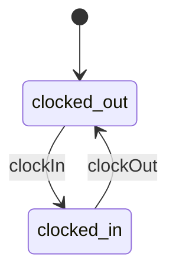

# Employee portal

Written from the demo code, 2026-11-10.

## Purpose

The portal is where a person handles their own hours, time off, pay, commission, documents, meetings and contact details. It exists in both products at `/my`. Every page reads one call, `myPortal` in `apps/web/src/lib/api/demo/portal-actions.ts`, which returns the signed-in person's data only.

`homeFor` in `apps/web/src/products/index.ts` sends people to the first menu page they may open. For the default Employee role that is `/my`.

Hours, time off and pay rules are in `docs/product-spec/hr.md`. Commission rules are in `docs/product-spec/commissions.md`.

| Page | Route | Shown when (`tabsFor`, `apps/web/src/features/my/my-shell.tsx`) | Component |
| --- | --- | --- | --- |
| Overview | `/my` | Always | `my-home.tsx` |
| My timesheet | `/my/timesheet` | `usesTimesheet`: passes `needsTimesheet` | `my-timesheet.tsx` |
| My time off | `/my/time-off` | W-2 | `my-time-off.tsx` |
| My pay | `/my/pay` | `visible.pay` | `my-pay.tsx` |
| My commission | `/my/commission` | `visible.commission` | `my-commission.tsx` |
| My payments | `/my/payments` | 1099 | `my-pages.tsx` |
| My documents | `/my/documents` | Linked to an employee | `my-pages.tsx` |
| My meetings | `/my/meetings` | Feature `meetings.calendar` is on | `my-pages.tsx` |
| My profile | `/my/profile` | Linked to an employee | `my-pages.tsx` |

Feature keys: `hr.portal` and `hr.clock`.

## Who uses it

Default roles come from `packages/shared/src/permissions/roles.ts`. "All nine" means Owner, Manager, Accountant, Sales, Purchasing, Warehouse, Installer, HR manager and Employee. The HR Suite ships only Owner, HR manager and Employee.

| Action | Permission key | Default roles | Enforced in |
| --- | --- | --- | --- |
| Open any portal page | `hr.portal.view` | All nine | `apps/web/src/products/pages.ts` for `/my/*` and the `/my` menu rule; `MyShell`; `myPortal` |
| Clock in or out | `hr.portal.view`, and the company setting for clock-in | All nine | `clockIn`, `clockOut` in `timesheet-actions.ts` |
| Save and submit own hours, upload own hours | `hr.timesheet.edit` | All nine | `assertMayEdit`, `uploadTimesheets` |
| Request or cancel own time off | `hr.pto.request` | All nine | `requestTimeOff`, `cancelTimeOff` |
| Change own phone and emergency contact | `hr.portal.view` | All nine | `updateMyProfile` in `people-actions.ts` |
| Open a document on file | `hr.portal.view` is one of several accepted keys | All nine | `DemoStore.getFile` |
| See own coming meetings | `meetings.meeting.view` | All nine | `DemoStore.list("meetings")` and `applyScope` |
| Request a meeting | `meetings.meeting.create` | All nine | `requestMeeting` in `meeting-actions.ts` |
| Sign own commission plan | None. The assignment must belong to the signed-in user | Anyone on a plan who can see My commission | `acknowledgePlan` |

Own data only. `myPortal` filters by the signed-in user's id and `employeeId`. In View as role, `ctx.actor` stays the real signed-in user, so the portal shows that person's records with the viewed role's permissions.

## Workflows and status rules

Status rules for timesheets and time off are in `docs/product-spec/hr.md`. Portal actions use them unchanged.

### Clock



`clockIn` needs `settings.hr.clockEnabled`, a person who passes `needsTimesheet`, and no open entry. It writes a `ClockEntry` with `outAt` null. `clockOut` closes the entry and adds the hours to that week's sheet, setting `source` to `clock`. Both are in `apps/web/src/lib/api/demo/timesheet-actions.ts`.

### Weekly hours

The person picks one of the current and seven earlier weeks. Save calls `saveTimesheet`. Submit saves and then calls `submitTimesheet`. The form locks while the sheet is `submitted` or `approved`. A sent-back sheet shows the reason and can be corrected and submitted again. The person may instead download a template for themselves and upload it, as a dry run first.

### Time off

The person sees balances per policy with waiting hours, and their requests. Request time off opens `RequestTimeOffDialog`. Cancel is offered on pending requests only.

### Signing a plan

When an assignment has no acknowledgement, My commission shows a panel. The person types their full name. See `docs/product-spec/commissions.md`.

## Business rules

1. **What a person may see.** `visibilityFor`, `apps/web/src/lib/api/demo/portal-actions.ts`.

   ```ts
   pay: !!employee && employee.workerType === "w2" && hr.showPayToEmployees,
   commission: onPlan && (employee?.commissionVisible ?? hr.showCommissionToEmployees),
   rates: hr.showRatesToEmployees,
   teamCalendar: hr.showTeamCalendarToEmployees,
   clock: hr.clockEnabled && !!employee && needsTimesheet(employee),
   ```

   `onPlan` means an assignment with no `effectiveTo`. `commissionVisible` is set per person on the employee form: follow the company, show, or hide. The company default is off (assumption C-2). The setting hides the portal page only.

2. **Hidden items are absent.** `tabsFor` leaves them out instead of greying them. Typing the address shows a plain message:
   - My pay: "Your company does not show pay here."
   - My commission: "Commission is not shown here."
   - My timesheet: "You do not fill in timesheets."
   - My profile: "Your sign-in is not linked to an employee record."

3. **Pay with commission hidden.** `ownLine`, `portal-actions.ts`. The commission line and its true-up leave the total, so the page still adds up. The total reads "Estimated gross pay from hours and leave".

   ```ts
   const gross = dec(line.grossPay).minus(line.commissionPay).minus(line.overtimeTrueUp);
   return { ...line, commissionPay: "0.00", overtimeTrueUp: "0.00", grossPay: moneyString(gross) };
   ```

4. **My pay rows.** Only periods with a stored line for this person appear, which means approved or exported runs. Newest first. The page shows `GROSS_PAY_LABEL`.

5. **Earned this year.** `myPortal`.

   ```ts
   moneyString(sum(pay.filter((p) => p.period.payDate.startsWith(year)).map((p) => p.line.grossPay)))
   ```

6. **Balances.** W-2 only. `hours` is `timeOffBalance` and `pending` is `pendingHours`, one row per policy. The My time off panel leaves out policies with `accrualMethod === "none"`.

7. **Statements.** Filter in `myPortal`:

   ```ts
   statementRows(ctx).filter((s) => s.userId === ctx.actor.id && (s.lines.length > 0 || s.status !== "draft")).reverse()
   ```

   "Waiting to be paid" in `my-commission.tsx` adds `payable` of every statement that is not `paid`, using JavaScript numbers. Each line shows its base. That is the rep's own margin base on a margin plan (plan N-5).

8. **Clock hours.** `clockOut`.

   ```ts
   const minutes = Math.max(0, (Date.parse(ctx.now) - Date.parse(open.inAt)) / 60_000);
   const hours = Math.round((minutes / 60) * 100) / 100;
   // added to the day of clock-in
   days.map((h, i) => (i === at ? Math.round((h + hours) * 100) / 100 : h))
   ```

   The week comes from `workweekStartOf(open.date, workweekStartDay)`. If that sheet is `submitted` or `approved`, the entry closes and no hours are added.

9. **My profile.** A person can change only phone and emergency contact (`MyProfilePatch`). The rate shows only when `visible.rates` is true.

10. **Team calendar.** `teamOut` is empty unless the company shows it. It holds every approved request with `kind` replaced by `vacation` and `note` and `decisionReason` cleared. `TeamCalendar` with `kinds={false}` shows that someone is out, never why.

11. **1099 workers.** They get Overview, My payments, My documents, My meetings and My profile. No timesheet, time off, pay or clock.

## Entities and fields

`Employee`, `Timesheet`, `ClockEntry`, `PtoRequest`, `TimeOffPolicy`, `PayPeriod`, `PayPeriodLine` and `ContractorPayment` are defined in `docs/product-spec/hr.md`. `CommissionStatement` and `CommissionAssignment` are in `docs/product-spec/commissions.md`. The portal adds these read models, in `apps/web/src/lib/api/contract.ts`.

### MyPortal

| Field | Type | Notes |
| --- | --- | --- |
| `employee` | `Employee` or null | The linked record |
| `visible` | `MyVisibility` | |
| `weekStart`, `weekStartDay` | date, number | Current workweek |
| `timesheets` | `Timesheet[]` | Own, newest first |
| `usesTimesheet` | boolean | |
| `clock` | `MyClock` | |
| `balances` | `{ policy, hours, pending }[]` | W-2 only |
| `requests` | `PtoRequest[]` | Own, newest first |
| `pay` | `MyPayRow[]` | Empty when pay is hidden |
| `earnedThisYear` | money string | |
| `statements` | `CommissionStatementRow[]` | Empty when commission is hidden |
| `assignment`, `plan` | object or null | Current plan, even when hidden |
| `contractorPayments` | `ContractorPayment[]` | Own |
| `teamOut`, `teamNames` | arrays | Empty unless the company shows the calendar |

### MyVisibility

| Field | Type | Notes |
| --- | --- | --- |
| `pay`, `commission`, `rates`, `teamCalendar`, `clock` | boolean | Business rule 1 |

### MyPayRow

| Field | Type | Notes |
| --- | --- | --- |
| `period` | `PayPeriod` | |
| `line` | `PayPeriodLine` | After `ownLine` |

### MyClock

| Field | Type | Notes |
| --- | --- | --- |
| `clockedInAt` | timestamp or null | From the open `ClockEntry` |

## Events and audit entries

The portal raises the same events as the HR actions. Recipients and channels are in `docs/product-spec/hr.md`.

| Event key | Portal action |
| --- | --- |
| `timesheet.submitted` | Submit |
| `timeoff.requested` | Request time off |
| `meeting.requested` | Request a meeting |

| Action string | Category | Trigger |
| --- | --- | --- |
| `Submitted timesheet` | data | Submit |
| `Uploaded timesheet hours` | data | Upload of own hours |
| `Requested time off` | data | Request time off |
| `Cancelled time off` | data | Cancel |
| `Updated own profile` | data | Save on My profile |
| `Signed commission plan` | data | Sign plan |

Not audited: saving hours, clock in, clock out.

## Emails

None. The portal sends no email of its own. Events it raises are described in `docs/product-spec/hr.md` and `docs/product-spec/meetings.md`. No real email is sent.

## Reports

None. The portal offers template downloads for hours and no report export.

## Edge cases and known limits

- **New people cannot reach the portal.** `User.employeeId` is set only by the fixture generator. `inviteUser` sets it to null, no screen links a user to an employee, and the employee import does not link one. An unlinked person gets an Overview with little on it.
- **A rep with hidden commission cannot sign their plan.** See `docs/product-spec/commissions.md`.
- **`hr.clock` is not read.** The feature key is registered in `packages/shared/src/features.ts`, but nothing calls `featureOn("hr.clock")`. The company setting `clockEnabled` is the only switch. `clockOut` does not check it.
- **Clock punches are not audited or validated.** All hours go to the day of clock-in, even past midnight. Punches in a submitted or approved week are dropped from the sheet with no message.
- **Hidden values are still in the response.** `myPortal` returns `employee` unmasked, so `payRate` is present even when `visible.rates` is false. `teamOut` keeps `policyId` and `hours`. `assignment` and `plan` are returned when commission is hidden. A real API must strip these.
- **Other people's data at the store.** `DemoStore.list("employees")` has no permission check or scope, with only pay rate masked. `DemoStore.getFile` checks a permission and not whether the file belongs to the caller. The portal screens do not use these to show other people, but a real API must narrow both.
- **Timesheets at `all` scope.** Any role with `hr.timesheet.view` and scope `all`, such as Accountant or Purchasing, can read every sheet through `list`. The page rule keeps the screen from them.
- **`/my/time-off` has no guard for a 1099 or unlinked person who types the address.** The store refuses a 1099 request. For an unlinked person the Request form reads `portal.employee!` and would fail.
- **Portal actions on approved requests.** Cancel is shown on pending requests only, although the store allows cancelling an approved request that has not started.
- **Documents are read-only.** People cannot add their own.

## Real build (ADR 0049)

The API closes the known limits above. `GET /me/portal` takes the person from the session only (the user and the employee linked to their sign-in). The pay rate is sent only when the company shows rates and the person holds `hr.employee.view_sensitive`. With commission hidden, statements, assignment and plan are absent and the plan can't be signed in the portal. Pay rows carry no other person's lines or exclusions. `teamOut` has no kind, note, reason, policy, hours or decider, and `teamNames` names only the people in it. `hr.clock` and the clock setting decide both clock-in and clock-out. A person opens only their own documents. An unlinked person gets an empty overview. My meetings stays on the demo client until Meetings moves. docs/api-contract.md, "Employee portal".
- **Hiding commission changes the portal only.** The pay period file HR exports still includes it.
