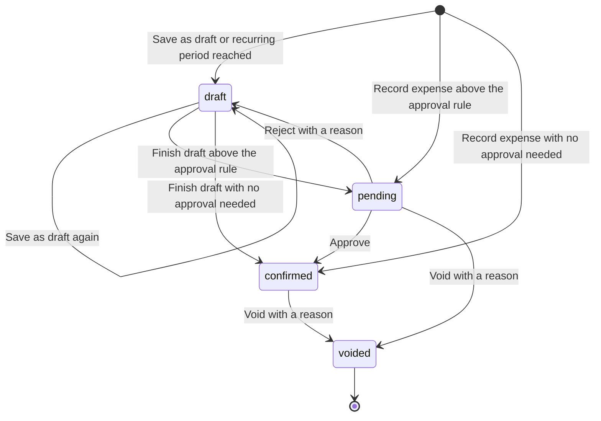

# Finance and expenses

Written from the demo code, 2026-11-10.

## Purpose

Finance is the Flooring Suite menu for money that waits for a decision (plan K-7, `apps/web/src/features/finance/finance-page.tsx`). It has two tabs.

- **Payments to verify** (`/finance?view=payments`, `apps/web/src/features/finance/payments-queue.tsx`, feature `finance.payments-queue`). Customer and supplier payments waiting for a second person. The queue is documented in `sales.md` and `purchasing.md`.
- **Expenses** (`/finance?view=expenses`, feature `finance.expenses`). What the company spends, per location, each with its receipt. This file covers it.

This module also covers:

- Recurring expenses that raise one draft per period.
- The company's one rule for sharing company-wide costs across locations.
- The journal lines an expense would post. They are derived and nothing is stored.

Recurring expenses and shared costs sit under the `finance.expenses` key. The plan's separate `finance.recurring-expenses` and `settings.cost-sharing` keys were not created (`packages/shared/src/features.ts`). The settings live at `/settings/expenses`.

## Who uses it

Effective access is role permissions, intersected with the company ceiling and enabled modules (`packages/shared/src/permissions/engine.ts`). All keys below are in the `core` module. Default roles come from `packages/shared/src/permissions/roles.ts`.

| Action | Permission key | Default roles | Enforced in |
| --- | --- | --- | --- |
| See the Finance menu | Any of `sales.payment.approve`, `purchasing.payment.approve`, `finance.expense.view` | Owner, Manager, Accountant | `apps/web/src/products/flooring.ts` (menu `anyOf`), `apps/web/src/features/finance/finance-page.tsx` |
| See the Expenses tab and list | `finance.expense.view` | Owner, Manager, Accountant | `finance-page.tsx` (`allowed.expenses`), `apps/web/src/products/pages.ts` (`SUB_PAGES`). Not checked in the store. See Edge cases. |
| Open a receipt | Any of `sales.payment.view`, `hr.employee.view`, `hr.portal.view`, `contracts.contract.view`, `finance.expense.view` | Every default role | `DemoStore.getFile` in `apps/web/src/lib/api/demo/store.ts` |
| Save a draft, finish a draft, record an expense | `finance.expense.create` | Owner, Manager, Accountant | `saveExpense` in `apps/web/src/lib/api/demo/expense-actions.ts` |
| Add or edit a recurring expense | `finance.expense.create` | Owner, Manager, Accountant | `saveRecurringExpense` in `expense-actions.ts` |
| Approve or reject an expense | `finance.expense.approve` | Owner, Manager, Accountant | `reviewExpense` in `expense-actions.ts`. The recorder is refused. |
| Void an expense | `finance.expense.void` | Owner, Accountant | `voidExpense` in `expense-actions.ts` |
| Export the expenses table | `finance.expense.export` exists in the catalog | Owner, Accountant | Not enforced. `apps/web/src/components/data-table/data-table.tsx` shows Export CSV whenever `csvName` is set. |
| Change the approval rule or the shared-cost rule | `settings.expenses.manage` | Owner | `apps/web/src/features/settings/expenses/expenses-settings-page.tsx`, `DemoStore.updateSettings` through `SETTINGS_SECTIONS.expenses` and `SETTINGS_SECTIONS.sharedCosts` in `packages/shared/src/settings/sections.ts`. On the API, `PUT /settings/expenses` for the approval rule and `PUT /settings/sharedCosts` for the shared-cost rule (ADR 0059, part 4b). Data scope `all` |

The collections `expenses` and `recurringExpenses` have no writers in the generic `save` (`SAVE_PERMISSIONS` in `permission-rules.ts`). They change only through the store calls above.

## Workflows and status rules

### Expense status



| From | To | Trigger and guard | Decided in |
| --- | --- | --- | --- |
| New | `draft` | Save as draft. No validation runs. | `saveExpense` with `asDraft: true` |
| New | `draft` | An active recurring template reaches a period. | `raiseRecurringDrafts`, using `dueRecurringDrafts` in `packages/shared/src/expenses.ts` |
| New or `draft` | `pending` | Record expense. `expenseProblem` returns null and `needsExpenseApproval` is true. | `saveExpense` |
| New or `draft` | `confirmed` | Record expense. `expenseProblem` returns null and `needsExpenseApproval` is false. A pay-later expense raises its bill here. | `saveExpense`, then `confirm` |
| `pending` | `confirmed` | Approve. The approver is not the recorder. A pay-later expense raises its bill here. | `reviewExpense`, then `confirm` |
| `pending` | `draft` | Reject. The reason must be at least 3 characters after trimming. | `reviewExpense` |
| `pending` | `voided` | Void. The reason must be at least 3 characters after trimming. | `voidExpense` |
| `confirmed` | `voided` | Void, with the same reason rule. Refused when a confirmed supplier payment is allocated to the linked bill. | `voidExpense` |

`Expense.status` also allows `rejected`, and the screen has a label for it (`STATUS` in `apps/web/src/features/finance/expenses/expenses-view.tsx`). No code sets it. A rejection returns the expense to `draft`. The seed has no rejected expense.

A recorded expense cannot be edited. `saveExpense` refuses any expense that is not a draft: "A recorded expense can't be edited. Void it and enter it again."

### Recording an expense

1. The person picks New expense, or Finish expense on a draft (`expense-form-dialog.tsx`).
2. They fill in date, vendor, category, location, amount before tax, tax, method, reference, Paid already or Pay later, note and files.
3. Save as draft stores it as is. Record expense runs the checks in rule 3.
4. The result is one of the transitions above.

### Recurring expenses

A template has an `active` flag and no status. People manage templates in Manage recurring on the Expenses tab (`apps/web/src/features/finance/expenses/recurring-expenses.tsx`). Each period raises a draft, and a person finishes the draft with the actual amount and receipt.

### The linked bill

A pay-later expense raises a supplier bill when it is confirmed. The bill's status (open, partly paid, paid) is derived from supplier payments by `billLedger` in `packages/shared/src/operations/purchasing.ts`. Bills are documented in `purchasing.md`.

## Business rules

### 1. What an expense costs

`expenseCost` in `packages/shared/src/expenses.ts`. Sales tax on a purchase is part of its cost (ADR 0023). The sum is not rounded here. `moneyString` rounds to two places, half up, wherever it is stored or shown.

```
cost = dec(amount).plus(tax)
```

### 2. What counts as a cost

`countsAsCost` in `packages/shared/src/expenses.ts`. A sales tax payment is money passed on to the state, so it is never a cost.

```
countsAsCost = status === "confirmed" && category !== "sales_tax_payment"
```

### 3. Receipt required to leave draft

`expenseProblem` in `packages/shared/src/expenses.ts`, called by `saveExpense` with `draft.files.length`. Checks run in this order, and the first failure is the message shown.

| Check | Message |
| --- | --- |
| `date` is empty | Choose the date. |
| `supplierId` is empty | Choose the vendor. |
| `amount` fails `/^\d+(\.\d{1,2})?$/`, or is 0 or less | Enter the amount. |
| `tax` is not empty and fails the same pattern | Enter the tax as an amount, or leave it empty. |
| No files | Attach the receipt, statement or lease. |

A draft needs none of these. Files already on a draft count toward the receipt rule.

### 4. Approval above an amount

`needsExpenseApproval` in `packages/shared/src/expenses.ts`, read from `CompanySettings.expenses`.

```
if (!approvalRequired) return false
return approvalThreshold.trim() === "" || expenseCost(e) > approvalThreshold
```

- The comparison is strictly greater, on cost including tax. An expense exactly at the threshold confirms at once.
- With approval on and a blank threshold, every recorded expense waits.
- The threshold is empty or plain money text (`MONEY_TEXT`: digits with up to two decimals, no sign, exponent or bare point). `expenseSettingsProblem` in `packages/shared/src/settings/section-rules.ts` refuses anything else in both modes, even while approval is off. No step-up (ADR 0059).
- Seed values (`packages/shared/scripts/fixtures/tenant.ts`): Summit has approval on above 1000.00. Keystone has approval off.

### 5. Nobody approves their own expense

`reviewExpense` in `expense-actions.ts` refuses when `expense.recordedById === ctx.actor.id`. The screen also hides Approve and Reject for the recorder (`expenses-view.tsx`).

### 6. Pay later is a linked bill with no purchase order

`linkBill` in `expense-actions.ts`, called from `confirm` when `settlement === "on_account"`. Nothing is raised while the expense is a draft or pending. The supplier must exist.

```
bill.number     = expense.number
bill.supplierId = supplier.id
bill.poId       = null
bill.receiptIds = []
bill.issuedAt   = expense.date
bill.dueAt      = expense.dueAt ?? supplierDueDate(expense.date, supplier.terms)
bill.total      = moneyString(expenseCost(expense))
bill.matchIssues = []
bill.files      = expense.files
```

The expense then stores `billId` and `dueAt`. The form always sends `dueAt: null`, so the due date comes from the supplier's terms. `supplierDueDate` in `packages/shared/src/operations/purchasing.ts` returns the bill date for pay on order and COD, the bill date plus 30, 60, 90 or 180 days for net terms, and the last day of the month after for a monthly statement.

Because it is an ordinary bill, supplier payments, payables and "You owe suppliers" work with no new logic.

### 7. Voiding a pay-later expense

`voidExpense` in `expense-actions.ts`.

```
paid = any supplierPayment with status "confirmed" that has an allocation to expense.billId
if (paid) refuse: "This expense has been paid, so it can't be voided."
else remove the bill
```

### 8. A sales tax payment is not an expense

`sharedFields` in `expense-actions.ts` forces `locationId` to null and `tax` to `"0.00"` when `category === "sales_tax_payment"`. The form hides Location and Tax for it (`expense-form-dialog.tsx`). `countsAsCost` keeps it out of every cost total. It does count in Cash paid out, and in the Taxes section of the Business report (`reports.md`).

### 9. Payroll is not a category people pick

`EXPENSE_CATEGORIES` in `packages/shared/src/expenses.ts` leaves out `payroll`. The category exists for seeded and imported months. The Expenses list hides those rows (`expenses-view.tsx`).

### 10. Vendors come from the supplier directory

The form and the recurring form offer suppliers where `type !== "goods"` and `status === "active"` (`expense-form-dialog.tsx`, `recurring-expenses.tsx`). This filter is on the screen only.

### 11. Expense numbers

`nextExpenseNumber` in `expense-actions.ts` calls `nextNumber("EXP-", existing, 1)` in `packages/shared/src/operations/quotes.ts`. The result is the prefix plus highest plus one, with no zero padding. Seeded numbers are padded to four digits, so the first new number after `EXP-0209` is `EXP-210`.

### 12. Receipt files

`describeFiles` and `storeFiles` in `apps/web/src/lib/api/demo/payment-actions.ts`, using `proofFilesProblem` and `detectProofType` in `packages/shared/src/file-types.ts`.

- PDF, PNG, JPEG, WebP or HEIC, checked from the file's first bytes.
- At most 5 MB each.
- At most 3 files per expense, counting those already on the draft.
- Bytes go to the IndexedDB file store. The record keeps `FileMeta` only.

### 13. Recurring drafts

`dueRecurringDrafts` in `packages/shared/src/expenses.ts` works out what is owed. `raiseRecurringDrafts` in `expense-actions.ts` writes the drafts. It runs in `DemoStore.openCompany` every time a company opens, and does nothing when `finance.expenses` is off.

```
STEP_MONTHS  = { monthly: 1, quarterly: 3, yearly: 12 }
MAX_CATCH_UP = 12
used = set of `${e.recurringId}|${e.period}` over every expense

for each active template, for i = 0, step, 2 * step, ...:
  date = dateIn(startYear, startMonthIndex + i, dayOfMonth)
         // the day is clamped to the last day of that month
  stop when date > today, or endsOn is set and date > endsOn
  skip when date < startsOn
  period = periodKey(date, frequency)
  due when `${template.id}|${period}` is not in used
keep only the last 12 due for that template

periodKey monthly   = YYYY-MM
periodKey yearly    = YYYY
periodKey quarterly = YYYY-Q(ceil(month / 3))
```

It is safe to repeat, because a period stays used even after its expense is voided.

Each draft copies `supplierId`, `category`, `locationId`, `amount`, `tax`, `paymentMethod` and `note` from the template. It has `reference: ""`, `files: []`, `settlement: "paid"`, `recurringId`, `period`, `recordedBy: "Recurring expense"`, and `recordedById` of whoever opened the company.

`saveRecurringExpense` requires a vendor and an amount that matches `/^\d+(\.\d{1,2})?$/` and is above 0.

### 14. One shared-cost rule per company

`CompanySettings.sharedCosts` holds one `rule` and `fixedPct`. Rules per category were left out. The rule is used only by the Business report (`figuresFor` in `packages/shared/src/business-report.ts`). Each company-wide cost, meaning an expense with no location or a pay line with no home location, is split on its own, using the weights of its own month.

`weightsFor` in `packages/shared/src/cost-sharing.ts` picks the weights. Each weight is a bigint.

```
revenue:    max(revenueCents[location], 0)
            revenueCents = sum of toCents(dec(subtotal).times(sign))
            over non-void invoices issued in the cost's month, placed by soldAt
floor_area: BigInt(dec(floorAreaSqFt ?? 0).times(100).toFixed(0))
fixed:      BigInt(dec(fixedPct[id] ?? 0).times(100).toFixed(0))
equal:      1

if the chosen weights total more than 0, use them
else if floor_area weights total more than 0, use floor_area
else use equal
```

The location list is every location, warehouses and showrooms. The seed default is `revenue` for all companies (`packages/shared/scripts/fixtures/tenant.ts`).

`fixedPctProblem` in `cost-sharing.ts` requires the fixed percentages to total exactly 100 when the rule is `fixed`. It is checked on the settings screen only (`canSave`).

### 15. Largest-remainder cent split

`shareByWeight` in `packages/shared/src/cost-sharing.ts`. Shares add up to the total exactly, and a weight of zero never receives a cent.

```
toCents(v)   = BigInt(dec(v).times(100).toFixed(0))
fromCents(c) = dec(c.toString()).dividedBy(100)

W = sum of weight[i]
if W == 0: every share is 0
base[i]  = (total * weight[i]) / W     // bigint division, truncates
rest[i]  = (total * weight[i]) % W
left     = total - sum of base[i]
extra    = the first `left` ids, sorted by rest descending, ties by id.localeCompare
share[i] = base[i] + (i is in extra ? 1 : 0)
```

### 16. Journal lines are derived and nothing is stored

`expenseJournal` and `billPaymentJournal` in `packages/shared/src/journal.ts`. No collection holds journal lines and no screen shows them. `expenseJournal` is called only by unit tests (`packages/shared/test/expenses.test.ts`, `reconciliation.test.ts`). `billPaymentJournal` has no caller.

```
if status is not "confirmed" or "voided": no lines
amount = moneyString(expenseCost(expense))
creditAccount = settlement === "on_account" ? "Accounts Payable" : "Cash or Bank"
debitLine  = { account: ACCOUNT[category], debit: amount, credit: "0.00", locationId: expense.locationId }
creditLine = { account: creditAccount, debit: "0.00", credit: amount, locationId: null }
confirmed: [debitLine, creditLine]
voided:    [debitLine, creditLine, creditLine with debit and credit swapped, debitLine with debit and credit swapped]

billPaymentJournal(amount):
  Accounts Payable debit amount
  Cash or Bank credit amount
```

| Category | Account (`ACCOUNT` in `journal.ts`) |
| --- | --- |
| `rent` | Rent |
| `electricity`, `water`, `internet_phone` | Utilities |
| `fuel_vehicles` | Vehicles |
| `other` | Other Expenses |
| `supplies` | Supplies |
| `maintenance` | Repairs and Maintenance |
| `insurance` | Insurance |
| `taxes_licenses` | Taxes and Licences |
| `marketing` | Marketing |
| `professional_fees` | Professional Fees |
| `payroll` | Payroll |
| `sales_tax_payment` | Sales Tax Payable |

A share of a company-wide cost is a report figure, never a posting. The debit line carries the expense's own `locationId`.

## Entities and fields

### Expense

Collection `expenses`. Type in `packages/shared/src/types/purchasing.ts`.

| Field | Type | Notes |
| --- | --- | --- |
| `id` | string | |
| `number` | string | See rule 11. |
| `date` | string | ISO date. Places the expense in a period. |
| `supplierId` | string or null | Vendor. Required to leave draft. |
| `category` | `ExpenseCategory` | `rent`, `electricity`, `water`, `internet_phone`, `supplies`, `maintenance`, `fuel_vehicles`, `insurance`, `taxes_licenses`, `marketing`, `professional_fees`, `other`, `sales_tax_payment`, `payroll`. |
| `locationId` | string or null | Null means company-wide, shared across locations in the report. |
| `amount` | string | Before tax. |
| `tax` | string | Saved as `"0.00"` when empty or for a sales tax payment. |
| `paymentMethod` | `PaymentMethod` | `cash`, `check`, `ach`, `card`, `other`. |
| `reference` | string | |
| `files` | `FileMeta[]` | Receipt, statement or lease. |
| `note` | string | |
| `status` | enum | `draft`, `pending`, `confirmed`, `rejected`, `voided`. `rejected` is never set. |
| `settlement` | enum | `paid` (Paid already) or `on_account` (Pay later). |
| `dueAt` | string or null | Only for `on_account`. Set when the bill is raised. |
| `billId` | string or null | The linked bill, set on confirmation. |
| `recurringId` | string or null | The template that raised it. |
| `period` | string or null | `YYYY-MM`, `YYYY-Qn` or `YYYY`. |
| `recordedById` | string | Set again each time a draft is saved. |
| `recordedBy` | string | Name. `Recurring expense` on a raised draft. |
| `recordedAt` | string | |
| `reviewedBy` | string or null | Null when confirmed with no approval. |
| `reviewedAt` | string or null | |
| `rejectReason` | string or null | Cleared when the draft is saved again. |
| `voidedBy` | string or null | |
| `voidedAt` | string or null | |
| `voidReason` | string or null | |

### RecurringExpense

Collection `recurringExpenses`. Type in `packages/shared/src/types/purchasing.ts`.

| Field | Type | Notes |
| --- | --- | --- |
| `id` | string | |
| `supplierId` | string | Required. |
| `category` | `ExpenseCategory` | |
| `locationId` | string or null | Null means company-wide. |
| `amount` | string | The estimate. |
| `tax` | string | No form field. Keeps the template's value, or `"0.00"`. |
| `paymentMethod` | `PaymentMethod` | No form field. Keeps the template's value, or `ach`. |
| `frequency` | enum | `monthly`, `quarterly`, `yearly`. |
| `dayOfMonth` | number | The screen limits it to 1 to 31. Clamped to the month's last day when used. |
| `startsOn` | string | ISO date. |
| `endsOn` | string or null | No form field. |
| `active` | boolean | Paused templates raise nothing. |
| `note` | string | |

### ExpenseSettings and SharedCostSettings

`CompanySettings.expenses` and `CompanySettings.sharedCosts`, types in `packages/shared/src/types/settings.ts`. Edited at `/settings/expenses`.

| Field | Type | Notes |
| --- | --- | --- |
| `expenses.approvalRequired` | boolean | Label: Approve larger expenses. |
| `expenses.approvalThreshold` | string | Label: Approval above. Cost including tax. Blank means all. Otherwise `MONEY_TEXT` (rule 4). |
| `sharedCosts.rule` | enum | `revenue`, `floor_area`, `equal`, `fixed`. |
| `sharedCosts.fixedPct` | `Record<string, string>` | Percent per location id, for the `fixed` rule. |

`Location.floorAreaSqFt` (optional, `packages/shared/src/types/locations.ts`) feeds the `floor_area` rule. It is edited in Settings under locations.

### JournalLine

Derived, never stored. `packages/shared/src/journal.ts`.

| Field | Type | Notes |
| --- | --- | --- |
| `account` | string | |
| `debit` | string | |
| `credit` | string | |
| `locationId` | string or null | On the debit line; null for company-wide. |

### Bill link

The linked bill is an ordinary `Bill` (`packages/shared/src/types/purchasing.ts`) with `poId: null` and `receiptIds: []`. It holds no reference to the expense. The link is only `Expense.billId`.

## Events and audit entries

Notification events: none. `packages/shared/src/notifications/events.ts` has no expense key, and `expense-actions.ts` makes no `notify` call.

Audit entries, all from `expense-actions.ts` with category `data` unless noted. The expense target reads `EXP-0001, Rent` (number, then category label).

| Action | When | Before | After |
| --- | --- | --- | --- |
| `Saved expense draft` | `saveExpense` with `asDraft` | null | amount |
| `Recorded expense for approval` | `saveExpense`, goes to `pending` | null | amount |
| `Recorded expense` | `saveExpense`, confirmed at once | null | amount |
| `Approved expense` | `reviewExpense` approve | `pending` | `confirmed` |
| `Rejected expense` | `reviewExpense` reject | `pending` | the reason |
| `Voided expense` | `voidExpense` | the prior status | the reason |
| `Added recurring expense` | `saveRecurringExpense`, new. Target is the category label. | null | amount |
| `Edited recurring expense` | `saveRecurringExpense`, existing. Target is the category label. | the prior amount | amount |
| `Changed expense approval` | `DemoStore.updateSettings("expenses", ...)`, including Reset to default. Category `settings`, target `Expense approval`. | diff from `diffSummary` | diff |
| `Changed shared costs` | `DemoStore.updateSettings("sharedCosts", ...)`, including Reset to default; on the API `PUT /settings/sharedCosts` (before and after as stored). Category `settings`, target `Shared costs`. | diff from `diffSummary` | diff |

Raising a recurring draft writes no audit entry. Creating or removing the linked bill writes no entry of its own.

## Emails

None.

## Reports

- **Expenses table.** CSV of the filtered rows, `expenses-<today>.csv` (`data-table.tsx`). Columns: Number, Date, Vendor, Category, Location, Cost, Status.
- **Business report.** Expenses by category, vendor and location, plus Operating expenses, Cash, Taxes and Profit by location. See `reports.md`.
- **Profit and loss.** Reads `expenses` through `monthlyPnl` in `packages/shared/src/analytics.ts`. See `reports.md`.
- **Dashboard.** Also calls `monthlyPnl` (`apps/web/src/features/dashboard/use-dashboard-data.ts`).

## Edge cases and known limits

- **No store check on reading expenses.** `DemoStore.list("expenses")` is not in `PRIVATE_COLLECTIONS` and `scope.ts` has no filter for it. Only the screen hides the data. Data scope does not apply either: a Manager with branch scope sees every expense.
- **Receipts are not tied to the expense.** `getFile` accepts any of five permission keys and does not check which record a file belongs to.
- **No alert for waiting approvals.** Pending expenses are in the list, but not in Needs attention (`apps/web/src/lib/attention.ts`) and not in Payments to verify. No notification is sent.
- **Finishing a draft changes the recorder.** `saveExpense` sets `recordedById` and `recordedBy` to whoever saves it, so the two-person check compares against the last person to save the draft.
- **Voiding a pending expense.** `voidExpense` allows it and the screen offers it. `expenseJournal` then returns four lines for something that never posted. They net to zero.
- **Journal lines have no date.** The void lines carry no void date. ADR 0023 says a void reverses on the void date; the real build has to add that.
- **A waiting supplier payment does not block a void.** Only `confirmed` payments block it. The void removes the bill, and a `pending` payment's allocation is left pointing at a bill that no longer exists.
- **The bill number field holds the expense number.** `Bill.number` is documented as the supplier's own invoice number.
- **The Cost total includes every status.** The Cost column total on the Expenses table sums the rows shown, including drafts, pending and void expenses, until the status filter is used.
- **Catch-up is capped.** At most the last 12 periods per template are raised, and older ones are never raised. ADR 0023 says the report states how many drafts it leaves out. That was not built.
- **Editing a template does not change drafts already raised.**
- **Recurring sales tax payments.** `saveRecurringExpense` does not force a sales tax template to be company-wide. The draft takes the template's location until it is finished, when `sharedFields` clears it.
- **`dayOfMonth` is limited on the screen only.** `saveRecurringExpense` does not check it.
- **A raised draft runs for whoever opens the company.** `raiseRecurringDrafts` needs no permission and writes no audit entry.
- **Shared costs are derived live.** Changing the rule, or voiding an old invoice under the revenue rule, rewrites past months. ADR 0023 says the real build must freeze shares when a period closes and give the rule effective dates.
- **Fixed percentages can go stale.** A location added later has no percentage, gets weight 0 and receives no share. Every save runs `sharedCostsProblem` in both modes and on the API (ADR 0059, part 4b), so the next save of the page re-checks the split.
- **File limit message.** The fourth file on an expense fails with "A payment keeps at most 3 files."
- **No future-date check.** `expenseProblem` only requires a date.
- **Differences from ADR 0023.** Rules per category were left out (`SharedCostSettings` has no `categoryRules`). Pay later raises the bill at confirmation, and the form has no due-date field. The plan's `Bill.expenseId` does not exist.
