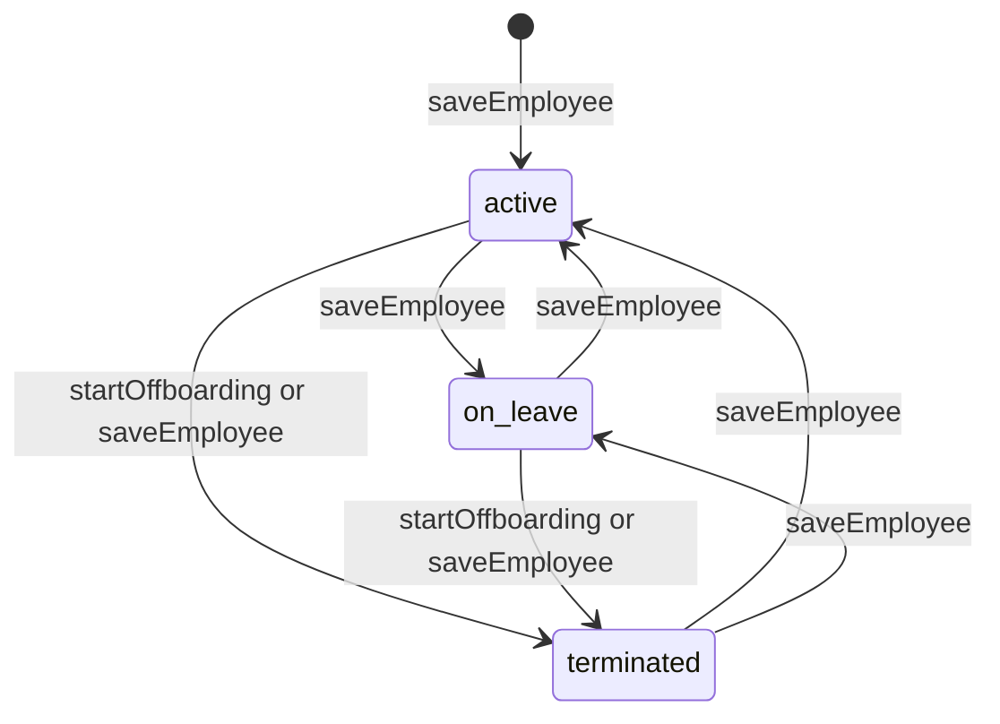
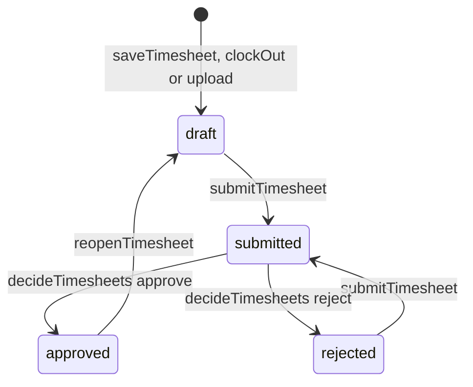
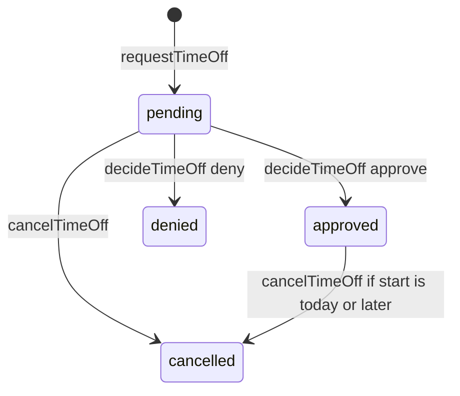
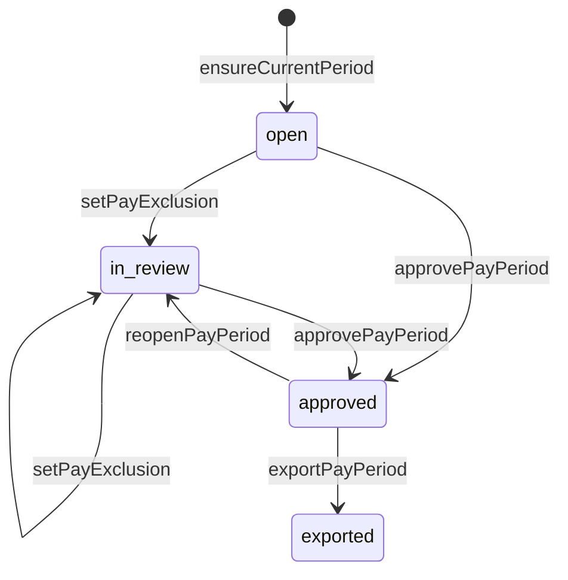

# HR

Written from the demo code, 2026-11-10.

## Purpose

HR keeps people records, weekly timesheets, overtime, time off and pay periods. It ends in a gross pay estimate and CSV files for an outside payroll provider. It does not calculate tax or net pay. Every gross figure carries the label in `GROSS_PAY_LABEL` (`packages/shared/src/hr/pay-export.ts`): "Gross pay estimate. Taxes and net pay are calculated by your payroll provider."

Flooring Suite companies reach HR through one menu item with tabs (`apps/web/src/features/hr/hr-tabs.tsx`). HR Suite companies get each page in the sidebar (`apps/web/src/products/hr.ts`).

Commission plans and statements are in `docs/product-spec/commissions.md`. The self-service pages are in `docs/product-spec/employee-portal.md`.

| Screen | Route | Feature key | Component |
| --- | --- | --- | --- |
| HR Home | `/hr`, or `/` on the HR host | `hr.dashboard` | `apps/web/src/features/hr/hr-dashboard.tsx` |
| People | `/hr/employees` | `hr.employees` | `apps/web/src/features/hr/employees-page.tsx`, `employee-sheet.tsx`, `employee-form-dialog.tsx` |
| Timesheets | `/hr/timesheets`, `/hr/timesheets?view=queue` | `hr.timesheets` | `apps/web/src/features/hr/timesheets-page.tsx` |
| Time off | `/hr/time-off` | `hr.time-off` | `apps/web/src/features/hr/time-off-page.tsx` |
| Pay periods | `/hr/pay-periods` | `hr.pay-periods` | `apps/web/src/features/hr/pay-periods-page.tsx` |
| Settings, HR | `/settings/hr` | `settings.hr` | `apps/web/src/features/settings/hr/hr-settings-page.tsx` |

## Who uses it

Default roles come from `packages/shared/src/permissions/roles.ts`. "All nine" means Owner, Manager, Accountant, Sales, Purchasing, Warehouse, Installer, HR manager and Employee. The HR Suite ships only Owner, HR manager and Employee (`PRODUCT_ROLES`).

| Action | Permission key | Default roles | Enforced in |
| --- | --- | --- | --- |
| Open HR Home | `hr.overview.view` | Owner, Manager, Accountant, HR manager | `HrDashboard`; `apps/web/src/products/pages.ts` |
| See People and profiles | `hr.employee.view` | Owner, Manager, HR manager | `apps/web/src/products/pages.ts`; `EmployeesPage` |
| See or change a pay rate | `hr.employee.view_sensitive` | Owner, HR manager | `DemoStore.list` masks `payRate` as `"0.00"`; `saveEmployee` keeps the old value |
| Add a person | `hr.employee.create` | Owner, HR manager | `saveEmployee` in `apps/web/src/lib/api/demo/people-actions.ts` |
| Edit a person, tick checklists, add documents, start offboarding | `hr.employee.edit` | Owner, HR manager | `saveEmployee`, `setChecklistItem`, `addEmployeeDocuments`, `startOffboarding` |
| Read timesheets within data scope | `hr.timesheet.view` | All nine | `TimesheetsPage`; `applyScope` in `apps/web/src/lib/api/demo/scope.ts` |
| Enter and submit own hours, upload own hours | `hr.timesheet.edit` | All nine | `assertMayEdit`, `uploadTimesheets` in `timesheet-actions.ts` |
| Open `/hr/timesheets`, enter someone else's hours, approve, send back, reopen, upload for anyone | `hr.timesheet.approve` | Owner, Manager, HR manager | `apps/web/src/products/pages.ts`; `assertMayEdit`, `decideTimesheets`, `reopenTimesheet`, `uploadTimesheets` |
| Read time off within data scope | `hr.pto.view` | All nine | `TimeOffPage`; `applyScope` |
| Request or cancel own time off | `hr.pto.request` | All nine | `requestTimeOff`, `cancelTimeOff` in `timeoff-actions.ts` |
| Open `/hr/time-off`, decide requests, adjust a balance, request or cancel for someone else | `hr.pto.approve` | Owner, Manager, HR manager | `apps/web/src/products/pages.ts`; `decideTimeOff`, `adjustTimeOff`, `requestTimeOff`, `cancelTimeOff` |
| Read pay periods, bonuses and contractor payments | `hr.payroll.view` | Owner, Accountant, HR manager | `PRIVATE_COLLECTIONS` and `listPayPeriods` in `store.ts`; `reviewPayPeriod` in `pay-actions.ts` |
| Leave someone out, approve a run, reopen a run | `hr.payroll.approve` | Owner, HR manager | `setPayExclusion`, `approvePayPeriod`, `reopenPayPeriod` |
| Export a run | `hr.payroll.export` | Owner, Accountant, HR manager | `exportPayPeriod` |
| Change Settings, HR and time-off policies | `settings.hr.manage` | Owner, HR manager | `SETTINGS_SECTIONS.hr` in `packages/shared/src/settings/sections.ts`, read by `DemoStore.updateSettings`; `saveTimeOffPolicy`; `HrSettingsPage` |

Data scope, from `applyScope`:

- `timesheets`, `ptoRequests` and `timeOffEntries` use `ownOrReports`. Scope `own` sees the person's own records. Scope `branch` adds direct reports (`Employee.managerId`). Scope `all` sees everything.
- `clockEntries` use `byEmployee` at `own` and `branch` scope.
- `employees` and `timeOffPolicies` have no filter.
- Scopes by role: Owner, Accountant, Purchasing and HR manager `all`; Manager and Warehouse `branch`; Sales, Installer and Employee `own`.
- In the real build, the details of pay-sensitive audit entries follow the same person rule (`seesPersonRecords`) for holders of `hr.employee.view_sensitive`. The Owner sees all of them, and the demo shows them only at scope `all` (owner decision 2026-11-15; "Events and audit entries").

## Workflows and status rules

### People: `Employee.status`



`saveEmployee` writes whatever status the form sends, so all moves are free, including adding someone as `on_leave` or `terminated`. `startOffboarding` sets `terminated` and creates the offboarding checklist. It does nothing if a checklist already exists. Both are in `apps/web/src/lib/api/demo/people-actions.ts`.

A new person gets the checklist from `ONBOARDING_STEPS`. Offboarding uses `OFFBOARDING_STEPS`. Both lists are in `packages/shared/src/hr/people.ts`. Checklist steps are ticked one at a time by `setChecklistItem`.

### Timesheets: `Timesheet.status`



| Transition | Function in `apps/web/src/lib/api/demo/timesheet-actions.ts` | Guards |
| --- | --- | --- |
| Create or edit hours | `saveTimesheet` | Person passes `needsTimesheet`. `hoursProblem` is null. `weekStart` is not after today. Status is not `approved`. The hours stored for the week equal the hours the form started from (`expectedDays`), or the hours being saved; otherwise refused with nothing saved (`overwritesNewerHours`, 2026-11-16). Keeps the current status, so a rejected sheet stays rejected until submitted again |
| To `submitted` | `submitTimesheet` | Status is not `submitted` or `approved`. Clears `rejectionReason`, adds a history event, tells approvers |
| To `approved` or `rejected` | `decideTimesheets` | Status is `submitted`. The sheet is not the decider's own. A rejection needs a reason of at least 3 characters. Hours never change |
| `approved` to `draft` | `reopenTimesheet` | Reason of at least 3 characters. No pay period with status `approved` or `exported` overlaps the week |

The UI calls `rejected` "Sent back" (`SHEET_STATUS` in `timesheets-page.tsx`).

HR uses two views. The weekly grid is read-only. The queue at `?view=queue` lists submitted sheets other than the viewer's own. Selecting rows and pressing Approve selected opens `BulkApproveDialog`, which shows total hours and overtime. It approves only rows with no flags.

Template upload: download CSV or Excel from `timesheetTemplate`, fill it in, and upload through `TimesheetUploadDialog`. The dialog first calls `uploadTimesheets` with `apply: false` to show each row's result, then with `apply: true` to save the good rows.

### Time off: `PtoRequest.status`



| Transition | Function in `apps/web/src/lib/api/demo/timeoff-actions.ts` | Guards and effect |
| --- | --- | --- |
| Create | `requestTimeOff` | See business rules 10 and 11. Worker is not 1099 |
| To `approved` | `decideTimeOff` | Status is `pending`. Not the decider's own request. Posts a `used` ledger line of negative hours dated `request.start` |
| To `denied` | `decideTimeOff` | Same, and a reason of at least 3 characters. No ledger line |
| To `cancelled` | `cancelTimeOff` | From `pending` or `approved`. Refused when approved and `request.start < today`. An approved request posts an `adjustment` of positive hours dated today, note "Cancelled time off returned" |

The UI calls `denied` "Declined".

### Pay periods: `PayPeriod.status`



| Transition | Function in `apps/web/src/lib/api/demo/pay-actions.ts` | Guards and effect |
| --- | --- | --- |
| Create | `ensureCurrentPeriod` | Runs on `listPayPeriods` and `myPortal`. Creates the period holding today if none has the same start and frequency |
| To `in_review` | `setPayExclusion` | Not `approved` or `exported`. Leaving someone out needs a reason of at least 3 characters. Passing `null` brings them back |
| To `approved` | `approvePayPeriod` | Not `approved` or `exported`. `period.end < today`. `payFrequencyProblem` is null. No blockers. Freezes `lines`, attaches approved commission statements, posts accrual |
| `approved` to `in_review` | `reopenPayPeriod` | Status is `approved`. Removes ledger lines with this `payPeriodId`, detaches statements, clears `lines` |
| To `exported` | `exportPayPeriod` | Status is `approved`. Sets `exportedAt`. Every statement with this `payPeriodId` becomes `paid`. An exported period cannot be reopened |

A blocker is a workweek ending in the period, for a person who needs timesheets and is not excluded, whose sheet is not `approved` (`blockersFor`). A missing sheet counts, unless the week ended before the hire date.

`ContractorPayment.status` is `approved` or `paid`. No action changes it. The fixture generator sets it.

## Business rules

1. **Who fills in timesheets.** `needsTimesheet`, `packages/shared/src/hr/timesheets.ts`.

   ```ts
   e.workerType === "w2" && e.flsaStatus === "non_exempt" && e.status !== "terminated"
   ```

2. **Worker classification on save.** `saveEmployee`, `people-actions.ts`.

   ```ts
   payRate: mayPay ? input.payRate : (before?.payRate ?? "0.00"),
   flsaStatus: input.workerType === "1099" ? "not_applicable" : input.flsaStatus,
   exemptionBasis: input.flsaStatus === "exempt" ? input.exemptionBasis : null,
   salaryHoursPerWeek: input.state === "CA" ? 40 : input.salaryHoursPerWeek,
   ```

3. **Exempt salary floor.** `exemptSalaryWarning`, `packages/shared/src/hr/people.ts`. It warns and never blocks. It applies only to exempt staff paid by salary, and never to `outside_sales`. Floors, per year: US $35,568 from 2019-01-01; CA $70,304 from 2026-01-01; CA $72,384 from 2027-01-01. The latest floor on or before today applies.

4. **California contractor warning.** `EmployeeSheet`, `employee-sheet.tsx`. Shown when `employee.workerType === "1099" && employee.state === "CA" && employee.documents.length === 0`.

5. **Valid hours.** `hoursProblem`, `packages/shared/src/hr/timesheets.ts`. Each day must be finite, from 0 to 24, with at most two decimals.

6. **The workweek.** `workweekStartOf`, `packages/shared/src/hr/timesheets.ts`. `Timesheet.days` has seven numbers. Index 0 is the company's workweek start day.

   ```ts
   addDays(date, -((weekday - startDay + 7) % 7))
   ```

7. **Which overtime rule applies.** `overtimeRuleFor`, `packages/shared/src/us-pack/overtime.ts`. The company rule is `settings.localization.payroll.overtimeRule`. **Behind `hr.payroll.california` (ADR 0050):** the California rules (daily and seventh-day overtime, double time, the flat-sum premium in rule 17 and the 40-hour salary) apply only while that switch is on, and it is off until a qualified payroll person reviews them. Off, every worker is on the federal weekly rule, even with California as the company rule. Screens and pay-period review (`warnings`) carry "California pay rules are pending payroll review — don't use them for real pay." while it is on, and an off note when California staff are present while it is off. The California refusals (rules 13 and 16 and the exempt floor) stay on either way (owner, 2026-11-14).

   ```ts
   workState === "CA" ? "california" : companyRule
   ```

8. **Overtime split.** `splitOvertime`, `packages/shared/src/us-pack/overtime.ts`. Hours are JavaScript numbers here.

   Federal:

   ```ts
   const WEEKLY_LIMIT = 40;
   const total = days.reduce((a, b) => a + b, 0);
   const overtime = Math.max(0, total - WEEKLY_LIMIT);
   return { regular: total - overtime, overtime, doubleTime: 0, flaggedDays: [] };
   ```

   California, day by day. The seventh-day rule needs hours on all seven days of the workweek:

   ```ts
   const sevenDays = days.length === 7 && days.every((h) => h > 0);
   // day index 6 when sevenDays is true
   overtime += Math.min(h, 8);
   doubleTime += Math.max(h - 8, 0);
   // every other day
   const dailyRegular = Math.min(h, 8);
   const dailyOt = Math.min(Math.max(h - 8, 0), 4);
   const dailyDouble = Math.max(h - 12, 0);
   const roomLeft = Math.max(WEEKLY_LIMIT - regular, 0);
   regular += Math.min(dailyRegular, roomLeft);
   overtime += dailyOt + Math.max(dailyRegular - roomLeft, 0);
   doubleTime += dailyDouble;
   ```

   Example from ADR 0024: days 8, 8, 8, 8, 8, 8, 10 give 40 regular, 16 overtime and 2 double-time hours.

9. **Flags that stop bulk approve.** `timesheetFlags`, `packages/shared/src/hr/timesheets.ts`: "No hours entered", "Worked all seven days", "A day over 16 hours", "Hours on a day of approved leave". The last needs an approved request of 8 hours or more covering that day. The rule is applied on screen by `BulkApproveDialog`. `decideTimesheets` does not check flags.

10. **Time-off balance.** `timeOffBalance`, `packages/shared/src/hr/time-off.ts`. A balance is the sum of `TimeOffEntry.hours` for the person and policy. Pending hours are not posted, and `pendingHours` tracks them.

11. **Time-off request checks.** In `timeOffProblem` (`packages/shared/src/hr/time-off.ts`) and `requestTimeOff` (`timeoff-actions.ts`), in this order:
    - The end date is not before the start date, and hours are above 0.
    - For a policy that is not `unpaid` and has `allowNegative` false: `hours <= balance - pending`.
    - `addDays(employee.hiredAt, policy.waitingPeriodDays) <= input.start`.
    - With `annualUseLimitHours` set: approved hours whose `start` is in the same year, plus these hours, must not exceed the limit.
    - An exempt person on an unpaid policy must take full days:

    ```ts
    const days = Math.max(1, Math.round((Date.parse(input.end) - Date.parse(input.start)) / 86_400_000) + 1);
    // refused when
    employee.flsaStatus === "exempt" && !policy.paid && dec(input.hours).mod(8 * days).gt(0)
    ```

12. **Accrual.** `accrualFor` in `packages/shared/src/hr/time-off.ts`, posted by `postAccrual` in `pay-actions.ts` when a run is approved. Only `per_pay_period` and `per_hour_worked` post. Each line is dated `period.end`, kind `accrual`, rounded with `toDecimalPlaces(2)`, and skipped at 0 or below.

    ```ts
    const earned =
      policy.accrualMethod === "per_pay_period" ? dec(policy.accrualRate)
      : policy.accrualMethod === "per_hour_worked" ? dec(policy.accrualRate).times(hoursWorked)
      : dec(0);
    if (!policy.capHours) return earned;
    return minDec(earned, maxDec(dec(policy.capHours).minus(balance), 0));
    ```

13. **California guard on policies.** `californiaPolicyProblem` in `packages/shared/src/hr/time-off.ts`, called by `saveTimeOffPolicy` when the company has a non-terminated employee with `state === "CA"`. A `vacation` or `personal` policy with a non-empty `carryoverHours` is refused. A cap is allowed, because it pauses accrual.

14. **Pay period dates.** `periodFor`, `packages/shared/src/hr/pay.ts`. Monthly is the calendar month. Semimonthly is the 1st to the 15th and the 16th to month end. Weekly and biweekly count from `payPeriodAnchor`. `ensureCurrentPeriod` sets `payDate` to `addDays(end, 5)`.

15. **Who is in a run.** `payable`, `pay-actions.ts`.

    ```ts
    e.workerType === "w2" && e.status !== "terminated" && e.hiredAt <= period.end
    ```

    1099 workers are never in a pay period. `grossPay` returns null for them.

16. **Monthly pay and California.** `payFrequencyProblem`, `packages/shared/src/hr/pay.ts`. Monthly is refused when any non-terminated employee has `state === "CA"` and `flsaStatus === "non_exempt"`.

17. **Gross pay per person and period (plan N-3, corrected formula).** `grossPay`, `packages/shared/src/hr/pay.ts`. The formula in the original spec is not used. Overtime is worked per workweek and paid in the period where the week ends. Money is rounded once per workweek premium and once per pay line.

    Rates:

    ```ts
    const hourly = employee.payType === "hourly";
    const exempt = employee.flsaStatus === "exempt";
    const annual = hourly ? dec(0) : dec(employee.payRate);
    const base = hourly ? dec(employee.payRate) : annual.dividedBy(52).dividedBy(employee.salaryHoursPerWeek || 40);
    ```

    For each approved sheet whose week ends in the period:

    ```ts
    const multiplier = dec(split.overtime).times("0.5").plus(split.doubleTime);
    const paidMultiplier = hourly ? multiplier : dec(split.overtime).times("1.5").plus(dec(split.doubleTime).times(2));
    const premium = exempt ? dec(0) : roundMoney(paidMultiplier.times(base));
    const regularRate = hours === 0 ? base : base.plus(extra.dividedBy(hours));
    ```

    Pay lines:

    ```ts
    // hourly
    straight = roundMoney(dec(hoursInPeriod).times(base));
    paidLeavePay = roundMoney(dec(paidHours).times(base));
    // not hourly
    salaryAmount = roundMoney(annual.dividedBy(periods));
    // not hourly, exempt
    salaryDeduction = roundMoney(annual.dividedBy(52).dividedBy(5).times(fullDays));
    // not hourly, non-exempt
    salaryDeduction = roundMoney(dec(unpaidHours).times(base));
    ```

    `periods` is 52, 26, 24 or 12 from `PERIODS_PER_YEAR`. `fullDays` counts dates in the period with 8 or more unpaid hours. Unpaid leave is shown for hourly staff and not subtracted. Hours in the period and leave come only from approved sheets and approved requests.

    The total:

    ```ts
    const gross = maxDec(
      straight.plus(paidLeavePay).plus(salaryAmount).minus(salaryDeduction)
        .plus(premiumTotal).plus(input.commission).plus(nonDiscretionary).plus(discretionary).plus(trueUpTotal),
      0,
    );
    ```

    Example at $20 an hour, federal, one week of 46 hours and $230 commission on that week's lines: straight $920.00, premium 3 x $20 = $60.00, commission $230.00, true-up $15.00, gross $1,225.00. The spec's formula would give $1,210.00. ADR 0024 shows a $75.00 premium with no separate true-up. The code splits that amount into premium and true-up, and the total is the same.

18. **Overtime true-up on commission and bonuses.** `grossPay`, `bonusAllocations` and `flatSumPremium`, `packages/shared/src/hr/pay.ts`. It is zero for exempt staff. It runs over every week that has an allocation, including weeks paid in earlier periods.

    ```ts
    trueUpTotal = trueUpTotal.plus(roundMoney(multiplier.times(extra.dividedBy(hours))));
    ```

    - Commission is allocated by `commissionAllocations`, which puts each statement line in the workweek of its `confirmedOn`.
    - A non-discretionary bonus is spread per hour over the approved weeks of its period: `dec(b.amount).times(weekHours(s)).dividedBy(total)`.
    - A California `flat_sum` bonus is not allocated. It adds `roundMoney((OT x 1.5 + DT x 2) x perHour)` per week, where `perHour = amount / (weeks.length * 40)`.
    - A discretionary bonus is paid and is not in the true-up.

19. **Commission in a run.** `lineFor`, `pay-actions.ts`. The person's statements with `status === "approved"` and `payPeriodId` null or this period are summed on `payable`. Paid statements do not join.

    **Real build (owner decision 2026-11-15, ADR 0048):** approval stores on the statement the employee the rep's sign-in is linked to then (`commission_statements.employee_id`). The run pays the amount the approval posted to that employee, so re-linking the sign-in later never moves it. A statement stored without one falls back to the rep's link today (`paidEmployee`). The pay-period review lists approved, unpaid statements that no run will pay (`strandedCommission`), judged on the same employee: there is none, its record was removed, it is a 1099 contractor, or the person has left.

20. **Leave by date.** `leaveByDate`, `packages/shared/src/hr/pay.ts`. A request's hours are divided equally over every calendar day from start to end, using JavaScript numbers. A request is unpaid when `policy?.paid === false || r.kind === "unpaid"`.

21. **Holidays.** `federalHolidays`, `packages/shared/src/us-pack/holidays.ts`, seeds the ten federal holidays for 2026 and 2027 into `settings.hr.holidays`. Holidays appear on HR Home and on Settings, HR. `grossPay` does not read them.

22. **Timesheet upload rows.** `resolveTimesheet`, `packages/shared/src/import/kinds/timesheets.ts`. The row matches on email, then external ID. A repeated employee and date is refused through `duplicateKey`. These are refused: no match, another person's row in a portal upload, a terminated person, a 1099 worker, hours outside 0 to 24, a week already approved. A blank leaves the day alone and a zero overwrites it.

## Entities and fields

### Employee (`packages/shared/src/types/hr.ts`)

| Field | Type | Notes |
| --- | --- | --- |
| `id`, `companyId` | string | |
| `name`, `title`, `department` | string | Name is required |
| `workerType` | `w2`, `1099` | |
| `payType` | `hourly`, `salary`, `per_job` | |
| `payRate` | money string | Per hour, per year or per job. Sensitive |
| `state` | string | Work state. Drives the overtime rule |
| `email`, `phone` | string | |
| `hiredAt` | date | |
| `status` | `active`, `on_leave`, `terminated` | |
| `managerId` | string or null | Another employee. In the real build every change is also kept, dated, in `employee_manager_history`, so commission overrides follow the manager on each line's day (ADR 0048) |
| `externalId` | string, optional | Set by import |
| `flsaStatus` | `non_exempt`, `exempt`, `not_applicable` | Forced to `not_applicable` for 1099 |
| `exemptionBasis` | `executive`, `administrative`, `professional`, `outside_sales`, null | |
| `salaryHoursPerWeek` | number | Forced to 40 in California while `hr.payroll.california` is on (ADR 0050) |
| `commissionVisible` | boolean or null | Null follows the company setting |
| `homeLocationId` | string or null | Where this person's pay counts in location profit |
| `birthDate` | date or null | Not on the form. HR Home reads it |
| `emergencyContact` | object or null | `name`, `phone`, `relation` |
| `documents` | `FileMeta[]` | |
| `onboarding`, `offboarding` | `ChecklistItem[]` | `id`, `label`, `doneAt` |

### Timesheet

| Field | Type | Notes |
| --- | --- | --- |
| `id`, `employeeId` | string | |
| `weekStart` | date | First day of the workweek |
| `days` | number[7] | Hours per day |
| `status` | `draft`, `submitted`, `approved`, `rejected` | |
| `submittedAt`, `decidedAt` | timestamp or null | |
| `decidedBy` | string or null | Name |
| `rejectionReason` | string or null | |
| `source` | `form`, `upload`, `clock` | |
| `history` | `TimesheetEvent[]` | `at`, `by`, `action`, `reason` |

`TimesheetEvent.action` allows `submitted`, `approved`, `rejected`, `reopened`, `uploaded`. No code writes `uploaded`.

### ClockEntry

| Field | Type | Notes |
| --- | --- | --- |
| `id`, `employeeId` | string | |
| `date` | date | Day of clock-in |
| `inAt` | timestamp | |
| `outAt` | timestamp or null | Null while clocked in |

### TimeOffPolicy

| Field | Type | Notes |
| --- | --- | --- |
| `id`, `name` | string | |
| `kind` | `vacation`, `sick`, `personal`, `unpaid` | |
| `paid` | boolean | |
| `accrualMethod` | `per_pay_period`, `per_hour_worked`, `annual_grant`, `none` | |
| `accrualRate` | decimal string | Unit depends on the method |
| `capHours` | string | Empty means no cap |
| `annualUseLimitHours` | string | Empty means no limit |
| `carryoverHours` | string | Stored. Used only by the California guard |
| `waitingPeriodDays` | number | |
| `allowNegative` | boolean | |

### TimeOffEntry

| Field | Type | Notes |
| --- | --- | --- |
| `id`, `employeeId`, `policyId` | string | |
| `date` | date | |
| `kind` | `accrual`, `used`, `adjustment`, `carryover`, `forfeit`, `payout` | |
| `hours` | decimal string | Positive adds, negative takes |
| `note` | string | |
| `requestId` | string or null | |
| `payPeriodId` | string or null | Set on accrual, so a reopened run can remove it |

### PtoRequest

| Field | Type | Notes |
| --- | --- | --- |
| `id`, `employeeId`, `policyId` | string | |
| `start`, `end` | date | |
| `hours` | decimal string | |
| `kind` | `vacation`, `sick`, `personal`, `unpaid` | Copied from the policy |
| `status` | `pending`, `approved`, `denied`, `cancelled` | |
| `note` | string | |
| `decidedBy`, `decidedAt`, `decisionReason` | string or null | |

### PayPeriod

| Field | Type | Notes |
| --- | --- | --- |
| `id` | string | |
| `frequency` | `weekly`, `biweekly`, `semimonthly`, `monthly` | |
| `start`, `end`, `payDate` | date | |
| `status` | `open`, `in_review`, `approved`, `exported` | |
| `approvedBy`, `approvedAt`, `exportedAt` | string or null | |
| `excluded` | `{ employeeId, reason }[]` | |
| `lines` | `PayPeriodLine[]` | Empty until approved. Computed live before that |

### PayPeriodLine

| Field | Type | Notes |
| --- | --- | --- |
| `employeeId` | string | |
| `hoursWorked`, `overtimeHours`, `doubleTimeHours`, `paidLeaveHours`, `unpaidLeaveHours` | decimal string | Two decimals |
| `baseRate` | decimal string | Four decimals |
| `straightTimePay`, `overtimePremium`, `paidLeavePay`, `salaryAmount`, `salaryDeduction` | money string | |
| `commissionPay`, `nondiscretionaryBonus`, `discretionaryBonus`, `overtimeTrueUp`, `grossPay` | money string | |
| `straddleNote` | string or null | "Overtime in a week that ends next period is settled there." |
| `weeks` | `PayWeek[]` | One per workweek ending in the period |

`PayWeek` has `weekStart`, `weekEnd`, `hoursWorked`, `overtimeHours`, `doubleTimeHours`, `allocatedEarnings`, `regularRate` (four decimals), `overtimePremium` and `straddlesPeriod`.

### Bonus

| Field | Type | Notes |
| --- | --- | --- |
| `id`, `employeeId` | string | |
| `amount` | money string | |
| `kind` | `production`, `flat_sum`, `discretionary` | Decides overtime treatment |
| `periodStart`, `periodEnd` | date | A bonus joins the run where `periodEnd` falls |
| `approvedBy`, `reason` | string | |

### ContractorPayment

| Field | Type | Notes |
| --- | --- | --- |
| `id`, `employeeId` | string | Employee is a 1099 worker |
| `date` | date | |
| `description` | string | |
| `amount` | money string | |
| `status` | `approved`, `paid` | |

### HrSettings (`packages/shared/src/types/settings.ts`, Settings, HR)

| Field | Type | Seeded value (`packages/shared/scripts/fixtures/tenant.ts`) |
| --- | --- | --- |
| `workweekStartDay` | 0 to 6 | 1, Monday |
| `payFrequency` | `weekly`, `biweekly`, `semimonthly`, `monthly` | Harbor weekly, others biweekly |
| `payPeriodAnchor` | date | Six weeks before the Monday of the anchor date. Not on the screen |
| `holidays` | `{ date, name }[]` | Federal holidays, 2026 and 2027 |
| `showPayToEmployees` | boolean | true |
| `showCommissionToEmployees` | boolean | false |
| `showRatesToEmployees` | boolean | false |
| `showTeamCalendarToEmployees` | boolean | false |
| `clockEnabled` | boolean | Keystone false, others true |

The overtime rule is `localization.payroll.overtimeRule`, changed under Settings, Localization, Payroll. The HR page shows it with a link. The tab saves on its own (`updateLocalization("payroll")`, `settings.localization.manage`, module `hr`); on the API `PUT /settings/localization/payroll`, which refuses the California rule while its switch is off and a holiday state that isn't a US state code (ADR 0059, part 2a).

## Events and audit entries

Events are defined in `packages/shared/src/notifications/events.ts` and raised through `notify` in `notification-actions.ts`. `notify` never tells the person who caused the event. It writes nothing when the event is switched off.

| Event key | Recipients in the code | Channels | Trigger |
| --- | --- | --- | --- |
| `timesheet.submitted` | Every active user whose role holds `hr.timesheet.approve` (`usersWith`). The catalogue says "The manager, else HR" | In-app only. The call passes `to: []` | `submitTimesheet` |
| `timesheet.decided` | The employee's linked user | Email and in-app | `decideTimesheets`, one per sheet |
| `timeoff.requested` | Every active user whose role holds `hr.pto.approve`. The catalogue says "The manager, else HR" | Email and in-app | `requestTimeOff` |
| `timeoff.decided` | The employee's linked user | Email and in-app | `decideTimeOff` |

`usersWith` reads role permissions directly. It does not apply the company ceiling or modules. A person with no linked user gets nothing.

Audit entries are written through `ctx.audit`.

| Action string | Category | Trigger |
| --- | --- | --- |
| `Added employee`, `Edited employee` | data | `saveEmployee` |
| `Completed checklist step`, `Reopened checklist step` | data | `setChecklistItem` |
| `Started offboarding` | data | `startOffboarding` |
| `Added employee documents` | data | `addEmployeeDocuments` |
| `Submitted timesheet` | data | `submitTimesheet` |
| `Approved timesheet`, `Rejected timesheet` | data | `decideTimesheets` |
| `Reopened timesheet` | data | `reopenTimesheet` |
| `Uploaded timesheet hours` | data | `uploadTimesheets` with `apply: true` |
| `Requested time off` | data | `requestTimeOff` |
| `Approved time off`, `Declined time off` | data | `decideTimeOff` |
| `Cancelled time off` | data | `cancelTimeOff` |
| `Adjusted time-off balance` | data | `adjustTimeOff` |
| `Added time-off policy`, `Edited time-off policy` | settings | `saveTimeOffPolicy` |
| `Approved pay period`, `Reopened pay period`, `Exported pay period` | data | `approvePayPeriod`, `reopenPayPeriod`, `exportPayPeriod` |
| `Changed hr` | settings | `DemoStore.updateSettings("hr", ...)` |

Not audited: `saveTimesheet`, `clockIn`, `clockOut` and `setPayExclusion`.

**Real build (ADR 0047; owner decision 2026-11-15, ADR 0048 "Audit visibility"):** the API audits bonuses (`Added bonus`, `Voided bonus`) and exclusions (`Left out of pay period`, `Brought back into pay period`). These entries are pay-sensitive like commission reasons. Every audit viewer sees the row, but its before and after read "Hidden: pay details" unless the viewer is the Owner, or holds `hr.employee.view_sensitive` and the person the entry is about (the bonus's employee, or the excluded employee) is inside their data scope by `seesPersonRecords`. An entry whose person can't be found needs scope `all`. The demo writes none of these four entries.

## Emails

No real email is sent. `notify` writes one Outbox row per recipient. Subjects below are the catalogue defaults, and each company can edit them in Settings, Notifications.

| Event key | Subject | Body | Attachment |
| --- | --- | --- | --- |
| `timesheet.decided` | `Your timesheet for {{ timesheet.week }} was {{ timesheet.decision }}` | Names the week, the decision and the reason | None |
| `timeoff.requested` | `Time off request from {{ employee.name }}` | Names the kind and dates | None |
| `timeoff.decided` | `Your time off from {{ timeoff.start }} was {{ timeoff.decision }}` | Names the dates, the decision and the reason | None |

`timesheet.submitted` has email off in the catalogue and no email recipients in the call. Pay amounts are not offered as template variables.

## Reports

| Output | Source | Who |
| --- | --- | --- |
| Summary CSV, `pay-period-<start>.csv` | `paySummaryTable`, `packages/shared/src/hr/pay-export.ts`. One row per included person. Written when Export for payroll is pressed, and downloadable once the run is approved | `hr.payroll.export` to export. The later download buttons have no permission check beyond the page |
| Workweek CSV, `pay-period-<start>-workweeks.csv` | `payWorkweekTable`, same file. One row per employee per workweek ending in the period | Same |
| Gross pay table CSV, `gross-pay-<start>` | `DataTable` in `pay-periods-page.tsx` | `hr.payroll.view` |
| Contractor payments CSV, `contractor-payments` | `DataTable` in `pay-periods-page.tsx`. Kept out of the W-2 files | `hr.payroll.view` |
| Time off, balances and timesheet queue CSVs | `DataTable` in `time-off-page.tsx` and `timesheets-page.tsx` | Page access |
| People costs in the Business report | `peopleLines`, `packages/shared/src/business-report.ts`. Reads `grossPay` from periods that are `approved` or `exported`, placed by `Employee.homeLocationId` | See `docs/product-spec/reports.md` |

Summary CSV columns, in order: `employee_external_id`, `employee_name`, `employee_email`, `flsa_status`, `work_state`, `pay_period_start`, `pay_period_end`, `pay_date`, `hours_worked`, `overtime_premium_hours`, `double_time_premium_hours`, `paid_leave_hours`, `unpaid_leave_hours`, `base_rate`, `salary_amount`, `salary_deduction`, `straight_time_pay`, `overtime_premium`, `paid_leave_pay`, `commission_pay`, `nondiscretionary_bonus`, `discretionary_bonus`, `overtime_true_up`, `gross_pay_estimate`. ADR 0024 also lists `adjustment`. The code has no such column.

Workweek CSV columns, in order: `employee_external_id` (falls back to email), `workweek_start`, `workweek_end`, `hours_worked`, `overtime_hours`, `double_time_hours`, `allocated_earnings`, `regular_rate`, `overtime_premium`, `straddles_period`.

## Edge cases and known limits

- **Bonuses have no entry screen.** The two seeded bonuses can be read on a pay line. `SAVE_PERMISSIONS` allows a generic save with `hr.payroll.approve`, but no screen calls it (audit U-53).
- **Contractor payments are read-only.** No action or screen creates or pays one. They come only from the seed.
- **Start offboarding acts at once, with no confirmation (audit U-51).** One click sets `terminated`. There is no termination date.
- **Offboarding removes people from unapproved runs.** `payable` drops anyone `terminated`, so a person offboarded before the run is approved has no line for their final weeks. `needsTimesheet` also becomes false, so no more hours can be saved for them.
- **The offboarding checklist is text only.** "Accrued vacation added to final pay" and "Final commission statement run" are checkboxes. No code calculates a vacation payout or runs a final statement.
- **`adjustTimeOff` has no screen.** The store action exists and no component calls it.
- **Time off cancelled by HR has no screen.** `/hr/time-off` has no cancel button. The portal offers Cancel only on pending requests, so cancelling an approved request cannot be done on screen.
- **Ledger kinds not posted.** No action posts `forfeit` or `payout`. `carryover` appears only as the seeded opening balance. `annual_grant` policies never accrue after the seed, and there is no year-end job.
- **The annual use limit counts approved requests only.** Pending requests can each pass the limit.
- **A monthly frequency is refused in two places only.** `HrSettingsPage` blocks saving and `approvePayPeriod` blocks approval. `updateSettings` has no such check.
- **Bulk approve is partly a screen rule.** `decideTimesheets` accepts flagged sheets. It writes sheet by sheet, so an error on a later sheet leaves the earlier ones approved.
- **Decisions do not re-check scope.** `decideTimesheets` and `decideTimeOff` check the permission and the own-record rule, not whether the person is a direct report. The screen shows only scoped records.
- **`saveTimesheet` allows editing a submitted sheet.** Only `approved` is locked in the store. The portal form locks `submitted` as well.
- **Template upload follows the form (real build, PR #25).** The demo's `resolveTimesheet` did not refuse a future week, lock a submitted week or check `needsTimesheet`. It now does all three, plus the 0 to 24 hours rule, so an upload can never change what an approver is about to see (ADR 0046).
- **The API is stricter than the store on own records, deciders and paid weeks (real build, PR #25).** On one's own record the API takes only phone and emergency contact changes (rule 9 of employee-portal.md), even in the HR register; a sign-in linked to no employee decides, reopens, adjusts and changes pay only if it is the Owner's; no save, upload or clock-out writes into a week of an approved or exported pay period, as reopen already refused (ADR 0046).
- **HR cannot type hours for someone on screen.** The weekly grid is read-only. HR uses the upload.
- **Tabs and page rules differ.** `hr-tabs.tsx` shows Timesheets on `hr.timesheet.view` and Time off on `hr.pto.view`. `pages.ts` needs the approve keys. A role with only the view key, such as the default Accountant, sees tabs that open the no-access page.
- **`DemoStore.list("employees")` has no permission check and no scope.** Any signed-in user can read every record, with pay rate masked. A real API must narrow this.
- **W-2 `per_job` pay is not modelled.** `grossPay` treats anything not hourly as a salary, so a W-2 person on `per_job` has their rate read as an annual salary. The form allows the combination.
- **The exemption dropdown shows a default it does not save.** The form shows Administrative when `exemptionBasis` is null, and null is saved until the field is changed.
- **Leaving someone out does not hold their commission.** `approvePayPeriod` attaches every approved, unattached commission statement, and export marks them paid. A person left out of the run, or a statement holder with no W-2 line, is marked paid with no amount in the file.
- **Allocation differs from ADR 0024.** `commissionAllocations` reads all statement lines, including waived reversals. Adjustments and draw top-ups are in `commissionPay` but are not allocated, so they carry no true-up.
- **Straddling weeks.** Straight pay follows approved days inside the period. Premium and true-up follow the week's end date. A week straddling two periods shows `straddleNote` on the earlier one.
- **Unpaid leave and weekends.** Leave hours are spread over calendar days, including weekends, so a request across a weekend can split differently between two periods.
- **Changing the workweek start or pay frequency.** Existing timesheets and periods keep their dates. A new frequency creates a new period beside any that already cover those dates.
- **Not modelled.** Taxes, net pay, minimum wage checks, other states' rules, California alternative workweeks, meal and rest premiums. Every California rule needs counsel's review before real use, as ADR 0024 records.
