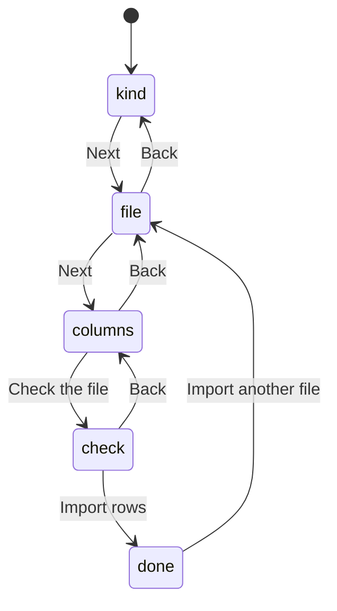
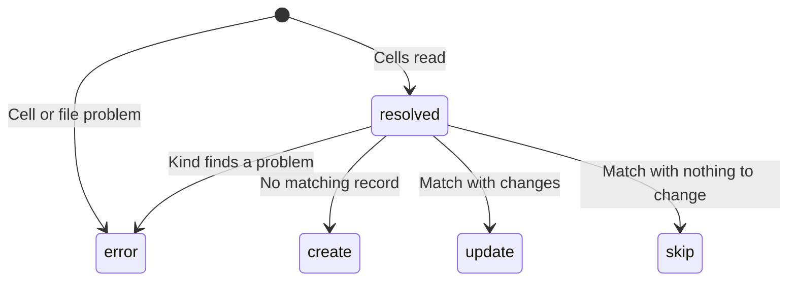
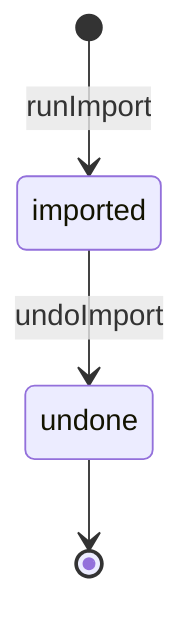

# Import

Written from the demo code, 2026-11-10.

## Purpose

Import brings a company's existing records over from CSV or Excel, so it can start without retyping them.

There are nine kinds: customers, customer addresses, suppliers, products, rolls and stock, open customer invoices, open supplier bills, employees and timesheets. Every row is checked before anything is written. A second import of the same file updates records rather than duplicating them. Each import can be undone while its records are unchanged.

Connect a database is a separate screen. It is simulated and stores nothing.

The rules live in `packages/shared/src/import/`. The store actions are in `apps/web/src/lib/api/demo/import-actions.ts`. The screens are in `apps/web/src/features/import/`.

## Who uses it

| Action | Permission key | Default roles | Enforced in |
| --- | --- | --- | --- |
| Open Data import or Connect a database in Settings | `settings.import.manage` | Owner | `SETTINGS_MENU`, `PageGate`, `SettingsImportPage`, `SettingsDatabasePage` |
| Overview, dry run, import, Undo, save mapping, connection test | `settings.import.manage` | Owner | `DemoStore.importScope` in `apps/web/src/lib/api/demo/store.ts` |
| The same actions for any company | None. Needs the platform session | Platform admin | `AdminLayout` in `apps/web/src/app/admin/layout.tsx`, and the `this.viewer` branch of `importScope` |
| Upload own hours from the portal | `hr.timesheet.edit` | Every default role | `uploadTimesheets` in `apps/web/src/lib/api/demo/timesheet-actions.ts` |
| Upload hours for others | `hr.timesheet.approve` | Owner, Manager, HR manager | `uploadTimesheets` |

A company user may import only into the open company. `importScope` throws `You can import only into your own company.` The platform pages call `closeCompany` first, so `this.viewer` is null there and the actor is `Platform admin`.

Which kinds a company sees depends on its modules. `importKindsFor` in `packages/shared/src/import/kinds/index.ts` filters on each kind's `module`.

| Kind | Label | Module | Matches on |
| --- | --- | --- | --- |
| `customers` | Customers | `core` | External ID, then email |
| `addresses` | Customer addresses | `core` | The customer's External ID, email or name, then street and ZIP |
| `suppliers` | Suppliers | `core` | External ID, then email, then name |
| `products` | Products | `core` | SKU |
| `stock` | Rolls and stock | `core` | Roll number, or SKU and warehouse |
| `invoices` | Open customer invoices | `core` | Invoice number |
| `bills` | Open supplier bills | `core` | Supplier and bill number |
| `employees` | Employees | `hr` | Email, then External ID |
| `timesheets` | Timesheets | `hr` | Email, then External ID, and the work date |

Harbor Staffing has no `core` module, so it sees only employees and timesheets.

## Workflows and status rules

### Wizard steps

`WIZARD_STEPS` in `apps/web/src/features/import/import-steps.tsx`. `ImportWizard` in `import-wizard.tsx` holds the step.



1. **What to import.** `KindStep` offers the kinds the company has.
2. **File.** `FileStep` offers a template in CSV or Excel, then takes a file. `parseImportFile` reads it in a Web Worker (`parse.worker.ts`).
3. **Columns.** `autoMap` fills the mapping. `mappingProblems` blocks Next while a required field has no column or a column is used twice. "Remember these columns" is on by default.
4. **Check.** `previewImport` runs the dry run. Nothing is written. `CheckStep` shows `dryRunSummary`, the counts per action and the first 50 rows. "Only rows with errors" starts on when there are errors.
5. **Import.** `runImport` plans again against the current records, writes the valid rows and keeps the batch. If "Remember" is on, `saveImportMapping` follows. `DoneStep` shows the counts and offers the error report.

The Import button is disabled when no row would create or update. Changing the mapping clears the dry run.

### Row action

`RowAction` in `packages/shared/src/import/types.ts`. Decided per row by `planImport` in `packages/shared/src/import/plan.ts` and the kind's `resolve`.



Blank rows are dropped before planning. A row with an error is left out and the rest continue.

### Import batch

The state is derived from `undoneAt` in `ImportBatch`.



`undoImport` in `import-actions.ts` refuses a batch already undone, with `${batch.number} was already undone.`

## Business rules

1. **File limits.** `MAX_IMPORT_BYTES` in `packages/shared/src/import/files.ts` is `10 * 1024 * 1024`. `MAX_IMPORT_ROWS` in `plan.ts` is `2000`, checked by `checkRequest` in `import-actions.ts`. Accepted extensions are `.csv`, `.txt`, `.xlsx` and `.xls` (`parse` in `parse.worker.ts`). Only the first sheet of a workbook is read.

2. **Headers.** `headersOf` in `parse.worker.ts` trims each header. A blank one becomes `Column N`. A repeated one gets a number such as `Name (2)`. Each row is made as wide as the header.

3. **Column matching.** `autoMap` in `packages/shared/src/import/mapping.ts`. A saved mapping wins when its header is in this file. Otherwise a header matches a field's key, label or alias after reduction to letters and digits. Each header feeds one field at most.

4. **Request check.** `checkRequest` in `import-actions.ts` runs on every dry run and import. The kind must be one the company has, the mapping must have no problems, and the row limit applies.

5. **Cell reading.** `readCell` in `packages/shared/src/import/fields.ts`. An empty cell is null, or an error when the field is required.

   | Type | Accepted | Refused |
   | --- | --- | --- |
   | `text` | Any text, trimmed | |
   | `email` | `^[^\s@]+@[^\s@]+\.[^\s@]+$`, stored lower case | Anything else |
   | `money` | Optional `$`, commas and spaces, at most two decimals, stored by `moneyString` | Negative, or more than two decimals |
   | `number` | Digits, optionally followed by the field's unit | Another unit |
   | `integer` | As `number`, whole only | A fraction |
   | `date` | `2026-03-15`, `3/15/2026`, `3/15/26`, must be a real date, stored `YYYY-MM-DD` | Anything else |
   | `bool` | `yes`, `y`, `true`, `1`, `x`, or `no`, `n`, `false`, `0` | Anything else |
   | `choice` | The label or the stored value, ignoring case, spaces, dashes and underscores | Any other value |
   | `list` | Choices separated by `;` or `\|`, repeats removed | One unknown value fails the cell |

   Unit spellings are `ft`, `feet`, `foot`, `'` for feet, and `sq ft`, `sqft`, `sf`, `ft2`, `ft²` for square feet.

6. **Planning.** `planImport` in `plan.ts`. Rows are read, repeats within the file are flagged, then each kind resolves its row. Rows run in file order on a working copy, so later rows see earlier ones. A repeat reports `Repeats row N; each record once per file.`

   ```ts
   const key = problems.length === 0 ? handler.duplicateKey(values) : null;
   ```

7. **Update means given cells only.** `patched` in `packages/shared/src/import/lookup.ts` drops null values and returns null when nothing would change. An empty cell never clears a field. The kinds that build the record whole (`invoices`, `bills`) compare the result with the existing record instead.

8. **Finding a party.** `findParty` in `lookup.ts` tries External ID, then email, then exact name, all with `fold`. Addresses, products, invoices, bills and an employee's manager use it. The customers, employees and timesheets kinds use their own match. Suppliers pass a single key, `text(row, "external_id") || text(row, "email") || name`.

9. **sq yd and cartons (plan A-2).** `pricePerSellUnit` in `packages/shared/src/import/kinds/products.ts`. A file may use `sq_yd` or `carton`, and the product is stored in `sq_ft`. Price and cost convert the same way.

   ```ts
   if (unit === "sq_yd") return dec(price).dividedBy(SQ_FT_PER_SQ_YD).toDecimalPlaces(4).toString();
   if (unit === "carton" && coverage) return dec(price).dividedBy(coverage).toDecimalPlaces(4).toString();
   return price;
   ```

   `SQ_FT_PER_SQ_YD` is 9 in `packages/shared/src/units.ts`. Quantities are not converted. Stock counts are in sq ft or items, roll lengths in ft.

10. **Boxed stock is a count.** `resolveBoxed` in `kinds/stock.ts` writes one movement for the difference, so on hand stays the sum of the ledger, and a second import of the same count changes nothing.

    ```ts
    const before = boxedOnHand(ctx.world.stockMovements, product.id, warehouse.id);
    const change = dec(counted).minus(before);
    ```

    The movement's `kind` is `opening` when `before` is zero, otherwise `adjustment`. Its source is `{ kind: "count", id: ctx.batch.id, number: ctx.batch.number }`.

11. **Rolls.** `resolveRoll` in `kinds/stock.ts`. A new roll number adds the roll at its full length. An existing roll changes only `bin` and `dyeLot`.

    ```ts
    costPerSqFt: text(row, "cost_per_sq_ft") || roundUnitCost(dec(product.cost)).toString(),
    widthFt: row.width_ft ? Number(row.width_ft) : (product.widthFt ?? 12),
    ```

    `stockUnit` in `packages/shared/src/stock.ts` decides the path: `ft` for carpet with a width, `sq_ft` for a product with coverage, `each` for adhesives and trims, null for anything else.

12. **Opening invoices.** `openingInvoice` in `kinds/opening.ts` builds one untaxed line described `Opening balance from the previous system`. `subtotal` and `total` equal the balance. `tax` and `cost` are `0.00`. `sentAt` is `${on.issued}T09:00`. The warehouse is the company default. The due date is the file's, else `dueDate(on.issued, customer.terms)`.

13. **Opening bills.** `resolveBill` in `kinds/opening.ts`. `poId` is null, `receiptIds` and `matchIssues` are empty. The due date is the file's, else `supplierDueDate(on.issued, supplier.terms)`.

14. **Opening PTO balance.** `balanceWrite` in `kinds/employees.ts` posts one `adjustment` entry for the difference on the first policy with `kind === "vacation"`, noted `Imported opening balance`. It does nothing when the balance already matches.

    ```ts
    const change = dec(row.pto_hours as string).minus(timeOffBalance(ctx.world.timeOffEntries, employeeId, policy.id));
    ```

15. **Timesheet week.** `resolveTimesheet` in `kinds/timesheets.ts` files a day into its week with `workweekStartOf(date, ctx.workweekStartDay)`. A blank `Hours worked` skips the day. A zero overwrites it. Hours must be between 0 and 24.

16. **Writing.** `runImport` in `import-actions.ts` numbers the batch with `nextNumber("IMP-", numbers, 1001)`, so the first is `IMP-1001`. It throws `Nothing to import: every row is skipped or has errors.` when no row would create or update. Each change is written with `db.put`.

17. **Undo.** `undoImport` and `undoProblem` in `import-actions.ts`. Records the import created are removed, and records it updated go back to the saved version. Undo is refused in two cases:

    - Any record differs from what the import wrote, compared with `JSON.stringify`.
    - A created record's id appears in another record of a collection in `REFERRING`.

    `REFERRING` is `customers`, `products`, `rolls`, `stockMovements`, `quotes`, `invoices`, `payments`, `invoiceAdjustments`, `refunds`, `reservations`, `stockAdjustments`, `transfers`, `purchaseOrders`, `receipts`, `bills`, `supplierPayments`, `jobs`, `meetings`, `employees`, `timesheets`, `ptoRequests`.

18. **Error report.** `errorTable` in `files.ts` has one line per problem, with the columns `Row`, `Column`, `Value`, `Problem`. Row numbers count the header as row 1. `DoneStep` saves it as `${batch.number}-errors.csv`.

19. **Template.** `templateTable` in `files.ts` writes the column labels, marks required ones with ` *`, then two example rows.

20. **Bulk timesheet upload.** `uploadTimesheets` in `timesheet-actions.ts` reuses the `timesheets` handler outside the wizard. `TIMESHEET_MAPPING` maps each field to a header of the same name. With `own`, `onlyEmployeeId` refuses anyone else's row. It keeps no batch, so it has no Undo.

### Validation by kind

Beyond the cell types above.

| Kind | Check | Message |
| --- | --- | --- |
| `customers` | External ID or email is needed | `Give an External ID or an Email, so a second import updates the customer.` |
| `customers` | Sales rep must be a user, by email or name | `No user matches “...”.` |
| `customers`, `suppliers`, `addresses` | Street, city, state and ZIP come together or not at all | `Give street, city, state and ZIP together, or leave all four empty.` |
| `customers`, `suppliers`, `addresses` | ZIP matches `^\d{5}(-\d{4})?$` | `“...” is not a US ZIP code.` |
| `addresses` | Customer must exist | `No customer matches “...”. Use their External ID, email or exact name.` |
| `products` | Supplier must exist | `No supplier matches “...”. Import suppliers first.` |
| `products` | Unit `carton` needs coverage, except adhesives and trims | `Products sold by the carton need the sq ft per carton.` |
| `products` | Carpet needs a width | `Broadloom carpet needs its roll width in ft.` |
| `stock` | SKU must exist | `No product with SKU “...”. Import products first.` |
| `stock` | Warehouse must exist | `No warehouse named “...”.` |
| `stock` | Showrooms hold no stock | `... is a showroom; showrooms hold no sellable stock.` |
| `stock` | Product must be stocked | `... is not a stocked product.` |
| `stock` | A roll product needs a roll number | `... is sold off the roll; give the roll number.` |
| `stock` | A roll number belongs to one product | `Roll ... is another product's roll.` |
| `stock` | A new roll needs a length above zero | `Give the roll's length in ft.` |
| `stock` | Boxed goods need a count | `Give the sq ft on hand.` or `Give the items on hand.` |
| `invoices`, `bills` | Customer or supplier must exist | `No customer matches “...”. Import customers first.` and the supplier form |
| `invoices`, `bills` | Issue date not in the future | `The issue date is in the future.` |
| `invoices`, `bills` | Balance above zero | `An open balance is more than zero.` |
| `employees` | Manager must be an employee | `No employee matches “...”.` |
| `timesheets` | Email or External ID is needed | `Give the employee's email or external ID.` |
| `timesheets` | Employee must exist | `No employee matches this row.` |
| `timesheets` | Not a terminated employee | `... is no longer active.` |
| `timesheets` | Not a 1099 worker | `Contractors do not use timesheets.` |
| `timesheets` | Week not approved | `This week is already approved.` |
| `timesheets` | Own rows in a portal upload | `You can only upload your own hours.` |

### Rows left alone

| Kind | Case | Note |
| --- | --- | --- |
| `customers`, `suppliers`, `employees`, `products`, `invoices`, `bills` | Nothing would change | `Nothing changed.` |
| `addresses` | Already there | `Already on file.` |
| `stock` | Boxed count already matches | `Already ... on hand.` |
| `stock` | Roll has nothing to change | `Already in stock.` |
| `invoices` | Made in the app | `Made in the app; change it on the invoice.` |
| `invoices` | Has payments or credits | `Has payments or credits; change it on the invoice.` |
| `bills` | Entered from a purchase order | `Entered from a purchase order; change it there.` |
| `bills` | Has supplier payments | `Has supplier payments.` |
| `timesheets` | Blank hours | `Blank hours leave the day alone.` |
| `timesheets` | Same hours | `Already these hours.` |

### Connect a database

`ConnectDatabase` in `apps/web/src/features/import/connect-database.tsx` and `sampleDatabase` in `apps/web/src/lib/api/demo/sample-database.ts`.

- The form takes engine (`sqlserver`, `mysql`, `postgres`), host, port, database, read-only user, password and Require SSL.
- `testDatabaseConnection` needs the same access as import. It checks that host, database and user are given and that the port is a whole number from 1 to 65535.
- It answers with five invented tables: `customers`, `items`, `vendors`, `open_invoices` and `audit_trail`. Table names follow the chosen engine. Each table suggests an import kind, or none.
- Nothing connects and nothing is stored. The password is not part of `DatabaseTestInput`, and the form clears it after the test.
- The table choices and the schedule (one-time or nightly) are screen state only. There is no save.
- A banner says live connections run on the server in the full product. The real design is in `docs/specs/data-integration.md`.

## Entities and fields

### ImportBatch

Collection `importBatches`. Type in `packages/shared/src/import/types.ts`.

| Field | Type | Notes |
| --- | --- | --- |
| `id` | string | |
| `number` | string | `IMP-1001` upward |
| `kind` | `ImportKind` | |
| `fileName` | string | |
| `at` | string | Timestamp |
| `byName` | string | Importer's name, or `Platform admin` |
| `mapping` | `ColumnMapping` | Field key to header, or null |
| `counts` | `ImportCounts` | `create`, `update`, `skip`, `error` |
| `changes` | `ImportChange[]` | `collection`, `id`, `before`, `after` |
| `undoneAt`, `undoneBy` | string or null | |

### ImportMapping

`importMappings`. One per kind per company, with id `${companyId}-map-${kind}`.

| Field | Type | Notes |
| --- | --- | --- |
| `id` | string | |
| `kind` | `ImportKind` | |
| `columns` | `ColumnMapping` | |
| `savedAt` | string | Who saved the columns is in the audit log ("Saved import columns"), not on the record. |

### PlannedRow

Returned by the dry run and the import. Not stored.

| Field | Type | Notes |
| --- | --- | --- |
| `line` | number | Row in the file, header is row 1 |
| `action` | `create`, `update`, `skip`, `error` | |
| `label` | string | The kind's `labelField`, or `Row N` |
| `cells` | `Record<string, string>` | As typed |
| `problems` | `CellProblem[]` | `field` is null for a whole-row problem |
| `note` | string or null | Why skipped, or what an update leaves alone |

### Collections an import writes

`ImportCollection`: `customers`, `suppliers`, `supplierContacts`, `products`, `rolls`, `stockMovements`, `invoices`, `bills`, `employees`, `timesheets`, `timeOffEntries`.

### Columns by kind

Field definitions are in `packages/shared/src/import/kinds/`. Aliases are other headers that auto-match.

**Customers** (`kinds/customers.ts`). Duplicate key: `external_id|email`.

| Field | Type | Notes |
| --- | --- | --- |
| `external_id` External ID | text | Aliases: id, customer id, account number, customer number |
| `name` Name | text | Required. Aliases: customer, customer name, account name, company |
| `type` Type | choice | Homeowner, Dealer, Contractor. New default homeowner. Alias: customer type |
| `contact_name` Contact | text | New default is the name. Aliases: contact name, contact person |
| `email` Email | email | Aliases: email address, e mail |
| `phone` Phone | text | Aliases: phone number, telephone, tel |
| `terms` Payment terms | choice | Due on receipt, Net 15, Net 30, Net 45. New default `due_on_receipt`. Alias: terms |
| `credit_limit` Credit limit | money | New default `0.00`. Alias: credit |
| `sales_rep` Sales rep | text | A user's email or name. New default is the importer, or for the platform admin the first active user. Aliases: rep, salesperson, sales person |
| `street`, `city`, `state`, `zip` | text, text, choice, text | Optional. Added as a `billing` address when not already there |

**Customer addresses** (`kinds/customers.ts`). Duplicate key: `customer|street|zip`.

| Field | Type | Notes |
| --- | --- | --- |
| `customer` Customer | text | Required. External ID, email or exact name. Aliases: customer id, customer email, account, external id |
| `label` Address type | choice | Home, Billing, Job site, Delivery. Default `job_site`. Aliases: type, kind, label |
| `street`, `city`, `state`, `zip` | text, text, choice, text | Required |
| `default` Default | bool | Makes it the default billing or job-site address. Aliases: is default, primary |

**Suppliers** (`kinds/suppliers.ts`). Duplicate key: External ID, else email, else name.

| Field | Type | Notes |
| --- | --- | --- |
| `external_id` External ID | text | Aliases: id, supplier id, vendor id, vendor number |
| `type` Type | choice | Goods, Services, Utility, Government. New default goods. Aliases: vendor type, supplier type |
| `account_number` Account number | text | Aliases: account, account no, our account |
| `name` Name | text | Required. Aliases: supplier, supplier name, vendor, vendor name |
| `contact_name` Contact | text | New supplier only. Creates a primary `sales_rep` contact with the supplier's phone and email. Aliases: contact name, rep |
| `email` Email | email | Alias: email address |
| `phone` Phone | text | Aliases: phone number, telephone |
| `terms` Terms | choice | Pay on order, Cash on delivery, Net 30, Net 60, Net 90, Net 180, Monthly statement. New default `net_30`. Alias: payment terms |
| `credit_limit` Credit limit | money | New default `0.00`. Alias: credit |
| `categories` Categories | list | Product categories. Aliases: category, product categories |
| `street`, `city`, `state`, `zip` | text, text, choice, text | Optional |

A new supplier is `active`, `track1099` false, `taxForm` null. No tax ID is imported.

**Products** (`kinds/products.ts`). Duplicate key: SKU, lower case.

| Field | Type | Notes |
| --- | --- | --- |
| `sku` SKU | text | Required. Aliases: item, item number, product code, code, part number |
| `name` Name | text | Required. Aliases: product, product name, description |
| `brand` Brand | text | Aliases: manufacturer, make |
| `collection` Collection | text | Aliases: series, line |
| `color` Color | text | Aliases: color name, colour |
| `category` Category | choice | Required. `CATEGORY_LABELS`. Aliases: product category, type |
| `unit` Selling unit | choice | Required. sq ft, each, steps, ft, h, sq yd, cartons. Aliases: unit, uom, unit of measure |
| `price` Price | money | Required. Converted by rule 9. Aliases: sell price, unit price, retail price |
| `cost` Cost | money | Required. Converted by rule 9. Aliases: unit cost, cost price |
| `sq_ft_per_carton` Sq ft per carton | number, unit sq ft | Aliases: coverage, sq ft per box, sqft per carton |
| `width_ft` Roll width (ft) | number, unit ft | Aliases: width, roll width |
| `reorder_point` Reorder point | integer | Aliases: reorder, min stock |
| `supplier` Supplier | text | Required. Aliases: vendor, supplier name, supplier id |

A new product takes the swatch `#A39A8E` and empty `attributes`.

**Rolls and stock** (`kinds/stock.ts`). Duplicate key: `roll:<number>`, else `<sku>@<warehouse>`.

| Field | Type | Notes |
| --- | --- | --- |
| `sku` SKU | text | Required. Aliases: item, product code |
| `warehouse` Warehouse | text | Required. Location name. Aliases: location, site |
| `quantity` On hand | integer | Boxed goods. Aliases: quantity, qty, count, on hand |
| `roll_number` Roll number | text | Roll goods. Aliases: roll, roll no, roll id |
| `length_ft` Length (ft) | number, unit ft | New rolls. Aliases: length, roll length |
| `width_ft` Width (ft) | number, unit ft | Alias: width |
| `dye_lot` Dye lot | text | Aliases: lot, dye lot number |
| `bin` Bin | text | Aliases: bin location, rack |
| `cost_per_sq_ft` Cost per sq ft | number | Aliases: roll cost, cost |

**Open customer invoices** (`kinds/opening.ts`). Duplicate key: invoice number.

| Field | Type | Notes |
| --- | --- | --- |
| `number` Invoice number | text | Required. Aliases: invoice, invoice no, invoice #, inv |
| `customer` Customer | text | Required. Aliases: customer id, customer email, account |
| `issued` Issue date | date | Required. Aliases: date, invoice date, issue date |
| `due` Due date | date | Aliases: due, due on |
| `balance` Open balance | money | Required. Aliases: balance, amount due, balance due, open amount, amount |

**Open supplier bills** (`kinds/opening.ts`). Duplicate key: `supplier|number`.

| Field | Type | Notes |
| --- | --- | --- |
| `number` Bill number | text | Required. Aliases: bill, bill no, supplier invoice, vendor invoice |
| `supplier` Supplier | text | Required. Aliases: vendor, supplier name, supplier id |
| `issued` Issue date | date | Required. Aliases: date, bill date, issue date |
| `due` Due date | date | Aliases: due, due on |
| `balance` Open balance | money | Required. Aliases as for invoices |

**Employees** (`kinds/employees.ts`). Duplicate key: email.

| Field | Type | Notes |
| --- | --- | --- |
| `external_id` External ID | text | Aliases: id, employee id, employee number |
| `name` Name | text | Required. Aliases: employee, full name, employee name |
| `email` Email | email | Required. Aliases: work email, email address |
| `title` Title | text | Aliases: job title, position |
| `department` Department | text | Aliases: dept, team |
| `worker_type` Worker type | choice | W-2 employee, 1099 contractor. New default `w2`. Aliases: classification, w2 or 1099 |
| `pay_type` Pay type | choice | Hourly, Salary, Per job. New default `hourly`. Alias: pay basis |
| `pay_rate` Pay rate | money | Required. Aliases: rate, wage, salary, hourly rate |
| `state` Work state | choice | Required. Aliases: state, work state |
| `phone` Phone | text | Aliases: phone number, mobile |
| `hired_at` Hire date | date | New default today. Aliases: hired, start date, date hired |
| `status` Status | choice | Active, On leave, Terminated. New default `active`. Alias: employment status |
| `pto_hours` PTO balance (hours) | number | Rule 14. Aliases: pto, pto balance, vacation hours |
| `manager` Manager | text | Must be an employee, or earlier in the file. Aliases: manager email, reports to, supervisor |

`flsaStatus` is set on creation: `not_applicable` for a 1099 worker, otherwise `non_exempt`. `salaryHoursPerWeek` is 40.

**Timesheets** (`kinds/timesheets.ts`). One row per employee per day. Duplicate key: `email or external id|work_date`.

| Field | Type | Notes |
| --- | --- | --- |
| `employee_email` Employee email | text | Aliases: email, employee, work email |
| `employee_external_id` External ID | text | Aliases: external id, employee id |
| `employee_name` Employee name | text | Not used for matching. Alias: name |
| `work_date` Work date | date | Required. Aliases: date, day |
| `hours_worked` Hours worked | number | Aliases: hours, hours worked |
| `note` Note | text | Read but not stored. Alias: comment |

A new sheet starts as `draft` with `source: "upload"`.

## Events and audit entries

**Notification events.** None. No import action calls a notify function.

**Audit entries.** All in category `data`.

| Action | Target | Before | After | Trigger | Where |
| --- | --- | --- | --- | --- | --- |
| `Imported customers` | `${number}, ${fileName}` | None | Counts text | `runImport`, kind `customers` | `import-actions.ts` |
| `Imported customer addresses` | as above | None | Counts text | Kind `addresses` | `import-actions.ts` |
| `Imported suppliers` | as above | None | Counts text | Kind `suppliers` | `import-actions.ts` |
| `Imported products` | as above | None | Counts text | Kind `products` | `import-actions.ts` |
| `Imported rolls and stock` | as above | None | Counts text | Kind `stock` | `import-actions.ts` |
| `Imported open customer invoices` | as above | None | Counts text | Kind `invoices` | `import-actions.ts` |
| `Imported open supplier bills` | as above | None | Counts text | Kind `bills` | `import-actions.ts` |
| `Imported employees` | as above | None | Counts text | Kind `employees` | `import-actions.ts` |
| `Imported timesheets` | as above | None | Counts text | Kind `timesheets` | `import-actions.ts` |
| `Undid import` | `${number}, ${fileName}` | Counts text | `records put back as before the import` | `undoImport` | `import-actions.ts` |
| `Uploaded timesheet hours` | File name | None | `N days` | `uploadTimesheets` with `apply` | `timesheet-actions.ts` |

Counts text is `${c.create} created, ${c.update} updated, ${c.skip} skipped, ${c.error} with errors`. Saving a mapping and running a dry run write no audit entry. Neither does a connection test.

When the platform admin imports, the actor is `Platform admin` with role `Super-admin` (`appendAudit` in `store.ts`).

## Emails

None.

## Reports

The error report in rule 18, and the import history in `ImportHistory` (`apps/web/src/features/import/import-history.tsx`): number, kind, file, when, by whom, result, and Undo. Templates are generated files, not reports.

## Edge cases and known limits

- **Undo does not look at every collection.** `REFERRING` leaves out `contracts`, `expenses`, `contractLines`, `commissionPlans`, `commissionStatements`, `supplierContacts` and others. A contract for an imported customer does not block Undo.
- **The reference check is a text search.** It looks for the record's id in quotes inside the JSON of the other records.
- **A dry run can touch the in-memory contact list.** `workingCopy` in `plan.ts` copies every writable collection except `supplierContacts`, and `applyWrite` pushes onto the array `CompanyDb.list` keeps in its cache. A preview of new suppliers with contacts leaves those contacts in the cache until the next write to that collection. They are not saved and point at supplier ids that do not exist.
- **Whole numbers only for boxed stock.** `quantity` is `integer`, so a carton product's real area, such as 236.4 sq ft, is refused. The import does not check that a count is a whole number of cartons.
- **A count may go below what is reserved.** `ImportWorld.reservations` is passed in, but no kind reads it.
- **A carton price can stay per carton.** With unit `carton`, category adhesives and trims, and no coverage, the product is stored as `sq_ft` with the price unchanged.
- **Prices may carry four decimals.** A converted price is cut to 4 places. Seeded prices are in cents per sq ft (plan K-2).
- **An External ID that matches nothing makes a new supplier,** even when the name or email matches one. `resolveSupplier` tries only the first non-empty key.
- **A new contact is not added to an existing supplier.** `contact_name` is used only on creation.
- **Worker type changes do not change `flsaStatus`.** It is set only on creation.
- **`pto_hours` is ignored without a vacation policy.** There is no message.
- **Submitted timesheets can be overwritten.** Only `approved` weeks are refused, and no entry is added to `history`.
- **Pay rate is visible in the import flow.** The comment on `resolveEmployee` says it is shown only with `hr.employee.view_sensitive`. The wizard has no such check, so the preview shows the cells from the file to anyone with `settings.import.manage`.
- **Tax exemption and certificates are not imported.** A new customer has `taxExempt` false and `certificate` null.
- **Opening invoices have zero cost.** Their margin is the whole balance wherever margin is computed.
- **The error report appears only after an import.** The check step shows the problems on screen but has no download.
- **Demo limits.** 10 MB, 2,000 rows and the first sheet only, because the overlay lives in browser storage. Batches keep every before and after version, so large imports can reach the storage quota. `writeStored` ignores that error and the change then lives in memory only.
- **Connect a database is simulated.** No connection, no stored host or credentials, no worker.
- **Nine kinds, not eight.** ADR 0019 and `docs/FEATURES.md` list eight. `timesheets` was added in batch 3.

## Real build (ADR 0057)

Part 1 of the import is on the API, built overnight on `feat/import-api` (PR #41) under the owner's rule: this spec is the approved behaviour, and the build differs from it only in the safer direction. Each difference is listed below, in ADR 0057 and in the 2026-11-16 import row of docs/blueprint-delta.md.

- **Routes:** `GET /imports`, `POST /imports/check` (the dry run), `POST /imports`, `POST /imports/:id/undo` and `PUT /imports/mappings/:kind`; see docs/api-contract.md, "Data import, part 1 (real build, ADR 0057)". In api mode the wizard and the history read and write only through `importOverview`, `previewImport`, `runImport`, `undoImport` and `saveImportMapping`. `testDatabaseConnection` stays simulated.
- **What runs on the API:** customers, customer addresses, suppliers (with the new contact) and products: dry run, import, history, Undo and saved columns. The other five kinds answer 404 there; the demo keeps all nine.
- **One plan:** the API and the demo run the same shared `planImport` and kinds, with the access, limit, lookup and Undo rules beside them in `packages/shared/src/import/` (`access.ts`, `limits.ts`, `lookups.ts`, `canonical.ts`, `undo.ts`). The browser parses the file as before (rules 1 and 2); only the chosen columns travel, and the server reads every cell again.
- **The demo** follows the same rules and words since this build. The text above describes the demo as written on 2026-11-10; where this section differs, this section is what both modes do, except where it says "on the API".

### Who uses it, as built

| Action | Needs |
| --- | --- |
| Open Data import, the dry run | `settings.import.manage`, data scope `all`, and every key of the kind: customers `customers.customer.view`, `.create`, `.edit`; addresses `customers.customer.view`, `.edit`; suppliers `purchasing.supplier.view`, `.create`, `.edit`; products `inventory.product.view`, `.create`, `.edit`, `.view_sensitive`, `purchasing.supplier.view` |
| A Credit limit column | Also `customers.customer.view_sensitive`; for suppliers, also `inventory.product.view_sensitive` or `purchasing.bill.view` |
| Import, Undo | The same, plus a step-up (the authenticator code) |
| Save columns | `settings.import.manage` and the kind open to the person |

With the default roles only the Owner imports. The later parts' kinds need their own keys in the demo (stock `inventory.product.view` and `inventory.stock.correct`; invoices `customers.customer.view` and `sales.invoice.create`; bills `purchasing.supplier.view` and `purchasing.bill.create`; employees `hr.employee.view`, `.create`, `.edit` and `.view_sensitive`; timesheets `hr.employee.view` and `hr.timesheet.approve`). A kind whose records' switch is off (`sales.customers`, `purchasing.suppliers`, `inventory.products`, …) is hidden and refused. The platform admin's import into another company stays demo only; in api mode `/admin/companies/*/import` is "not found".

### Safer than this spec
1. **S-1. Part 1 only on the API:** customers, addresses, suppliers and products. Stock, open invoices and bills, employees and timesheets wait for later parts (below).
2. **S-2. Company-wide data scope** (rule 4, "Who uses it"). Rows are matched against every record, and a row may set another person as sales rep. Anyone else gets "Importing needs company-wide data scope, because rows are matched against every record."
3. **S-3. The kind's own keys** on top of `settings.import.manage` (rule 4, "Who uses it"): "Your role can't see, add and change customers, so it can't import them." The overview offers only the kinds the person may import.
4. **S-4. Sensitive columns:** a chosen Credit limit or Cost needs the key that shows it: "Your role can't see credit limit, so leave the Credit limit column out." Undo checks the batch's columns too.
5. **S-5. Stock history freezes a product's valuation** (rule 9, the products table): once a product has any stock movement or any roll, deleted rolls and stock in transit included, an import can't change its cost, category, selling unit, coverage or roll width, and Undo can't put them back.
6. **S-6. Retired SKUs:** a SKU held by a deleted product, an undone import's included, is a row error ("SKU “…” belonged to a deleted product. Use another SKU."), because the SKU index covers deleted rows.
7. **S-7. Step-up** for the import and Undo (rules 16 and 17).
8. **S-8. Active members only** as a customer's sales rep (the customers table).
9. **S-9. The strictest terms:** a new supplier without Terms pays on order (the suppliers table said Net 30; Pay on order is the purchasing module's default). A new customer keeps Due on receipt, never the company's default terms.
10. **S-10. What you saw is what you get** (rule 16): the import sends the dry run's action per row and is refused, with nothing written, if any row would now do something else: "The records changed since you checked this file. Check it again before importing." All valid rows import together or none do.
11. **S-11. Re-imports skip** (rule 7): numbers compare as numbers ("3.40" against "3.4000"), a supplier's address by its four fields, categories as a set, records by content. When a supplier's four address fields differ, the four given replace the stored address and its county goes.
12. **S-12. Limits** (rules 1 and 5): 2,000 rows, 60 columns, cells of at most 1,000 characters, headers and file names of at most 200; each field's own length (customer and supplier names 200, External IDs 100, emails 320, phones 50, SKUs 64, product names 200, brand, collection and color 100); money at most 10 whole digits; coverage and roll width at most 10 whole digits and 3 decimals; reorder point whole; at most 50 addresses per customer; a request of at most 100 KB of chosen columns, refused by the browser before sending ("This file is too large to send in one go. Split it into smaller files and import them one by one."); one dry run, import or Undo at a time per company ("Another import or undo is running for this company. Try again when it finishes."); 50 imports per company in 24 hours ("Your company has imported 50 files in the last 24 hours. Try again later."). The browser's own 10 MB file limit stays.
13. **S-13. More audit** ("Events and audit entries"): on the API one entry per record created, updated, removed or restored ("Imported customer", "Updated customer by import", "Removed imported customer", "Restored customer after undoing an import"), each naming the batch, besides the batch entries above; saving columns writes "Saved import columns" in both modes. A dry run still writes none.
14. **S-14. Undo stays exact** (rule 17): on the API each record is compared with what its module reads now; references come from the database's foreign keys plus meeting guests, attachments, journal sources and outbox rows, counting live rows only; Undo is refused when a product's earlier supplier is gone ("Q's earlier supplier was removed, so the import cannot be undone."); created records are soft-deleted. The demo uses the same comparison and the product check, and keeps its text search.
15. **S-15. Nothing leaves that needn't:** the history and the answers never carry the saved versions (`changes`), `ImportMapping.savedBy` is gone, answers are never cached, the file is never stored, only its chosen columns travel, and the templates and the error report (rules 18 and 19) put a `'` before a cell that starts with `=`, `+`, `-`, `@`, a tab or a carriage return.
16. **S-16. Ambiguous keys are refused** (rules 6 and 8): an External ID, email, name or SKU that matches more than one record is a row error ("2 customers match “…”. …"), never the first one. Emails match exactly, ignoring case only; External IDs and names still fold.
17. **S-17. Hidden control characters are refused** (rule 5) in cells ("… has a hidden control character. Remove it and try again."), except tab and line breaks in a timesheet Note, and in headers, file names and column choices.
18. **S-18. Product rules** (rule 9, the products table, "Validation by kind"): sq ft per carton and roll width more than 0; cartons need coverage in every category, adhesives and trims included; carpet needs a width; a price or cost converted from sq yd or cartons must still fit the column; never negative; a supplier that matches exactly one record.
19. **S-19. Blank means blank in the chosen columns** ("Row action"): a row with nothing in any chosen column is left out as blank, in the wizard and in the timesheet upload.
20. **S-20. Sensitive columns are never chosen automatically** (rule 3) for someone who can't use them.

Also settled while building: Undo in the demo checks the import's access too; the demo hides kinds whose switch is off, for the platform admin as well; saved columns in the demo need the kind open and refuse unknown fields; `GET /imports` lists saved columns only for the kinds the person may import; if saving the columns fails after a good import, the wizard says "The import worked, but the columns were not saved." and still shows the result.

### Known limits this build closes
- **Undo does not look at every collection** and **The reference check is a text search:** closed on the API (S-14). The demo keeps its text search.
- **A dry run can touch the in-memory contact list:** closed; the working copy copies supplier contacts.
- **A carton price can stay per carton:** closed (S-18).
- **Pay rate is visible in the import flow:** closed. Employees need `hr.employee.view_sensitive` as a kind key in the demo, and part 2 keeps that rule on the API.

### Known limits kept
- An External ID that matches nothing makes a new supplier; a new contact is added only to a new supplier; tax exemption and certificates are not imported.
- The error report appears only after an import.
- The later parts' limits (boxed stock as whole numbers, counts below reservations, `flsaStatus`, PTO without a vacation policy, submitted timesheets, opening invoices at zero cost) stay in the demo until their parts.
- Connect a database is simulated.

### Later parts
2. **HR:** employees (with the PTO opening balance) and timesheets in the wizard, through HR's own save rules.
3. **Opening stock:** with an opening-balance journal entry.
4. **Open invoices and bills:** with opening events, never sales or cost of goods.
5. **The platform-admin path:** waits for support-grant use.
6. **Portal timesheet uploads:** already on the API.
7. **Connect a database:** waits for docs/specs/data-integration.md.
8. **Follow-ups:** partial SKU index, a larger body limit, `FOR SHARE` in module writers, a dry-run cap.

### Waiting for the owner
1. Add `settings.import.manage` to the keys that need MFA, or keep the step-up only (S-7)?
2. Raise the request limit from 100 KB to 1 MB (S-12)?
3. A partial unique SKU index (a migration), so an undone import frees its SKUs (S-6)?
4. Opening balances (parts 3 and 4): one entry per document or a summary; the equity account; the go-live date and period; an `opening` marker; reports and commissions; the review and sign-off (blueprint p54).
5. Opening stock only for products with no stock history?
6. May an employee import set pay rates, and should each person need an HR confirmation (part 2)?
7. Platform-admin imports through a support grant (part 5).
8. Approve docs/specs/data-integration.md before any connector.
9. Confirm S-2, S-3, S-5, S-9, the limits of S-12, S-16 (exact emails included) and S-19.
10. Close the Undo race: module writers take a share lock on the parent and re-check that it is live.
11. Formula escaping for every CSV export, including HR's timesheet templates and the pay-period export?
12. Accept size, linear planning and one at a time as the bound on dry runs?
13. Reorder point: a whole number (this spec) or sq ft for boxed goods (inventory.md), as Summit's data has?
