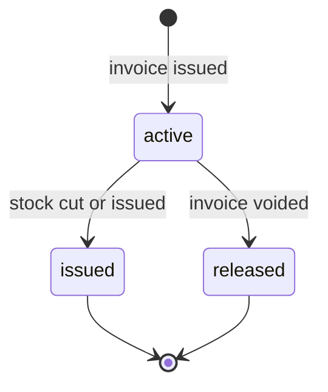
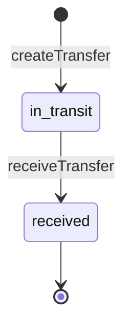
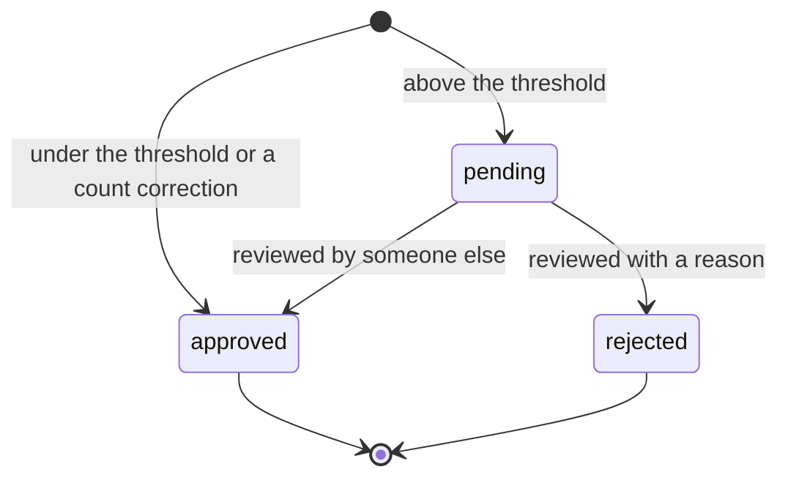
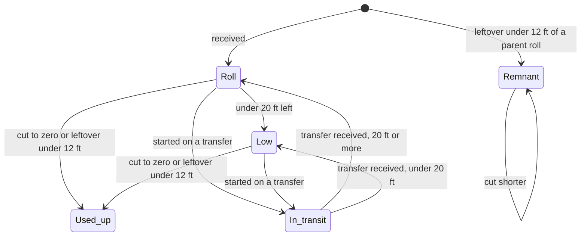

# Inventory

Written from the demo code, 2026-11-10.

## Purpose

Inventory says what a company has, where it is, and who it is promised to. It covers the product catalog, carpet rolls and remnants, boxed stock, warehouses and showrooms, transfers between warehouses, reservations made by invoices, and the cut or issue that takes stock out.

Every stock change has a source document: a receipt, an invoice, a transfer, a count or an import. There is no free editing of stock. `assertRollEditOnly` in `apps/web/src/lib/api/demo/permission-rules.ts` refuses a roll save that changes length, warehouse or cuts.

Area is stored in sq ft and length in ft (CLAUDE.md rule 4). The feature keys are `inventory.products`, `inventory.rolls`, `inventory.transfers`, `inventory.reservations`, `inventory.ready-to-cut`, `inventory.stock-correction`, `inventory.locations` and `units.square-feet`. `inventory.adjustments` is switched off, with status `removed`.

## Who uses it

Effective access is role permissions, intersected with the company ceiling and enabled modules. All keys below belong to the `core` module. `settings.locations.manage` also belongs to `core`, so the HR Suite has no warehouses page.

| Action | Permission key | Default roles | Enforced in |
| --- | --- | --- | --- |
| See products and product stock | `inventory.product.view` | Owner, Manager, Accountant, Sales, Purchasing, Warehouse | `inventory-page.tsx`, `apps/web/src/products/pages.ts` |
| See product cost and roll cost | `inventory.product.view_sensitive` | Owner, Manager, Accountant, Purchasing | Screens only, through `SENSITIVE.productCost`: `products-table.tsx`, `rolls-table.tsx`, `product-drawer.tsx`, `roll-page.tsx` |
| Create or edit a product | `inventory.product.create`, `inventory.product.edit` | Owner, Manager | `SAVE_PERMISSIONS.products` in `permission-rules.ts`. No screen calls it |
| Delete or export products | `inventory.product.delete`, `inventory.product.export` | Delete: Owner, Manager. Export: Owner, Manager, Accountant | Not checked by any store action or screen |
| See rolls and remnants | `inventory.roll.view` | Owner, Manager, Accountant, Sales, Purchasing, Warehouse | `inventory-page.tsx`, `roll-page.tsx`, `pages.ts` |
| See open reservations with invoice and customer | `inventory.roll.view` or `inventory.product.view` | As the two rows above | `listStockHolds` in `apps/web/src/lib/api/demo/inventory-actions.ts` |
| Cut or issue reserved stock, open Ready to cut | `inventory.roll.cut` | Owner, Manager, Warehouse | `issueReservation` in `inventory-actions.ts`, `inventory-page.tsx`, `pages.ts` |
| Cut or issue before payment, with a reason | `inventory.reservation.override` | Owner, Manager | `issueReservation` in `inventory-actions.ts` |
| Move a roll to another bin | `inventory.roll.edit` | Owner, Manager, Warehouse | `SAVE_PERMISSIONS.rolls` and `assertRollEditOnly` in `permission-rules.ts` |
| Correct stock count | `inventory.stock.correct` | Owner only. The Manager template filters it out in `packages/shared/src/permissions/roles.ts` | `correctStockCount` in `inventory-actions.ts`, `roll-page.tsx`, `product-drawer.tsx` |
| Record a stock adjustment (switched off) | `inventory.stock.adjust` | Owner, Manager | `recordAdjustment` in `inventory-actions.ts` |
| Approve a stock adjustment (switched off) | `inventory.stock.approve` | Owner, Manager | `reviewAdjustment` in `inventory-actions.ts` |
| See transfers | `inventory.transfer.view` | Owner, Manager, Purchasing, Warehouse | `inventory-page.tsx`, `pages.ts` |
| Start a transfer | `inventory.transfer.create` | Owner, Manager, Warehouse | `DemoStore.createTransfer` in `apps/web/src/lib/api/demo/store.ts` |
| Receive a transfer | `inventory.transfer.receive` | Owner, Manager, Warehouse | `DemoStore.receiveTransfer` in `store.ts` |
| Quick invoice from Cut roll | `sales.invoice.create` | Owner, Manager, Accountant, Sales | `createRollInvoice` in `inventory-actions.ts` |
| Manage warehouses, showrooms and stock rules | `settings.locations.manage` | Owner | `saveLocation` (`POST /locations`, `PUT /locations/:id` in api mode, ADR 0059 part 4a; `DemoStore.saveLocation` in `store.ts`), `SETTINGS_SECTIONS.inventory` in `packages/shared/src/settings/sections.ts` |

Data scope does not narrow any inventory collection. `FILTERS` in `apps/web/src/lib/api/demo/scope.ts` has no entry for products, rolls, stock movements, reservations, transfers or locations. Reservations are left out on purpose (audit U-03), so everyone who sees stock sees all holds.

`DemoStore.list` puts no permission check on these collections, because they are not in `PRIVATE_COLLECTIONS` in `store.ts`.

## Workflows and status rules

The normal path for stock:

1. Stock arrives on a goods receipt (see `purchasing.md`), an opening count or an import.
2. An invoice is issued and `reserveFor` holds what it needs.
3. A deposit or payment is confirmed, so `mayIssue` turns true and the hold appears in Ready to cut.
4. Warehouse staff cut the roll or issue the boxed goods with `issueReservation`.

Three screens lead to the cut or issue:

- Inventory, Ready to cut tab (`ready-to-cut.tsx`).
- Roll page, Cut roll dialog (`cut-roll-dialog.tsx`), with the modes For an invoice and New invoice. A third mode, Adjustment, is hidden while `inventory.adjustments` is off.
- Invoice page, Stock panel (`apps/web/src/features/invoices/invoice-stock.tsx`).

### Reservation.status



| Transition | Decided by | File |
| --- | --- | --- |
| Created as `active` | `reserveFor`, using `planReservations`. Called from `DemoStore.convertQuoteToInvoice` in `store.ts`, `createRollInvoice`, and the job invoice in `job-actions.ts` | `inventory-actions.ts`, `packages/shared/src/reservations.ts` |
| `active` to `issued` | `issueReservation` | `inventory-actions.ts` |
| `active` to `released` | `releaseFor`, called only by the void invoice action | `inventory-actions.ts`, `invoice-actions.ts` |

### Transfer.status



| Transition | Decided by | File |
| --- | --- | --- |
| Created as `in_transit` | `validateTransfer`, then `startTransfer` | `store.ts`, `packages/shared/src/operations/transfers.ts` |
| `in_transit` to `received` | `receiveTransfer` | `store.ts`, `operations/transfers.ts` |

A transfer cannot be cancelled. No action does it.

### StockAdjustment.status (feature switched off)



| Transition | Decided by | File |
| --- | --- | --- |
| Created as `approved` or `pending` | `recordAdjustment`, using `adjustmentNeedsApproval` | `inventory-actions.ts`, `reservations.ts` |
| Created as `approved` | `correctStockCount`, always | `inventory-actions.ts` |
| `pending` to `approved` or `rejected` | `reviewAdjustment` | `inventory-actions.ts` |

### Roll type (derived, nothing stored)

A roll has no status field. `rollType` in `apps/web/src/features/inventory/rolls-table.tsx` derives its label, in this order:



```ts
if (roll.transferId) return "In transit";
if (roll.isRemnant) return "Remnant";
if (left === 0) return "Used up";
return left < LOW_ROLL_FT ? "Low" : "Roll";
```

`LOW_ROLL_FT` is 20, in `apps/web/src/lib/attention.ts`. A remnant keeps the label Remnant even at zero length.

## Business rules

1. **What is stocked and in what unit.** `stockUnit` in `packages/shared/src/stock.ts`. Broadloom counts in ft of length, carton goods in sq ft, trims and adhesives as items. Anything else is not stocked.

   ```ts
   if (product.category === "carpet" && product.widthFt) return "ft";
   if (product.sqFtPerCarton) return "sq_ft";
   if (product.category === "adhesive_trim") return "each";
   return null;
   ```

2. **Square feet is the one area unit.** Prices and costs are per sq ft on area goods. Cartons are a hint only. `packages/shared/src/units.ts`:

   ```ts
   // cartonsForArea: partial cartons round up
   dec(areaSqFt).dividedBy(per).toDecimalPlaces(0, D.ROUND_CEIL).toNumber()
   // wholeCartonArea
   dec(cartonsForArea(areaSqFt, sqFtPerCarton)).times(sqFtPerCarton)
   // withWaste
   dec(areaSqFt).times(dec(100).plus(wastePct)).dividedBy(100)
   // quantityForArea: waste first, then whole cartons
   sqFtPerCarton ? wholeCartonArea(gross, sqFtPerCarton) : gross.toDecimalPlaces(2, D.ROUND_CEIL)
   ```

   500 sq ft at 23.64 sq ft per carton is 22 cartons, 520.08 sq ft.

3. **Typing cartons.** `parseAreaEntry` in `units.ts`. "500" is sq ft. "22c", "22 ctn" and "22 cartons" convert, and a fraction of a carton rounds up: `amount.ceil().times(sqFtPerCarton)`. `AreaQuantityInput` (`apps/web/src/components/quantity/area-quantity-input.tsx`) then stores `wholeCartonArea(parsed, pack)` for carton goods, so a typed sq ft figure also rounds up to whole cartons.

4. **Carton hint.** `CartonHint` (`apps/web/src/components/quantity/carton-hint.tsx`) prints "≈ 22 cartons (23.64 sq ft each)" from `cartonEquivalent`. With `units.square-feet` off, the hint and carton typing go and everything stays in sq ft.

5. **On hand.** `availability` in `reservations.ts`.

   - Boxed goods: the sum of `StockMovement.quantity` for the product, at one warehouse or across all (`boxedStock`, `boxedOnHand` in `stock.ts`). No stored figure exists.
   - Rolls: the sum of `remainingLengthFt` for rolls of the product with no `transferId`, at the warehouse if one is given. In-transit rolls are left out.

6. **Reserved and Available.** `reservedOnRoll`, `reservedBoxed`, `rollAvailable`, `availability` in `reservations.ts`. Only `active` reservations count.

   ```ts
   // rollAvailable
   maxDec(dec(roll.remainingLengthFt).minus(reservedOnRoll(roll.id, reservations)), 0)
   // availability
   { onHand, reserved, available: maxDec(onHand.minus(reserved), 0) }
   ```

7. **What a warehouse can promise on a quote.** `availableToSell` in `reservations.ts`. Boxed goods use `available`. Carpet is free length times width, in sq ft, across rolls at that warehouse with no `transferId`:

   ```ts
   .reduce((area, r) => area.plus(rollAvailable(r, stock.reservations).times(r.widthFt)), dec(0))
   ```

8. **Stock badges.** `stockStatus` in `reservations.ts`, used by `stockLevel` in `apps/web/src/features/inventory/stock.ts`. `rollCount` is passed as 1 for boxed goods.

   ```ts
   if (available.lte(0) || rollCount === 0) return "out";
   if (product.reorderPoint !== undefined && available.lte(product.reorderPoint)) return "low";
   return "ok";
   ```

9. **How much an invoice line needs.** `stockNeed` in `reservations.ts`, in the stock unit:

   ```ts
   if (unit === "ft") {
     if (line.unit === "ft") return dec(line.quantity);
     if (line.unit === "sq_ft" && product.widthFt) return dec(line.quantity).div(product.widthFt).toDecimalPlaces(2);
     return null;
   }
   return line.unit === "sq_ft" || line.unit === "each" ? dec(line.quantity) : null;
   ```

10. **Which warehouse a line ships from.** `lineWarehouse` in `reservations.ts`: `line.locationId ?? documentLocationId`.

11. **Reservation plan.** `planReservations` in `reservations.ts`. A shortage never blocks the invoice (plan C-1).

    - Boxed goods: hold `minDec(free, need)` at the line's warehouse. `shortBy` is `need.minus(quantity)`.
    - Carpet, one roll: the line's chosen roll if it has no `transferId` and enough free length. Otherwise the first result of `rollsForLength` at the line's warehouse. `shortBy` is `"0"`.
    - Carpet, several rolls: `rollsForLength(rolls, held, productId, fromId, dec("0.01"), chosen?.dyeLot).reverse()`, taking `minDec(rollAvailable(roll, held), left)` from each.
    - Anything left over is one more row with `rollId: null`, `quantity: "0"` and `shortBy` set to what is left.

    Reservations are made only when an invoice is issued. Each plan also counts holds it has just made.

12. **Roll picker.** `rollsForLength` in `reservations.ts`. Rolls of the product at the warehouse with no `transferId` and enough free length, the chosen dye lot first, then the shortest that fits:

    ```ts
    Number(b.dyeLot === dyeLot) - Number(a.dyeLot === dyeLot) ||
      rollAvailable(a, reservations).comparedTo(rollAvailable(b, reservations))
    ```

13. **When stock may leave.** `mayIssue` in `reservations.ts`. Confirmed money has come in, as a deposit, a part or the whole:

    ```ts
    dec(ledger.paid).gt(0) || ledger.state === "paid"
    ```

    Otherwise `issueReservation` needs a non-empty override reason and `inventory.reservation.override`. The store does not set a minimum length for that reason. The Cut roll dialog asks for at least 3 characters.

14. **Ready to cut.** `ReadyToCut` in `apps/web/src/features/inventory/ready-to-cut.tsx` lists holds from `listStockHolds`:

    ```ts
    h.mayIssue && Number(h.quantity) > 0 && (!warehouseId || h.locationId === warehouseId)
    ```

    It shows the invoice number, customer, item, roll or warehouse, and quantity, so Warehouse staff do not need the Sales menu. A hold not yet paid for is not listed. It can still be cut with an override from the roll page or the invoice.

15. **Issue and cut.** `issueReservation` in `inventory-actions.ts`.

    - The reservation must be `active`, and `quantity` above zero. A short row is refused.
    - A roll with a `transferId` is refused.
    - A roll goes through `cutRoll`, and the cut records `source: { kind: "invoice", id, number }`.
    - Boxed goods write a `StockMovement` of kind `issue`, with the negated quantity, at `reservation.locationId`.

16. **Validating a cut.** `validateCut` in `packages/shared/src/operations/rolls.ts`. The length must be above 0 and not more than `remainingLengthFt`.

17. **Remnant rule.** `cutRoll` in `operations/rolls.ts`, with `REMNANT_THRESHOLD_FT = 12` in `units.ts`:

    ```ts
    const left = dec(roll.remainingLengthFt).minus(input.lengthFt);
    const becomesRemnant = !roll.isRemnant && left.gt(0) && left.lt(REMNANT_THRESHOLD_FT);
    remainingLengthFt: (becomesRemnant ? dec(0) : left).toString()
    ```

    The leftover becomes a new `Roll` with `isRemnant: true`, `parentRollId` set, `rollNumber` `${roll.rollNumber}-R${roll.cuts.length + 1}`, `originalLengthFt` and `remainingLengthFt` equal to the leftover, `bin` `"Remnant rack"`, `receivedAt` the cut date and no cuts. Exactly 12 ft stays on the roll. Exactly 0 ft makes no remnant. Cutting a remnant only shortens it.

18. **Quick invoice from a roll.** `createRollInvoice` in `inventory-actions.ts` and `invoiceFromRoll` in `packages/shared/src/operations/jobs.ts`. The length must match `^\d+(\.\d{1,2})?$`, be above 0 and be within `rollAvailable`. One line is written:

    ```ts
    const sqFt = rollAreaSqFt(roll.widthFt, lengthFt).toDecimalPlaces(2);
    // unit: "sq_ft", quantity: sqFt, unitPrice: product.price, unitCost: roll.costPerSqFt, rollId: roll.id
    ```

    The invoice number comes from `nextNumber(invoicePrefix, numbers, 1001)`. `reserveFor` then holds the roll.

19. **Transfers.** `validateTransfer` in `operations/transfers.ts`. Both ends must be different locations of kind `warehouse`, with at least one line. A roll must be at the sender with no `transferId`. Boxed quantity must be above 0, not more than `boxedOnHand` at the sender, and a whole number of cartons or items:

    ```ts
    pack ? !quantity.dividedBy(pack).isInteger() : !quantity.isInteger()
    ```

20. **What a transfer moves and when.** `startTransfer` and `receiveTransfer` in `operations/transfers.ts`.

    - Boxed goods leave at the start with a `transfer_out` movement, and arrive at receipt with a `transfer_in` movement.
    - Rolls move whole. They get `transferId` at the start and keep the sender's `locationId`. On receipt `locationId` becomes the receiver, `bin` becomes `"Receiving"` and `transferId` clears.

    Numbers run `TR-1001` upward (`nextNumber("TR-", ..., 1001)` in `store.ts`). Transfers can also start from a short quote line, through `TransferPreset` in `new-transfer-dialog.tsx`.

21. **Moving a bin.** `MoveRollDialog` calls the generic `save`. `assertRollEditOnly` allows a change to `bin` and labels only. Another warehouse needs a transfer.

22. **Correct stock count.** `correctStockCount` in `inventory-actions.ts`, Owner only. Reason at least 3 characters. Count not negative. Boxed counts must be whole cartons or items.

    ```ts
    const before = roll ? dec(roll.remainingLengthFt) : boxedOnHand(movements, product.id, input.locationId);
    const change = counted.minus(before);
    ```

    A zero change is refused. Otherwise an `ADJ-` record is written with `status: "approved"`, `reason: "count"` and the reason in `note`, and `apply` runs at once. On a roll, `apply` adds `quantity` to `remainingLengthFt` and appends a cut with `lengthFt` equal to the negated quantity. On boxed goods it writes a movement of kind `adjustment`.

23. **Adjustments (switched off).** `recordAdjustment` and `reviewAdjustment` in `inventory-actions.ts`. Screens are hidden by `featureOn("inventory.adjustments")`. The Owner's Correct stock count replaces them (plan A-1). Past adjustments stay in the ledger, so on hand still adds up.

    ```ts
    // adjustmentNeedsApproval in reservations.ts
    limit !== "" && dec(quantity).abs().gt(limit)
    ```

24. **Warehouses and showrooms.** `saveLocation`, through the shared `location-rules.ts` in both modes (settings-and-permissions.md rule 29; ADR 0059, part 4a). A showroom cannot hold stock and cannot be the default. One warehouse stays the default; setting a new default clears the old one. A location's branch is fixed once added. A warehouse becomes a showroom only while it holds no stock (rolls with length left, in transit or not; boxed stock not zero), no transfer is in transit from or to it, it holds no stock for an invoice (an active reservation above zero; a short row holds nothing and doesn't block) and no open quote ships from it. On the API the save and the quote conversion's warehouse check run under the stock lock.

25. **Default warehouse on new documents.** `defaultWarehouse` in `stock.ts`: the person's `defaultLocationId`, then the company default, then the first warehouse. Showrooms are left out by `warehousesOf`.

26. **Stock value.** `inventoryValuation` and `rollValue` in `packages/shared/src/analytics.ts`. Boxed goods use `Product.cost` as the average cost.

    ```ts
    // rollValue
    rollAreaSqFt(roll.widthFt, roll.remainingLengthFt).times(roll.costPerSqFt)
    // boxed
    (boxed.get(p.id) ?? dec(0)).times(p.cost)
    ```

27. **Numbers.** `ADJ-0001` comes from `nextPaymentNumber` in `packages/shared/src/operations/payments.ts`, four digits after the prefix.

## Entities and fields

### Product (`packages/shared/src/types/catalog.ts`)

| Field | Type | Notes |
| --- | --- | --- |
| `id` | string | |
| `sku` | string | Import matches on it |
| `name`, `brand`, `collection`, `colorName` | string | Invented brands only |
| `swatch` | string | Color for the chip beside the name |
| `category` | `ProductCategory` | carpet, carpet_tile, lvp, laminate, engineered_hardwood, solid_hardwood, porcelain_tile, pad, adhesive_trim, service |
| `unit` | `SellUnit` | sq_ft, each, step, ft, hour |
| `price` | string | Per selling unit, per sq ft for area goods |
| `cost` | string | Per selling unit. Sensitive. Also the average cost for boxed value |
| `sqFtPerCarton` | string, optional | Boxed goods only. Packaging data |
| `reorderPoint` | number, optional | Boxed goods, in sq ft |
| `widthFt` | number, optional | Broadloom roll width |
| `attributes` | Record of string | Fiber, construction and similar |
| `supplierId` | string | The order form offers this supplier's products first |
| `createdAt` | string | |

### Roll (`types/catalog.ts`)

| Field | Type | Notes |
| --- | --- | --- |
| `id` | string | |
| `rollNumber` | string | Remnants add `-R` and a number |
| `productId` | string | |
| `dyeLot` | string | |
| `widthFt` | number | |
| `originalLengthFt`, `remainingLengthFt` | string | In ft |
| `costPerSqFt` | string | Sensitive. Each roll carries its own cost |
| `locationId` | string | Stays the sender's while in transit |
| `bin` | string | `"Receiving"` after a receipt or transfer, `"Remnant rack"` for a new remnant |
| `transferId` | string or null | Set while travelling. A roll with it cannot be cut or reserved |
| `isRemnant` | boolean | |
| `parentRollId` | string or null | The roll a remnant came from |
| `receivedAt` | string | Date |
| `cuts` | `RollCut[]` | History, kept on the roll |

### RollCut (`types/catalog.ts`)

| Field | Type | Notes |
| --- | --- | --- |
| `id` | string | |
| `at` | string | |
| `lengthFt` | string | Positive for a cut. An adjustment stores the negated change |
| `reference` | string | Invoice or adjustment number |
| `byUserId` | string | |
| `source` | object, optional | `{ kind: "invoice" or "adjustment", id, number }`. Older cuts carry only `reference` |

### StockMovement (`packages/shared/src/types/locations.ts`)

| Field | Type | Notes |
| --- | --- | --- |
| `id` | string | |
| `at` | string | |
| `productId` | string | |
| `locationId` | string | Never a showroom |
| `quantity` | string | Signed, in sq ft or items |
| `kind` | `MovementKind` | opening, receipt, issue, transfer_out, transfer_in, adjustment, return |
| `source` | `MovementSource` | `{ kind, id, number }`. Kind is count, receipt, invoice, transfer, adjustment or credit_note |
| `byUserId` | string or null | |

Rolls do not use this ledger. Their history is `Roll.cuts`.

### Reservation (`packages/shared/src/types/stock.ts`)

| Field | Type | Notes |
| --- | --- | --- |
| `id` | string | |
| `invoiceId`, `lineId` | string | |
| `productId` | string | |
| `rollId` | string or null | Null for boxed goods and for the short row |
| `locationId` | string | The roll's warehouse, or the line's |
| `quantity` | string | In the stock unit. Zero on a short row: `"0"` in the demo, `"0.000"` from the API |
| `shortBy` | string | Zero when fully held: `"0"` in the demo, `"0.000"` from the API (numeric(14,3)). Read by value with `isShort` in `reservations.ts`, never compared as text (STATUS B3) |
| `status` | `active`, `released`, `issued` | |
| `createdAt` | string | |
| `closedAt` | string or null | |
| `overrideReason` | string or null | Set when a reason was given at issue |

### StockHold (API projection, `apps/web/src/lib/api/contract.ts`)

Returned by `listStockHolds` for active reservations. It carries the customer name and invoice number but no price.

| Field | Type | Notes |
| --- | --- | --- |
| `reservationId`, `invoiceId`, `productId`, `locationId` | string | |
| `invoiceNumber`, `customerName` | string | |
| `mayIssue` | boolean | From the invoice's ledger |
| `rollId` | string or null | |
| `quantity`, `shortBy` | string | |

### StockAdjustment (`types/stock.ts`)

| Field | Type | Notes |
| --- | --- | --- |
| `id` | string | |
| `number` | string | `ADJ-0001` |
| `productId` | string | |
| `rollId` | string or null | |
| `locationId` | string | |
| `quantity` | string | Signed, in the stock unit |
| `reason` | `damage`, `count`, `samples`, `other` | |
| `note` | string | The stated reason on a count correction |
| `status` | `pending`, `approved`, `rejected` | |
| `requestedById`, `requestedBy`, `requestedAt` | string | |
| `reviewedBy`, `reviewedAt` | string or null | |
| `rejectReason` | string or null | |

### Transfer and TransferLine (`types/locations.ts`)

| Field | Type | Notes |
| --- | --- | --- |
| `id`, `number` | string | `TR-1001` upward |
| `fromId`, `toId` | string | Warehouses |
| `status` | `in_transit`, `received` | |
| `lines` | `TransferLine[]` | |
| `createdAt`, `createdBy` | string | |
| `receivedAt`, `receivedBy` | string or null | |
| `note` | string | |
| Line `id`, `productId` | string | |
| Line `rollId` | string or null | The roll moves whole |
| Line `quantity` | string | Sq ft or items. A roll's remaining ft for a roll |

### Location (`types/locations.ts`)

| Field | Type | Notes |
| --- | --- | --- |
| `id`, `name` | string | |
| `kind` | `warehouse`, `showroom` | |
| `branchId` | string | Branches drive data scope and limits. Fixed once the location is added |
| `address` | `Address` | |
| `isDefault` | boolean | One warehouse per company |
| `displaySamples` | number | A count only, never sellable stock |
| `floorAreaSqFt` | string, optional | Used to share company-wide costs. Sq ft with up to 3 decimals; blank is none. The name is unique among live locations as the stock import folds names |

### InventorySettings (`packages/shared/src/types/settings.ts`)

| Field | Type | Notes |
| --- | --- | --- |
| `adjustmentApprovalQty` | string | Seeded as `"1000"` in `packages/shared/scripts/fixtures/tenant.ts`. ADR 0015 says 50. Edited in `stock-rules-form.tsx` |

## Events and audit entries

Notification events: None. `inventory-actions.ts` and the transfer methods in `store.ts` raise no events, and `packages/shared/src/notifications/events.ts` has no stock event.

Derived attention checks, from `apps/web/src/lib/attention.ts`. Nothing is stored.

| Key | Needs | Counts |
| --- | --- | --- |
| `low-rolls` | `inventory.roll.view`, feature `inventory.rolls` | `!r.isRemnant && Number(r.remainingLengthFt) > 0 && Number(r.remainingLengthFt) < LOW_ROLL_FT` |
| `approve-adjustments` | `inventory.stock.approve`, feature `inventory.adjustments`, so off today | Adjustments with `status === "pending"` |

Audit entries. All use category `data` unless noted.

| Action string | Trigger | Function and file |
| --- | --- | --- |
| `Issued stock` | Cut or issue with confirmed money in | `issueReservation`, `inventory-actions.ts` |
| `Issued stock before payment` | Cut or issue with an override. `after` carries the reason | `issueReservation` |
| `Created invoice for a roll cut` | Quick invoice from Cut roll | `createRollInvoice` |
| `Corrected stock count` | Correct stock count. `after` is the count and reason | `correctStockCount` |
| `Adjusted stock` | Adjustment applied at once | `recordAdjustment` |
| `Requested stock adjustment` | Adjustment waiting for approval | `recordAdjustment` |
| `Approved stock adjustment` | Approved by someone else | `reviewAdjustment` |
| `Rejected stock adjustment` | Rejected with a reason | `reviewAdjustment` |
| `Started transfer` | Transfer created | `DemoStore.createTransfer`, `store.ts` |
| `Received transfer` | Transfer received | `DemoStore.receiveTransfer`, `store.ts` |
| `Moved roll` | New bin. The entry is built by the screen and passed to `save` | `move-roll-dialog.tsx` |
| `Added location`, `Changed location` | Location saved, and the default it cleared. Category `settings` | `locations.service.ts`, `DemoStore.saveLocation` in `store.ts` |

Two sales audit entries report reservations: `Converted quote to invoice` adds the `reservationSummary` text, and `Voided invoice` adds how many reservations were released.

## Emails

None.

## Reports

- **Business report, Stock on hand section.** `stockSection` in `packages/shared/src/business-report.ts`. One row per warehouse, using `inventoryValuation`. It shows value today, and the period does not change it. Needs `reports.financial.view`.
- **Inventory valuation report.** Feature `reports.inventory-valuation` has status `removed` (plan A3). The code stays. `reports.inventory.view` and `reports.inventory.export` have no other report to open.
- **Lists.** Each inventory table exports a CSV of its filtered rows (`shell.tables`).
- **Dashboard.** The Warehouse today panel (`apps/web/src/features/dashboard/warehouse-today.tsx`) links to Ready to cut.

## Edge cases and known limits

- **A remnant does not take over other holds.** If a cut leaves under 12 ft, the parent roll goes to zero and a new remnant gets the leftover. Other active reservations on the parent keep pointing at it. `issueReservation` then fails `validateCut` with "Only 0 ft is left on this roll", while the remnant shows the length as free.
- **Transfers ignore reservations.** `validateTransfer` checks `boxedOnHand`, not `availability`, and does not look at holds on a roll. Reserved stock can be sent away. A held roll that travels cannot be cut until received, and afterwards `Reservation.locationId` still names the old warehouse, so Ready to cut's warehouse filter reads the wrong place.
- **Boxed issue has no on-hand check.** `issueReservation` writes the movement without reading the ledger, so stock moved after it was reserved can take a warehouse negative.
- **Short lines stay short.** Nothing re-plans a reservation when stock arrives. A receipt or transfer does not fill a short row.
- **A short row at a location that becomes a showroom stays there.** It holds nothing, so it doesn't block the change (ADR 0059, part 4a, D22); the invoice's stock panel shows it short against the showroom until the invoice is voided.
- **Voiding does not bring back cut stock.** `releaseFor` only closes `active` reservations. An invoice cut before payment with an override can be voided, and the issued stock stays out.
- **Credit notes do not return stock.** `issueCreditNote` in `commission-actions.ts` writes `lines: []` and no movement. No store action writes movement kind `return` or source kind `credit_note`, and the seed has none.
- **In-transit value.** Boxed goods in transit are in no warehouse's on hand or value. In-transit rolls are out of on hand, but still count in the sender's value, because `stockSection` does not filter `transferId`.
- **Correct stock count limits.** It does not check `transferId` or holds on a roll, so a count can go below what is reserved. Available then floors at zero. On boxed goods the store does not check that `locationId` is a warehouse. The screen offers only warehouses.
- **Whole cartons are enforced in different places.** Transfers and corrections check whole cartons in the shared rules or store. Purchase orders and receipts rely on `AreaQuantityInput`, so a direct API call could write a part carton.
- **Adjustments are hidden, not gone.** `recordAdjustment` and `reviewAdjustment` do not check the feature switch, and Manager still holds the keys. The seed has 3 approved adjustments per flooring company, and they stay in the ledger.
- **Seeded ledger is narrow.** Seed movements are kinds `opening`, `transfer_out`, `transfer_in` and `adjustment` only. Seeded receipts and issued invoices wrote no movements. `receipt` and `issue` appear only from actions taken in the demo.
- **Products have no form.** No screen creates or edits a product. They come from the seed or an import. `inventory.product.delete` and `inventory.product.export` are checked nowhere.
- **New rolls.** `assertRollEditOnly` refuses a new roll through `save`. Rolls arrive by receipt, remnant or import.
- **Cost is hidden on screen only.** `DemoStore.list` returns `Product.cost` and `Roll.costPerSqFt` to every role. The real API must strip them.
- **Customer names on holds.** `listStockHolds` shows the invoice number and customer to anyone who can see stock, by design (audit U-03).
- **Doc comment and API contract disagree with the code.** `createRollInvoice` and `docs/api-contract.md` still say "by the sq yd". The line is in sq ft.
- **Dye lot order when several rolls are needed.** The doc comment on `planReservations` says the same dye lot comes first. `.reverse()` puts other dye lots first whenever a chosen roll supplies `dyeLot`, and the longest rolls first within each group. With no chosen roll it is longest first.
- **Feature checks on Ready to cut.** The tab checks `featureOn("inventory.reservations")` in `inventory-page.tsx`, and `PageGate` checks `inventory.ready-to-cut` through `featureForPath`. Both must be on.
- **No locking.** DemoStore works on one browser's overlay, so two people cannot reserve the same roll at once in the demo. The real build needs locking around reserve and issue.
