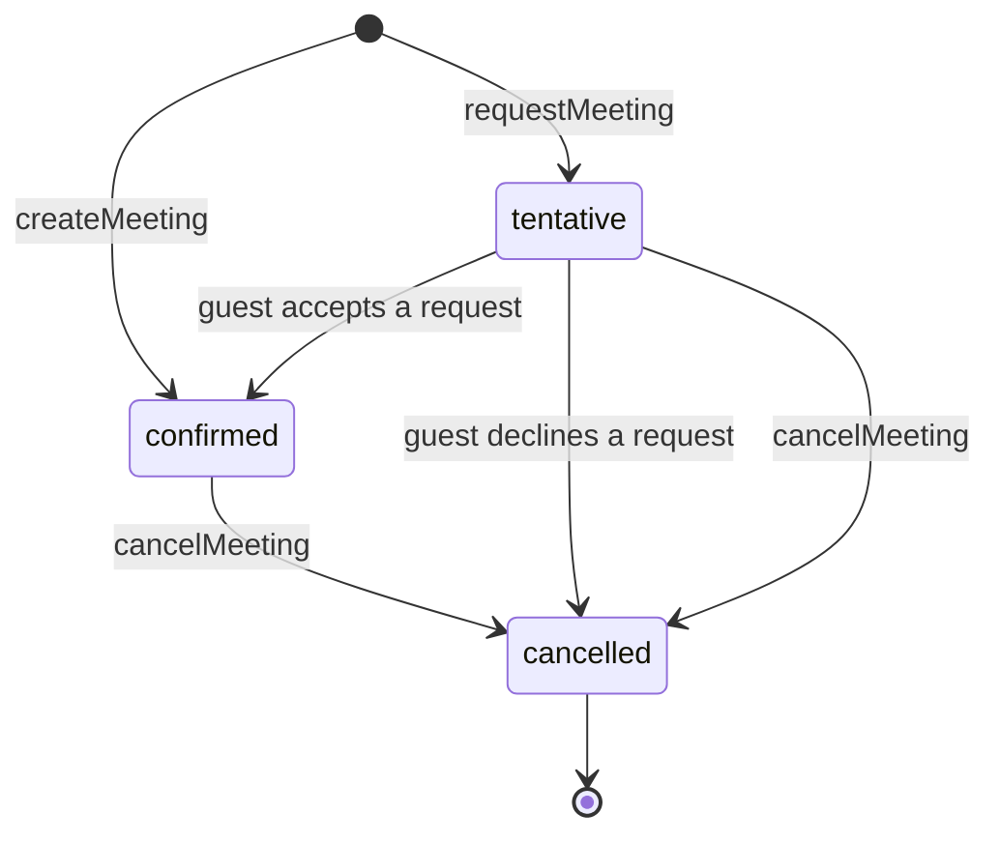
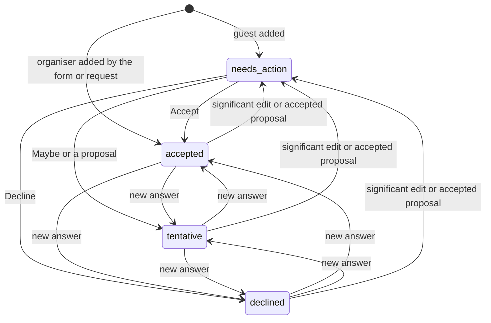
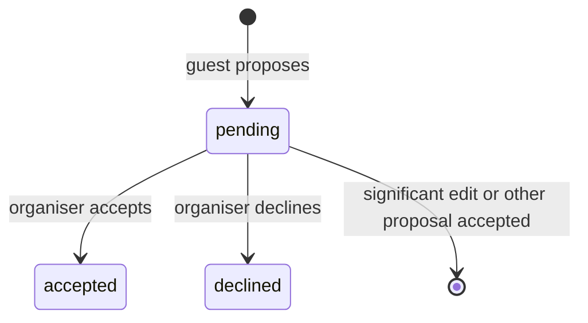

# Meetings

Written from the demo code, 2026-11-10.

## Purpose

Meetings is a shared calendar in both products (Flooring Suite and HR Suite). People schedule meetings with staff, customers, suppliers, people at those companies, or anyone with an email address. Each guest gets a calendar invite in the Outbox. Guests answer Accept, Maybe or Decline, and can propose another time. Any user can ask a colleague to meet.

No real email is sent, and no guest outside the company can really answer. The Outbox shows what would have gone, and Simulate reply stands in for the guest.

| Part | Feature key | Screen |
| --- | --- | --- |
| Calendar: day, week, month and agenda views, drag, resize, recurring meetings | `meetings.calendar` | `/meetings` |
| Guests, invites, `.ics` files, replies, proposals, Simulate reply | `meetings.invites` | Meeting drawer, Outbox drawer |
| Request a meeting | `meetings.requests` | `/meetings`, `/my/meetings` |
| Default reminder, new guests, invite defaults | `settings.meetings` | `/settings/meetings` |
| The person's own coming meetings | `hr.portal` | `/my/meetings` |

Code: `apps/web/src/lib/api/demo/meeting-actions.ts` (store actions), `packages/shared/src/operations/meetings.ts` (occurrences, moves, conflicts), `packages/shared/src/calendar/ics.ts` (calendar files), `apps/web/src/features/meetings/` (screens).

## Who uses it

Effective permission = role permissions, limited by the company ceiling and the enabled modules (`effectivePermissions` in `packages/shared/src/permissions/engine.ts`). `meetings.meeting.*` and `settings.meetings.manage` belong to the `meetings` module in `packages/shared/src/permissions/catalog.ts`. All three demo companies have that module (`packages/shared/scripts/fixtures/companies.ts`).

The nine default roles are Owner, Manager, Accountant, Sales, Purchasing, Warehouse, Installer, HR manager and Employee. The HR Suite ships only Owner, HR manager and Employee (`PRODUCT_ROLES` in `packages/shared/src/permissions/roles.ts`).

| Action | Permission key | Default roles | Enforced in |
| --- | --- | --- | --- |
| Open the calendar, read a meeting | `meetings.meeting.view` | All nine | `PageGate` with the menu item's `anyOf` (`apps/web/src/products/flooring.ts`, `hr.ts`); `MeetingsPage`; `applyScope` in `apps/web/src/lib/api/demo/scope.ts` |
| Open My meetings | `hr.portal.view` | All nine | `SUB_PAGES` in `apps/web/src/products/pages.ts` |
| New meeting, click an empty slot | `meetings.meeting.create` | All nine | `createMeeting`; `MeetingsPage` |
| Request a meeting | `meetings.meeting.create` | All nine | `requestMeeting`; `MeetingsPage` |
| Answer your own invitation | `meetings.meeting.view`, and you must be a staff guest on the meeting | All nine | `respondToMeeting` |
| Add to my calendar | `meetings.meeting.view` | All nine | `meetingCalendarFile` |
| Move, resize, Undo | `meetings.meeting.edit` | Owner, Manager, HR manager, Sales | `rescheduleMeeting`, `undoReschedule` |
| Cancel a meeting | `meetings.meeting.edit` | Owner, Manager, HR manager, Sales | `cancelMeeting` |
| Remove a guest | `meetings.meeting.edit` | Owner, Manager, HR manager, Sales | `removeGuest` |
| Edit title, place, notes | `meetings.meeting.edit` | Owner, Manager, HR manager, Sales | `updateMeeting`, from Edit details in the meeting's drawer |
| Accept or decline a proposed time | `meetings.meeting.edit`; the screen also needs the viewer to be the organiser | Owner, Manager, HR manager, Sales | `decideProposal`; `MeetingAnswers` |
| Simulate reply | `meetings.meeting.view` for the organiser, otherwise `settings.outbox.view` | All nine for their own meetings; Owner for any | `simulateReply` |
| Delete a meeting | `meetings.meeting.delete` | Owner, Manager, HR manager | Not enforced anywhere. The key exists and no action checks it. There is no delete. |
| Change Settings > Meetings | `settings.meetings.manage` | Owner | `MeetingsSettingsPage`; `settingsPermissions("meetings")` in `apps/web/src/lib/api/demo/permission-rules.ts` |

Who sees which meeting (`FILTERS.meetings` in `scope.ts`, applied at every data scope):

| Viewer's data scope | Non-private meeting | Private meeting |
| --- | --- | --- |
| own (Sales, Installer, Employee) | Only if organiser or guest | Only if organiser or guest |
| branch or all (Manager, Warehouse, Accountant, Purchasing, HR manager, Owner) | Visible | Only if organiser or guest |

A private meeting is hidden from an Owner who is not on it.

The edit actions check the permission only. They do not check that the person is the organiser, so anyone with `meetings.meeting.edit` who can see a meeting can change it. The generic `save` refuses `meetings`, `meetingResponses` and `customerContacts` (`SAVE_PERMISSIONS` in `permission-rules.ts`), so these change only through the actions below.

The guest list in the drawer shows when `organiser || !meeting.hideGuestList || canEdit` (`MeetingAnswers` in `apps/web/src/features/meetings/meeting-answers.tsx`). Only the viewer's own answer is shown otherwise.

## Workflows and status rules

### Meeting.status



| Transition | Decided in |
| --- | --- |
| Start at `confirmed` | `createMeeting` |
| Start at `tentative` with `kind: request` | `requestMeeting` |
| `tentative` to `confirmed` or `cancelled` on a reply | `applyReply`, only when `saved.kind === "request" && saved.status === "tentative"` |
| Any to `cancelled` | `cancelMeeting`, which has no guard on the current status |

`updateMeeting` refuses a cancelled meeting. A Maybe or a proposal leaves a request `tentative`. `meetingOccurrences` leaves cancelled meetings out of every calendar view.

### Attendee.partStat

`needs_action` in the diagram is the stored value `needs-action`.



| Transition | Decided in |
| --- | --- |
| Answers | `applyReply`, reached from `respondToMeeting` or `simulateReply`. A stale reply changes nothing. |
| Back to `needs-action` | `updateMeeting` on a significant change; `decideProposal` on accept. Both reset every guest, the organiser included. |

`rescheduleMeeting` does not reset answers. See known limits.

Screen labels (`STATE_LABEL` in `meeting-answers.tsx`): Accepted, Maybe (`tentative`), Declined, No reply yet (`needs-action`).

### MeetingProposal.status



| Transition | Decided in |
| --- | --- |
| Created as `pending` | `applyReply` |
| To `accepted`, or to `declined` | `decideProposal` |
| Cleared to null | `updateMeeting` on a significant change; `decideProposal` on accept clears every other guest's proposal |

The meeting does not move until the organiser accepts.

### What each action sends

Every row is one `meeting.invite` Outbox row and one `.ics` per guest, from `sendToGuests`. The organiser never gets a row: `sendToGuests` skips `guest.kind === "staff" && guest.id === meeting.ownerUserId`.

| Action | Function | Calendar file | SEQUENCE | rescheduleSequence | Who gets a row | Answers |
| --- | --- | --- | --- | --- | --- | --- |
| Schedule | `createMeeting` | REQUEST, STATUS:CONFIRMED | 0 | 0 | Every guest | As given; other guests start `needs-action` |
| Edit title, notes or reminder | `updateMeeting` | REQUEST, STATUS:CONFIRMED | Unchanged | Unchanged | Every guest | Kept |
| Edit start, length or location | `updateMeeting` | REQUEST, STATUS:CONFIRMED | +1 | Set to the new SEQUENCE | Every guest | All reset; `respondedAt` and `proposal` cleared |
| Cancel the meeting | `cancelMeeting` | CANCEL, STATUS:CANCELLED | +1 | Set to the new SEQUENCE | Every guest | Left as they were |
| Remove a guest | `removeGuest` | CANCEL, no STATUS, lists that guest only | +1 | Unchanged | The removed guest only | Others kept |
| Move this event | `rescheduleMeeting` | REQUEST with RECURRENCE-ID and the occurrence's own time, STATUS:CONFIRMED | +1 | Unchanged | Every guest | Not reset |
| Move this and following | `rescheduleMeeting` | Old series: REQUEST with a trimmed UNTIL. New series: REQUEST under a new UID. | Old +1, new 0 | Old set to the new SEQUENCE, new 0 | Every guest, once per series | Not reset |
| Move all, or a one-off | `rescheduleMeeting` | REQUEST, STATUS:CONFIRMED | +1 | Set to the new SEQUENCE | Every guest | Not reset |
| Undo a move | `undoReschedule` | REQUEST, STATUS:CONFIRMED | Current +1 | Set to the new SEQUENCE | Every guest | As they were in the saved copy |
| Accept a proposal | `decideProposal` | REQUEST, STATUS:CONFIRMED | +1 | Set to the new SEQUENCE | Every guest | All reset |
| Decline a proposal | `decideProposal` | DECLINECOUNTER, no STATUS, lists the proposer only | Unchanged | Unchanged | The proposer only | Unchanged |
| Request a meeting | `requestMeeting` | None. `meeting.requested` only. | 0 | 0 | The person asked | Requester accepted, other `needs-action` |
| Guest answers a request | `applyReply` | None. `meeting.reply` to the organiser. | +1 on Accept or Decline, else unchanged | Unchanged | Organiser | That guest only |
| Guest answers a meeting | `applyReply` | None. `meeting.reply` or `meeting.proposed` to the organiser. | Unchanged | Unchanged | Organiser | That guest only |
| Add to my calendar | `meetingCalendarFile` | PUBLISH, no ATTENDEE, no STATUS, current UID and SEQUENCE | Unchanged | Unchanged | None, a download | None |

### Workflows

**Views** (`MeetingsPage` in `apps/web/src/features/meetings/meetings-page.tsx`). Week is the default. Day and Week use a time grid from 07:00 to 19:00 (`FIRST_HOUR`, `LAST_HOUR` in `time-grid.tsx`). Month is a 42-day grid from the Monday on or before the 1st. Agenda lists 30 days from the anchor date. Times are shown in the meeting's own time zone, with no conversion.

**Schedule a meeting** (`NewMeetingDialog`, `createMeeting`).

1. The person opens New meeting, or clicks an empty slot. The form starts today at 09:00 for 30 minutes at "Conference room", with the person as an accepted guest.
2. They search for guests or type an email (`GuestPicker`). One search finds active staff, customers, customer contacts, suppliers and supplier contacts by name or email, up to 8 results. Customers follow the viewer's data scope.
3. An address that is not known offers Add guest by email, with an optional name and, when new guests become contacts, a customer to save under.
4. They set Repeats (`none`, `weekly`, `biweekly`, `monthly`), Reminder (10, 15, 30 or 60 minutes), Private and Hide the guest list.
5. Schedule meeting checks the title, the recurrence start and each new email. It saves new guests, writes the meeting, sends the invites and schedules the reminder.

**Move or resize** (`useReschedule`, `TimeGrid`, `RescheduleForm`, `rescheduleMeeting`). Drag moves a meeting and snaps to 15 minutes. Dragging the bottom edge resizes it. The drawer's Reschedule form does the same by keyboard. A repeating meeting asks This event, This and following events, or All events, with This event selected. A one-off goes straight through with scope `all`. After saving, conflicts appear as a warning, and the toast offers Undo.

**Answer.** Staff answer in the meeting drawer with Accept, Maybe, Decline or Propose a new time. The organiser gets no answer buttons. External guests are represented by Simulate reply on the Outbox row (`SimulateReply` in `simulate-reply.tsx`), which offers the same four answers.

**Propose a new time.** Offered when `meeting.allowProposals && meeting.recurrence === "none"` (`ReplyButtons`). A proposal is stored as a `tentative` answer with `proposal.status: pending`. The organiser sees Accept time and Decline time in the drawer. Accepting moves the meeting and asks everyone again. Declining sends the proposer a DECLINECOUNTER.

**Request a meeting** (`RequestMeetingDialog`, `requestMeeting`). The person picks one active colleague, a subject, a date, a start and a note, and can mark it private. The dialog fixes the length at 30 minutes and the place at "To be agreed". The reminder comes from Settings > Meetings. The meeting is `tentative`, `kind: request`, with `allowProposals: true`. The drawer says "Waiting for an answer."

**Settings > Meetings** (`MeetingsSettingsPage`). Four values. See `MeetingSettings` below.

## Business rules

1. **Occurrences.** `meetingOccurrences` in `packages/shared/src/operations/meetings.ts` expands each non-cancelled meeting from its `start`, stopping after `until`. An exception with the same `planned` value replaces the time and length. An exception with `cancelled` is left out.

2. **Repeat steps.** `next` in `operations/meetings.ts`.

   ```text
   weekly    addDays(start, 7)
   biweekly  addDays(start, 14)
   monthly   nextMonthSameWeekday(start)
   ```

   `nextMonthSameWeekday` keeps the weekday and week of the month:

   ```ts
   const week = Math.min(Math.ceil(date.getUTCDate() / 7), 4);
   const first = new Date(Date.UTC(date.getUTCFullYear(), date.getUTCMonth() + 1, 1));
   const firstMatch = (date.getUTCDay() - first.getUTCDay() + 7) % 7;
   return addDays(first.toISOString().slice(0, 10), firstMatch + (week - 1) * 7) + iso.slice(10);
   ```

3. **Monthly start limit.** `recurrenceProblem` in `packages/shared/src/calendar/ics.ts`, called from `createMeeting` only.

   ```ts
   if (recurrence === "monthly" && Number(start.slice(8, 10)) > 28)
     return "A monthly meeting can't start in the fifth week of a month.";
   ```

4. **Move scopes.** `moveOccurrence` in `operations/meetings.ts`, where `shift` is the minutes between `planned` and the new start.

   | Scope | Result |
   | --- | --- |
   | `all`, or any one-off | `start` moves by `shift`, `durationMin` becomes the new length, every exception's `planned` moves by `shift` |
   | `this` | The exception for `planned` is replaced with `{ planned, start, durationMin }` |
   | `following` | Old series: `until: addDays(planned date, -1)`, keeps earlier exceptions. New series: new id, starts at the new time, keeps the old `until`, takes later exceptions moved by `shift`. |

5. **Move input.** `rescheduleMeeting` refuses `move.durationMin < 15` and a start that fails `/^\d{4}-\d{2}-\d{2}T\d{2}:\d{2}$/`.

6. **Significant change.** `updateMeeting`:

   ```ts
   const SIGNIFICANT = ["start", "durationMin", "recurrence", "until", "status", "location"] as const;
   const significant = SIGNIFICANT.some((k) => merged[k] !== before[k]);
   const sequence = before.sequence + (significant ? 1 : 0);
   ```

   The patch type allows only `title`, `notes`, `location`, `start`, `durationMin` and `reminderMin`.

7. **Stale replies.** `applyReply`:

   ```ts
   const stale = sequence < meeting.rescheduleSequence;
   ```

   A stale reply is logged in `meetingResponses` with `stale: true` and changes nothing. `respondToMeeting` passes `meeting.sequence`, so a staff answer is never stale. `simulateReply` passes the SEQUENCE the Outbox row was sent with (`message.values["meeting.sequence"]`).

8. **When a proposal is allowed.** `respondToMeeting` refuses a proposal unless `meeting.allowProposals && meeting.recurrence === "none"`. `simulateReply` has no such check and relies on the screen.

9. **Hidden guest lists.** At creation (`createMeeting`):

   ```ts
   hideGuestList: input.hideGuestList || input.private || external.length > 0,
   ```

   For a request, `hideGuestList: input.private`. In each file (`sendToGuests`):

   ```ts
   const listed = meeting.hideGuestList ? [guest] : (opts.listed ?? meeting.attendees);
   ```

   Guests with no email are left out of the ATTENDEE lines (`listed.filter((a) => a.email)`).

10. **Reminder time.** `scheduleReminder`:

    ```ts
    const scheduledFor = addMinutes(meeting.start, -meeting.reminderMin);
    if (scheduledFor <= ctx.now) return;
    ```

    Only staff guests are addressed, one Outbox row each, with status `scheduled`.

11. **New guests.** `keepNewGuest` in `meeting-actions.ts`, following assumption E-1 and `settings.meetings.newGuestHandling`.

    | Setting | Result |
    | --- | --- |
    | `contact` with a `customerId` | A `customerContacts` row: name, email, empty phone |
    | `contact` with no `customerId` | Not saved; the guest stays on the meeting |
    | `lead` | A `customers` row: `lifecycle: "lead"`, `type: "homeowner"`, `terms: "due_on_receipt"`, `creditLimit: "0.00"`, `salesRepId` the actor |
    | `none` | Not saved |

    In all cases the guest goes on the meeting as `kind: "external"`, with id `ext-<id>-<index>`. The name defaults to the email.

12. **Valid email.** `/^[^@\s]+@[^@\s]+\.[^@\s]+$/` (`validEmail` in `meeting-actions.ts`, `looksLikeEmail` in `guest-picker.tsx`).

13. **Conflicts.** `attendeeConflicts` in `operations/meetings.ts`. It looks at occurrences on the new start's day only and skips the occurrence being moved. A conflict is an overlap: `!(o.start >= end || oEnd <= candidate.start)`. It matches attendees by `id`. It is called only from `rescheduleMeeting`, after the save, and only warns.

14. **UID.** `crypto.randomUUID()` at creation, never changed. The new series from a "following" split gets a new UID and `sequence: 0`.

15. **Calendar file.** `meetingIcs` in `calendar/ics.ts` writes one VEVENT per file. Lines end in CRLF and fold at 75 octets (`foldLine`). `PRODID:-//Flooring Suite//Demo//EN`. DTSTART and DTEND are local with TZID. DTSTAMP is UTC. REQUEST files carry one VALARM with `TRIGGER:-PT<reminderMin>M`. Other methods carry none. A file with RECURRENCE-ID has no RRULE.

16. **RRULE.** `recurrenceRule` in `calendar/ics.ts`.

    ```text
    weekly    RRULE:FREQ=WEEKLY
    biweekly  RRULE:FREQ=WEEKLY;INTERVAL=2
    monthly   RRULE:FREQ=MONTHLY;BYDAY=<ceil(day/7)><weekday>
    ```

    With an end date, `;UNTIL=<endOfDayUtc(until, timeZone)>` is added.

17. **Outbox row identity.** The invite's version is `` `${opts.sequence}-${opts.method}-${ctx.now}-${opts.recurrenceId ?? ""}` ``. `ctx.now` has minute precision (`nowStamp` in `store.ts`), so two identical sends in one minute write one row.

## Entities and fields

### Meeting (`meetings`, `packages/shared/src/types/meetings.ts`)

| Field | Type | Notes |
| --- | --- | --- |
| `id` | string | `ctx.newId("mtg")`. |
| `title` | string | Required, trimmed. |
| `start` | string | Local `YYYY-MM-DDTHH:mm`, no zone. The first occurrence of a series. |
| `durationMin` | number | Minutes. At least 15 on a move. The store does not check it at creation. |
| `location` | string | Free text. A change is significant. |
| `attendees` | Attendee[] | The form adds the organiser. |
| `recurrence` | `none`, `weekly`, `biweekly`, `monthly` | |
| `reminderMin` | number | Minutes before the start. |
| `ownerUserId` | string | The organiser. Becomes ORGANIZER in the file. |
| `notes` | string | DESCRIPTION in the file. A request's note lands here. |
| `timeZone` | string | The company's region time zone at creation. |
| `until` | string or null | Last day of a series. Set when a series is split. |
| `exceptions` | MeetingException[] | Occurrences changed on their own. |
| `uid` | string | Random UUID, set once. |
| `sequence` | number | Starts at 0. See the table above. |
| `rescheduleSequence` | number | SEQUENCE at the last significant change. Replies below it are stale. |
| `status` | `tentative`, `confirmed`, `cancelled` | |
| `kind` | `meeting`, `request` | |
| `private` | boolean | Only organiser and guests can see it. |
| `hideGuestList` | boolean | See rule 9. |
| `allowProposals` | boolean | From `settings.meetings.allowProposals`; always true on a request. |

### Attendee (inside `Meeting.attendees`)

| Field | Type | Notes |
| --- | --- | --- |
| `kind` | `staff`, `customer`, `supplier`, `customer-contact`, `supplier-contact`, `external` | Maps to the Outbox recipient kind in `RECIPIENT_KIND`. |
| `id` | string | The linked record's id, or `ext-...` for a guest added by email. |
| `name` | string | |
| `email` | string | Empty produces a `failed` Outbox row. |
| `role` | `required`, `optional` | No screen sets `optional`. |
| `partStat` | `needs-action`, `accepted`, `tentative`, `declined` | |
| `respondedAt` | string or null | |
| `respondedSequence` | number or null | SEQUENCE of the last answer. |
| `note` | string | |
| `proposal` | MeetingProposal or null | |

### MeetingProposal (inside `Attendee.proposal`)

| Field | Type | Notes |
| --- | --- | --- |
| `start` | string | Proposed local date-time. |
| `durationMin` | number | The form uses the meeting's current length. |
| `note` | string | |
| `status` | `pending`, `accepted`, `declined` | |

### MeetingException (inside `Meeting.exceptions`)

| Field | Type | Notes |
| --- | --- | --- |
| `planned` | string | The date-time the series planned. The key. |
| `start` | string, optional | New start. |
| `durationMin` | number, optional | New length. |
| `cancelled` | boolean, optional | Read by `meetingOccurrences`. Nothing writes it. |
| `sequence` | number, optional | Nothing writes or reads it. |
| `location` | string, optional | Nothing writes or reads it. |

### MeetingResponse (`meetingResponses`)

| Field | Type | Notes |
| --- | --- | --- |
| `id` | string | `ctx.newId("mres")`. |
| `meetingId` | string | |
| `attendeeId` | string | |
| `method` | `reply`, `counter` | `counter` when the answer carries a proposal. |
| `partStat` | Attendee partStat | |
| `proposedStart` | string or null | |
| `note` | string | |
| `sequence` | number | SEQUENCE the answer was made against. |
| `at` | string | |
| `stale` | boolean | See rule 7. |

Every reply is logged, including stale ones. No screen reads this collection. The seed has none.

### CustomerContact (`customerContacts`)

| Field | Type | Notes |
| --- | --- | --- |
| `id` | string | `ctx.newId("ccon")`. |
| `customerId` | string | |
| `name` | string | |
| `email` | string | |
| `phone` | string | Empty when saved from a meeting. |

The seed adds one contact for up to 12 non-homeowner customers (`buildContacts` in `packages/shared/scripts/fixtures/meeting-records.ts`).

### MeetingSettings (`CompanySettings.meetings`, `packages/shared/src/types/settings.ts`)

| Field | Type | Seed value (`scripts/fixtures/tenant.ts`) | Notes |
| --- | --- | --- | --- |
| `defaultReminderMin` | number | 15 | Starts the New meeting form and sets a request's reminder. Options 10, 15, 30, 60. |
| `newGuestHandling` | `contact`, `lead`, `none` | `contact` | See rule 11. |
| `allowProposals` | boolean | true | Copied to each new meeting. The form has no control for it. |
| `hideGuestList` | boolean | false | Starts the form's checkbox. |

### MeetingOccurrence (derived, not stored)

`meeting`, `start`, `durationMin`, `planned`, from `meetingOccurrences`.

## Events and audit entries

Notification events, all raised from `meeting-actions.ts`. The catalogue is in `docs/product-spec/notifications.md`.

| Event key | Recipients as built | Trigger | Channels used |
| --- | --- | --- | --- |
| `meeting.invite` | Each guest except the organiser. Staff also get an in-app note. | `sendToGuests`, from every row of the sends table with a calendar file | Email; in-app for staff |
| `meeting.reminder` | Staff guests only | `scheduleReminder`, from `createMeeting` | Email only. The call passes no in-app list. |
| `meeting.reply` | The organiser | `applyReply`, not stale, no proposal | Email, in-app |
| `meeting.proposed` | The organiser | `applyReply`, not stale, with a proposal | Email, in-app |
| `meeting.requested` | The person asked | `requestMeeting` | Email, in-app |

`notify` drops a staff recipient who is the actor, and `restricted` is set to `meeting.private` on all five.

Audit entries, all `category: "data"`, written with `ctx.audit`:

| Action string | Trigger | Target | Before | After |
| --- | --- | --- | --- | --- |
| `Scheduled meeting` | `createMeeting` | Title | null | Start and guest count |
| `Edited meeting` | `updateMeeting` | Title | Old start | New start |
| `Cancelled meeting` | `cancelMeeting` | Title | `confirmed` | `cancelled` |
| `Removed meeting guest` | `removeGuest` | Title | Guest name | null |
| `Answered meeting` | `respondToMeeting` | Title | Old answer | New answer |
| `Simulated guest reply` | `simulateReply` | Title | Guest name | Answer |
| `Accepted proposed time` | `decideProposal` on accept | Title | Old start | New start |
| `Requested meeting` | `requestMeeting` | Title | null | The other person |
| `Moved meeting` | `rescheduleMeeting` | Title | Planned time | New time, length and scope |
| `Undid meeting move` | `undoReschedule` | Title | null | Restored start |

Saving Settings > Meetings writes `Changed meetings`, `category: "settings"`, target `Meetings`, from `updateSettings` in `store.ts`.

Not audited: declining a proposal, and saving a new guest as a contact or lead.

## Emails

No real email is sent. Each row below is an Outbox row only. A row with status `sent` is labelled "Sent (simulated)". The `.ics` files were not tried in a real mailbox: unit tests in `packages/shared/test/ics.test.ts` check their text, and no file was imported into a real Google or Outlook calendar (`docs/ux-audit.md`, final walkthrough).

| Event | Default subject | Default body | Attachment |
| --- | --- | --- | --- |
| `meeting.invite` | `{{ meeting.action }}: {{ meeting.title }}` | `{{ meeting.action }}: {{ meeting.title }}`, then When, Where and Organiser lines | One `.ics` |
| `meeting.reminder` | `Reminder: {{ meeting.title }}` | `A reminder for {{ meeting.title }} at {{ meeting.when }}, {{ meeting.location }}.` | None |
| `meeting.reply` | `{{ guest.name }} replied {{ guest.reply }}: {{ meeting.title }}` | `{{ guest.name }} replied {{ guest.reply }} to {{ meeting.title }}.` | None |
| `meeting.proposed` | `{{ guest.name }} proposed a new time for {{ meeting.title }}` | `{{ guest.name }} proposed {{ meeting.when }} for {{ meeting.title }}.` | None |
| `meeting.requested` | `{{ actor.name }} asked to meet: {{ meeting.title }}` | `{{ actor.name }} asked to meet about {{ meeting.title }} at {{ meeting.when }}.` | None |

`meeting.action` is one of `Invitation`, `Updated`, `Cancelled`, `Removed` or `Proposal declined`. `meeting.when` is `YYYY-MM-DD at HH:mm` (`whenText`). The file name is the title with characters outside `[\w ]` removed, plus `.ics`.

## Reports

None.

## Edge cases and known limits

Known gaps:

- **A guest cannot be added to an existing meeting** (U-50). `ApiClient` has no such call, and the `updateMeeting` patch does not include attendees. A guest can only be removed.
- **The `.ics` files were not tried in a real mailbox.**
- **No real email is sent**, so external guests cannot answer. Simulate reply stands in.

Differences from ADR 0021, as built:

- `rescheduleMeeting` raises SEQUENCE but does not reset answers or clear proposals. A pending proposal survives a move.
- After a "this and following" or "all" move, surviving exceptions are not sent again.
- Cancelling one occurrence is not offered. Cancel meeting cancels the whole series.
- A request has no `.ics` when it is created. If it is later moved or a proposal is decided, `sendToGuests` attaches one, marked STATUS:CONFIRMED even while the meeting is still `tentative`.

Reminders:

- A reminder is scheduled only by `createMeeting`, only for the first occurrence, and never for a request.
- Moving or cancelling a meeting does not change or cancel its reminder row.
- Scheduled rows turn to sent only when the company is opened (`releaseScheduled`).

Moves and conflicts:

- `recurrenceProblem` is checked only at creation. A monthly series moved to day 29 to 31 gets `BYDAY=5..` in its RRULE, while `nextMonthSameWeekday` caps the week at 4.
- "This and following" from the first occurrence leaves the old series with `until` before its `start`. It shows no occurrences and still gets an update.
- Undo removes a split-off series without sending its guests a cancellation.
- Conflicts are checked only on a move, only warn, cover only the moved occurrence on its own day, and are not checked at creation.
- `attendeeConflicts` reads every meeting without the viewer's scope, so a warning can name the title of a private meeting the viewer cannot see.
- The time grid places an occurrence by hour with no clamp, so a meeting before 07:00 or after 19:00 falls outside the grid column. Month and agenda still list it. Dragging is clamped to the grid.

Permissions and answers:

- An organiser without `meetings.meeting.edit`, such as an Employee, sees Accept time and Decline time and is refused on clicking.
- A non-organiser who changes a meeting does not cause a row for the organiser, because `sendToGuests` always skips the organiser.
- `respondToMeeting`, `removeGuest` and `decideProposal` do not check for a cancelled meeting. The screen hides those controls.
- `simulateReply` audits and shows success even when the reply was stale.
- A later plain answer keeps an earlier pending proposal (`attendee.proposal` is carried over in `applyReply`).

Other:

- A cancelled meeting disappears from the calendar. Its rows stay in the Outbox.
- `timezoneBlock` in `calendar/ics.ts` has seven US zones. Any other TZID gets the New York block under its own name.
- Times are not converted between zones (ADR 0018).
- A lead saved from a meeting has no Lead label in the customer list (U-52).
- With `newGuestHandling: contact`, the picker preselects the first customer, so an unchanged form saves the guest under it.
- The store does not check that a new guest's email is unique. The picker hides the Add option for an address it already knows.
- `docs/api-contract.md` has no rows for these calls. The contract is `apps/web/src/lib/api/contract.ts`.
