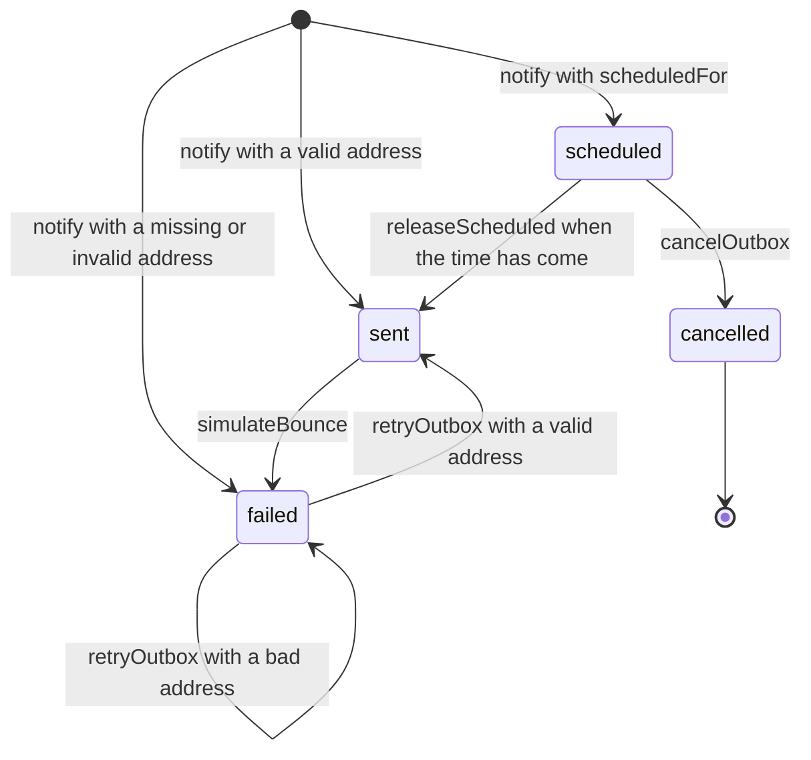
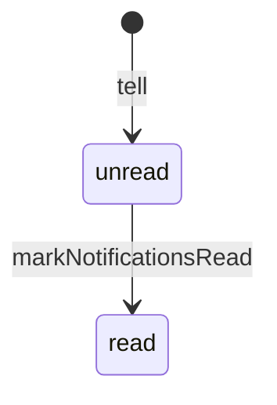

# Notifications

Written from the demo code, 2026-11-10.

## Purpose

Notifications is one place where the system says something happened. An action raises an event. The event's rule decides whether anything is written, and on which channels. Email becomes one Outbox row per recipient. In-app becomes one stored notification per person, shown in the bell with read state.

The demo never sends real email. There is no provider, no background worker and no delivery webhook. A row with status `sent` is labelled "Sent (simulated)", and the Outbox page carries a banner saying nothing is really sent (`OutboxBanner` in `apps/web/src/features/outbox/outbox-page.tsx`).

The bell shows two different things:

| List in the bell | Stored? | Source | Goes away when |
| --- | --- | --- | --- |
| Updates | Yes, per person | `inAppNotifications`, written by `notify` | Never removed. It turns read. |
| Needs attention | No, derived on each read | `loadAttention` in `apps/web/src/lib/attention.ts` | The work is done |

| Part | Feature key | Screen |
| --- | --- | --- |
| Sender, event switches, channels, templates | `settings.notifications` | `/settings/notifications` |
| Outbox, the person's own rows | `settings.outbox` | `/outbox` |
| Outbox, the whole company | `settings.outbox` | `/settings/outbox` |
| Needs attention and the bell | `shell.notifications` | Top bar |

Code: `apps/web/src/lib/api/demo/notification-actions.ts` (actions), `packages/shared/src/notifications/events.ts` (catalogue), `packages/shared/src/notifications/render.ts` (templates).

## Who uses it

`settings.notifications.manage` and `settings.outbox.view` are in the `platform` module (`packages/shared/src/permissions/catalog.ts`). Default roles come from `packages/shared/src/permissions/roles.ts`.

| Action | Permission key | Default roles | Enforced in |
| --- | --- | --- | --- |
| Change sender name, reply-to, sign-off | `settings.notifications.manage` | Owner | `NotificationsSettingsPage`; `SETTINGS_SECTIONS.email` in `packages/shared/src/settings/sections.ts`, checked by `updateSettings` |
| Switch an event on or off, set channels, edit its template | `settings.notifications.manage` | Owner | `saveNotificationRule` |
| Reset an event to its defaults | `settings.notifications.manage` | Owner | `resetNotificationRule` |
| Open the whole Outbox | `settings.outbox.view` | Owner | `PageGate` with the item in `apps/web/src/products/settings-menu.ts`; `OutboxPage`; `listOutbox` |
| Open your own Outbox | None | Every signed-in user | `/outbox` has no page rule, so `canOpenPage` in `apps/web/src/products/pages.ts` lets everyone open it; `listOutbox` limits the rows |
| Send again on a failed row | One's own row, or `settings.outbox.view` | Everyone, on their own rows | `retryOutbox` |
| Cancel a scheduled row | One's own row, or `settings.outbox.view` | Everyone, on their own rows | `cancelOutbox` |
| Simulate bounce | `settings.outbox.view` | Owner | `simulateBounce`; the button appears only in the whole-company view |
| Simulate reply on a meeting invite | `meetings.meeting.view` for the organiser, otherwise `settings.outbox.view` | See `docs/product-spec/meetings.md` | `simulateReply` |
| Read the bell | None | Every signed-in user | `Notifications` in `apps/web/src/components/shell/notifications.tsx` |
| Mark your own notifications read | None | Every signed-in user | `markNotificationsRead`, which works only on the person's own rows |

Each Needs attention check has its own permission. See rule 15.

### Who can see which Outbox row

`listOutbox` in `notification-actions.ts`:

```ts
const admin = all && (await ctx.can("settings.outbox.view"));
const hrView = await ctx.can("hr.employee.view");
const mine = (m: OutboxMessage) =>
  m.actorUserId === ctx.actor.id ||
  (m.recipient.kind === "user" && m.recipient.id === ctx.actor.id) ||
  m.recipient.email === ctx.actor.email;
```

| Case | Result |
| --- | --- |
| `admin` is true, or `mine(m)` is true | The row is listed. Otherwise it is left out. |
| `m.restricted && !mine(m) && !hrView` | The row is redacted: subject `Restricted message`, body `Only the people involved can read this.`, no attachments |

Recipient, status and dates stay visible on a redacted row. With the default roles, only the Owner holds `settings.outbox.view`, and the Owner also holds `hr.employee.view`, so redaction only applies to a custom role that has the first without the second.

In the real build, a restricted row whose source is a meeting is a private meeting's invite, reminder or notice. Such a row is redacted for every reader it does not involve, `hr.employee.view` and the Owner included, because a private meeting is hidden from everyone not on it (meetings.md; ADR 0051).

`ctx.actor` is the signed-in user even during View as role, so "mine" means the real person.

The generic `list` returns an empty array for `outboxMessages` and `inAppNotifications` (`applyScope` in `apps/web/src/lib/api/demo/scope.ts`), so only the calls above can read them. `notificationRules` has no scope filter. The generic `save` refuses all three (`SAVE_PERMISSIONS` in `permission-rules.ts`).

## Workflows and status rules

### OutboxMessage.status



| Transition | Decided in |
| --- | --- |
| Starting status | `notify`: `status: failure ? "failed" : input.scheduledFor ? "scheduled" : "sent"` |
| `scheduled` to `sent` | `releaseScheduled`, which runs only in `DemoStore.openCompany`. `sentAt` is set to `scheduledFor`. |
| `scheduled` to `cancelled` | `cancelOutbox`. Refuses any other status. |
| `sent` to `failed` | `simulateBounce`. Sets `failureType: "bounced"`, `failureDetail: "the mailbox refused the message"`, clears `sentAt`, and tells the actor. |
| `failed` to `sent` or `failed` | `retryOutbox`. Runs `failureOf` again on the same row. Refuses any other status. |

`queued` is in the `OutboxStatus` type and has a screen label, but no code writes it. `provider_error` is in `OutboxFailure` and no code writes it.

### InAppNotification read state

There is no status field. Read state is `readAt`.



`tell` in `notification-actions.ts` writes `readAt: null`. `markNotificationsRead` sets `readAt: ctx.now` on the person's own unread rows.

### Raising an event

`notify` in `notification-actions.ts`, in this order:

1. Stop if the feature `settings.notifications` is off. Nothing is written.
2. Read the rule (`effectiveRule`). Stop if `rule.enabled` is false.
3. Add `company.name` to the values.
4. If `rule.channels.email`, for each recipient in `input.to`: skip a `user` recipient who is the actor; skip if the `dedupeKey` already exists; render the subject and body; write one `OutboxMessage`. If the address failed, tell the actor in-app.
5. If `rule.channels.inApp`, for each person in `input.inApp`: skip the actor; write one `InAppNotification`.

Subject, body, attachments and values are stored on the row as a snapshot. Editing a template later does not change a row already written.

### Settings > Email and notifications

`NotificationsSettingsPage` has a Sender form and one row per event, grouped: Sales and invoices, Purchasing, People, Meetings, Contracts, System. A row has an On switch, Email and In the app checkboxes, and a Template button.

`TemplateEditor` edits the subject and body, lists the event's variables, previews the result, and offers Reset to default. The preview uses `{ ...sampleValues(event), ...(latest?.values ?? {}) }`, where `latest` is the newest row of that event from `listOutbox(true)`.

### Outbox

`OutboxPage` lists rows newest first: When, To, Subject, Event, Attachments, Status. Opening a row shows the body, attachments and the actions its status allows: Send again, Cancel message, Simulate bounce, Simulate reply. A PDF attachment is a link to the document. An `.ics` attachment downloads the stored text.

## Business rules

1. **Rule in force.** `effectiveRule` in `packages/shared/src/notifications/render.ts`. A saved rule replaces the catalogue's defaults. With no saved rule: `{ enabled: true, channels: event.channels, subject: event.subject, body: event.body }`.

2. **Actor is never told.** In `notify`: `recipient.kind === "user" && recipient.id === ctx.actor.id` skips an email, and `person.userId === ctx.actor.id` skips an in-app note.

3. **One row per send.** `notify`:

   ```ts
   const dedupeKey = [input.key, input.source.id, input.version ?? "", recipient.kind, recipient.id].join("|");
   if (ctx.db.list("outboxMessages").some((m) => m.dedupeKey === dedupeKey)) continue;
   ```

   In-app notes are not deduplicated.

4. **Address check.** `failureOf` in `notification-actions.ts`:

   ```ts
   if (!email) return { type: "missing_email", detail: "no email address on file" };
   if (!EMAIL.test(email)) return { type: "invalid_email", detail: "that email address is not valid" };
   ```

   `EMAIL` is `/^[^@\s]+@[^@\s]+\.[^@\s]+$/`.

5. **Failure notice.** `reportFailure` tells `row.actorUserId` in-app, with the title `` `The email to ${row.recipient.name} could not be delivered: ${row.failureDetail ?? "unknown problem"}` ``. It calls `tell` directly, so it ignores the rule for `delivery.failed` and writes no Outbox row.

6. **Restricted rows.** `notify`: `restricted: input.restricted ?? event.restricted ?? false`. `commission.ready` is restricted in the catalogue. The five `meeting.*` events pass `restricted: meeting.private`.

7. **Body.** `notify`:

   ```ts
   bodyText: [renderTemplate(rule.body, scoped).text, ctx.db.settings.email.signature].filter(Boolean).join("\n\n"),
   ```

   `scoped` is `{ "company.name": displayName, ...input.values, "recipient.name": recipient.name }`. `fromName` and `replyTo` come from `settings.email`.

8. **Templates.** `renderTemplate` in `render.ts`. Tokens match `/\{\{\s*([\w.]+)\s*\}\}/g`. Tokens are plain names, never expressions. A token with no value renders empty and is reported in `missing`.

9. **Unknown tokens are refused.** `unknownTokens` in `render.ts`, checked by `saveNotificationRule` and by the editor. The error is `` This event has no {{ name }}. Use one of the variables listed. ``.

10. **Sensitive values.** The catalogue offers no variable for cost, margin, pay rate, credit limit or pay amounts (comment on `NOTIFICATION_EVENTS` in `events.ts`).

11. **Money in messages.** `money` in `notification-actions.ts`: `` `$${formatNumber(amount, "money", ctx.db.settings.numbers)}` ``.

12. **People who can approve.** `usersWith` in `notification-actions.ts`: active users holding a role whose `permissions` include the key. It reads role permissions only, without the company ceiling or enabled modules.

13. **Reminders.** `scheduledFor` holds a row until its time. `releaseScheduled` turns a row to `sent` when `row.scheduledFor <= ctx.now`. Only `meeting.reminder` uses it.
    In the real build:
    - a pg-boss job sends the row at its time (ADR 0032);
    - a row may also carry an expiry (`NotifyInput.expiresAt`; a meeting reminder expires at its occurrence's start), and a worker or Retry that claims it later cancels it instead of sending it;
    - meetings cancel a meeting's waiting reminder rows and raise the next one after every change (ADR 0051).

14. **Bell badge.** `Notifications` in `notifications.tsx`: `total = items.length + unread.length`, where `items` is the attention list. The Updates list shows the newest 8. Mark all read covers every unread row, including those beyond the 8. Opening an update marks it read.

15. **Needs attention checks.** `CHECKS` in `apps/web/src/lib/attention.ts`. A check runs only when its feature is on, the product matches and the viewer holds the permission. Items with a count of zero are dropped. Nothing is stored.

    | Key | Feature | Permission | Products | Counts | Link |
    | --- | --- | --- | --- | --- | --- |
    | `overdue` | `sales.invoices` | `sales.invoice.view` | flooring | Invoices whose leading status is overdue | `/sales?view=invoices`, filtered |
    | `verify-payments` | `finance.payments-queue` | `sales.payment.approve` | flooring | Pending customer and supplier payments not recorded by the viewer | `/finance?view=payments` |
    | `low-rolls` | `inventory.rolls` | `inventory.roll.view` | flooring | Non-remnant rolls with remaining length above 0 and under `LOW_ROLL_FT` (20 ft) | `/inventory?view=rolls`, filtered |
    | `certificates` | `sales.customers` | `customers.customer.view` | flooring | Certificates expiring in 0 to `CERTIFICATE_WARNING_DAYS` (30) days | `/sales?view=customers`, filtered |
    | `pto` | `hr.time-off` | `hr.pto.approve` | flooring, hr | Pending `ptoRequests` | `/hr/time-off` |
    | `timesheets` | `hr.timesheets` | `hr.timesheet.approve` | flooring, hr | `submitted` timesheets | `/hr/timesheets?view=queue` |
    | `completed-jobs` | `installation.calendar` | `sales.payment.record` | flooring | Never runs: the feature is off | `/sales/invoices/...` |
    | `approve-adjustments` | `inventory.adjustments` | `inventory.stock.approve` | flooring | Never runs: the feature is off | `/inventory?view=adjustments` |
    | `jobs-today` | `installation.calendar` | `installation.job.view` | flooring | Never runs: the feature is off | `/installation` |

## Entities and fields

### NotificationRule (`notificationRules`, `packages/shared/src/types/notifications.ts`)

One row per event, only once a company changes it. The seed has none.

| Field | Type | Notes |
| --- | --- | --- |
| `id` | NotificationEventKey | The event key. |
| `enabled` | boolean | Off means nothing is written for the event. |
| `channels` | `{ email: boolean, inApp: boolean }` | |
| `subject` | string | Template. |
| `body` | string | Template. |
| `updatedAt` | string | |
| `updatedBy` | string | The actor's name. |

### OutboxMessage (`outboxMessages`)

| Field | Type | Notes |
| --- | --- | --- |
| `id` | string | `ctx.newId("out")`. |
| `eventKey` | NotificationEventKey | |
| `sourceType` | string | `quote`, `invoice`, `payment`, `purchaseOrder`, `timesheet`, `timeoff`, `commission`, `meeting`, `contract`. |
| `sourceId` | string | The source's id, or a derived key for `payment.to_verify` and `contract.expiring`. |
| `actorUserId` | string or null | Who caused it. |
| `recipient` | OutboxRecipient | |
| `fromName` | string | Snapshot of `settings.email.senderName`. |
| `replyTo` | string | Snapshot of `settings.email.replyTo`. |
| `subject` | string | Rendered snapshot. |
| `bodyText` | string | Rendered snapshot, with the sign-off. |
| `values` | `Record<string, string>` | The values used. Feeds the preview. `simulateReply` reads `meeting.sequence` from it. |
| `attachments` | OutboxAttachment[] | |
| `status` | `scheduled`, `queued`, `sent`, `failed`, `cancelled` | `queued` is never written. |
| `failureType` | `missing_email`, `invalid_email`, `provider_error`, `bounced`, or null | `provider_error` is never written. |
| `failureDetail` | string or null | |
| `createdAt` | string | Local, minute precision. |
| `scheduledFor` | string or null | |
| `sentAt` | string or null | |
| `restricted` | boolean | See rule 6. |
| `dedupeKey` | string | See rule 3. Seed rows end in `\|seed`. |

### OutboxRecipient (inside `OutboxMessage.recipient`)

| Field | Type | Notes |
| --- | --- | --- |
| `kind` | `user`, `customer`, `customer_contact`, `supplier_contact`, `supplier`, `guest` | |
| `id` | string | |
| `name` | string | |
| `email` | string | May be empty, which produces a `failed` row. |

### OutboxAttachment (inside `OutboxMessage.attachments`)

| Field | Type | Notes |
| --- | --- | --- |
| `kind` | `pdf`, `ics` | |
| `fileName` | string | |
| `href` | string, optional | Where a PDF opens. It is a link to the live document, not a stored file. |
| `text` | string, optional | An `.ics` file's text, stored inline. The real build emails it as a UTF-8 `text/calendar; method=<METHOD>` attachment (ADR 0051). |

### InAppNotification (`inAppNotifications`)

| Field | Type | Notes |
| --- | --- | --- |
| `id` | string | `ctx.newId("ntf")`. |
| `userId` | string | The person told. |
| `eventKey` | NotificationEventKey | |
| `title` | string | Fixed text from the calling action. See the in-app titles table. |
| `href` | string | Where it opens. |
| `createdAt` | string | |
| `readAt` | string or null | |

### EmailSettings (`CompanySettings.email`)

| Field | Type | Seed value (`packages/shared/scripts/fixtures/tenant.ts`) |
| --- | --- | --- |
| `senderName` | string | The company name |
| `replyTo` | string | `office@<company domain>` |
| `signature` | string | `The team at <company name>` |

### NotificationEvent (catalogue, in code, not stored)

`key`, `group`, `label`, `audience` (`external` or `internal`), `goesTo`, `channels`, `subject`, `body`, `variables`, `attachment` (`pdf`, `ics` or null), `restricted` (optional). Defined in `packages/shared/src/notifications/events.ts`.

### AttentionItem (derived, not stored)

`key`, `count`, `label`, `href`, `tone`. Built by `loadAttention` in `attention.ts`.

## Events and audit entries

### Catalogue

All events in `NOTIFICATION_EVENTS`. Every event also offers `company.name`, so it is left out of the variables column.

| Event key | Label | Group | Audience | Default channels | Attachment | Template variables | Amounts and redaction |
| --- | --- | --- | --- | --- | --- | --- | --- |
| `quote.sent` | Quote sent | sales | external | Email | PDF | `customer.name`, `quote.number`, `quote.total`, `quote.expires` | Shows the quote total. Not restricted. |
| `invoice.sent` | Invoice sent | sales | external | Email | PDF | `customer.name`, `invoice.number`, `invoice.total`, `invoice.due` | Shows the invoice total. Not restricted. |
| `payment.receipt` | Payment receipt | sales | external | Email | PDF | `customer.name`, `invoice.number`, `invoice.balance`, `payment.amount` | Shows the payment and the balance. Not restricted. |
| `payment.to_verify` | Payment to verify | sales | internal | In-app | None | `actor.name`, `document.number`, `payment.amount` | Shows the payment amount. Not restricted. |
| `po.sent` | Supplier purchase order sent | purchasing | external | Email | PDF | `contact.name`, `po.number`, `po.expected` | No amounts. Not restricted. |
| `timesheet.submitted` | Timesheet submitted | hr | internal | In-app | None | `employee.name`, `timesheet.week` | No amounts. Not restricted. |
| `timesheet.decided` | Timesheet approved or rejected | hr | internal | Email, in-app | None | `employee.name`, `timesheet.week`, `timesheet.decision`, `timesheet.reason` | No amounts. Not restricted. |
| `timeoff.requested` | Time off requested | hr | internal | Email, in-app | None | `employee.name`, `timeoff.kind`, `timeoff.start`, `timeoff.end` | No amounts. Not restricted. |
| `timeoff.decided` | Time off decided | hr | internal | Email, in-app | None | `employee.name`, `timeoff.start`, `timeoff.end`, `timeoff.decision`, `timeoff.reason` | No amounts. Not restricted. |
| `commission.ready` | Commission statement ready | hr | internal | Email, in-app | None | `employee.name`, `statement.month` | No amounts. Restricted, so redacted in the Outbox. |
| `meeting.invite` | Meeting invitation, update or cancellation | meetings | external | Email, in-app | `.ics` | `meeting.action`, `meeting.title`, `meeting.when`, `meeting.location`, `meeting.organiser` | No amounts. Restricted when the meeting is private. |
| `meeting.reminder` | Meeting reminder | meetings | external | Email, in-app | None | `meeting.title`, `meeting.when`, `meeting.location` | No amounts. Restricted when the meeting is private. |
| `meeting.reply` | Reply to a meeting received | meetings | internal | Email, in-app | None | `guest.name`, `guest.reply`, `meeting.title` | No amounts. Restricted when the meeting is private. |
| `meeting.proposed` | New time proposed | meetings | internal | Email, in-app | None | `guest.name`, `meeting.title`, `meeting.when` | No amounts. Restricted when the meeting is private. |
| `meeting.requested` | Meeting requested | meetings | internal | Email, in-app | None | `actor.name`, `meeting.title`, `meeting.when` | No amounts. Restricted when the meeting is private. |
| `contract.signature` | Contract sent for signature | contracts | external | Email | PDF, as declared; the call attaches none | `party.name`, `contract.number`, `contract.title` | No amounts. Not restricted. |
| `contract.expiring` | Contract or insurance expiring | contracts | internal | Email, in-app | None | `contract.number`, `contract.title`, `reminder.what`, `reminder.date` | No amounts. Not restricted. |
| `milestone.invoiced` | Milestone invoiced | contracts | external | Email | PDF, as declared; the call attaches none | `party.name`, `invoice.number`, `invoice.total`, `contract.title` | Shows the invoice total. Not restricted. |
| `delivery.failed` | Email delivery failed | system | internal | In-app | None | `recipient.name`, `message.subject`, `message.problem` | No amounts. No Outbox row is written. |

`recipient.name` is added to the values of every row, but only `delivery.failed` offers it, so other templates are refused if they use it. `meeting.sequence` is passed on invites but is not offered as a variable.

### Recipients and triggers, as built

| Event key | Catalogue says (`goesTo`) | What the code does | Raised by | Source id and version |
| --- | --- | --- | --- | --- |
| `quote.sent` | The customer | The customer record's name and email (`customerRecipient`) | `notifyQuoteSent`, from the quote status change with `action === "send"` in `store.ts` | Quote id; `quote.sentAt` |
| `invoice.sent` | The customer | Same | `notifyInvoiceSent`, from `markInvoiceSent` | Invoice id; none |
| `payment.receipt` | The customer | Same | `notifyPaymentReceipt`, from `recordPayment` when confirmed at once, and `reviewPayment` on confirm | Payment id; none |
| `payment.to_verify` | People who can approve payments | `usersWith` `sales.payment.approve`, or `purchasing.payment.approve` for a supplier payment | `notifyPaymentToVerify`, from `recordPayment` and `recordSupplierPayment` when `status` is `pending` | `<number>-<amount>`; none |
| `po.sent` | The sales rep on the order | The rep if the rep has an email, otherwise the supplier's own address | `notifyPoSent`, from `createPurchaseOrder` (ordered, not by phone) and `markOrdered` by email | PO id; none |
| `timesheet.submitted` | The manager, else HR | In-app to `usersWith` `hr.timesheet.approve`. `to` is empty, so no email is ever written. | `submitTimesheet` | Sheet id; `ctx.now` |
| `timesheet.decided` | The employee | The user linked to the employee | `notifyDecision`, from `decideTimesheets` | Sheet id; `ctx.now` |
| `timeoff.requested` | The manager, else HR | `usersWith` `hr.pto.approve` | `requestTimeOff` | Request id; none |
| `timeoff.decided` | The employee | The user linked to the employee | `decideTimeOff` | Request id; none |
| `commission.ready` | The sales rep | The statement's user | `approveStatement` | Statement id; none |
| `meeting.invite` | Each guest | Each guest except the organiser, in-app for staff; a colleague who is no longer active gets none. Nothing while `meetings.invites` is off | `deliver` in `demo/meeting-sends.ts`, from the shared `sendPlan` (and `exceptionResends` after a series change) of every meetings action (ADR 0051 part 3) | Meeting id; `inviteVersion`, `<sequence>-<method>-<recurrenceId>-<stamp in ms>` |
| `meeting.reminder` | Each guest | Staff guests but the organiser (`reminderRecipients`) who are still active; no in-app list is passed. Nothing while `meetings.invites` is off | `syncReminder` in `demo/meeting-sends.ts`, after every change: the meeting's waiting rows are cancelled and the next occurrence's is raised (`nextReminder`; ADR 0051 part 3) | Meeting id; `<sequence>-reminder-<planned>-<now in ms>` |
| `meeting.reply` | The organiser | The organiser, unless no longer active | `respondToMeeting` and `simulateReply`, through the shared `replyOutcome` (ADR 0051 part 3) | Meeting id; the `meetingResponses` row id |
| `meeting.proposed` | The organiser | The organiser, unless no longer active | `respondToMeeting` and `simulateReply`, through the shared `replyOutcome` (ADR 0051 part 3) | Meeting id; the `meetingResponses` row id |
| `meeting.requested` | The person asked | The person asked | `requestMeeting` | Meeting id; none |
| `contract.signature` | The other party's signer | The contract's customer or supplier record (`party`) | `sendContract` | Contract id; `ctx.now` |
| `contract.expiring` | The contract owner and Owners | `usersWith` `contracts.contract.approve` | `raiseContractReminders`, from `openCompany` | The reminder's key; none |
| `milestone.invoiced` | The customer | The customer record | `fileBilling` | Invoice id; none |
| `delivery.failed` | The person who caused it, and Outbox viewers | The actor only, in-app | `reportFailure`, from `notify` and `simulateBounce` | Not applicable |

### In-app titles, fixed in code

| Event key | Title |
| --- | --- |
| `payment.to_verify` | `Payment of <amount> on <number> needs checking` |
| `timesheet.submitted` | `Timesheet from <name> to approve` |
| `timesheet.decided` | `Your timesheet for <week> was <decision>` |
| `timeoff.requested` | `Time off request from <name>` |
| `timeoff.decided` | `Your time off from <start> was <status>` |
| `commission.ready` | `Your commission statement for <month> is ready` |
| `meeting.invite` | `<action>: <title>` |
| `meeting.reply` | `<guest> <answer>: <title>` |
| `meeting.proposed` | `<guest> proposed a new time: <title>` |
| `meeting.requested` | `<name> asked to meet: <title>` |
| `contract.expiring` | `<number>: <what> on <date>` |
| `delivery.failed` | `The email to <name> could not be delivered: <detail>` |

### Audit entries

| Action string | Category | Trigger | Target | After |
| --- | --- | --- | --- | --- |
| `Changed notification` | `settings` | `saveNotificationRule` | Event label | `off`, or the channels on, such as `email in-app` |
| `Reset notification` | `settings` | `resetNotificationRule` | Event label | `default` |
| `Changed email and notifications` | `settings` | `updateSettings("email", ...)` in `store.ts` | `Email and notifications` | Summary of changed fields |

Not audited: writing an Outbox row, Send again, Cancel message, Simulate bounce and marking read. Simulate reply is audited as `Simulated guest reply` under Meetings.

## Emails

No real email is sent. These are the default templates in `NOTIFICATION_EVENTS`. A company can edit the subject and body, and `settings.email.signature` is added after the body. `\n` is a line break.

| Event key | Default subject | Default body |
| --- | --- | --- |
| `quote.sent` | `Your quote {{ quote.number }} from {{ company.name }}` | `Hello {{ customer.name }},\n\nYour quote {{ quote.number }} for {{ quote.total }} is attached. It is valid until {{ quote.expires }}.` |
| `invoice.sent` | `Invoice {{ invoice.number }} from {{ company.name }}` | `Hello {{ customer.name }},\n\nInvoice {{ invoice.number }} for {{ invoice.total }} is attached. It is due {{ invoice.due }}.` |
| `payment.receipt` | `Receipt for your payment on {{ invoice.number }}` | `Hello {{ customer.name }},\n\nThank you. We received {{ payment.amount }} on invoice {{ invoice.number }}. The remaining balance is {{ invoice.balance }}.` |
| `payment.to_verify` | `Payment to verify on {{ document.number }}` | `{{ actor.name }} recorded {{ payment.amount }} on {{ document.number }}. It needs a second person to check the proof.` |
| `po.sent` | `Purchase order {{ po.number }} from {{ company.name }}` | `Hello {{ contact.name }},\n\nPlease find purchase order {{ po.number }} attached, for delivery by {{ po.expected }}.` |
| `timesheet.submitted` | `Timesheet from {{ employee.name }} to approve` | `{{ employee.name }} submitted the timesheet for the week of {{ timesheet.week }}.` |
| `timesheet.decided` | `Your timesheet for {{ timesheet.week }} was {{ timesheet.decision }}` | `Hello {{ employee.name }},\n\nYour timesheet for the week of {{ timesheet.week }} was {{ timesheet.decision }}. {{ timesheet.reason }}` |
| `timeoff.requested` | `Time off request from {{ employee.name }}` | `{{ employee.name }} asked for {{ timeoff.kind }} from {{ timeoff.start }} to {{ timeoff.end }}.` |
| `timeoff.decided` | `Your time off from {{ timeoff.start }} was {{ timeoff.decision }}` | `Hello {{ employee.name }},\n\nYour request from {{ timeoff.start }} to {{ timeoff.end }} was {{ timeoff.decision }}. {{ timeoff.reason }}` |
| `commission.ready` | `Your commission statement for {{ statement.month }} is ready` | `Hello {{ employee.name }},\n\nYour commission statement for {{ statement.month }} is ready to view.` |
| `meeting.invite` | `{{ meeting.action }}: {{ meeting.title }}` | `{{ meeting.action }}: {{ meeting.title }}\nWhen: {{ meeting.when }}\nWhere: {{ meeting.location }}\nOrganiser: {{ meeting.organiser }}` |
| `meeting.reminder` | `Reminder: {{ meeting.title }}` | `A reminder for {{ meeting.title }} at {{ meeting.when }}, {{ meeting.location }}.` |
| `meeting.reply` | `{{ guest.name }} replied {{ guest.reply }}: {{ meeting.title }}` | `{{ guest.name }} replied {{ guest.reply }} to {{ meeting.title }}.` |
| `meeting.proposed` | `{{ guest.name }} proposed a new time for {{ meeting.title }}` | `{{ guest.name }} proposed {{ meeting.when }} for {{ meeting.title }}.` |
| `meeting.requested` | `{{ actor.name }} asked to meet: {{ meeting.title }}` | `{{ actor.name }} asked to meet about {{ meeting.title }} at {{ meeting.when }}.` |
| `contract.signature` | `Please sign contract {{ contract.number }}` | `Hello {{ party.name }},\n\nContract {{ contract.number }}, {{ contract.title }}, is ready for your signature.` |
| `contract.expiring` | `{{ contract.number }}: {{ reminder.what }} on {{ reminder.date }}` | `{{ contract.number }}, {{ contract.title }}: {{ reminder.what }} on {{ reminder.date }}.` |
| `milestone.invoiced` | `Invoice {{ invoice.number }} for {{ contract.title }}` | `Hello {{ party.name }},\n\nInvoice {{ invoice.number }} for {{ invoice.total }} covers work on {{ contract.title }}.` |
| `delivery.failed` | `An email to {{ recipient.name }} could not be delivered` | `The email "{{ message.subject }}" to {{ recipient.name }} could not be delivered: {{ message.problem }}.` |

The `delivery.failed` template exists in the catalogue and is never rendered.

The seed writes up to three `quote.sent` rows and three `invoice.sent` rows per company (`packages/shared/scripts/fixtures/final-touches.ts`), and one `meeting.invite` row (`packages/shared/scripts/fixtures/meeting-records.ts`). `notificationRules` and `inAppNotifications` are empty in the seed.

## Reports

None.

## Edge cases and known limits

Known gaps:

- **No real email is sent.** There is no provider, delivery status or inbound reply. `sent` means the row was written.
- **No personal preferences.** ADR 0020's `NotificationPreference` was left out (plan section 3). A person cannot turn off their own notifications.
- There is no retention or clean-up of Outbox rows.

Where the code differs from the catalogue's `goesTo` or ADR 0020:

- `timesheet.submitted` and `timeoff.requested` go to everyone holding the approve permission. There is no "the manager, else HR" routing.
- `timesheet.submitted` passes an empty `to`, so switching its email channel on writes nothing.
- `meeting.reminder` addresses staff only and has no in-app note, although its default channels include in-app.
- `contract.expiring` goes to holders of `contracts.contract.approve`, with no reference to the contract's owner.
- `po.sent` falls back to the supplier's own address when the rep has no email.
- `delivery.failed` ignores its rule and tells only the actor. Outbox viewers are not told.
- `contract.signature` and `milestone.invoiced` declare a PDF attachment, but the calls pass none, so the rows have no attachment.
- `retryOutbox` goes straight to `sent` or `failed`, not through `queued`.
- `renderTemplate` does not escape values. The screen shows them as plain text. The real build must escape them if bodies become HTML.

Behaviour to carry into the real build:

- Redaction changes only `subject`, `bodyText` and `attachments`. `values` stays on the returned row, and the template preview reads it.
- `usersWith` ignores the company ceiling and modules, so someone can be told about work they cannot open.
- `verify-payments` needs `sales.payment.approve` but also counts supplier payments. A person holding only `purchasing.payment.approve` is not shown the count.
- `ctx.now` has minute precision, so two identical sends in one minute write one row where the version uses `ctx.now`.
- `payment.to_verify` uses `<number>-<amount>` as its source id. A second pending payment of the same amount on the same document is deduplicated if email is on. The in-app note is still written.
- `invoice.sent` and `po.sent` have no version, so a repeat send would write nothing. The invoice action refuses a second send anyway.
- `quote.sent` uses `quote.sentAt` as its version, and that date is set only the first time, so sending a quote again writes no new row.
- Reminders turn to `sent` only when a company is opened, because the demo has no worker. Rows are not cancelled when the meeting moves or is cancelled (closed in part 3, ADR 0051: the demo also cancels and raises them again after every change). The real build cancels and raises them again on every change, and drops one not sent by the meeting's start (rule 13, ADR 0051).
- Dates in variables are stored as `YYYY-MM-DD`, or as `YYYY-MM-DD at HH:mm` for meetings. The catalogue's samples show friendlier formats.
- With `settings.notifications` off, nothing is written. With only `settings.outbox` off, rows are still written and the pages and bell link are hidden.
- `docs/api-contract.md` has no rows for these calls. The contract is `apps/web/src/lib/api/contract.ts`.

## Real build: meetings (ADR 0051)

The five `meeting.*` events keep their keys, templates and recipients. On the API:

| Event key | Version in the dedupe key | Channels | Notes |
| --- | --- | --- | --- |
| `meeting.invite` | `<sequence>-<method>-<recurrenceId>-<the meeting's updated_at in ms>` | Email with the `.ics`; in-app for staff | One row per guest, never the organiser. Sent after the change commits, each guest on its own. None while `meetings.invites` is off. Part 2: a REQUEST about one occurrence carries its RECURRENCE-ID and own time, so each occurrence is its own row; after a series' time, rule, title, place, notes or reminder changes, each occurrence moved on its own that has not ended is sent again, by email only (the colleague's in-app note comes once, with the series' invite); a declined proposal is a DECLINECOUNTER, "Proposal declined", to the proposer only; an undo that removes a split-off series sends its guests a CANCEL |
| `meeting.reminder` | `<sequence>-reminder-<planned occurrence>-<a new UUID v7>` | Email only, as meetings.md has it | Scheduled for `reminderMin` before the next occurrence, expires at its start. Staff guests who are still members, never the organiser, with no actor. Cancelled and raised again after every change, a move, an undo and an accepted proposal included; a series an undo removes only has its rows cancelled |
| `meeting.reply`, `meeting.proposed` | The `meeting_responses` row id | Email, in-app | To the organiser, one per answer |
| `meeting.requested` | `request` | Email, in-app | To the person asked |

Every one is restricted when the meeting is private, and a colleague who is no longer an active member gets none. Part 2 adds no event: moves, undo and proposal decisions send through `meeting.invite`, and every send counts against the daily meeting email limits. Part 3 adds no event either: the demo store now writes these rows from the same shared send plan, reminder and reply rules (the table under "Recipients and triggers, as built"), with its own PRODID and no daily caps. In api mode the Outbox and the bell still read DemoStore's rows, not the API's (ADR 0051 part 3, residual risks).
