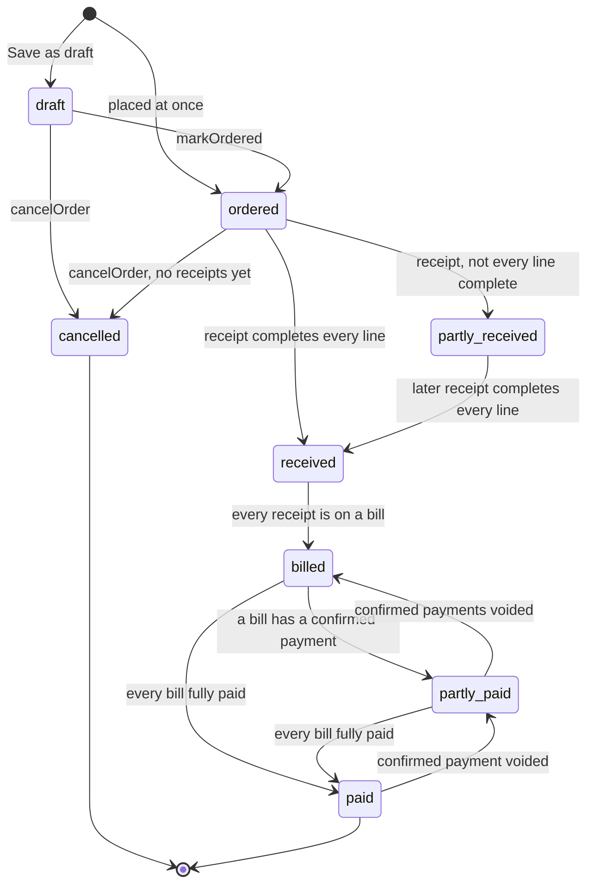
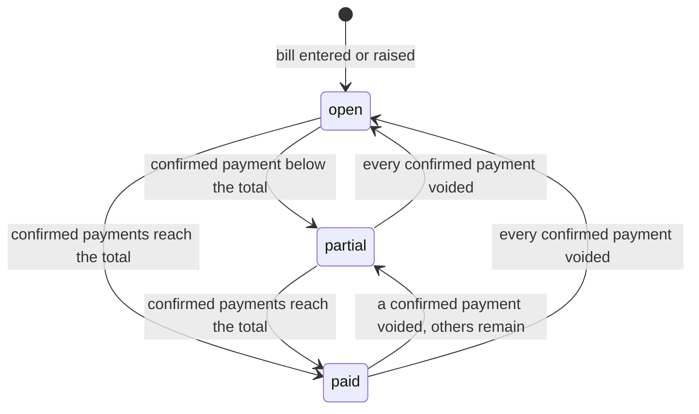
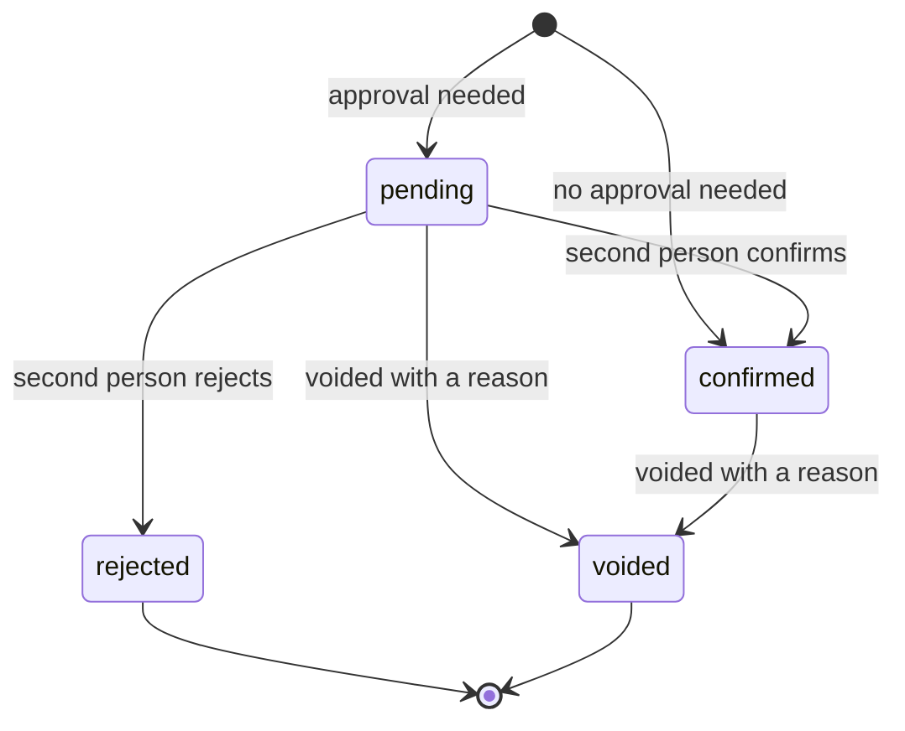
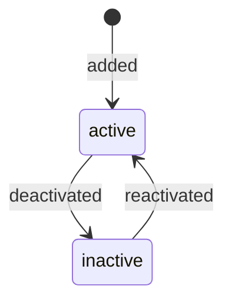

# Purchasing

Written from the demo code, 2026-11-10.

## Purpose

Purchasing covers what the company buys and owes. It holds the supplier directory and the people at each supplier, purchase orders, goods receipts, supplier bills, supplier payments and payables.

An order goes from draft to placed, goods arrive in one or more receipts, the supplier's bill is entered only for what arrived, and payments are split over bills with proof and an optional second person. What is owed is always derived. A bill stores no paid amount.

The feature keys are `purchasing.suppliers`, `purchasing.orders` and `finance.payments-queue`. Screens are `/purchasing` with the tabs Suppliers, Purchase orders, and Bills and payables, plus `/finance?view=payments`.

## Who uses it

Effective access is role permissions, intersected with the company ceiling and enabled modules. All keys below belong to the `core` module.

| Action | Permission key | Default roles | Enforced in |
| --- | --- | --- | --- |
| Open the Purchasing page | `purchasing.order.view` or `purchasing.bill.view` | Owner, Manager, Accountant, Purchasing, Warehouse | `purchasing-page.tsx`, `apps/web/src/products/flooring.ts` |
| See the supplier directory | `purchasing.supplier.view` | Owner, Manager, Accountant, Purchasing, Warehouse | Not checked. The Suppliers tab shows to anyone who can open the page |
| Add a supplier, add a contact | `purchasing.supplier.create` | Owner, Manager, Purchasing | `saveSupplier`, `saveSupplierContact` in `apps/web/src/lib/api/demo/supplier-actions.ts`, `supplier-picker.tsx`, `contact-picker.tsx` |
| Edit, deactivate or reactivate a supplier or contact | `purchasing.supplier.edit` | Owner, Manager, Purchasing | `saveSupplier`, `setSupplierStatus`, `saveSupplierContact`, `setContactStatus` in `supplier-actions.ts` |
| See purchase orders | `purchasing.order.view` | Owner, Manager, Accountant, Purchasing, Warehouse | `purchasing-page.tsx`, `apps/web/src/products/pages.ts` |
| Create, place or cancel an order | `purchasing.order.create` | Owner, Manager, Purchasing | `createPurchaseOrder`, `markOrdered`, `cancelOrder` in `apps/web/src/lib/api/demo/purchasing-actions.ts` |
| Approve an order | `purchasing.order.approve` | Owner, Manager, Purchasing | Not checked. Orders have no approval step |
| Receive goods | `purchasing.order.receive` | Owner, Manager, Purchasing, Warehouse | `recordReceipt` in `purchasing-actions.ts`, `order-drawer.tsx` |
| See bills and payables | `purchasing.bill.view` | Owner, Manager, Accountant, Purchasing | `purchasing-page.tsx`, `pages.ts` |
| Enter a supplier's bill | `purchasing.bill.create` | Owner, Manager, Accountant, Purchasing | `enterBill` in `purchasing-actions.ts`, `order-drawer.tsx` |
| Record a supplier payment | `purchasing.payment.record` | Owner, Manager, Accountant, Purchasing | `recordSupplierPayment` in `purchasing-actions.ts` |
| Confirm or reject a supplier payment | `purchasing.payment.approve` | Owner, Manager, Accountant | `reviewSupplierPayment` in `purchasing-actions.ts`, `bill-drawer.tsx`, `payments-queue.tsx` |
| Void a supplier payment | `purchasing.payment.void` | Owner, Manager, Accountant | `voidSupplierPayment` in `purchasing-actions.ts`, `bill-drawer.tsx` |
| Open Payments to verify | `sales.payment.approve` or `purchasing.payment.approve` | Owner, Manager, Accountant | `pages.ts`. Supplier rows need `purchasing.payment.approve` in `payments-queue.tsx` |
| See money columns on suppliers and orders | `inventory.product.view_sensitive` or `purchasing.bill.view` | Owner, Manager, Accountant, Purchasing | `money` in `purchasing-page.tsx`, `supplier-drawer.tsx` |
| See unit cost in the order drawer | `inventory.product.view_sensitive` | Owner, Manager, Accountant, Purchasing | `showCost` in `order-drawer.tsx` |
| Set the payment approval rule | `settings.payments.manage` | Owner, Accountant | `SETTINGS_PERMISSIONS.payments` in `apps/web/src/lib/api/demo/permission-rules.ts` |

Warehouse can receive goods but has no `purchasing.bill.view`, so it sees no bills tab. Purchasing can record a payment but cannot confirm or void one.

Data scope does not narrow any purchasing collection. `FILTERS` in `apps/web/src/lib/api/demo/scope.ts` has no entry for them. `DemoStore.list` puts no permission check on them, because they are not in `PRIVATE_COLLECTIONS` in `store.ts`.

The generic `save` refuses `supplierContacts`, `purchaseOrders`, `receipts`, `bills` and `supplierPayments` through `SAVE_PERMISSIONS` in `permission-rules.ts`. `suppliers` is allowed there for `purchasing.supplier.create` and `purchasing.supplier.edit`, but the screens use `saveSupplier`.

## Workflows and status rules

The normal path:

1. Find or add the supplier and sales rep on the order form. Anything added is saved to the directory at once.
2. Add lines, each with a cost per sq ft and, if it differs, its own warehouse.
3. Save as a draft, or place the order. The order is emailed to the rep, or marked as ordered by phone.
4. Receive goods in one or more receipts.
5. Enter the supplier's bill for what arrived and has not been billed.
6. Pay, with proof. A second person confirms it if the company's rule asks for that.

### PurchaseOrder status

`PurchaseOrder.status` stores only `draft`, `ordered` or `cancelled`. Everything after `ordered` is derived by `poState` in `packages/shared/src/operations/purchasing.ts`.



| Transition | Decided by | File |
| --- | --- | --- |
| Created as `draft` or `ordered` | `createPurchaseOrder`, from `input.asDraft` | `purchasing-actions.ts` |
| `draft` to `ordered` | `markOrdered` | `purchasing-actions.ts` |
| To `cancelled` | `cancelOrder`, refused if a receipt exists | `purchasing-actions.ts` |
| Every derived state | `poState` | `operations/purchasing.ts` |

```ts
if (po.status !== "ordered") return po.status;
const got = receivedByLine(po.id, receipts);
const anyIn = [...got.values()].some((v) => v.gt(0));
if (!anyIn) return "ordered";
const all = po.lines.every((l) => (got.get(l.id) ?? dec(0)).gte(l.quantity));
const own = bills.filter((b) => b.poId === po.id);
const fullyBilled = all && unbilledReceipts(po, receipts, bills).length === 0 && own.length > 0;
if (!fullyBilled) return all ? "received" : "partly_received";
const ledgers = own.map((b) => billLedger(b, payments, today));
if (ledgers.every((l) => l.state === "paid")) return "paid";
return ledgers.some((l) => l.state !== "open") ? "partly_paid" : "billed";
```

An order that is only partly received keeps the label Partly received even if its receipts are billed and paid.

### Bill state (derived)

`Bill` has no status field. `billLedger` in `operations/purchasing.ts` derives `state`, and an `overdue` flag sits beside it.



### SupplierPayment.status



| Transition | Decided by | File |
| --- | --- | --- |
| Created as `pending` or `confirmed` | `recordSupplierPayment`, using `needsApproval` | `purchasing-actions.ts`, `packages/shared/src/operations/payments.ts` |
| `pending` to `confirmed` or `rejected` | `reviewSupplierPayment`. Never by the person who recorded it | `purchasing-actions.ts` |
| `pending` or `confirmed` to `voided` | `voidSupplierPayment` | `purchasing-actions.ts` |

### Supplier.status and SupplierContact.status



| Transition | Decided by | File |
| --- | --- | --- |
| Supplier `active` to `inactive` | `setSupplierStatus`, refused with an open order or a balance | `supplier-actions.ts` |
| Contact `active` to `inactive` | `setContactStatus`, promotes a new primary | `supplier-actions.ts` |

Suppliers and contacts are deactivated, never deleted.

## Business rules

1. **Supplier types.** `SupplierType` in `packages/shared/src/types/purchasing.ts`: goods, services, utility, government. The same directory serves expenses. `expense-form-dialog.tsx` lists only active suppliers whose type is not `goods`.

2. **Adding a supplier.** `saveSupplier` in `supplier-actions.ts`. Only a name is required. A new supplier defaults to type `goods`, status `active`, terms `pay_on_order` and credit limit `"0.00"`. The order form passes `{ name, from: "order" }`, which only changes the audit text. Inline adding is on the purchase order form only, and needs `purchasing.supplier.create`.

3. **Profile incomplete is derived, never stored.** `supplierProfileGaps` in `packages/shared/src/suppliers.ts`. The label shows when the list is not empty. The gaps are `"an address"` when `address.street` is empty, and `"a way to reach them"` when the supplier has no email, no phone, and no active contact with an email, mobile or office phone.

4. **Duplicate warning.** `findSimilarSupplier` and `normalizeCompanyName` in `suppliers.ts`. Names are compared after lowercasing, removing punctuation and removing inc, incorporated, llc, co, corp, corporation, company, ltd and limited. A match warns and never blocks.

5. **Supplier search.** `searchSuppliers` in `suppliers.ts`. It looks at active suppliers by name, account number, email or phone, and at active contacts by name, email or phone. Phones match on digits only, once at least 3 digits are typed.

6. **Contacts.** `contactProblem` in `suppliers.ts`: a name, and an email or a phone. WhatsApp needs a mobile number.

7. **One primary contact.** `saveSupplierContact` and `setContactStatus` in `supplier-actions.ts`. A contact is primary if asked for or if no other active contact exists:

   ```ts
   isPrimary: input.isPrimary || others.filter((c) => c.id !== before?.id).length === 0
   ```

   Saving a primary clears the others. When a primary is deactivated, the first active `sales_rep` in the list takes over, else the first active contact.

8. **Contact order.** `contactsOf` in `suppliers.ts`: primary first, then sales rep, account manager, other, and accounts receivable last, then by name. The order form preselects the first.

9. **Deactivating a supplier.** `setSupplierStatus` in `supplier-actions.ts`. Refused if any order has stored status `ordered`, or any bill has a balance. See the first edge case.

10. **Order numbers and dates.** `nextNumber(poPrefix, numbers, 3001)`. The form sets `expectedAt` to today plus `LEAD_DAYS`, which is 10, in `new-order-dialog.tsx`. There is no field to change it.

11. **Order total.** `poTotal` in `operations/purchasing.ts`. Each line rounds to cents:

    ```ts
    moneyString(sum(lines.map((l) => roundMoney(dec(l.quantity).times(l.unitCost)))))
    ```

12. **Order lines.** `createPurchaseOrder` needs at least one line, a supplier that exists, and a quantity above zero on every line. Area goods are in sq ft at a cost per sq ft. `AreaQuantityInput` rounds carton goods up to whole cartons (`wholeCartonArea`) and accepts "22c". `unitCost` starts at `Product.cost`. The form offers the supplier's own products, or every non-service product if it has none.

13. **Warehouse per line.** `PoLine.locationId` is set only when the line differs from the order's Receive into. The receipt form starts each line there, and `receiptStock` uses `line.locationId ?? receipt.locationId`. One receipt can fill several warehouses.

14. **Sales rep snapshot.** `contactSnapshot` in `purchasing-actions.ts`, taken when the order becomes `ordered`. A draft reads the contact live, and an ordered order keeps its copy:

    ```ts
    contact ? { name: contact.name, email: contact.email, phone: contact.mobile || contact.officePhone } : null
    ```

15. **How the order reaches the supplier.** `notifyPoSent` in `purchasing-actions.ts`. It goes to the chosen contact if the contact has an email, else to the supplier's company email.

16. **Mark as ordered by phone.** With no email on the contact or the supplier, the button reads Mark as ordered by phone. The order becomes `ordered`, `placedVia` records `phone`, and no Outbox row is written. `new-order-dialog.tsx` uses `contact?.email || supplier?.email`. `order-drawer.tsx` also checks the snapshot.

17. **Cancelling.** `cancelOrder` needs a reason of at least 3 characters. It is refused once any receipt exists.

18. **Receipts.** `recordReceipt` and `receiptProblem` in `purchasing-actions.ts` and `operations/purchasing.ts`. Lines with nothing received or damaged are dropped. The order must have stored status `ordered`. Each line must be on the order, not negative, and within what is still to come:

    ```ts
    const open = dec(ordered.quantity).minus(got.get(ordered.id) ?? 0);
    if (received.plus(damaged).gt(open)) return `${ordered.description}: only ${open.toString()} is still to come.`;
    ```

    `receivedByLine` counts good units only, so damaged units stay owed.

19. **What a receipt adds to stock.** `receiptStock` in `operations/purchasing.ts`. Damaged units do not enter stock.

    - Boxed goods write a `StockMovement` of kind `receipt`.
    - Broadloom creates the rolls entered, in bin `"Receiving"`, each with `costPerSqFt` of `roundUnitCost(dec(ordered.unitCost)).toString()`.
    - With no rolls entered, one roll is made:

    ```ts
    const fallback = dec(line.received).dividedBy(product.widthFt).toDecimalPlaces(1);
    // rollNumber: `${product.sku.slice(0, 2)}-${receipt.number.slice(-4)}`
    // dyeLot: `${po.number.slice(-3)}A`
    ```

20. **Bills are only for received goods.** `enterBill` in `purchasing-actions.ts` and `unbilledReceipts` in `operations/purchasing.ts`. A bill needs at least one receipt not yet on any bill, a bill number, a total matching `^\d+(\.\d{1,2})?$` above zero, and the supplier's file. It takes every unbilled receipt of the order together.

21. **Match differences are flagged, not blocked.** `receivedValue` and `matchIssues` in `operations/purchasing.ts`. Each receipt line rounds to cents at the order's cost. Damaged units are not billed.

    ```ts
    roundMoney(dec(l.received).times(po.lines.find((x) => x.id === l.poLineId)?.unitCost ?? 0))
    // matchIssues
    const diff = dec(total).minus(expected);
    if (diff.abs().lt("0.01")) return [];
    ```

    Otherwise one line is stored, for example "Billed $X, received goods worth $Y (over by $Z)." It shows as Check in the Match column. The bill form starts at the received value.

22. **Due date.** `supplierDueDate` in `operations/purchasing.ts`. `issuedAt` for `pay_on_order` and `cod`. Plus 30, 60, 90 or 180 days for net terms. For `monthly_statement`, the last day of the month after the bill date:

    ```ts
    const [y, m] = issuedAt.split("-").map(Number);
    const next = new Date(Date.UTC(y, m + 1, 0));
    ```

23. **Three kinds of bill share one table.** Payables, supplier balances and supplier payments treat them all the same.

    | | Purchase order bill | Pay-later expense bill | Subcontract bill |
    | --- | --- | --- | --- |
    | Created by | `enterBill`, by a person with `purchasing.bill.create` | `linkBill` in `expense-actions.ts`, automatically when the expense is confirmed | `contractBill` in `packages/shared/src/contracts/documents.ts`, when a billing posts |
    | `poId` | The order | `null` | `null` |
    | `receiptIds` | Every unbilled receipt | `[]` | `[]` |
    | `number` | The supplier's own number | The expense number, `EXP-` | `${contract.number}-${billing.number}` |
    | `total` | Typed, flagged if different | `moneyString(expenseCost(expense))`, amount plus tax | `dec(amounts.gross).minus(amounts.withheld).plus(amounts.released)` |
    | `dueAt` | `supplierDueDate(issuedAt, terms)` | `expense.dueAt ?? supplierDueDate(expense.date, supplier.terms)` | `supplierDueDate(issuedAt, terms)` |
    | `matchIssues` | From the received value | `[]` | `[]` |
    | `files` | The supplier's invoice, required | The expense's receipts | `[]` |
    | Extra fields | None | None. The link is `Expense.billId` | `contractId`, `billingId`, `kind`, `gross`, `retainageWithheld`, `retainageReleased` |
    | Can it go away | No action removes it | `voidExpense` deletes it if no confirmed payment | `voidBilling` deletes it if no confirmed payment |

    A pay-later bill has no match check because there is no order or receipt. `Bill` has no `expenseId`, so the bill does not link back to its expense. Its Order column is blank.

24. **What a bill owes.** `billLedger` in `operations/purchasing.ts`:

    ```ts
    const balance = maxDec(dec(bill.total).minus(paid), 0);          // paid = confirmed allocations
    const overdue = balance.gt(0) && daysBetween(bill.dueAt, today) > 0;
    unpaid: moneyString(maxDec(balance.minus(pending), 0))           // pending = pending allocations
    state: balance.isZero() ? "paid" : paid.gt(0) ? "partial" : "open"
    ```

    Rejected and voided payments count for nothing, so voiding a payment puts the amount back on the bill.

25. **Recording a supplier payment.** `recordSupplierPayment` in `purchasing-actions.ts`.

    - Amount matches `^\d+(\.\d{1,2})?$`, is above zero, and is not more than the `unpaid` total of the bills chosen. No supplier credit exists.
    - A reference is required unless the method is `cash`.
    - The date must be set and not in the future.
    - Methods are cash, check, ach, card, other.
    - Proof is required through `describeFiles`.

26. **Proof files.** `proofFilesProblem` and `detectProofType` in `packages/shared/src/file-types.ts`. At least 1 and at most 3 files, each at most 5 MB. The real type is read from the first bytes: PDF, PNG, JPEG, WebP or HEIC. The same check applies to a supplier's invoice on a bill. Bytes live in the IndexedDB file store, and the record keeps only `FileMeta`.

27. **Allocation.** `allocate` in `operations/purchasing.ts`. Oldest due first, up to each bill's `unpaid` figure. `dueAt` is compared as text.

    ```ts
    const take = minDec(left, bill.balance);
    out.push({ billId: bill.id, amount: moneyString(take) });
    left = left.minus(take);
    ```

28. **Approval.** `needsApproval` in `operations/payments.ts`, reading `settings.payments`, the same rule as customer payments. Summit is seeded with `approvalRequired: true` and threshold `"1000.00"`. Keystone has approval off. The rule that a Sales-recorded customer payment always waits does not apply here.

    ```ts
    if (!settings.approvalRequired) return false;
    const threshold = settings.approvalThreshold.trim();
    return !threshold || dec(amount).gt(threshold);
    ```

29. **Review and void.** `reviewSupplierPayment` needs status `pending` and a different person from the one who recorded it. A rejection needs a reason of at least 3 characters. `voidSupplierPayment` needs status `pending` or `confirmed` and a reason of at least 3 characters. The same person may record and void.

30. **Payments to verify.** `PaymentsQueue` in `apps/web/src/features/finance/payments-queue.tsx` lists customer rows with `sales.payment.approve` and supplier rows with `purchasing.payment.approve`, each with status `pending`, plus the proof files and Confirm or Reject in place. Nobody can confirm what they recorded. A pending payment also shows on the bill (`BillDrawer`), so a bill is not paid twice by accident.

31. **Supplier balance.** `supplierBalance` in `operations/purchasing.ts`. `owed` and `overdue` sum the bills' balances. `nextDueAt` is the earliest due date of a bill not yet overdue.

    ```ts
    creditUsedPct: limit.gt(0) ? owed.div(limit).times(100).toDecimalPlaces(1).toString() : "0"
    ```

32. **Payables.** `payablesSummary` in `operations/purchasing.ts`. Only bills with a balance above zero count. `dueSoon` is the current bills with `b.dueAt <= addDays(today, 7)`. Rows show `total`, `current`, `overdue` and `dueSoon`, where `overdue` means past due.

33. **Remaining on the orders list.** `poRemaining` in `purchasing-page.tsx`: `dec(p.total).minus(paid).toString()`, where `paid` sums the order's bills.

34. **Numbers.** Receipts are `GR-0001` and supplier payments `SP-0001`, from `nextPaymentNumber` in `operations/payments.ts`.

## Entities and fields

### Supplier (`packages/shared/src/types/purchasing.ts`)

| Field | Type | Notes |
| --- | --- | --- |
| `id` | string | |
| `name` | string | Required |
| `type` | `goods`, `services`, `utility`, `government` | Default `goods` |
| `status` | `active`, `inactive` | Never deleted |
| `accountNumber` | string | The company's account with this supplier. Searchable |
| `email`, `phone` | string | The company's main line. The people are contacts |
| `terms` | `pay_on_order`, `cod`, `net_30`, `net_60`, `net_90`, `net_180`, `monthly_statement` | Sets the bill due date |
| `creditLimit` | string | Shown, not enforced |
| `categories` | `ProductCategory[]` | `saveSupplier` keeps what is there and offers no way to change it |
| `address` | `Address` | |
| `track1099` | boolean | |
| `taxForm` | `SupplierTaxForm` or null | No tax ID is stored (plan K-9) |
| `notes` | string | |
| `externalId` | string, optional | Set by an import |

### SupplierTaxForm (`types/purchasing.ts`)

| Field | Type | Notes |
| --- | --- | --- |
| `w9OnFile` | boolean | |
| `receivedAt` | string or null | |
| `legalName`, `entityType` | string | |
| `exemptFromReporting` | boolean | |

### SupplierContact (`types/purchasing.ts`)

| Field | Type | Notes |
| --- | --- | --- |
| `id`, `supplierId` | string | One supplier per contact |
| `name` | string | Required |
| `role` | `sales_rep`, `account_manager`, `accounts_receivable`, `other` | The form defaults to `sales_rep` |
| `mobile`, `officePhone`, `email` | string | At least one required. Call uses `mobile`, then `officePhone` (`callNumber`) |
| `whatsapp` | boolean | Needs a mobile. `whatsappLink` adds country code 1 for a 10 digit number |
| `preferredMethod` | `call`, `email`, `whatsapp` | |
| `notes` | string | |
| `isPrimary` | boolean | One active primary per supplier |
| `status` | `active`, `inactive` | |

### PurchaseOrder (`types/purchasing.ts`)

| Field | Type | Notes |
| --- | --- | --- |
| `id`, `number` | string | |
| `supplierId` | string | |
| `status` | `draft`, `ordered`, `cancelled` | The rest is derived |
| `createdAt`, `expectedAt` | string | |
| `orderedAt`, `cancelledAt` | string or null | |
| `locationId` | string | Receive into |
| `lines` | `PoLine[]` | |
| `total` | string | From `poTotal` |
| `contactId` | string or null | The sales rep |
| `contactSnapshot` | `{ name, email, phone }` or null | Set when ordered |
| `supplierRef` | string | The supplier's order number, optional |
| `buyerId` | string | The person who made the order |
| `placedVia` | `email`, `phone` or null | Null while a draft |

### PoLine (`types/purchasing.ts`)

| Field | Type | Notes |
| --- | --- | --- |
| `id`, `productId`, `description` | string | |
| `quantity` | string | In the selling unit, sq ft for area goods |
| `unit` | `SellUnit` | |
| `unitCost` | string | |
| `sqFtPerCarton` | string, optional | Copied when written, for the carton hint |
| `locationId` | string, optional | Set only when it differs from the order |

### GoodsReceipt and ReceiptLine (`types/purchasing.ts`)

| Field | Type | Notes |
| --- | --- | --- |
| `id`, `number` | string | `GR-0001` |
| `poId`, `supplierId` | string | |
| `locationId` | string | Default warehouse of the receipt |
| `receivedAt`, `receivedById`, `receivedBy` | string | |
| `note` | string | The form sends empty text |
| `lines` | `ReceiptLine[]` | |
| Line `poLineId`, `productId` | string | |
| Line `received`, `damaged` | string | Good units go to stock and can be billed |
| Line `rolls` | array of `{ rollNumber, dyeLot, lengthFt }` | Broadloom |
| Line `locationId` | string, optional | When different from the receipt |

### Bill (`types/purchasing.ts`)

| Field | Type | Notes |
| --- | --- | --- |
| `id`, `number` | string | See rule 23 for what `number` holds |
| `supplierId` | string | |
| `poId` | string or null | Null on pay-later and subcontract bills |
| `receiptIds` | string[] | Empty on pay-later and subcontract bills |
| `issuedAt`, `dueAt` | string | |
| `total` | string | Payments are never stored here |
| `matchIssues` | string[] | |
| `files` | `FileMeta[]` | |
| `contractId`, `billingId` | string, optional | Subcontract bills |
| `kind` | `progress`, `retainage_release`, optional | Subcontract bills |
| `gross`, `retainageWithheld`, `retainageReleased` | string, optional | Subcontract bills |

### SupplierPayment (`types/purchasing.ts`)

| Field | Type | Notes |
| --- | --- | --- |
| `id`, `number` | string | `SP-0001` |
| `supplierId` | string | |
| `date` | string | Not in the future |
| `method` | `cash`, `check`, `ach`, `card`, `other` | |
| `reference`, `note` | string | Reference required unless cash |
| `files` | `FileMeta[]` | Proof |
| `allocations` | array of `{ billId, amount }` | One payment over several bills |
| `amount` | string | |
| `status` | `pending`, `confirmed`, `rejected`, `voided` | |
| `recordedById`, `recordedBy`, `recordedAt` | string | |
| `reviewedBy`, `reviewedAt`, `rejectReason` | string or null | |
| `voidedBy`, `voidedAt`, `voidReason` | string or null | |

### FileMeta (`packages/shared/src/types/sales.ts`)

| Field | Type | Notes |
| --- | --- | --- |
| `id`, `name` | string | |
| `type` | string | The real type, from the first bytes |
| `size` | number | Bytes |
| `uploadedBy`, `uploadedAt` | string | |

## Events and audit entries

Notification events, from `packages/shared/src/notifications/events.ts`:

| Event key | Recipients | Trigger | Raised in |
| --- | --- | --- | --- |
| `po.sent` | The order's contact if it has an email, else the supplier's company email | An order becomes `ordered` and was not placed by phone | `notifyPoSent`, from `createPurchaseOrder` and `markOrdered` |
| `payment.to_verify` | Active users holding `purchasing.payment.approve`, except the person who recorded it | `recordSupplierPayment` creates a `pending` payment | `notifyPaymentToVerify` in `notification-actions.ts` |
| `delivery.failed` | The person who caused the send, in the app | A `po.sent` row has no valid email | `reportFailure` in `notification-actions.ts` |

No event fires when a payment is confirmed, rejected or voided, or when goods are received or a bill is entered.

Derived attention check, from `apps/web/src/lib/attention.ts`:

| Key | Needs | Counts |
| --- | --- | --- |
| `verify-payments` | `sales.payment.approve`, feature `finance.payments-queue` | Pending customer and supplier payments the viewer did not record |

Audit entries. Category is `data` unless noted. An entry with no category in the code gets `payment` from `actionContext` in `store.ts`.

| Action string | Trigger | Function |
| --- | --- | --- |
| `Added supplier` | Supplier added from the directory | `saveSupplier` |
| `Added supplier from a purchase order` | Supplier added on the order form | `saveSupplier` |
| `Edited supplier` | Supplier edited | `saveSupplier` |
| `Changed supplier status` | Deactivated or reactivated | `setSupplierStatus` |
| `Added supplier contact`, `Edited supplier contact` | Contact saved | `saveSupplierContact` |
| `Changed supplier contact status` | Contact deactivated or reactivated | `setContactStatus` |
| `Saved purchase order draft` | Saved as a draft | `createPurchaseOrder` |
| `Created purchase order` | Placed at once | `createPurchaseOrder` |
| `Ordered purchase order` | Draft placed | `markOrdered` |
| `Cancelled purchase order` | Cancelled, with the reason in `after` | `cancelOrder` |
| `Received goods` | Receipt recorded | `recordReceipt` |
| `Entered bill` | Bill entered, with the received value in `before` and any match issue in `after` | `enterBill` |
| `Paid supplier` | Payment recorded. Category `payment` | `recordSupplierPayment` |
| `Confirmed supplier payment`, `Rejected supplier payment` | Reviewed. Category `payment` | `reviewSupplierPayment` |
| `Voided supplier payment` | Voided, with the reason in `after`. Category `payment` | `voidSupplierPayment` |

A pay-later bill has no audit entry of its own. The expense's `Recorded expense` or `Approved expense` entry covers it.

## Emails

One email, and none is really sent. Each one is a row in the Outbox.

| Event | Subject | Body | Attachment |
| --- | --- | --- | --- |
| `po.sent` | `Purchase order {{ po.number }} from {{ company.name }}` | `Hello {{ contact.name }},` then `Please find purchase order {{ po.number }} attached, for delivery by {{ po.expected }}.` | `{{ po.number }}.pdf` |

The default channel is email only. The Outbox row stores the attachment name and a link to the order. The PDF itself is built in the browser by `po-pdf.tsx` when someone downloads it. `po.expected` carries the raw date.

`payment.to_verify` is in-app by default. A company can switch on its email channel in Settings, Notifications.

There is no remittance email to the supplier, although ADR 0022 describes one.

## Reports

- **Bills and payables tab.** Shows Current, Overdue and Due in 7 days from `payablesSummary`, and the total owed.
- **Suppliers tab.** Owed, Overdue, Credit limit, Credit used and Next due per supplier, for people with the `money` flag.
- **Business report.** `You owe suppliers, current` and `You owe suppliers, overdue`, from `balancesAt` in `packages/shared/src/business-report.ts`, with bills and payments cut off at the report date.
- **Payables aging report.** Feature `reports.payables-aging` has status `removed` (plan A3). The code stays.
- **Purchase order PDF.** `po-pdf.tsx`. The sales rep is the snapshot once ordered, or the chosen contact on a draft.
- **Lists.** Each table exports a CSV of its filtered rows (`shell.tables`).

## Edge cases and known limits

- **Deactivation is stricter than it reads.** `setSupplierStatus` refuses when any order has stored status `ordered`. Stored status stays `ordered` after a full receipt and full payment, because later stages are derived. So any supplier with one placed, uncancelled order can never be deactivated.
- **A short delivery cannot be closed.** Damaged units stay owed. `cancelOrder` is refused once a receipt exists. An order that never gets its replacement goods stays Partly received, and its receipts can still be billed.
- **Bills cannot be voided or edited.** No action removes or changes a purchase order bill. A wrong bill stays.
- **A voided expense or billing can orphan a pending payment.** `voidExpense` and `voidBilling` block only on confirmed payments and then delete the bill. A pending payment keeps an allocation to a bill that no longer exists, and `reviewSupplierPayment` can still confirm it.
- **Billing takes every open receipt.** `enterBill` cannot bill one receipt and leave another.
- **Duplicates.** No check stops the same supplier bill number twice. The duplicate supplier name check warns only.
- **Credit limit and terms are shown, not enforced.** Nothing blocks an order or a bill over the limit.
- **Supplier credit limit gate.** It is shown with `inventory.product.view_sensitive` or `purchasing.bill.view`. `SENSITIVE.creditLimit` is a customer key and is not used here.
- **Cost on the order form.** `new-order-dialog.tsx` always shows and fills `unitCost`, with no `view_sensitive` check. Default roles with `purchasing.order.create` all hold that key, but a custom role may not.
- **Whole cartons are a screen rule here.** `createPurchaseOrder` and `recordReceipt` do not check whole cartons. `AreaQuantityInput` does the rounding.
- **Drafts cannot be edited.** No action changes an order's lines. A draft is placed or cancelled.
- **Date checks.** `enterBill` does not refuse a future bill date. The screen caps it at today.
- **Overpayment.** A payment above what the chosen bills owe is refused. There is no supplier credit or refund.
- **Empty bill list.** `recordSupplierPayment` treats an empty `billIds` as every open bill. The sheet disables Save when no bill is picked, so this applies only to a direct call.
- **Attention count.** `verify-payments` needs `sales.payment.approve`. Manager holds `purchasing.payment.approve` but not that key, so it can confirm supplier payments and sees no count in Needs attention.
- **Opening proof files.** `getFile` in `store.ts` needs one of `sales.payment.view`, `hr.employee.view`, `hr.portal.view`, `contracts.contract.view` or `finance.expense.view`. Default roles with purchasing work reach it through one of those. A custom role with only purchasing keys cannot open a proof.
- **Inactive contact on a draft.** `contactSnapshot` and `notifyPoSent` do not check `status`, so an inactive contact chosen on a draft still gets the order.
- **Inline add on expenses.** ADR 0022 planned it. `expense-form-dialog.tsx` has no inline add.
- **Proof wording on bills.** The store's missing-file message speaks of a receipt, bank confirmation or check photo even for a supplier's invoice. The form disables Enter bill with no file, so this appears only on a direct call.
- **No real sending.** `po.sent` writes an Outbox row only. Electronic orders to suppliers are not in the demo.
