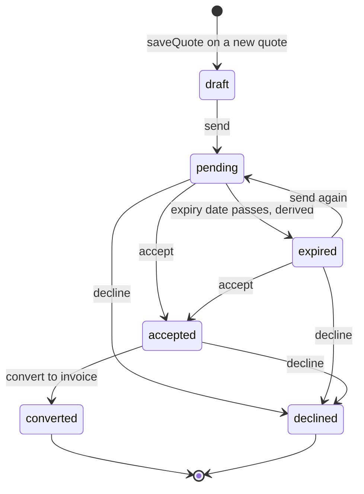
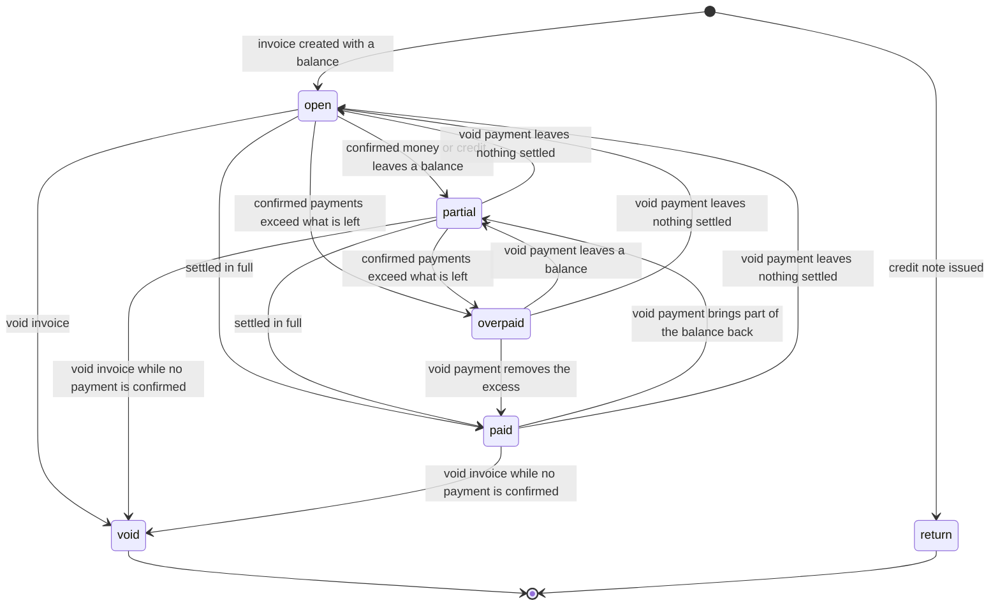
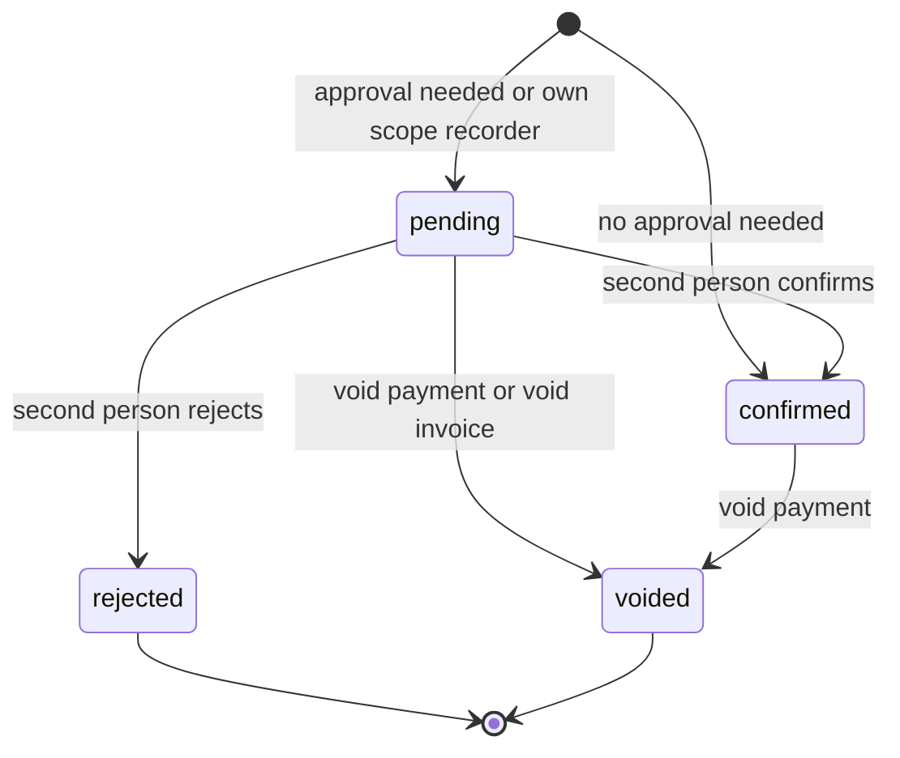
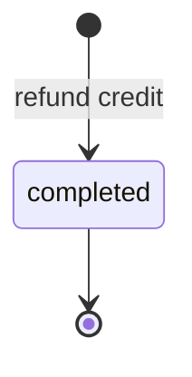
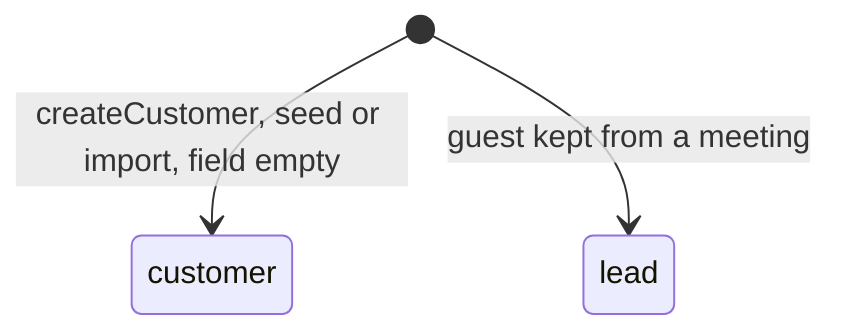

# Sales

Written from the demo code, 2026-11-10.

## Purpose

Sales takes a job from a priced quote to money received. It covers customers and their addresses, quotes with rooms and lines, tax by job site, conversion to an invoice, customer payments with proof and a two-person check, corrections by reversal, credit notes, customer credit and refunds, and receivables.

An invoice stores no status and no paid amount. Both are worked out from its payments, credits and write-offs each time they are shown.

Feature switches: `sales.quotes`, `sales.quote-availability`, `sales.invoices`, `sales.payments`, `sales.customers`, `finance.payments-queue`, `units.square-feet`, `shell.addresses`. Sales > Team is `sales.team` and is covered in `docs/product-spec/commissions.md`.

Where the code lives:

| Part | File |
| --- | --- |
| Quote, conversion and customer store calls | `apps/web/src/lib/api/demo/store.ts` |
| Payment store calls | `apps/web/src/lib/api/demo/payment-actions.ts` |
| Void, write-off, credit, refund, mark sent | `apps/web/src/lib/api/demo/invoice-actions.ts` |
| Credit notes and commission split | `apps/web/src/lib/api/demo/commission-actions.ts` |
| Totals | `packages/shared/src/documents.ts` |
| Quote rules and conversion | `packages/shared/src/operations/quotes.ts`, `packages/shared/src/operations/quote-status.ts` |
| Invoice ledger and customer credit | `packages/shared/src/ledger.ts` |
| Payment validation and invoice actions | `packages/shared/src/operations/payments.ts` |
| Tax | `packages/shared/src/us-pack/tax.ts`, `packages/shared/src/us-pack/tax-defaults.ts` |
| Receivables and statement | `packages/shared/src/receivables.ts`, `packages/shared/src/analytics.ts` |
| Customer helpers | `packages/shared/src/customers.ts` |
| Units | `packages/shared/src/units.ts` |
| Reservations and availability | `packages/shared/src/reservations.ts`, `apps/web/src/lib/api/demo/inventory-actions.ts` |
| Contract billing invoices | `apps/web/src/lib/api/demo/contract-actions.ts` |
| Notifications | `apps/web/src/lib/api/demo/notification-actions.ts`, `packages/shared/src/notifications/events.ts` |
| Business report | `packages/shared/src/business-report.ts` |
| Page permissions | `apps/web/src/products/pages.ts` |
| Invoice PDF | `apps/web/src/features/invoices/invoice-pdf.tsx` |

A file name used alone below means the file in this table. `payments.ts` means `packages/shared/src/operations/payments.ts`.

## Who uses it

The Owner role holds every key in the company's plan. Default roles come from `packages/shared/src/permissions/roles.ts`. "Store" below means the check runs inside the DemoStore action, so it holds even if a screen is bypassed. "Screen only" means nothing in the store checks it.

| Action | Permission key | Default roles | Enforced in |
| --- | --- | --- | --- |
| Open the quote list or a quote | `sales.quote.view` | Owner, Manager, Accountant, Sales | Screen only: `apps/web/src/products/pages.ts`, `SalesPage`, `QuotePage` |
| Create a quote | `sales.quote.create` | Owner, Manager, Sales | Store: `saveQuote` |
| Edit a saved quote | `sales.quote.edit` | Owner, Manager, Sales | Store: `saveQuote` |
| Send, accept or decline a quote | `sales.quote.edit` | Owner, Manager, Sales | Store: `updateQuoteStatus` |
| Change waste % on a line | `sales.waste.view` | Owner, Manager, Accountant, Warehouse | Store: `saveQuote` through `wasteChanged`. Column hidden in `QuoteBuilder` |
| Change tax on a document | `sales.tax.override` | Owner, Accountant | Store: `saveQuote`. Link in `QuoteSummary` |
| Draw rooms on the canvas | `retail.room.measure` (Retail module) | Owner, Manager, Sales | Screen only: `QuoteBuilder` |
| Start a transfer from a short line | `inventory.transfer.create` | Owner, Manager, Warehouse | Button in `QuoteBuilder`. The transfer call has its own check, see `docs/product-spec/inventory.md` |
| See margin on a quote | `sales.margin.view_sensitive` and `inventory.product.view_sensitive` | Owner, Manager, Accountant | Screen only: `QuoteSummary` through `seesMargin`; it also shows only when every line carries its cost |
| See margin on the dashboard, Best sellers and Sales → Team | `sales.margin.view_sensitive` and `inventory.product.view_sensitive` | Owner, Manager, Accountant | Screen only: `FigureRow`, `RevenuePanel`, `BestSellers`, `TeamTable` through `seesMargin`; each also shows only when every invoice it adds up carries its cost (a contract invoice arrives without it for anyone without contract cost) |
| Convert a quote to an invoice | `sales.invoice.create` | Owner, Manager, Accountant, Sales | Store: `convertQuoteToInvoice` |
| Create an invoice for a roll cut | `sales.invoice.create` | Owner, Manager, Accountant, Sales | Store: `createRollInvoice` |
| Open the invoice list or an invoice | `sales.invoice.view` | Owner, Manager, Accountant, Sales | Screen only: `pages.ts`, `SalesPage`, `InvoicePage` |
| Mark an invoice as sent | `sales.invoice.edit` or `sales.invoice.create` | Owner, Manager, Accountant, Sales | Store: `markInvoiceSent`. The menu item asks for `sales.invoice.create` |
| Void an invoice | `sales.invoice.void` | Owner, Manager, Accountant | Store: `voidInvoice` |
| Issue a credit note | `sales.invoice.void` | Owner, Manager, Accountant | Store: `issueCreditNote` |
| Split commission on an invoice | `hr.commission.manage` or `sales.invoice.edit` | Owner, Manager, Accountant, HR manager | Store: `setCommissionSplit` |
| See payments on an invoice | `sales.payment.view` | Owner, Manager, Accountant, Sales | Screen only: `InvoicePage` |
| Open a proof file | Any of `sales.payment.view`, `hr.employee.view`, `hr.portal.view`, `contracts.contract.view`, `finance.expense.view` | Everyone holding one of them | Store: `getFile` |
| Record a payment or deposit, add a file | `sales.payment.record` | Owner, Manager, Accountant, Sales | Store: `recordPayment`, `attachPaymentFiles` |
| Confirm or reject a payment | `sales.payment.approve` | Owner, Accountant | Store: `reviewPayment` |
| Open Payments to verify | `sales.payment.approve` or `purchasing.payment.approve` | Owner, Accountant (customer rows need the first key) | Screen only: `pages.ts`, `PaymentsQueue` |
| Void a payment | `sales.payment.void` | Owner, Accountant | Store: `voidPayment` |
| Write off a balance | `sales.payment.write_off` | Owner, Accountant | Store: `writeOffBalance` |
| Apply customer credit, or record an extra amount as credit | `sales.payment.apply_credit` | Owner, Accountant | Store: `applyCredit`, `recordPayment` |
| Refund customer credit | `sales.payment.refund` | Owner, Accountant | Store: `refundCredit` |
| Open the customer list | `customers.customer.view` | Owner, Manager, Accountant, Sales | Screen only: `pages.ts`, `SalesPage` |
| Add a customer | `customers.customer.create` | Owner, Manager, Sales | Store: `createCustomer` |
| Edit a customer or their addresses | `customers.customer.edit` | Owner, Manager, Sales | Store: `saveCustomer`. Screen: `CustomerAddresses`, `CustomerDrawer` |
| See a credit limit | `customers.customer.view_sensitive` | Owner, Manager, Accountant | Screen only: `CustomersTable`, `CustomerDrawer` |
| Settings > Payments | `settings.payments.manage` | Owner, Accountant | Store: `updateSettings` through `settingsPermissions`. Screen: `PaymentsSettingsPage` |
| Settings > Sales and documents | `settings.localization.manage` to open the page. The store accepts it or `settings.tax.manage` | Owner, Accountant | Store: `updateSettings`. Screen: `apps/web/src/products/settings-menu.ts` |
| Tax rates in Settings > Localization | `settings.localization.manage` or `settings.tax.manage` | Owner, Accountant | Store: `updateSettings` |

Data scope, from `apps/web/src/lib/api/demo/scope.ts`, applied by `DemoStore.list` and `DemoStore.get`:

| Scope | Default roles | Quotes and invoices | Customers | Payments, credits, write-offs | Refunds |
| --- | --- | --- | --- | --- | --- |
| `own` | Sales | `salesRepId` is the viewer | `salesRepId` is the viewer | Follow their invoice | Follow their customer |
| `branch` | Manager | `branchId` is the viewer's branch | The rep's branch is the viewer's branch | Follow their invoice | Follow their customer |
| `all` | Owner, Accountant | Everything | Everything | Everything | Everything |

Keys in the catalog that no code checks: `sales.quote.delete`, `sales.quote.approve`, `sales.invoice.export`, `customers.customer.delete`, `customers.customer.export`, `sales.commission.manage`, `wholesale.credit.approve`. What `sales.quote.approve` was meant to gate: Could not determine from the code.

## Workflows and status rules

### Main flow

1. A person with `sales.quote.create` opens a new quote. `QuotePage` and `newQuote` in `apps/web/src/features/quotes/` set Fulfilled from to the person's default warehouse (`defaultWarehouse`), Sold at to a showroom in their branch or else the same warehouse, and the deposit to the company default.
2. They pick or quick-add a customer, enter the job site, draw rooms if the company has Retail, and add lines. Each stocked line shows what its warehouse can still promise.
3. Save as draft works at any point and needs only a customer.
4. Send / mark pending runs full validation, asks for an optional expiry date, and writes an Outbox row to the customer.
5. Mark accepted, then Convert to invoice. Conversion recomputes totals, reserves stock and closes the quote.
6. Mark as sent writes the invoice email to the Outbox. Conversion does not.
7. Someone records a deposit or payment with proof. Above the threshold, or when recorded by someone with only `own` scope roles, it waits in Payments to verify for a second person.
8. A confirmed payment lowers the balance and allows the warehouse to cut or issue the stock (`mayIssue` in `packages/shared/src/reservations.ts`).
9. Mistakes are corrected by reversal: void payment, void invoice, write-off, credit note, apply credit, refund.

The invoice page shows a timeline built by `timelineSteps` in `apps/web/src/features/invoices/invoice-timeline.tsx`: Created, Sent, Deposit (only when the invoice has a deposit percent), Installation scheduled and Installed (only when `installation.calendar` is on, which it is not), Paid.

### Quote status (`Quote.status`)

`expired` is not stored. `quoteState` reads a pending quote whose `expiresAt` is before today as expired.



| Transition | Decided by |
| --- | --- |
| New quote is a draft | `DemoStore.saveQuote` in `store.ts`, which keeps the stored `status`, `sentAt`, `expiresAt` and `invoiceId` on every save |
| Which of send, accept, decline is allowed | `quoteActions` in `quote-status.ts`, checked again by `DemoStore.updateQuoteStatus` |
| Target status of an action | `QUOTE_ACTION_STATUS` in `quote-status.ts` |
| Pending to expired | `quoteState` in `quote-status.ts` |
| Accepted to converted | `DemoStore.convertQuoteToInvoice`. It refuses anything but `accepted` |
| Converted and declined are closed | `quoteIsOpen` in `quote-status.ts`, checked by `saveQuote` and `convertQuoteToInvoice` |

A draft cannot be accepted directly. An expired quote cannot be converted until it is accepted. An accepted quote never expires, because `quoteState` only looks at pending quotes.

### Invoice state (derived, never stored)

`stateOf` in `ledger.ts` returns one of `open`, `partial`, `paid`, `overpaid`, `void`, `return`.



| Transition | Decided by |
| --- | --- |
| Any state from the records | `invoiceLedger` and `stateOf` in `ledger.ts` |
| A payment counts only when confirmed | `invoiceLedger`, filter `confirmed` |
| To void | `voidInvoice` in `invoice-actions.ts`, refused when `ledger.locked` is true |
| To return | `issueCreditNote` in `commission-actions.ts`, or a seeded return from `buildReturn` in `packages/shared/scripts/fixtures/sales.ts` |
| What the Update status menu offers | `invoiceActions` in `operations/payments.ts`, narrowed by permission in `apps/web/src/features/invoices/update-status-menu.tsx` |

Screens show `invoiceStatus` from `ledger.ts`: one leading status and extra labels. Void and return lead alone. Otherwise a payment waiting for verification leads, then overdue, then the base state. `Deposit paid` replaces `Partly paid` when the deposit is what was paid. `Open` is never shown as an extra label. Labels are in `INVOICE_STATUS_LABELS`.

### Payment status (`Payment.status`)



| Transition | Decided by |
| --- | --- |
| Starts pending or confirmed | `recordPayment` in `payment-actions.ts`, using `needsApproval` and `recordedByOwnScopeRole` |
| Pending to confirmed or rejected | `reviewPayment` in `payment-actions.ts`. Never by the person who recorded it |
| Pending or confirmed to voided | `voidPayment` in `invoice-actions.ts` |
| Pending to voided with the invoice | `voidInvoice` in `invoice-actions.ts` |

### Refund status (`Refund.status`)



`refundCredit` in `invoice-actions.ts` writes `completed`. The type also allows `voided`, but no code writes it.

### Customer lifecycle (`Customer.lifecycle`)



`keepNewGuest` in `apps/web/src/lib/api/demo/meeting-actions.ts` writes `lead`. An empty field means a customer. No code moves a lead to a customer, and no code reads the field.

## Business rules

Money runs on decimal.js with `precision: 28` and `ROUND_HALF_UP` (`packages/shared/src/money.ts`). In the formulas below:

```
roundMoney(v)  = v.toDecimalPlaces(2, ROUND_HALF_UP)
moneyString(v) = roundMoney(v).toFixed(2)
pctOf(v, p)    = v * p / 100
```

### Quotes

1. **Draft needs only a customer.** `quoteDraftProblem` in `quote-status.ts`.
2. **Sending and converting need a complete quote.** `quoteSendProblems` in `quote-status.ts` requires a customer, at least one line, a job-site street and city, a state, a ZIP matching `^\d{5}(-\d{4})?$`, a warehouse, and an expiry date not in the past. Conversion passes `null` as the expiry, so an old expiry does not block it.
3. **Default expiry.** `defaultQuoteExpiry(today, documents.quoteExpiryDays)`. The seed sets 30 days. It can be cleared in the Send dialog.
4. **Saving keeps status fields.** `saveQuote` ignores any `status`, `sentAt`, `expiresAt` or `invoiceId` sent by the caller.
5. **Quote total is a snapshot.** The builder sends `total` from `computeTotals`. The store does not recompute it. Conversion overwrites it with the invoice total.
6. **Room measurement.** `roomAreaSqFt` and `roomsArea`. Area is `widthFt * lengthFt`, summed over the line's rooms. `remeasureLines` in `quotes.ts` updates only lines tied to rooms:

   ```
   material quantity  = quantityForArea(area, wastePct, sqFtPerCarton)
   labor per sq ft    = area.toDecimalPlaces(2)
   other labor units  = unchanged
   ```

7. **Waste and whole cartons.** `withWaste`, `cartonsForArea`, `wholeCartonArea` and `quantityForArea` in `packages/shared/src/units.ts`. Cartons are billed whole (plan N-2).

   ```
   gross          = area * (100 + wastePct) / 100
   cartons        = ceil(gross / sqFtPerCarton)
   boxed quantity = cartons * sqFtPerCarton
   other quantity = gross.toDecimalPlaces(2, ROUND_CEIL)
   ```

8. **Waste is internal.** A new line takes `defaultWastePct(product, documents.defaultWastePct)`. Services carry none. `wasteChanged` in `apps/web/src/lib/api/demo/permission-rules.ts` and the API's `assertWaste` treat a save as a change when a saved line's waste differs in value, or a new line's waste differs in value from the category default: `10` and `10.00000000` are the same waste (`sameOptionalDecimal`; STATUS B6). A saved line is the same line only with the same id and product (`savedQuoteLine`); a line sent with another product is new and starts from that product's default, and a line sent without the product it had is a new line without a product, which needs `sales.tax.override`. The API refuses a quote that sends one line twice. On the API a blank waste also differs from a number; the demo reads a line without waste as unchanged. A change needs `sales.waste.view`. `buildInvoiceModel` prints the billed quantity only. Seed defaults: carpet 12, porcelain tile 10, every other category 8.
9. **Typing a quantity.** `parseAreaEntry` in `units.ts` reads `500` as sq ft, and `22c`, `22 ctn` or `22 cartons` as `ceil(22) * sqFtPerCarton`.
10. **Availability on a line.** `LineStock` in `apps/web/src/features/quotes/line-stock.tsx` shows `availableToSell` from `packages/shared/src/reservations.ts` at `lineWarehouse(line, quote.locationId)`:

    ```
    boxed goods = max(onHand - reserved, 0)
    carpet      = sum over rolls at the warehouse, not on a transfer, of rollAvailable(roll) * roll.widthFt
    rollAvailable = max(remainingLengthFt - reservedOnRoll, 0)
    ```

    When `quantity > available` the line warns. It can move to another warehouse, which sets `DocLine.locationId`, listed by `stockAcrossWarehouses` with the most stock first. With `inventory.transfer.create` it can also start a transfer. The warning never blocks a save, a send or a conversion. `ProductPicker` shows brand, SKU, price per unit and what is free in each result.
11. **Sold at.** `Quote.soldAtLocationId` and `Invoice.soldAtLocationId` are optional. `soldAt` in `packages/shared/src/business-report.ts` is `invoice.soldAtLocationId ?? invoice.locationId`. It decides whose revenue the invoice is. `invoiceFromQuote` copies the field when set. Invoices from a roll cut, a job, a contract or an import leave it empty and fall back to `locationId`.
12. **Deposit.** `Quote.depositPct` starts at `documents.defaultDepositPct` (seed: 50 for Retail companies, 0 otherwise) and is copied to the invoice. `depositAmount` in `documents.ts` is `moneyString(pctOf(total, depositPct))`. Nothing forces a deposit to be paid first.

### Totals and tax

13. **Document totals.** `computeTotals` and `lineAmount` in `documents.ts`. The same function serves the builder, conversion and the seed.

    ```
    amount        = roundMoney(quantity * unitPrice)              per line
    lineCost      = roundMoney(quantity * unitCost)               per line
    rate          = (rule && !exempt) ? rule.ratePct : "0"
    lineTax       = taxable ? roundMoney(pctOf(amount, rate)) : 0  per line
    subtotal      = sum(amount)
    taxableAmount = sum(amount where taxable)
    tax           = rounding == "line" ? sum(lineTax) : roundMoney(pctOf(taxableAmount, rate))
    total         = moneyString(subtotal + tax)
    cost          = sum(lineCost)
    margin        = subtotal - cost
    marginPct     = subtotal == 0 ? 0 : (subtotal - cost) / subtotal * 100
    ```

    The seed uses `rounding: "invoice"` for every company.

    A line without `unitCost` (the API leaves it out for a viewer without product cost) has no known cost: `cost`, `margin` and `marginPct` are null for the whole document, never a partial sum or zero. Amounts, tax and total don't depend on cost. A new line keeps the product's cost as received and never fills one in (`quoteLineFor`); the server costs it from the catalog. A document being stored takes its cost through `storedCost`, which refuses a null (ADR 0037, 2026-11-16).

    The invoice-level figures (`monthlyPnl`, `pnlTotals`, `salesTotals`, `marginSeries`, `bestSellersIn`, `teamStats`) follow the same rule through `sumKnown`: an invoice without `cost`, or a counted line without `unitCost`, makes the set's cost and margin unknown (ADR 0037, 2026-11-17).
14. **What is taxable.** `isLineTaxable` in `documents.ts`:

    ```
    no rule, or exempt                                     -> false
    category == labor and lumpSum and rule.lumpSumLaborTaxable -> true
    otherwise                                              -> rule.taxable[category]
    ```

15. **Which rule applies.** `resolveTaxRule` in `tax-defaults.ts`, for the job site on a date. A rule is valid when `validFrom <= date` and `validTo` is empty or `validTo >= date`. The newest valid one wins.
    - A county rate for the site's county, when a state or company rule exists to build on. It replaces only the rate and keeps that rule's taxability. County names match without case and without the word "County". Source `jurisdiction`.
    - Else the state rule. Source `state`.
    - Else the company default, only in the company's states of operation. Source `company`.
    - Else nothing is collected. Source `none`.
16. **Exemption.** `taxContextFor` in `quotes.ts`: `customer.taxExempt && !!customer.certificate && customer.certificate.expiresAt >= on`.
17. **Changing tax on one document.** `withOverride` in `tax-defaults.ts` keeps the resolved rule's taxability and swaps the rate. With no rule at all it taxes materials only. Source `override`. `TaxOverrideDialog` requires a rate matching `^\d{1,2}(\.\d{1,4})?$` and a reason of at least 3 characters. `saveQuote` requires `sales.tax.override` when `taxOverride` changed, and writes an audit entry.
18. **Invoices keep the tax they used.** `invoiceFromQuote` in `quotes.ts` recomputes under the rule valid on the issue date. It stores `taxRule` (state, jurisdiction, rate, version), `taxSource`, `taxOverride` and `taxExempt`, so later rule changes never alter it. The builder previews with today's date.

### Conversion and invoices

19. **Conversion.** `DemoStore.convertQuoteToInvoice` refuses a quote that is not `accepted`, needs `sales.invoice.create`, refuses one already invoiced, and runs `quoteSendProblems`. It then builds the invoice with `invoiceFromQuote`, calls `reserveFor`, marks the quote `converted`, and sets the quote's `invoiceId` and `total`. Reservations are planned by `planReservations`; a short line is recorded as short and does not block the sale. See `docs/product-spec/inventory.md`.
20. **Other ways an invoice is created.** `createRollInvoice` in `inventory-actions.ts` makes one line from a roll using `invoiceFromRoll` and reserves it. `contractInvoice` in `packages/shared/src/contracts/documents.ts` makes a contract billing invoice with no reservation. The import makes opening invoices with one untaxed line (`packages/shared/src/import/kinds/opening.ts`). `createInvoiceFromJob` exists but no screen reaches it while `installation.calendar` is off.
21. **Due dates (plan K-3).** `invoiceDueDate` in `quotes.ts`:

    ```
    byTerms = addDays(issuedAt, PAYMENT_TERM_DAYS[customer.terms])
    deposit = depositPct > 0
    if holdUntilInstalled and deposit: dueAt = null
    if not deposit or balanceDueDays is 0: dueAt = byTerms
    byBalance = addDays(issuedAt, balanceDueDays)
    dueAt = byBalance > byTerms ? byBalance : byTerms
    ```

    `PAYMENT_TERM_DAYS`: `due_on_receipt` 0, `net_15` 15, `net_30` 30, `net_45` 45. `holdUntilInstalled` is `featureOn("installation.calendar") && company.modules.includes("installation")`. That feature is `removed`, so it is always false and every new invoice from a quote has a date. Seed `balanceDueDays` is 30. Roll and contract invoices use `dueDate(issuedAt, customer.terms)`. A credit note is due the day it is issued.
22. **Numbers.** `nextNumber` in `quotes.ts` takes the highest number already used with the prefix, plus one. Quotes start at 2001 and invoices at 1001, with the prefixes in `documents.quotePrefix` and `documents.invoicePrefix`. Credit notes use the fixed prefix `CR-` from 5001. `nextPaymentNumber` in `payments.ts` pads to four digits: `PAY-0001`, `RF-0001`.
23. **The ledger.** `invoiceLedger` in `ledger.ts`:

    ```
    paid       = sum(amount of confirmed payments)
    pending    = sum(amount of pending payments)
    credited   = sum(amount of credit_applied adjustments)
    writtenOff = sum(amount of write_off adjustments)
    settled    = paid + credited + writtenOff
    owed       = total - settled
    balance    = (voidedAt or isReturn) ? 0 : max(owed, 0)
    overpaid   = max(paid - (total - credited - writtenOff), 0)
    overdue    = balance > 0 and dueAt set and daysBetween(dueAt, today) > 0
    daysOverdue = overdue ? daysBetween(dueAt, today) : 0
    deposit    = roundMoney(pctOf(total, depositPct))
    depositPaid = balance > 0 and paid > 0
                  and ((deposit > 0 and paid >= deposit) or any confirmed payment has kind deposit)
    paidAt     = (balance == 0 and settled > 0) ? latest(last confirmed payment date, adjustment dates) : null
    locked     = paid > 0
    ```

    Values are stored as `moneyString`. `stateOf` then applies, in this order: `voidedAt` gives `void`, `isReturn` gives `return`, `overpaid > 0` gives `overpaid`, `balance == 0` gives `paid`, `settled > 0` gives `partial`, otherwise `open`.
24. **Update status menu.** `invoiceActions` in `payments.ts` returns nothing for void and return. Otherwise:

    | Action | Offered when |
    | --- | --- |
    | `deposit` | Balance above 0, nothing confirmed yet, deposit percent above 0 |
    | `payment` | Balance above 0 |
    | `send` | `sentAt` is empty |
    | `credit` | Balance above 0 and customer credit above 0 |
    | `write_off` | Balance above 0 and at or below the write-off maximum. An empty maximum passes the balance itself, so the action is always offered |
    | `void` | `ledger.locked` is false |

### Payments

25. **Record payment.** `validatePayment` in `payments.ts`, run on the screen and again in `recordPayment`:
    - The amount matches `^\d+(\.\d{1,2})?$`, is above 0, and is not above the balance unless `extraAsCredit` is set and the person holds `sales.payment.apply_credit`.
    - The date is set, not in the future, and not before the invoice's `issuedAt`.
    - Anything but cash needs a reference. A check needs a number matching `^\d{1,10}$`. A card needs exactly the last four digits.
    - Void and return invoices, and a balance of `0.00`, are refused.
26. **Duplicate references.** `duplicateReference` in `payments.ts` compares trimmed, lowercased references with every payment not voided. It does not apply to cash. A match is refused unless `allowDuplicateReference` is true.
27. **Proof.** `proofFilesProblem` in `packages/shared/src/file-types.ts`: 1 to 3 files, 5 MB each, PDF, JPG, PNG, WebP or HEIC, read from the file's first bytes. `storeFiles` writes all files or none. `attachPaymentFiles` adds files later up to 3 in all, not on voided or rejected payments. Bytes live behind `FileStore` (IndexedDB in the demo).
28. **The two-person check.** `recordPayment` sets the status:

    ```
    needsApproval = approvalRequired and (threshold empty or amount > threshold)
    ownScope      = the recorder has roles and every role has dataScope own
    status        = (needsApproval or ownScope) ? pending : confirmed
    ```

    `needsApproval` is in `payments.ts`. `recordedByOwnScopeRole` is in `payment-actions.ts` (plan N-1). Seed settings: Summit `approvalRequired` true with threshold `1000.00`; Keystone false. `reviewPayment` refuses the person who recorded it, needs a pending payment, and a rejection needs a reason of at least 3 characters.
29. **Payments to verify.** `PaymentsQueue` in `apps/web/src/features/finance/payments-queue.tsx` lists pending customer payments for holders of `sales.payment.approve`, beside pending supplier payments for holders of `purchasing.payment.approve`. Proof opens in place. The recorder's own rows show "Someone else verifies it" with no buttons. Needs attention counts only payments the viewer did not record (`verify-payments` in `apps/web/src/lib/attention.ts`).
30. **Recording helpers on the screen.** `RecordPaymentSheet` prefills `max(balance - pending, 0)` and warns when money is already waiting. The Deposit shortcut is offered when the deposit percent is above 0, nothing is confirmed, and the deposit is below the balance. It sets `kind: "deposit"`. Typing an amount resets `kind` to `payment`.
31. **Settings > Payments.** `PaymentSettings` holds `approvalRequired`, `approvalThreshold`, `writeOffMax`, `paymentPrefix`, `refundPrefix`. Seed values for the last three: `5.00`, `PAY-`, `RF-`.

### Corrections

32. **Void a payment.** `voidPayment` needs a pending or confirmed payment and a reason of at least 3 characters. The payment stays with its files. The balance returns because voided payments no longer count. It does not touch stock already cut or issued.
33. **Void an invoice.** `voidInvoice` needs a reason of at least 3 characters and is refused when `ledger.locked` is true. Pending payments are voided with it. `releaseFor` releases active reservations. Stock already cut or issued stays out.
34. **Write off.** `writeOffBalance` writes one `write_off` adjustment for the whole balance, needs a reason of at least 3 characters, and is refused when `writeOffMax` is set and the balance is above it. The invoice then reads Paid.
35. **Customer credit.** `customerCredit` in `ledger.ts`:

    ```
    overpaid = sum(ledger.overpaid of the customer's invoices)
    notes    = sum(total of the customer's credit notes not voided and not refunded on the spot)
    applied  = sum(amount of the customer's credit_applied adjustments)
    refunded = sum(amount of the customer's completed refunds)
    credit   = max(overpaid + notes - applied - refunded, 0)
    ```

36. **Apply credit.** `applyCredit` writes one `credit_applied` adjustment of `moneyString(min(credit, balance))`, with the reason `Customer credit applied`.
37. **Refund.** `refundCredit` and `validateRefund`: the amount is above 0 with at most two decimals and not above the credit, the date is not in the future, anything but cash needs a reference, and proof follows rule 27. It lowers the credit and does not touch an invoice.
38. **Credit note (plan K-11).** `issueCreditNote` in `commission-actions.ts` needs a live invoice and a reason of at least 3 characters.

    ```
    amount  = dec(input.subtotal || 0)
    already = sum(subtotal of credit notes for this invoice not voided)
    refused when amount <= 0 or amount + already > invoice.subtotal
    tax     = roundMoney(invoice.tax  * amount / invoice.subtotal)
    cost    = roundMoney(invoice.cost * amount / invoice.subtotal)
    note.subtotal = moneyString(amount)
    note.tax      = moneyString(tax)
    note.cost     = moneyString(cost)
    note.total    = moneyString(amount + tax)
    ```

    The note is a copy of the invoice as a new `Invoice` with `isReturn: true`, `creditForInvoiceId` set, `quoteId: null`, `issuedAt`, `dueAt` and `sentAt` today, `refundedAt: null`, `depositPct: "0"` and `lines: []`. It becomes customer credit under rule 35. It does not lower the original invoice's balance until someone applies the credit. `creditNoteReversals` in `packages/shared/src/hr/commission-plans.ts` reverses commission, see `docs/product-spec/commissions.md`. Seeded returns differ: they carry a line and `refundedAt` is set, so they never become credit.
39. **Commission split.** `setCommissionSplit` in `commission-actions.ts` allows at most two people, shares must add up to 100, and it locks at the first confirmed payment.

### Customers and receivables

40. **Adding a customer.** `createCustomer` needs only a name, defaults the type to homeowner, uses `documents.defaultTerms`, credit limit `0.00`, no address, not exempt, and makes the current subject the rep. `CustomerPicker` searches name, contact, email and phone digits (3 or more).
41. **Addresses.** `saveCustomer` resets a default billing or job-site id that no longer exists to the first address. `defaultAddress` in `customers.ts` falls back to the first address.
42. **Profile incomplete.** `profileIncomplete` in `customers.ts`, derived: no address, or neither email nor phone.
43. **Leads and contacts (plan K-8, E-1).** `keepNewGuest` follows `settings.meetings.newGuestHandling` (seed `contact`). With `contact` and a chosen customer it writes a `customerContacts` row. With `lead` it writes a `Customer` with `lifecycle: "lead"`, type homeowner, `due_on_receipt`. With `none`, or `contact` and no customer, nothing is saved.
44. **Receivables.** `receivablesSummary` in `receivables.ts`. Only invoices with a balance count. Current and overdue add up to the total. `dueSoon` is current invoices with `dueAt` on or before today plus 7 days (`DUE_SOON_DAYS`). `customerReceivable` gives each customer's open, overdue, oldest days overdue, next due date and last payment.
45. **Statement.** `customerStatement` in `analytics.ts` lists, in date order with a running balance: invoices (`+total`), credit notes not refunded (`-total`), confirmed payments (`-amount`), write-offs (`-amount`), completed refunds (`+amount`). On the same day the order is invoice, credit, payment, write-off, refund. Voided invoices are left out. Credit applied is not a line, because it only moves credit already shown. The closing balance is open balances minus credit.

## Entities and fields

### Customer (`packages/shared/src/types/sales.ts`)

| Field | Type | Notes |
| --- | --- | --- |
| `id` | string | |
| `type` | enum: homeowner, dealer, contractor | |
| `name` | string | Required |
| `contactName` | string | Set to the name by `createCustomer` |
| `email`, `phone` | string | Either can be empty |
| `addresses` | CustomerAddress[] | May be empty |
| `defaultBillingId`, `defaultJobSiteId` | string or null | |
| `terms` | enum: due_on_receipt, net_15, net_30, net_45 | |
| `creditLimit` | decimal string | Sensitive. Display only |
| `taxExempt` | boolean | No edit screen |
| `certificate` | Certificate or null | No edit screen |
| `salesRepId` | user id | Drives data scope |
| `createdAt` | date | |
| `lifecycle` | enum: customer, lead, optional | Empty means customer |
| `externalId` | string, optional | Set by an import, used to match |

### CustomerAddress

Extends `Address` from `packages/shared/src/types/company.ts`.

| Field | Type | Notes |
| --- | --- | --- |
| `id` | string | |
| `label` | enum: home, billing, job_site, delivery | |
| `street`, `city`, `state`, `zip` | string | |
| `county` | string, optional | Picks the county tax rate |
| `lat`, `lng` | number, optional | From address suggestions |

### Certificate

| Field | Type | Notes |
| --- | --- | --- |
| `number` | string | |
| `state` | string | |
| `expiresAt` | date | Exempt only while on or after the document date. Flagged 30 days ahead by `CERTIFICATE_WARNING_DAYS` |

### CustomerContact (`customerContacts`, `packages/shared/src/types/meetings.ts`)

| Field | Type | Notes |
| --- | --- | --- |
| `id` | string | |
| `customerId` | customer id | |
| `name`, `email` | string | |
| `phone` | string | Empty when added from a meeting |

Written only by `keepNewGuest` and the seed. The generic `save` refuses this collection. No screen edits it.

### Quote

| Field | Type | Notes |
| --- | --- | --- |
| `id`, `number` | string | Number given on first save |
| `customerId`, `salesRepId`, `branchId` | ids | |
| `status` | enum: draft, pending, accepted, converted, declined | Expired is derived |
| `createdAt` | date | |
| `sentAt` | date or null | First send only. Resending keeps it |
| `expiresAt` | date or null | Set only by send |
| `locationId` | location id | Fulfilled from |
| `soldAtLocationId` | location id, optional | Empty means `locationId` |
| `jobSite` | Address | Picks the tax rule |
| `rooms` | Room[] | |
| `lines` | DocLine[] | |
| `depositPct` | decimal string | Percent as 50, not 0.5. Up to four decimals by value; the API answers it at numeric(18,8) scale (`50.00000000`) and takes that back |
| `lumpSum` | boolean | Only seeded quotes are true |
| `taxOverride` | TaxOverride or null | |
| `invoiceId` | invoice id or null | |
| `total` | decimal string | Snapshot for lists |
| `notes` | string | |

### Room

| Field | Type | Notes |
| --- | --- | --- |
| `id`, `name` | string | |
| `x`, `y` | number | Canvas position |
| `widthFt`, `lengthFt` | number | Feet |

### DocLine (`packages/shared/src/documents.ts`)

| Field | Type | Notes |
| --- | --- | --- |
| `id` | string | |
| `productId` | product id, optional | Empty on opening and labor lines |
| `description` | string | |
| `category` | enum: material, labor, freight, service | Tax category |
| `unit` | enum: sq_ft, each, step, ft, hour | |
| `quantity` | decimal string | Billed quantity, waste included |
| `unitPrice` | decimal string | |
| `unitCost` | decimal string | Sensitive by screen only in the demo. The API leaves it out without `inventory.product.view_sensitive` |
| `wastePct` | decimal string, optional | Already inside the quantity. Up to four decimals by value; the API answers `10.00000000` and takes it back |
| `roomIds` | string[], optional | Rooms the line is measured from |
| `rollId` | roll id, optional | Chosen roll on carpet lines |
| `sqFtPerCarton` | decimal string, optional | For the carton hint |
| `locationId` | location id, optional | Only when it differs from the document's |

### Invoice

A credit note is an `Invoice` with `isReturn: true`.

| Field | Type | Notes |
| --- | --- | --- |
| `id`, `number` | string | |
| `quoteId` | quote id or null | |
| `customerId`, `salesRepId`, `branchId` | ids | |
| `issuedAt` | date | |
| `dueAt` | date or null | Null only while a deposit job waits for installation, which needs the removed feature |
| `createdBy` | user id | |
| `sentAt`, `sentBy` | date or null, user id or null | |
| `voidedAt`, `voidReason` | date or null, string or null | |
| `depositPct` | decimal string | |
| `isReturn` | boolean | True on a credit note |
| `creditForInvoiceId` | invoice id or null | The invoice it credits |
| `refundedAt` | date or null | Set only on seeded returns |
| `locationId` | location id | Fulfilled from |
| `soldAtLocationId` | location id, optional | Empty means `locationId` |
| `jobSite` | Address | |
| `lines` | DocLine[] | Empty on a credit note issued in the app |
| `taxRule` | state, jurisdiction, ratePct, version, or null | Kept so history never changes |
| `taxSource` | TaxSource | |
| `taxOverride` | TaxOverride or null | |
| `taxExempt` | boolean | |
| `subtotal`, `tax`, `total`, `cost` | decimal string | `cost` is sensitive by screen only |
| `commissionSplit` | userId and pct list, optional | Empty means the rep alone |
| `contractId`, `billingId` | ids, optional | Contract billings |
| `retainageWithheld`, `retainageReleased` | decimal string, optional | Contract billings |

### TaxOverride and TaxSource (`packages/shared/src/us-pack/tax-defaults.ts`)

| Field | Type | Notes |
| --- | --- | --- |
| `TaxOverride.ratePct` | decimal string | |
| `TaxOverride.reason`, `byName`, `at` | string | |
| `TaxSource.kind` | enum: jurisdiction, state, company, override, none | |
| `TaxSource.label` | string | Shown on screen, not printed |

### Payment

| Field | Type | Notes |
| --- | --- | --- |
| `id`, `number` | string | |
| `invoiceId`, `customerId` | ids | |
| `kind` | enum: payment, deposit | |
| `amount` | decimal string | Full amount, including any extra that becomes credit |
| `date` | date | The day the customer paid |
| `method` | enum: cash, check, ach, card, other | |
| `checkNumber`, `cardLast4` | string | Empty unless that method. Card keeps 4 digits only |
| `reference` | string | May be empty only for cash |
| `note` | string | |
| `files` | FileMeta[] | |
| `status` | enum: pending, confirmed, rejected, voided | |
| `recordedById`, `recordedBy`, `recordedAt` | strings | |
| `reviewedBy`, `reviewedAt`, `rejectReason` | string or null | |
| `voidedBy`, `voidedAt`, `voidReason` | string or null | |

### FileMeta

| Field | Type | Notes |
| --- | --- | --- |
| `id`, `name` | string | |
| `type` | string | Real type from the first bytes |
| `size` | number | Bytes |
| `uploadedBy`, `uploadedAt` | string | |

### InvoiceAdjustment (`invoiceAdjustments`)

| Field | Type | Notes |
| --- | --- | --- |
| `id` | string | |
| `invoiceId`, `customerId` | ids | |
| `kind` | enum: write_off, credit_applied | |
| `amount` | decimal string | |
| `reason`, `byName`, `at` | string | |

### Refund (`refunds`)

| Field | Type | Notes |
| --- | --- | --- |
| `id`, `number` | string | |
| `customerId` | customer id | No invoice link |
| `amount` | decimal string | |
| `date` | date | |
| `method` | enum: cash, check, ach, card, other | |
| `reference`, `note` | string | |
| `files` | FileMeta[] | |
| `status` | enum: completed, voided | Only `completed` is written |
| `byName`, `at` | string | |

### Settings that drive this module (`packages/shared/src/types/settings.ts`)

| Field | Type | Notes |
| --- | --- | --- |
| `payments.approvalRequired` | boolean | |
| `payments.approvalThreshold` | decimal string | Empty means every payment waits |
| `payments.writeOffMax` | decimal string | Empty means no limit |
| `payments.paymentPrefix`, `payments.refundPrefix` | string | |
| `localization.documents.defaultTerms` | PaymentTerms | New customers |
| `localization.documents.defaultDepositPct` | decimal string | New quotes |
| `localization.documents.quoteExpiryDays` | number | Suggested expiry |
| `localization.documents.balanceDueDays` | number | Rule 21 |
| `localization.documents.quotePrefix`, `invoicePrefix` | string | |
| `localization.documents.defaultWastePct` | map by category | |
| `localization.documents.lateFeePct` | decimal string | Stored and editable. Nothing applies it |
| `localization.documents.legalFooter` | string | Printed on invoices |
| `localization.tax.rounding` | enum: line, invoice | |
| `localization.tax.rules`, `jurisdictions`, `companyDefault` | see `tax-defaults.ts` | |

### Derived, never stored

`InvoiceLedger` (`ledger.ts`), `InvoiceStatus` (`ledger.ts`), `ReceivablesSummary` and `CustomerReceivable` (`receivables.ts`), `StatementLine` (`analytics.ts`), `QuoteState` (`quote-status.ts`).

## Events and audit entries

### Notification events

From `packages/shared/src/notifications/events.ts`, raised through `notify` in `apps/web/src/lib/api/demo/notification-actions.ts`. A company can switch an event off or change its channels. The person who caused an event is never told about it.

| Event key | Default channels | Recipients | Trigger |
| --- | --- | --- | --- |
| `quote.sent` | Email | The customer | `updateQuoteStatus` with `send`, through `notifyQuoteSent` |
| `invoice.sent` | Email | The customer | `markInvoiceSent`, through `notifyInvoiceSent` |
| `payment.to_verify` | In-app | Active users whose role lists `sales.payment.approve` | `recordPayment` when the payment starts pending, through `notifyPaymentToVerify` |
| `payment.receipt` | Email | The customer | `recordPayment` when it starts confirmed, or `reviewPayment` on confirm, through `notifyPaymentReceipt` |
| `milestone.invoiced` | Email | The customer | `fileBilling` in `contract-actions.ts`, see `docs/product-spec/contracts.md` |
| `delivery.failed` | In-app | The person who caused the send | `reportFailure`, when the customer's email is missing or invalid |

Conversion, rejection, voids, write-offs, applied credit, refunds and credit notes raise no event.

### Audit entries

Exact `action` strings. The default category inside an `ActionContext` is `payment`; entries that set their own are marked.

| Action | Category | Trigger |
| --- | --- | --- |
| `Added customer` | data | `createCustomer` |
| `Changed customer` | data | `saveCustomer` |
| `Created quote` | data | `saveQuote`, new quote |
| `Saved quote` | data | `saveQuote`, existing quote |
| `Changed tax on a document` | data | `saveQuote` when `taxOverride` changed. Before and after are the rates, after includes the reason |
| `Marked quote pending` | data | `updateQuoteStatus`, send |
| `Marked quote accepted` | data | `updateQuoteStatus`, accept |
| `Marked quote declined` | data | `updateQuoteStatus`, decline |
| `Converted quote to invoice` | data | `convertQuoteToInvoice`. After is the invoice number and a reservation summary |
| `Created invoice for a roll cut` | data | `createRollInvoice` |
| `Created invoice from job` | data | `createInvoiceFromJob` |
| `Marked invoice sent` | data | `markInvoiceSent` |
| `Voided invoice` | data | `voidInvoice` |
| `Issued credit note` | data | `issueCreditNote` |
| `Changed commission split` | data | `setCommissionSplit` |
| `Recorded payment` | payment | `recordPayment`, kind payment |
| `Recorded deposit` | payment | `recordPayment`, kind deposit |
| `Confirmed payment` | payment | `reviewPayment`, confirm |
| `Rejected payment` | payment | `reviewPayment`, reject |
| `Attached file to payment` | payment | `attachPaymentFiles` |
| `Voided payment` | payment | `voidPayment` |
| `Wrote off balance` | payment | `writeOffBalance` |
| `Applied customer credit` | payment | `applyCredit` |
| `Refunded customer credit` | payment | `refundCredit` |
| `Changed payments` | settings | `updateSettings("payments", ...)` |
| `Changed localization and tax` | settings | `updateSettings("localization", ...)` |

`keepNewGuest` writes no audit entry of its own for a lead or a customer contact.

## Emails

No real email is sent. Each email is a row in the Outbox, one per recipient, with the rendered text kept as a snapshot. A customer with no valid email gets a row marked failed. Companies can edit these templates. Defaults, from `events.ts`, with the blank line after the greeting shown as a space:

| Event | Subject | Body | Attachment |
| --- | --- | --- | --- |
| `quote.sent` | `Your quote {{ quote.number }} from {{ company.name }}` | `Hello {{ customer.name }}, Your quote {{ quote.number }} for {{ quote.total }} is attached. It is valid until {{ quote.expires }}.` | The quote number plus `.pdf`, a link to the quote page |
| `invoice.sent` | `Invoice {{ invoice.number }} from {{ company.name }}` | `Hello {{ customer.name }}, Invoice {{ invoice.number }} for {{ invoice.total }} is attached. It is due {{ invoice.due }}.` | The invoice number plus `.pdf`, a link to the invoice page |
| `payment.receipt` | `Receipt for your payment on {{ invoice.number }}` | `Hello {{ customer.name }}, Thank you. We received {{ payment.amount }} on invoice {{ invoice.number }}. The remaining balance is {{ invoice.balance }}.` | `Receipt`, the payment number and `.pdf`, a link to the invoice page |
| `payment.to_verify` | `Payment to verify on {{ document.number }}` | `{{ actor.name }} recorded {{ payment.amount }} on {{ document.number }}. It needs a second person to check the proof.` | None |

`notify` adds the sender name, reply-to and signature from `settings.email`. `payment.to_verify` is in-app by default, so its email only exists if a company turns that channel on. The contract billing email is in `docs/product-spec/contracts.md`.

Attachments are links. The app makes invoice and receipt PDFs on those pages. It has no quote PDF.

## Reports

| Report or export | Feature key | Permission | Source | Notes |
| --- | --- | --- | --- | --- |
| Business report | `reports.business` | `reports.financial.view`, `reports.financial.export` | `businessReport` in `packages/shared/src/business-report.ts` | Revenue placed by `soldAt`. Tax charged, write-offs as bad debts, Customers owe. See `docs/product-spec/reports.md` |
| Profit and loss | `reports.pnl` | `reports.financial.view`, `reports.financial.export` | `monthlyPnl` in `analytics.ts`, `pnlReport` | Signed `subtotal` and `cost`. Voided invoices left out. `pnlReport` reads stored invoices only, through `storedPnl` |
| Sales by category | `reports.sales-category` | `reports.sales.view`, `reports.sales.export` | `salesByCategory` in `analytics.ts`, `salesByCategoryReport` | Reads invoice lines. Cost and margin columns need `SENSITIVE.productCost` |
| Payments received | `reports.payments` | `reports.financial.view`, `reports.financial.export` | `paymentsReport` in `apps/web/src/features/reports/report-model.ts` | Confirmed payments by payment date |
| Receivables aging | `reports.receivables-aging` | Switched off in batch 3 | `agingReport`, `agingSummary` | Code kept |
| Sales tax by jurisdiction | `reports.tax-jurisdiction` | Switched off in batch 3 | `salesTaxReport`, `salesTaxByJurisdiction` | Code kept |
| Customer statement CSV | `sales.customers` | Whoever can open the customer drawer | `customerStatement` | No export permission is checked |
| Quotes, invoices, customers CSV | `shell.tables` | Whoever can open the list | `DataTable` with `csvName` | Filtered rows. No export permission is checked |
| Invoice print and PDF | `sales.invoices` | `sales.invoice.view` | `buildInvoiceModel`, `invoice-pdf.tsx` | Screen and PDF share one model. PAID or VOID mark. Tax source and waste are not printed |
| Payment receipt PDF | `sales.payments` | `sales.payment.view` | `apps/web/src/features/invoices/payments/receipt-pdf.tsx` | Confirmed payments only |

## Edge cases and known limits

**Credit notes**

- A credit note issued in the app has `lines: []`. Sales reports count it through `salesLines` in `packages/shared/src/sales-lines.ts`, as one line under Credit notes, so it lowers revenue and margin everywhere.

- A credit note does not lower the original invoice's balance. The customer gets credit, and someone must apply it. The real API differs (ADR 0039): a new note settles its own invoice's open balance first, and only the rest becomes customer credit. A written-off invoice takes no note.
- A credit note does not return stock or close a reservation.
- `refundedAt` is never set on a credit note issued in the app. It always becomes customer credit.
- `voidInvoice` accepts a credit note and an invoice that has credit notes. The menu offers no void on a credit note. Voiding an invoice leaves its credit notes live, so the credit stays. The real API refuses that void while a credit note is live, and refuses voiding a credit note whose credit was spent (ADR 0038).

**Payments and corrections**

- `reviewPayment` does not re-check the balance. Two pending payments can each pass validation and both be confirmed, which leaves the invoice Overpaid and creates customer credit without the extra-as-credit step. The real API re-checks the balance on confirm; the extra needs a reviewer with `sales.payment.apply_credit` (ADR 0038). A write-off while a payment is pending can do the same.
- `voidInvoice` is allowed when credit was applied, because `locked` looks only at confirmed payments. The `credit_applied` adjustment stays, so that credit remains used up. The real API refuses voiding an invoice with credit applied or a write-off (ADR 0038).
- No action reverses a write-off, an applied credit or a refund.
- The store checks a duplicate reference against every payment in the company. The form sees only payments in the viewer's scope. A Sales rep whose reference matches another rep's payment gets a refusal with no box to confirm it.
- `recordedByOwnScopeRole` reads the signed-in person's real roles, not a role being viewed as.
- A rejected payment is shown on the invoice with the reason. The recorder gets no notification.
- `notifyPaymentToVerify` uses the invoice number and the amount as the source id. With the email channel on, a second pending payment of the same amount on the same invoice gets no email row.

**Quotes**

- A pending or accepted quote can be edited and saved without being sent again.
- Sending an expired quote again keeps the first `sentAt`, and `notifyQuoteSent` uses it as the version. If an Outbox row already exists for that quote, no new row is written.
- A quote sent with no expiry renders "It is valid until ." Dates in `quote.expires` and `invoice.due` are raw ISO dates, not the company's date format.
- `lumpSum` has no control on any screen.
- The deposit percent has no upper limit.
- The tax override's rate format and reason are checked only in `TaxOverrideDialog`. `saveQuote` checks only the permission.

**Customers**

- A lead has no label in the customer list (audit U-52). It appears with the profile-incomplete badge and counts as a customer.
- No screen edits a credit limit, `taxExempt` or a certificate. The credit limit comes from the seed or an import. The import always writes `taxExempt: false` and `certificate: null`. No quote, invoice or payment checks a credit limit.

**Access**

- Store actions check permissions but not data scope. They read records with `ctx.db.get`, so a call can act on a record outside the caller's scope. Screens prevent this by loading through the scoped `list`.
- `DemoStore.list` strips no sales fields. `unitCost`, `cost`, `wastePct` and `creditLimit` reach every viewer's browser and are hidden only on screen. The real API must strip them.
- The generic `save` accepts `quotes`, `invoices` and `customers` for holders of their create or edit keys and applies none of the rules above. No screen calls it for these collections. The real API should not expose it for them.

**Other**

- An invoice with a total of zero reads Paid as soon as it exists, because its balance is zero.
- With Installation off, `signOffJob` and `createInvoiceFromJob` remain in the code and no screen reaches them. `HELD_LABEL` ("After installation") would print only for a null `dueAt`. All seeded invoices have a due date.
- `documents.lateFeePct` is stored and editable, and nothing applies it.
- No real email is sent, and no card or bank is contacted. Payments are records only.
