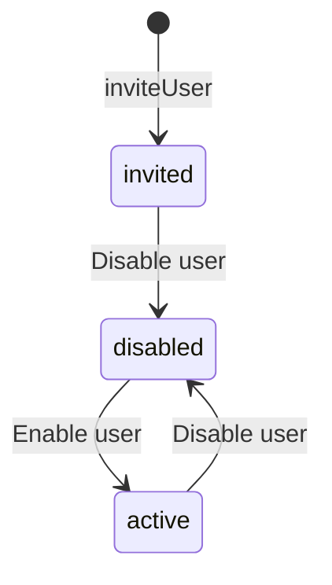
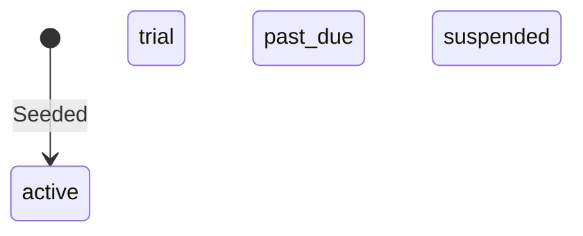
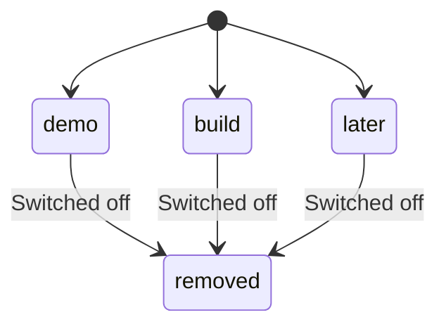

# Settings and permissions

Written from the demo code, 2026-11-10.

## Purpose

This module decides who can do what in a company, and holds the company's configuration.

It has four layers of control. A permission takes effect only when all of them allow it:

1. The feature register decides whether a feature exists in the build at all. It is global.
2. Modules decide which areas a company has switched on.
3. The company ceiling decides which permissions a company's admins may hand out.
4. Security roles decide what each person holds, and how wide their data scope is.

It also covers Settings: company profile, branding, number format, localization and tax, documents, payments, expenses, HR, meetings, email, warehouses, users, roles and the audit log. Other specs own the behaviour those settings drive. This file names the settings and who may change them.

## Who uses it

Role names are the default roles in `packages/shared/src/permissions/roles.ts`.

| Action | Permission key | Default roles | Enforced in |
| --- | --- | --- | --- |
| Open Users | `settings.users.view` or `settings.users.manage` | Owner, Manager, HR manager | `SETTINGS_MENU` in `apps/web/src/products/settings-menu.ts`, `PageGate`, `UsersPage` |
| Invite a user | `settings.users.manage` | Owner | `DemoStore.inviteUser` in `apps/web/src/lib/api/demo/store.ts` |
| Change roles, disable, enable, reset MFA | `settings.users.manage` | Owner | `DemoStore.updateUser` |
| Open Security roles | `settings.roles.view` or `settings.roles.manage` | Owner | `SETTINGS_MENU`, `PageGate`, `RolesPage` |
| Create, duplicate, edit, reset, delete a role | `settings.roles.manage` | Owner | `DemoStore.saveRole`, `resetRole` (through `saveRole`), `deleteRole` |
| View as a role | Owner role, or a held role listing `settings.roles.manage` | Owner | `useCanViewAs` in `apps/web/src/components/shell/view-as.tsx` |
| Change company profile | `settings.company.manage` | Owner | `DemoStore.updateSettings` through `settingsPermissions` in `apps/web/src/lib/api/demo/permission-rules.ts` |
| Change branding | `settings.branding.manage` | Owner | `updateSettings` |
| Change number format | `settings.numbers.manage` | Owner, Accountant | `updateSettings` |
| Change region, currency, payroll rules, Sales and documents | `settings.localization.manage` | Owner, Accountant | `LocalizationPage` and `DocumentsPage` for the tabs; `updateSettings` for the save |
| Change sales tax | `settings.tax.manage` | Owner, Accountant | `LocalizationPage` for the tab; `updateSettings` for the save |
| Change payment settings | `settings.payments.manage` | Owner, Accountant | `updateSettings` |
| Change warehouses, showrooms and stock rules | `settings.locations.manage` | Owner | `DemoStore.saveLocation`; `updateSettings` for section `inventory` |
| Change expense approval and shared costs | `settings.expenses.manage` | Owner | `updateSettings` |
| Change HR settings | `settings.hr.manage` | Owner, HR manager | `updateSettings` |
| Change meeting settings | `settings.meetings.manage` | Owner | `updateSettings` |
| Change sender details and notification rules | `settings.notifications.manage` | Owner | `updateSettings`; `apps/web/src/lib/api/demo/notification-actions.ts` |
| See every Outbox row | `settings.outbox.view` | Owner | `listOutbox` in `notification-actions.ts` |
| Read the audit log | `settings.audit.view` | Owner, Manager, Accountant, HR manager | `AuditLogPage` in `apps/web/src/features/settings/audit-log-page.tsx` |
| Data import, Connect a database | `settings.import.manage` | Owner | `DemoStore.importScope`. See `docs/product-spec/import.md` |
| Change own default warehouse | None | Everyone signed in | `DemoStore.updateMyProfile` |
| Change a company's modules, ceiling and limits | None. Needs the platform session | Platform admin | `AdminLayout` in `apps/web/src/app/admin/layout.tsx`. `DemoStore.updateCompanyAccess` has no check of its own |

### Default roles

Templates are `TEMPLATES` in `packages/shared/src/permissions/roles.ts`. Each is copied into a company at setup by `buildRoles` in `packages/shared/scripts/fixtures/tenant.ts`, limited to what the product offers.

| Key | Name | Data scope | Keys in template | Flooring Suite | HR Suite | Description in code |
| --- | --- | --- | --- | --- | --- | --- |
| `owner` | Owner | all | 139 | Yes | Yes | Everything, including billing, branding and roles |
| `manager` | Manager | branch | 100 | Yes | No | Sales, purchasing, inventory, installation, reports and approvals |
| `accountant` | Accountant | all | 68 | Yes | No | Invoices, bills, payments, tax and financial reports |
| `sales` | Sales | own | 34 | Yes | No | Customers, quotes, orders and invoices; no cost or margin |
| `purchasing` | Purchasing | all | 23 | Yes | No | Suppliers, purchase orders, receiving and supplier bills |
| `warehouse` | Warehouse | branch | 21 | Yes | No | Receiving, stock moves, roll cuts and counts |
| `installer` | Installer | own | 9 | Yes | No | Assigned jobs, job photos, sign-off and own timesheet |
| `hr` | HR manager | all | 26 | Yes | Yes | Employees, timesheets, PTO and payroll register |
| `employee` | Employee | own | 7 | Yes | Yes | Own timesheet, own meetings and own PTO requests |

The Owner template holds all 139 keys. On the HR Suite only 39 are offered: 14 platform, 20 HR and 5 meetings. `PRODUCT_ROLES` lists the roles per product.

The template patterns are in `roles.ts`. `Manager` is built with `.filter((key) => key !== "inventory.stock.correct")`, so only the Owner corrects stock counts.

### Permission keys

Every key in `PERMISSIONS` in `packages/shared/src/permissions/catalog.ts`, in catalog order, 139 in all. Keys are written `module.resource.action`. Module is the module that must be enabled. Sensitive means the action is `view_sensitive`.

Default roles: Own = Owner, Mgr = Manager, Acc = Accountant, Sal = Sales, Pur = Purchasing, Wh = Warehouse, Ins = Installer, HR = HR manager, Emp = Employee.

The table was generated from the source of `catalog.ts` and `roles.ts`, and it matches `packages/shared/test/__snapshots__/role-matrix.test.ts.snap`.

| Key | Module | Resource | Sensitive | Default roles |
| --- | --- | --- | --- | --- |
| `dashboard.overview.view` | core | Dashboard | No | Own, Mgr, Acc, Sal, Pur, Wh |
| `sales.quote.view` | core | Quotes | No | Own, Mgr, Acc, Sal |
| `sales.quote.create` | core | Quotes | No | Own, Mgr, Sal |
| `sales.quote.edit` | core | Quotes | No | Own, Mgr, Sal |
| `sales.quote.delete` | core | Quotes | No | Own, Mgr |
| `sales.quote.approve` | core | Quotes | No | Own, Mgr |
| `sales.invoice.view` | core | Invoices | No | Own, Mgr, Acc, Sal |
| `sales.invoice.create` | core | Invoices | No | Own, Mgr, Acc, Sal |
| `sales.invoice.edit` | core | Invoices | No | Own, Mgr, Acc |
| `sales.invoice.void` | core | Invoices | No | Own, Mgr, Acc |
| `sales.invoice.export` | core | Invoices | No | Own, Mgr, Acc |
| `sales.payment.view` | core | Customer payments | No | Own, Mgr, Acc, Sal |
| `sales.payment.record` | core | Customer payments | No | Own, Mgr, Acc, Sal |
| `sales.payment.approve` | core | Customer payments | No | Own, Acc |
| `sales.payment.void` | core | Customer payments | No | Own, Acc |
| `sales.payment.refund` | core | Customer payments | No | Own, Acc |
| `sales.payment.write_off` | core | Customer payments | No | Own, Acc |
| `sales.payment.apply_credit` | core | Customer payments | No | Own, Acc |
| `sales.tax.override` | core | Document sales tax | No | Own, Acc |
| `sales.waste.view` | core | Waste allowance | No | Own, Mgr, Acc, Wh |
| `sales.commission.view` | core | Commissions | No | Own, Mgr, Acc, Sal |
| `sales.commission.manage` | core | Commissions | No | Own |
| `sales.margin.view_sensitive` | core | Margins | Yes | Own, Mgr, Acc |
| `customers.customer.view` | core | Customers | No | Own, Mgr, Acc, Sal |
| `customers.customer.create` | core | Customers | No | Own, Mgr, Sal |
| `customers.customer.edit` | core | Customers | No | Own, Mgr, Sal |
| `customers.customer.delete` | core | Customers | No | Own, Mgr |
| `customers.customer.export` | core | Customers | No | Own, Mgr, Acc |
| `customers.customer.view_sensitive` | core | Customers | Yes | Own, Mgr, Acc |
| `inventory.product.view` | core | Products | No | Own, Mgr, Acc, Sal, Pur, Wh |
| `inventory.product.create` | core | Products | No | Own, Mgr |
| `inventory.product.edit` | core | Products | No | Own, Mgr |
| `inventory.product.delete` | core | Products | No | Own, Mgr |
| `inventory.product.export` | core | Products | No | Own, Mgr, Acc |
| `inventory.product.view_sensitive` | core | Products | Yes | Own, Mgr, Acc, Pur |
| `inventory.roll.view` | core | Rolls | No | Own, Mgr, Acc, Sal, Pur, Wh |
| `inventory.roll.cut` | core | Rolls | No | Own, Mgr, Wh |
| `inventory.roll.edit` | core | Rolls | No | Own, Mgr, Wh |
| `inventory.stock.adjust` | core | Stock adjustments | No | Own, Mgr |
| `inventory.stock.approve` | core | Stock adjustments | No | Own, Mgr |
| `inventory.stock.correct` | core | Stock count | No | Own |
| `inventory.transfer.view` | core | Warehouse transfers | No | Own, Mgr, Pur, Wh |
| `inventory.transfer.create` | core | Warehouse transfers | No | Own, Mgr, Wh |
| `inventory.transfer.receive` | core | Warehouse transfers | No | Own, Mgr, Wh |
| `inventory.reservation.override` | core | Stock reservations | No | Own, Mgr |
| `purchasing.supplier.view` | core | Suppliers | No | Own, Mgr, Acc, Pur, Wh |
| `purchasing.supplier.create` | core | Suppliers | No | Own, Mgr, Pur |
| `purchasing.supplier.edit` | core | Suppliers | No | Own, Mgr, Pur |
| `purchasing.order.view` | core | Purchase orders | No | Own, Mgr, Acc, Pur, Wh |
| `purchasing.order.create` | core | Purchase orders | No | Own, Mgr, Pur |
| `purchasing.order.approve` | core | Purchase orders | No | Own, Mgr, Pur |
| `purchasing.order.receive` | core | Purchase orders | No | Own, Mgr, Pur, Wh |
| `purchasing.bill.view` | core | Supplier bills | No | Own, Mgr, Acc, Pur |
| `purchasing.bill.create` | core | Supplier bills | No | Own, Mgr, Acc, Pur |
| `purchasing.payment.record` | core | Supplier payments | No | Own, Mgr, Acc, Pur |
| `purchasing.payment.approve` | core | Supplier payments | No | Own, Mgr, Acc |
| `purchasing.payment.void` | core | Supplier payments | No | Own, Mgr, Acc |
| `finance.expense.view` | core | Expenses | No | Own, Mgr, Acc |
| `finance.expense.create` | core | Expenses | No | Own, Mgr, Acc |
| `finance.expense.approve` | core | Expenses | No | Own, Mgr, Acc |
| `finance.expense.void` | core | Expenses | No | Own, Acc |
| `finance.expense.export` | core | Expenses | No | Own, Acc |
| `reports.sales.view` | core | Sales reports | No | Own, Mgr, Acc, Sal |
| `reports.sales.export` | core | Sales reports | No | Own, Mgr, Acc |
| `reports.financial.view` | core | Financial reports | No | Own, Mgr, Acc |
| `reports.financial.export` | core | Financial reports | No | Own, Acc |
| `reports.inventory.view` | core | Inventory reports | No | Own, Mgr, Acc, Pur, Wh |
| `reports.inventory.export` | core | Inventory reports | No | Own, Mgr, Acc |
| `reports.tax.view` | core | Sales tax reports | No | Own, Acc |
| `reports.tax.export` | core | Sales tax reports | No | Own, Acc |
| `retail.room.measure` | retail | Room measurements | No | Own, Mgr, Sal |
| `retail.sample.view` | retail | Sample checkout | No | Own, Mgr, Sal |
| `retail.sample.create` | retail | Sample checkout | No | Own, Mgr, Sal |
| `wholesale.price_list.view` | wholesale | Price lists | No | Own, Mgr, Sal |
| `wholesale.price_list.manage` | wholesale | Price lists | No | Own, Mgr |
| `wholesale.certificate.view` | wholesale | Resale certificates | No | Own, Mgr, Acc, Sal |
| `wholesale.certificate.manage` | wholesale | Resale certificates | No | Own, Mgr |
| `wholesale.credit.approve` | wholesale | Credit limit overrides | No | Own, Mgr |
| `installation.job.view` | installation | Jobs | No | Own, Mgr, Sal, Wh, Ins |
| `installation.job.create` | installation | Jobs | No | Own, Mgr |
| `installation.job.schedule` | installation | Jobs | No | Own, Mgr |
| `installation.job.edit` | installation | Jobs | No | Own, Mgr |
| `installation.job.sign_off` | installation | Jobs | No | Own, Mgr, Ins |
| `installation.job.view_sensitive` | installation | Jobs | Yes | Own, Mgr |
| `installation.crew.view` | installation | Crews and subcontractors | No | Own, Mgr |
| `installation.crew.manage` | installation | Crews and subcontractors | No | Own, Mgr |
| `contracts.contract.view` | contracts | Contracts | No | Own, Mgr, Acc, Sal |
| `contracts.contract.create` | contracts | Contracts | No | Own, Mgr, Sal |
| `contracts.contract.edit` | contracts | Contracts | No | Own, Mgr, Sal |
| `contracts.contract.approve` | contracts | Contracts | No | Own, Mgr |
| `contracts.contract.view_sensitive` | contracts | Contracts | Yes | Own, Mgr, Acc |
| `contracts.billing.view` | contracts | Progress billing | No | Own, Mgr, Acc, Sal |
| `contracts.billing.create` | contracts | Progress billing | No | Own, Mgr, Acc |
| `contracts.billing.void` | contracts | Progress billing | No | Own, Mgr, Acc |
| `contracts.change_order.create` | contracts | Change orders | No | Own, Mgr, Sal |
| `contracts.change_order.approve` | contracts | Change orders | No | Own, Mgr |
| `contracts.compliance.view` | contracts | Contract compliance | No | Own, Mgr, Acc |
| `contracts.compliance.manage` | contracts | Contract compliance | No | Own, Mgr, Acc |
| `hr.overview.view` | hr | HR dashboard | No | Own, Mgr, Acc, HR |
| `hr.employee.view` | hr | Employees | No | Own, Mgr, HR |
| `hr.employee.create` | hr | Employees | No | Own, HR |
| `hr.employee.edit` | hr | Employees | No | Own, HR |
| `hr.employee.view_sensitive` | hr | Employees | Yes | Own, HR |
| `hr.timesheet.view` | hr | Timesheets | No | Own, Mgr, Acc, Sal, Pur, Wh, Ins, HR, Emp |
| `hr.timesheet.edit` | hr | Timesheets | No | Own, Mgr, Acc, Sal, Pur, Wh, Ins, HR, Emp |
| `hr.timesheet.approve` | hr | Timesheets | No | Own, Mgr, HR |
| `hr.pto.view` | hr | Time off | No | Own, Mgr, Acc, Sal, Pur, Wh, Ins, HR, Emp |
| `hr.pto.request` | hr | Time off | No | Own, Mgr, Acc, Sal, Pur, Wh, Ins, HR, Emp |
| `hr.pto.approve` | hr | Time off | No | Own, Mgr, HR |
| `hr.portal.view` | hr | My portal | No | Own, Mgr, Acc, Sal, Pur, Wh, Ins, HR, Emp |
| `hr.commission.view` | hr | Commission plans | No | Own, HR |
| `hr.commission.manage` | hr | Commission plans | No | Own, HR |
| `hr.commission.approve` | hr | Commission plans | No | Own, HR |
| `hr.commission.adjust` | hr | Commission plans | No | Own, HR |
| `hr.payroll.view` | hr | Pay periods | No | Own, Acc, HR |
| `hr.payroll.approve` | hr | Pay periods | No | Own, HR |
| `hr.payroll.export` | hr | Pay periods | No | Own, Acc, HR |
| `meetings.meeting.view` | meetings | Meetings | No | Own, Mgr, Acc, Sal, Pur, Wh, Ins, HR, Emp |
| `meetings.meeting.create` | meetings | Meetings | No | Own, Mgr, Acc, Sal, Pur, Wh, Ins, HR, Emp |
| `meetings.meeting.edit` | meetings | Meetings | No | Own, Mgr, Sal, HR |
| `meetings.meeting.delete` | meetings | Meetings | No | Own, Mgr, HR |
| `settings.users.view` | platform | Users | No | Own, Mgr, HR |
| `settings.users.manage` | platform | Users | No | Own |
| `settings.roles.view` | platform | Security roles | No | Own |
| `settings.roles.manage` | platform | Security roles | No | Own |
| `settings.branding.manage` | platform | Branding | No | Own |
| `settings.localization.manage` | platform | Localization | No | Own, Acc |
| `settings.tax.manage` | platform | Sales tax | No | Own, Acc |
| `settings.numbers.manage` | platform | Number format | No | Own, Acc |
| `settings.company.manage` | platform | Company profile | No | Own |
| `settings.payments.manage` | platform | Payment settings | No | Own, Acc |
| `settings.locations.manage` | core | Warehouses and showrooms | No | Own |
| `settings.expenses.manage` | core | Expense settings | No | Own |
| `settings.notifications.manage` | platform | Email and notifications | No | Own |
| `settings.outbox.view` | platform | Outbox | No | Own |
| `settings.hr.manage` | hr | HR settings | No | Own, HR |
| `settings.meetings.manage` | meetings | Meeting settings | No | Own |
| `settings.import.manage` | platform | Data import | No | Own |
| `settings.audit.view` | platform | Audit log | No | Own, Mgr, Acc, HR |

Two keys were renamed in batch 2, and `RENAMED_PERMISSIONS` in `catalog.ts` upgrades saved ceilings: `sales.payment.create` became `sales.payment.record`, and `purchasing.bill.pay` became `purchasing.payment.record`.

These 14 keys are in the catalog and the default roles, but no screen or store action checks them:

`sales.quote.delete`, `sales.quote.approve`, `sales.invoice.export`, `sales.commission.manage`, `customers.customer.delete`, `inventory.product.delete`, `purchasing.order.approve`, `finance.expense.export`, `retail.sample.view`, `retail.sample.create`, `wholesale.price_list.manage`, `wholesale.certificate.manage`, `wholesale.credit.approve`, `meetings.meeting.delete`.

### Modules

`MODULES` and `PRODUCT_MODULES` are in `packages/shared/src/products.ts`.

| Key | Label | Offered on | Keys in catalog |
| --- | --- | --- | --- |
| `platform` | Platform | Flooring Suite, HR Suite | 14 |
| `core` | Core | Flooring Suite | 72 |
| `retail` | Retail | Flooring Suite | 3 |
| `wholesale` | Wholesale | Flooring Suite | 5 |
| `installation` | Installation | Flooring Suite | 8 |
| `contracts` | Contracts | Flooring Suite | 12 |
| `hr` | HR | Flooring Suite, HR Suite | 20 |
| `meetings` | Meetings | Flooring Suite, HR Suite | 5 |

Seeded companies, from `packages/shared/scripts/fixtures/companies.ts`:

| Company | Product | Plan | Modules | User limit | Branch limit | Left out of the ceiling |
| --- | --- | --- | --- | --- | --- | --- |
| Summit Floor Co. | Flooring Suite | Flooring Pro | platform, core, retail, installation, contracts, hr, meetings | 16 | 3 | `customers.customer.delete`, `inventory.product.delete` |
| Keystone Flooring Supply | Flooring Suite | Flooring Wholesale | platform, core, wholesale, contracts, hr, meetings | 13 | 2 | `customers.customer.delete`, `reports.financial.export`, `retail.room.measure` |
| Harbor Staffing Co. | HR Suite | HR Standard | platform, hr, meetings | 10 | 2 | `hr.payroll.export` |

### Settings pages

Groups and pages are `SETTINGS_GROUPS` and `SETTINGS_MENU` in `apps/web/src/products/settings-menu.ts`. A page shows when its feature is on and the viewer holds any listed key.

| Group | Page | Route | Keys, any of | Feature key | Stored in |
| --- | --- | --- | --- | --- | --- |
| Company | Company profile | `/settings/company` | `settings.company.manage` | `settings.company` | `settings.profile` |
| Company | Branding | `/settings/branding` | `settings.branding.manage` | `settings.branding` | `settings.branding` |
| Company | Number format | `/settings/number-format` | `settings.numbers.manage` | `settings.number-format` | `settings.numbers` |
| People and access | Users | `/settings/users` | `settings.users.view`, `settings.users.manage` | `settings.users` | `users` |
| People and access | Security roles | `/settings/roles` | `settings.roles.view`, `settings.roles.manage` | `settings.roles` | `roles` |
| People and access | Audit log | `/settings/audit` | `settings.audit.view` | `settings.audit` | `audit` |
| People and access | HR | `/settings/hr` | `settings.hr.manage` | `settings.hr` | `settings.hr`, `timeOffPolicies` |
| Sales and documents | Sales and documents | `/settings/documents` | `settings.localization.manage` | `settings.localization` | `settings.localization.documents` |
| Inventory and warehouses | Warehouses and showrooms | `/settings/locations` | `settings.locations.manage` | `inventory.locations` | `locations`, `settings.inventory` |
| Tax and localization | Localization and tax | `/settings/localization` | `settings.localization.manage`, `settings.tax.manage` | `settings.localization` | `settings.localization` |
| Payments | Payments | `/settings/payments` | `settings.payments.manage` | `sales.payments` | `settings.payments` |
| Payments | Expenses | `/settings/expenses` | `settings.expenses.manage` | `finance.expenses` | `settings.expenses`, `settings.sharedCosts` |
| Email and notifications | Meetings | `/settings/meetings` | `settings.meetings.manage` | `settings.meetings` | `settings.meetings` |
| Email and notifications | Email and notifications | `/settings/notifications` | `settings.notifications.manage` | `settings.notifications` | `settings.email`, `notificationRules` |
| Email and notifications | Outbox | `/settings/outbox` | `settings.outbox.view` | `settings.outbox` | `outboxMessages` |
| Data import and integrations | Data import | `/settings/import` | `settings.import.manage` | `settings.import` | `importBatches`, `importMappings` |
| Data import and integrations | Connect a database | `/settings/database` | `settings.import.manage` | `settings.database` | Nothing |

`/settings` is the grouped home with a search over single settings (`SettingsHome`, `searchSettings` in `apps/web/src/features/settings/form/registry.ts`). It shows only the pages the viewer may open.

## Workflows and status rules

### User status



- `inviteUser` in `apps/web/src/lib/api/demo/store.ts` creates the user as `invited`, with `mfaEnrolled` false.
- `setStatus` in `apps/web/src/features/settings/users/users-page.tsx` calls `updateUser` with `disabled` or `active`.
- The menu offers Enable user only on a disabled user. No screen moves `invited` straight to `active`, so there is no accept step. Disabling and enabling an invited user makes them active.
- Users are never deleted. `UserPatch` in `apps/web/src/lib/api/contract.ts` has no delete.
- `updateUser` runs `assertOwnerRemains` before every change.

### Company status



`CompanyStatus` in `packages/shared/src/types/company.ts` has four values. `buildCompany` seeds `active` for all three companies. `CompanyAccessPatch` has no status, so no action changes it. `useLoginDirectory` lists only `active` companies on the sign-in page.

### Feature status



`FeatureStatus` in `packages/shared/src/features.ts`. No code changes a status. The process is `.claude/commands/feature-change.md`, which edits `FEATURES` and `docs/FEATURES.md` together. Step 7 sets `enabled: false` and status `removed`, and the key is never reused. Moves between `demo`, `build` and `later` are not defined anywhere. Today 63 features are `demo` and 6 are `removed`: `inventory.adjustments`, `installation.calendar`, `reports.tax-jurisdiction`, `reports.inventory-valuation`, `reports.receivables-aging`, `reports.payables-aging`.

### Workflows

**Invite a user.** Settings, Users, Invite user. `InviteDialog` collects name, email, title, roles and branch. `inviteUser` checks the permission and the seat limit, creates the user and writes the audit entry. No email goes out.

**Change a user's roles.** `ChangeRolesDialog` asks for a step-up code, then calls `updateUser` with `roleIds`. Only newly added roles go through `assertCanAssign`. A role the user already holds is not re-checked.

**Reset MFA.** `UsersPage` asks for a step-up code, then calls `updateUser` with `{ mfaEnrolled: false }`. The audit entry is in category `security`. The item is disabled when the user has no MFA.

**Create or duplicate a role.** `draftRole` in `apps/web/src/features/settings/roles/roles-page.tsx` builds an unsaved role with `key: "custom"`, `system: false` and `owner: false`. A new role starts empty with scope `own`. A copy of the Owner role starts empty too. Save role asks for a step-up code, then calls `saveRole`.

**Edit a role.** `RoleEditor` shows the matrix by module, resource and action. `lockOf` greys a cell with one of four reasons: `plan` (outside the ceiling), `module` (module off), `not_held` (the editor lacks it and the role does not already have it), `owner` (the Owner role, or the viewer cannot manage roles). The name of a system role cannot be edited.

**Reset a role.** Reset to default calls `resetRole` with no step-up code. It restores name, description, data scope and permissions from the template, limited to the product, and passes through `saveRole`.

**Delete a role.** Only a non-system role that nobody holds. There is no step-up code.

**View as.** `ViewAsSwitcher` lists every role except Owner. `setViewAs` stores the role id in `sessionStorage` under `fp-view-as:<companyId>` and calls `api.setViewer`.

**Save settings.** `SettingsForm` in `apps/web/src/features/settings/form/settings-form.tsx` keeps a draft, marks changed fields and shows a sticky Save and Discard bar. Reset to default only loads the original values into the draft. Save calls `updateSettings`, which replaces the whole section. `DemoStore.resetSettings` exists, but no screen calls it.

**Change company access.** Platform admin, Company. `AccessEditor` in `apps/web/src/features/admin/company-access-page.tsx` edits modules, ceiling, user limit and branch limit, with a live preview. Save access calls `updateCompanyAccess`. It applies at once.

**Sign in.** `POST /api/demo/login` records the chosen persona in a signed cookie. The MFA step is on the login page, and any six digits pass. `useLoginDirectory` picks the first active user who holds the persona's role.

## Business rules

Formulas below are copied from the code.

1. **Effective permissions.** `effectivePermissions` in `packages/shared/src/permissions/engine.ts`. Union of the user's role permissions, intersected with the company ceiling, intersected with the permissions of enabled modules. A role keeps ticks outside the ceiling. They are inactive until the ceiling allows them again.

   ```ts
   export function effectivePermissions(
     roles: readonly RoleLike[],
     ceiling: Iterable<PermissionKey>,
     modules: readonly ModuleKey[],
   ): Set<PermissionKey> {
     const allowed = new Set(ceiling);
     const result = new Set<PermissionKey>();
     for (const role of roles) {
       for (const key of role.permissions) {
         const def = permissionDef(key);
         if (def && allowed.has(key) && modules.includes(def.module)) result.add(key);
       }
     }
     return result;
   }
   ```

2. **Viewer access.** `viewerAccess` in `apps/web/src/lib/access.ts`. Shared by the store and the screens. While viewing as a role, only that role counts.

   ```ts
   const held = viewAsRoleId
     ? roles.filter((r) => r.id === viewAsRoleId)
     : roles.filter((r) => user.roleIds.includes(r.id));
   return resolveAccess(held, company.ceiling, company.modules);
   ```

3. **Data scope.** `dataScope` in `engine.ts`. The widest scope across a user's roles, ranked by `SCOPE_RANK` in `roles.ts` (`own` 0, `branch` 1, `all` 2).

   ```ts
   export function dataScope(roles: readonly RoleLike[]): DataScope {
     return roles.reduce<DataScope>(
       (widest, r) => (SCOPE_RANK[r.dataScope] > SCOPE_RANK[widest] ? r.dataScope : widest),
       "own",
     );
   }
   ```

4. **Scope filters.** `FILTERS` and `applyScope` in `apps/web/src/lib/api/demo/scope.ts`. Collections with no entry are company-wide.

   | Collection | Own | Branch |
   | --- | --- | --- |
   | `quotes`, `invoices`, `contracts` | `item.salesRepId === user.id` | `item.branchId === user.branchId` |
   | `customers` | `item.salesRepId === user.id` | The sales rep's `branchId` equals the user's |
   | `payments`, `invoiceAdjustments` | Follow their invoice | Follow their invoice |
   | `refunds` | Follow their customer | Follow their customer |
   | `contractLines`, `changeOrders`, `contractBillings` | Follow their contract | Follow their contract |
   | `jobs` | The crew's `lead` equals the user's name | Every job |
   | `timesheets`, `ptoRequests`, `timeOffEntries` | Own employee record | Own, plus direct reports by `managerId` |
   | `clockEntries` | Own employee record | Own employee record |

   Scope `all` returns everything, with one exception. `meetings` always filter: private meetings show only to their owner and attendees, whatever the scope, and scope `own` sees only meetings the user owns or attends. `inAppNotifications` and `outboxMessages` return an empty list from `list`, and are read through their own actions.

5. **Store-side check.** `assertCan` in `store.ts` passes when any listed key is held. Otherwise it throws `Your role does not allow this. Ask an Owner to change your security role.` Screens hide what a role cannot do, and the store refuses it anyway.

6. **Generic save.** `SAVE_PERMISSIONS` in `permission-rules.ts`. Any listed key allows `DemoStore.save`. A collection with an empty list refuses every generic save through the key `store.internal.manage`, which no role can hold.

   | Collection | Keys, any of |
   | --- | --- |
   | `roles` | `settings.roles.manage` |
   | `users` | `settings.users.manage` |
   | `locations` | `settings.locations.manage` |
   | `products` | `inventory.product.create`, `inventory.product.edit` |
   | `rolls` | `inventory.roll.edit`, and `assertRollEditOnly` refuses a change of length, warehouse or cuts |
   | `customers` | `customers.customer.create`, `customers.customer.edit` |
   | `quotes` | `sales.quote.create`, `sales.quote.edit` |
   | `invoices` | `sales.invoice.create`, `sales.invoice.edit` |
   | `suppliers` | `purchasing.supplier.create`, `purchasing.supplier.edit` |
   | `crews` | `installation.crew.manage` |
   | `jobs` | `installation.job.create`, `installation.job.edit`, `installation.job.schedule`, `installation.job.sign_off` |
   | `bonuses` | `hr.payroll.approve` |
   | Every other collection | None. Written only by domain actions |

7. **Settings sections.** `SETTINGS_PERMISSIONS` in `permission-rules.ts`.

   | Section | Keys, any of |
   | --- | --- |
   | `branding` | `settings.branding.manage` |
   | `localization` | `settings.localization.manage`, `settings.tax.manage` |
   | `numbers` | `settings.numbers.manage` |
   | `profile` | `settings.company.manage` |
   | `payments` | `settings.payments.manage` |
   | `inventory` | `settings.locations.manage` |
   | `expenses`, `sharedCosts` | `settings.expenses.manage` |
   | `hr` | `settings.hr.manage` |
   | `meetings` | `settings.meetings.manage` |
   | `email` | `settings.notifications.manage` |

8. **Private collections.** `PRIVATE_COLLECTIONS` in `store.ts`. `list` returns an empty array without the key.

   | Collections | Key |
   | --- | --- |
   | `payPeriods`, `bonuses`, `contractorPayments` | `hr.payroll.view` |
   | `commissionPlans`, `commissionAssignments`, `commissionStatements`, `commissionAdjustments` | `hr.commission.view` |
   | `contracts`, `contractLines`, `changeOrders` | `contracts.contract.view` |
   | `contractBillings` | `contracts.billing.view` |
   | `lienWaivers`, `insuranceCertificates` | `contracts.compliance.view` |

9. **Sensitive fields.** `SENSITIVE` in `catalog.ts` maps each field to the key that reveals it.

   | Field | Key | Hidden by |
   | --- | --- | --- |
   | Product cost | `inventory.product.view_sensitive` | Screens, through `can(SENSITIVE.productCost)` |
   | Sales margin | `sales.margin.view_sensitive` | Screens |
   | Job margin | `installation.job.view_sensitive` | Screens |
   | Credit limit | `customers.customer.view_sensitive` | Screens |
   | Pay rate | `hr.employee.view_sensitive` | `DemoStore.list`, which returns `payRate: "0.00"` |
   | Contract line estimated cost | `contracts.contract.view_sensitive` | `DemoStore.list`, which returns `estimatedCost: "0.00"` |

   The last key is not in the `SENSITIVE` map. `store.ts` and `contract-form-dialog.tsx` name it directly.

10. **No privilege escalation.** `canGrant` in `engine.ts` is the single-key test. The role save uses `escalations`, which allows keys the role already had.

    ```ts
    export function canGrant(granter: Access, key: PermissionKey): boolean {
      return granter.permissions.has(key);
    }

    export function escalations(
      granter: Access,
      proposed: readonly PermissionKey[],
      current: readonly PermissionKey[],
    ): PermissionKey[] {
      const before = new Set(current);
      return proposed.filter((key) => !before.has(key) && !granter.permissions.has(key));
    }
    ```

    `assertCanGrant` in `store.ts` throws `You can only grant permissions you hold. Not held: ...`, naming up to three keys.

11. **Assigning a role.** `canAssignRole` in `engine.ts`. Only an Owner makes an Owner. The role's active permissions must all be held by the granter.

    ```ts
    if (role.owner && !granter.isOwner) return "owner_only";
    const active = effectivePermissions([role], ceiling, modules);
    for (const key of active) if (!granter.permissions.has(key)) return "not_held";
    return null;
    ```

12. **Owner role is locked.** `saveRole` in `store.ts` throws `The Owner role is locked. It always holds everything in your plan.` `resetRole` on the Owner reaches the same refusal.

13. **Last Owner.** `assertOwnerRemains` in `apps/web/src/lib/api/demo/admin-rules.ts` applies the patch to a copy and calls `hasActiveOwner`. It throws `This is the last active Owner. Make someone else an Owner first.`

    ```ts
    export function hasActiveOwner(users: readonly UserLike[], ownerRoleIds: ReadonlySet<string>): boolean {
      return users.some((u) => u.status === "active" && u.roleIds.some((id) => ownerRoleIds.has(id)));
    }
    ```

14. **Seat limit.** `seatsUsed` and `assertSeatAvailable` in `admin-rules.ts`. Active and invited users count. Disabled users free a seat. Only `inviteUser` checks it.

    ```ts
    export function seatsUsed(users: readonly User[]): number {
      return users.filter((u) => u.status !== "disabled").length;
    }

    if (seatsUsed(users) >= limit) { /* throws */ }
    ```

    The message is `All ${limit} seats on your plan are in use. Disable a user or ask us to raise the limit.`

15. **Role delete.** `deleteRole` in `store.ts`. A system role throws `Default roles can be copied but not deleted.` A held role throws `Users still hold this role. Move them to another role first.`

16. **Company ceiling at setup.** `buildCompany` in `packages/shared/scripts/fixtures/tenant.ts`. The ceiling is every permission the product offers, minus what the plan leaves out. It is not limited to the company's modules, so the module check in rule 1 still matters.

    ```ts
    ceiling: ALL_PERMISSION_KEYS.filter((k) => offered.has(k) && !excluded.has(k)),
    ```

17. **Ceiling upgrade.** `upgradeCeiling` in `packages/shared/src/migrations/permissions.ts` renames retired keys, adds new keys of the company's modules, drops unknown keys and restores catalog order. `upgradeCompany` in `migrations/overlay.ts` applies it to a company record saved by an older demo.

18. **Modules shown.** `visibleModules` in `features.ts` hides Installation while `installation.calendar` is off. The company access page and the permission matrix use it. The Platform switch is disabled on the company access page.

19. **Feature switches.** `featureOn` in `packages/shared/src/features.ts`. A removed feature is off whatever its switch says.

    ```ts
    return feature.enabled && feature.status !== "removed";
    ```

    `featureForPath` picks the feature that owns a route. `pagePatternScore` scores a match: 3 for `/path/*`, 2 for a matching `?view=`, 1 for the path alone. A feature of the product itself outranks a `both` feature on a shared path. `FEATURES` has 69 keys and has no per-company switch. A unit test in `packages/shared/test/features.test.ts` compares `FEATURES` with `docs/FEATURES.md`.

20. **Page access.** `pagePermissions` and `canOpenPage` in `apps/web/src/products/pages.ts`. Top-level pages take the permissions of their menu item. `SUB_PAGES` adds views and detail pages. The most specific match wins. `PageGate` in `apps/web/src/components/page-gate.tsx` checks the feature first, then the permission. A page without a rule, such as `/`, stays open.

21. **Menu and home.** `visibleItems` and `homeFor` in `apps/web/src/products/index.ts`. An item shows when any of its features is on and any of its keys is held. A persona lands on the first item they may open.

22. **View as limits saves.** `granter` in `store.ts` uses `viewerAccess` with the viewed role, so saves are limited too. `scopeSubject` in `scope.ts` borrows the first active user who holds the role, so "own" means that persona's records. The audit entry still names the real person.

23. **Step-up.** `StepUpDialog` in `apps/web/src/components/step-up-dialog.tsx` accepts `/^\d{6}$/`. It guards: save role, change a user's roles, reset MFA, and the Currency and Sales tax tabs (`stepUp: true` in `apps/web/src/features/settings/localization/localization-page.tsx`). With `auth.step-up` off it confirms at once.

24. **Effective access preview.** `AccessPreview` in `apps/web/src/components/access-preview.tsx` runs `resolveAccess` for a role or a person against a ceiling and modules. The platform admin passes the draft, so the result shows before saving. It lists pages, actions, sensitive fields and data scope.

25. **Tax rule resolution.** `resolveTaxRule` in `packages/shared/src/us-pack/tax-defaults.ts`. Order: a county rate for the job site, else the state default, else the company default in states of operation only, else not collected. A county rate needs a state or company rule under it, keeps that rule's taxability and replaces only the rate. Among several valid rules, the latest `validFrom` wins. `validOn` is:

    ```ts
    r.validFrom <= on && (!r.validTo || r.validTo >= on)
    ```

    `withOverride` applies a rate changed on one document. With no rule at all, materials are taxed at the new rate. Rules are examples and carry `EXAMPLE_RULE_NOTE` in `packages/shared/src/us-pack/tax.ts`.

26. **Number format is display only.** `formatNumber` in `packages/shared/src/numbers.ts`. It never changes a stored value. `NUMBER_KINDS` sets the defaults and limits:

    | Kind | Default decimals | Min | Max |
    | --- | --- | --- | --- |
    | `money` | 2 | 0 | 4 |
    | `unitCost` | 4 | 0 | 4 |
    | `quantity` | 2 | 0 | 3 |
    | `count` | 0 | 0 | 3 |
    | `percent` | 1 | 0 | 4 |
    | `taxRate` | 3 | 0 | 4 |
    | `fxRate` | 4 | 0 | 6 |

    A value that rounds to zero at the shown precision has no sign. `displayDecimals` clamps a per-column change to the same limits.

27. **Brand color.** `checkBrandColor` in `packages/shared/src/color.ts`. The color must be 6-digit hex, and `contrastRatio(hex, NEUTRALS.light.surface)` must be at least 3. `BrandingPage` passes this as `canSave`. A logo may be up to 300 KB (`MAX_LOGO_BYTES`) and is stored as a data URL.

28. **Company profile.** `ProfileSchema` in `apps/web/src/features/settings/company-profile-page.tsx`. Legal name required. EIN matches `^\d{2}-\d{7}$`. Phone has at least 7 characters. Valid email. Street and city required. State is a US code. ZIP matches `ZIP_PATTERN`. The store does not repeat these checks.

29. **Locations.** `saveLocation` in `store.ts`. A location holding stock cannot become a showroom. A showroom cannot be the default. One warehouse must stay the default. Saving a new default clears the old one.

30. **Audit entries.** `appendAudit` in `store.ts` stamps who and when. `diffSummary` in `admin-rules.ts` names up to three changed fields, then adds `and N more`. `permissionDiff` lists added and removed keys. The `audit` collection refuses generic saves.

31. **Saved demo data.** `OVERLAY_SCHEMA_VERSION` is 4 in `packages/shared/src/migrations/overlay.ts`. `upgradeOverlay` accepts only that version. Anything else starts the company fresh with `UPGRADE_RESET_NOTICE` from `apps/web/src/lib/api/demo/company-db.ts`, and its uploaded files are removed. `resetDemo` clears everything.

## Entities and fields

### Company

`packages/shared/src/types/company.ts`.

| Field | Type | Notes |
| --- | --- | --- |
| `id` | `"summit" \| "keystone" \| "harbor"` | |
| `name`, `city`, `state` | string | |
| `product` | `flooring` or `hr` | One per company in the demo |
| `modules` | `ModuleKey[]` | Set by the platform admin |
| `plan` | string | Label only |
| `status` | `active`, `trial`, `past_due`, `suspended` | Always `active` in the seed |
| `userLimit` | number | Seat limit |
| `branchLimit` | number | Stored and editable, not enforced |
| `ceiling` | `PermissionKey[]` | Set by the platform admin |
| `branches` | `Branch[]` | `id`, `name`, `city`, `state` |
| `createdAt` | date | |

### Role

| Field | Type | Notes |
| --- | --- | --- |
| `id` | string | |
| `companyId` | `CompanyId` | |
| `key` | string | A default role key, or `custom` |
| `name`, `description` | string | A system role's name is read-only on screen |
| `permissions` | `PermissionKey[]` | May hold ticks outside the ceiling |
| `dataScope` | `own`, `branch`, `all` | |
| `system` | boolean | Shipped role: cannot be deleted, can be reset |
| `owner` | boolean | Locked superuser role |

### User

| Field | Type | Notes |
| --- | --- | --- |
| `id`, `companyId` | string | |
| `name`, `email`, `title` | string | |
| `roleIds` | `string[]` | Several roles are allowed |
| `branchId` | string | Drives branch scope |
| `status` | `invited`, `active`, `disabled` | Disabled, never deleted |
| `mfaEnrolled` | boolean | Simulated |
| `lastLoginAt` | string or null | |
| `employeeId` | string or null | Link to the HR record |
| `defaultLocationId` | string or null | Personal default warehouse; null uses the company default |

### PermissionDef and Access

| Field | Type | Notes |
| --- | --- | --- |
| `PermissionDef.key` | `PermissionKey` | `module.resource.action` |
| `PermissionDef.module` | `ModuleKey` | Must be enabled |
| `PermissionDef.resource` | string | Row label in the matrix |
| `PermissionDef.action` | `PermissionAction` | One of 23 actions in `catalog.ts` |
| `PermissionDef.label` | string | `${action label} ${resource lower case}` |
| `Access.permissions` | `ReadonlySet<PermissionKey>` | Effective permissions |
| `Access.dataScope` | `DataScope` | Widest of the roles |
| `Access.isOwner` | boolean | Any held role has `owner` |

### Feature

`packages/shared/src/features.ts`.

| Field | Type | Notes |
| --- | --- | --- |
| `title` | string | |
| `product` | `flooring`, `hr`, `both` | |
| `module` | `ModuleKey` | |
| `status` | `demo`, `build`, `later`, `removed` | |
| `enabled` | boolean | The switch |
| `screens` | `string[]` | `/path`, `/path?view=x`, or `/path/*` |

### AuditEntry

`packages/shared/src/types/settings.ts`.

| Field | Type | Notes |
| --- | --- | --- |
| `id` | string | |
| `at` | string | `yyyy-MM-dd'T'HH:mm` |
| `actorName`, `actorRole` | string | `Platform admin` and `Super-admin` when no company user acted |
| `category` | `role`, `user`, `ceiling`, `settings`, `data`, `security`, `payment` | |
| `action`, `target` | string | |
| `before`, `after` | string or null | |

### CompanySettings

`CompanySettings` in `packages/shared/src/types/settings.ts`. Defaults are from `buildSettings` in `packages/shared/scripts/fixtures/tenant.ts`.

**`branding`**

| Field | Type | Notes |
| --- | --- | --- |
| `displayName` | string | |
| `monogram` | string | Up to 2 characters on the form |
| `brandColor` | string | 6-digit hex, contrast checked |
| `pattern` | `herringbone`, `running-bond`, `basketweave` | |
| `logoDataUrl` | string or null | Null shows the monogram |
| `defaultTheme` | `light`, `dark`, `system` | Seeded `system` |

**`profile`**

| Field | Type | Notes |
| --- | --- | --- |
| `legalName`, `dba`, `ein`, `phone`, `email`, `website` | string | Printed on documents |
| `address` | `Address` | `street`, `city`, `state`, `zip`, optional `county`, `lat`, `lng` |

**`localization.region`**

| Field | Type | Notes |
| --- | --- | --- |
| `country` | `"US"` | |
| `primaryState`, `statesOfOperation` | string, `string[]` | `statesOfOperation` limits the company default rate |
| `timeZone`, `locale` | string | |
| `dateFormat` | `MM/dd/yyyy`, `yyyy-MM-dd`, `MMM d, yyyy` | Seeded `MMM d, yyyy` |
| `firstDayOfWeek` | `sunday`, `monday` | Seeded `monday` |
| `fiscalYearStartMonth` | number | Seeded 1 |

**`localization.currency`**

| Field | Type | Notes |
| --- | --- | --- |
| `base` | `"USD"` | |
| `locked` | boolean | Seeded true |
| `extra` | `{ code, rate, asOf }[]` | Keystone seeds CAD |

**`localization.tax`**

| Field | Type | Notes |
| --- | --- | --- |
| `pricesInclude` | `exclusive`, `inclusive` | Seeded `exclusive` |
| `rounding` | `line`, `invoice` | Seeded `invoice` |
| `rules` | `TaxRule[]` | State defaults |
| `jurisdictions` | `JurisdictionRate[]` | County rates |
| `companyDefault` | `CompanyDefaultRate` or null | |
| `filing` | `{ state, frequency }[]` | `monthly`, `quarterly`, `annual` |
| `certificateTypes` | `string[]` | |

**`TaxRule`** (`packages/shared/src/us-pack/tax.ts`)

| Field | Type | Notes |
| --- | --- | --- |
| `state`, `jurisdiction` | string | |
| `ratePct` | string | Combined rate in percent |
| `taxable` | `Record<TaxCategory, boolean>` | `material`, `labor`, `freight`, `service` |
| `lumpSumLaborTaxable` | boolean | |
| `validFrom`, `validTo` | date, optional date | |
| `version` | number | A posted document keeps the rule it used |
| `rationale` | string | Shown in settings |

**`JurisdictionRate`** (`packages/shared/src/us-pack/tax-defaults.ts`)

| Field | Type | Notes |
| --- | --- | --- |
| `id`, `state`, `name` | string | |
| `county` | string | Without the word County, case ignored |
| `ratePct` | string | |
| `validFrom`, `validTo` | date, date or null | |

**`CompanyDefaultRate`**

| Field | Type | Notes |
| --- | --- | --- |
| `ratePct` | string | |
| `taxable` | `Record<TaxCategory, boolean>` | |
| `validFrom` | date | |

**`localization.payroll`**

| Field | Type | Notes |
| --- | --- | --- |
| `overtimeRule` | `federal`, `california` | Seeded `federal` |
| `holidayState` | string | |

**`localization.documents`**

| Field | Type | Notes |
| --- | --- | --- |
| `defaultTerms` | `PaymentTerms` | `due_on_receipt` with Retail, otherwise `net_30` |
| `lateFeePct` | string | Seeded `1.5` |
| `quotePrefix`, `invoicePrefix`, `poPrefix` | string | `Q-`, `INV-`, `PO-` |
| `legalFooter` | string | |
| `defaultDepositPct` | string | `50` with Retail, otherwise `0` |
| `quoteExpiryDays` | number | Seeded 30 |
| `balanceDueDays` | number | Seeded 30 |
| `defaultWastePct` | `Record<WasteCategory, string>` | Carpet 12, porcelain tile 10, carpet tile and the rest 8 |

**`numbers`** (`NumberSettings` in `packages/shared/src/numbers.ts`)

| Field | Type | Notes |
| --- | --- | --- |
| `decimals` | `Record<NumberKind, number>` | Limits in rule 26 |
| `negativeStyle` | `minus`, `parens` | Seeded `minus` |
| `compactDashboards` | boolean | Seeded true |
| `locale`, `currency` | string | `en-US`, `USD` |

**`payments`**

| Field | Type | Notes |
| --- | --- | --- |
| `approvalRequired` | boolean | True with Retail |
| `approvalThreshold` | string | `1000.00` with Retail; empty means every payment |
| `writeOffMax` | string | Seeded `5.00`; empty means no limit |
| `paymentPrefix`, `refundPrefix` | string | `PAY-`, `RF-` |

**`inventory`**

| Field | Type | Notes |
| --- | --- | --- |
| `adjustmentApprovalQty` | string | Seeded `1000`; empty means no approval |

**`expenses`**

| Field | Type | Notes |
| --- | --- | --- |
| `approvalRequired` | boolean | True with Retail |
| `approvalThreshold` | string | `1000.00` with Retail |

**`sharedCosts`**

| Field | Type | Notes |
| --- | --- | --- |
| `rule` | `revenue`, `floor_area`, `equal`, `fixed` | One rule per company; seeded `revenue` |
| `fixedPct` | `Record<string, string>` | Percent per location id |

**`hr`**

| Field | Type | Notes |
| --- | --- | --- |
| `workweekStartDay` | number | 0 Sunday to 6 Saturday; seeded 1 |
| `payFrequency` | `weekly`, `biweekly`, `semimonthly`, `monthly` | Harbor weekly, others biweekly |
| `payPeriodAnchor` | date | |
| `holidays` | `{ date, name }[]` | Federal holidays for 2026 and 2027 |
| `showPayToEmployees` | boolean | Seeded true |
| `showCommissionToEmployees` | boolean | Seeded false |
| `showRatesToEmployees`, `showTeamCalendarToEmployees` | boolean | Seeded false |
| `clockEnabled` | boolean | False for Keystone |

**`meetings`**

| Field | Type | Notes |
| --- | --- | --- |
| `defaultReminderMin` | number | Seeded 15 |
| `newGuestHandling` | `contact`, `lead`, `none` | Seeded `contact` |
| `allowProposals` | boolean | Seeded true |
| `hideGuestList` | boolean | Seeded false |

**`email`** (`EmailSettings` in `packages/shared/src/types/notifications.ts`)

| Field | Type | Notes |
| --- | --- | --- |
| `senderName`, `replyTo`, `signature` | string | Seeded from the company |

## Events and audit entries

**Notification events.** None. No event in `NOTIFICATION_EVENTS` (`packages/shared/src/notifications/events.ts`) is raised by a user, role, company access or settings change.

**Audit entries.** Strings are exact.

| Action | Category | Target | Trigger | Where |
| --- | --- | --- | --- | --- |
| `Changed company access` | `ceiling` | Company name | `updateCompanyAccess`. Actor is `Platform admin`, role `Super-admin` | `store.ts` |
| `Changed branding` | `settings` | `Branding` | `updateSettings("branding")` | `store.ts` |
| `Changed localization and tax` | `settings` | `Localization and tax` | `updateSettings("localization")` | `store.ts` |
| `Changed number format` | `settings` | `Number format` | `updateSettings("numbers")` | `store.ts` |
| `Changed company profile` | `settings` | `Company profile` | `updateSettings("profile")` | `store.ts` |
| `Changed payments` | `settings` | `Payments` | `updateSettings("payments")` | `store.ts` |
| `Changed stock rules` | `settings` | `Stock rules` | `updateSettings("inventory")` | `store.ts` |
| `Changed expense approval` | `settings` | `Expense approval` | `updateSettings("expenses")` | `store.ts` |
| `Changed shared costs` | `settings` | `Shared costs` | `updateSettings("sharedCosts")` | `store.ts` |
| `Changed hr` | `settings` | `HR` | `updateSettings("hr")` | `store.ts` |
| `Changed meetings` | `settings` | `Meetings` | `updateSettings("meetings")` | `store.ts` |
| `Changed email and notifications` | `settings` | `Email and notifications` | `updateSettings("email")` | `store.ts` |
| `Added location`, `Changed location` | `settings` | Location name | `saveLocation` | `store.ts` |
| `Invited user` | `user` | User name | `inviteUser` | `store.ts` |
| `Changed user` | `user`, or `security` when `mfaEnrolled` is set false | User name | `updateUser` | `store.ts` |
| `Changed own profile` | `user` | User name | `updateMyProfile` | `store.ts` |
| `Created role`, `Changed role` | `role` | `Role: <name>` | `saveRole`, also reached from `resetRole` | `store.ts` |
| `Deleted role` | `role` | `Role: <name>` | `deleteRole` | `store.ts` |
| `Changed notification`, `Reset notification` | `settings` | Event label | Notification rule save and reset | `notification-actions.ts` |

Rows in `packages/shared/scripts/fixtures/audit.ts` are seed history. It writes strings that no action produces: `Changed brand color`, `Changed role permissions`, `Removed from plan`, `Reset MFA`, `Updated tax rule`, `Disabled user`.

## Emails

None. Inviting a user, resetting MFA and changing access send no email. The `email` section holds the sender details used by other modules. See `docs/product-spec/notifications.md`.

## Reports

None as a report. The audit log has a CSV of its filtered rows, `csvName="audit-log"`, through the shared `DataTable`. The Business report and the three remaining reports are in `docs/product-spec/reports.md`.

## Edge cases and known limits

- **Step-up is on the client only.** `StepUpDialog` runs before the API call. `saveRole` and `updateUser` do not check a code, and any six digits pass. Resetting and deleting a role ask for no code.
- **MFA is simulated.** `mfaEnrolled` is a flag. No real code is checked at sign-in.
- **Invited users have no accept step.** See User status.
- **The seat limit is checked only on invite.** Enabling a disabled user does not check it. Lowering `userLimit` below the seats in use is allowed.
- **`branchLimit` is not enforced.** Nothing reads it except the company access form.
- **Company status has no effect beyond sign-in.** The sign-in list filters on it and the companies page shows it. Nothing else reads it.
- **The generic `save` skips the role and user rules.** `save("roles", ...)` and `save("users", ...)` check only the collection's key. They skip the Owner lock, escalation, last Owner and seat checks. No screen calls them for these collections. The real API must not offer them.
- **`updateCompanyAccess` has no check in the store.** Only the `/admin` layout guards it. The store would accept a patch that drops `platform`, whose switch is only disabled on screen.
- **`settings.tax.manage` is enough to save all of `localization`.** The section is one record, and `SETTINGS_PERMISSIONS` accepts either key. Only the tabs separate them.
- **Most sensitive fields are hidden by the screens alone.** Product cost, margin and credit limit stay in the records `list` returns. Only pay rate and contract line estimated cost are removed by the store.
- **The audit log is not a private collection.** `list("audit")` answers any viewer. Only the page checks `settings.audit.view`.
- **`useCanViewAs` reads a role's raw permissions**, not the effective ones, so it ignores the ceiling. The View as banner's note reads raw permissions as well.
- **View as depends on a persona.** With no active user in that role, "own" falls back to the signed-in person.
- **Fourteen permission keys are never checked.** They are listed under Permission keys.
- **Installation is hidden, not removed.** Its 8 keys stay in the catalog, the role templates and the ceilings. Summit still has the module. `visibleModules` hides it from the matrix and the access page.
- **`inventory.stock.adjust` and `inventory.stock.approve` have no page.** `inventory.adjustments` is removed. The Stock rules form on `/settings/locations` still shows its threshold.
- **Settings are not validated by the store.** `updateSettings` stores the section as given. Validation is in the forms.
- **A section is replaced whole.** Two people editing different tabs of `localization` would overwrite each other. The demo has one user at a time.
- **Feature switches are global.** A change needs a code edit and a redeploy.
- **Stored data lives in the browser.** Settings, roles and users are kept per company in localStorage under `fp-demo:v2:`, so they do not carry to another device.
