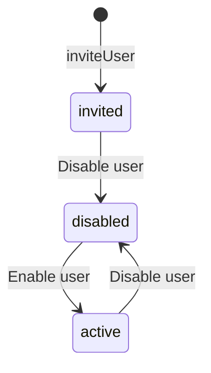
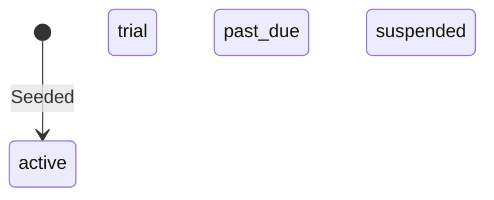
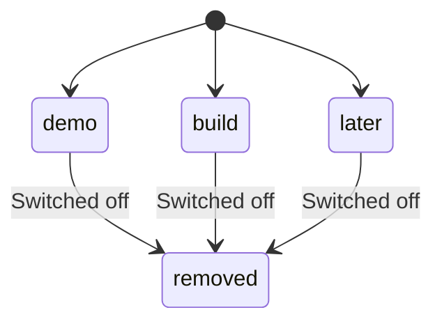

# Settings and permissions

Written from the demo code, 2026-11-10.

## Purpose

This module decides who can do what in a company, and holds the company's configuration.

It has four layers of control. A permission takes effect only when all of them allow it:

1. The feature register decides whether a feature exists in the build at all. It is global.
2. Modules decide which areas a company has switched on.
3. The company ceiling decides which permissions a company's admins may hand out.
4. Security roles decide what each person holds, and how wide their data scope is.

It also covers Settings: company profile, branding, number format, localization and tax, documents, payments, expenses, HR, meetings, email, warehouses, users, roles and the audit log. Other specs own the behaviour those settings drive. This file names the settings and who may change them.

## Who uses it

Role names are the default roles in `packages/shared/src/permissions/roles.ts`.

| Action | Permission key | Default roles | Enforced in |
| --- | --- | --- | --- |
| Open Users | `settings.users.view` or `settings.users.manage` | Owner, Manager, HR manager | `SETTINGS_MENU` in `apps/web/src/products/settings-menu.ts`, `PageGate`, `UsersPage` |
| Invite a user | `settings.users.manage` | Owner | `DemoStore.inviteUser` in `apps/web/src/lib/api/demo/store.ts` |
| Change roles, disable, enable, reset MFA | `settings.users.manage` | Owner | `DemoStore.updateUser` |
| Open Security roles | `settings.roles.view` or `settings.roles.manage` | Owner | `SETTINGS_MENU`, `PageGate`, `RolesPage` |
| Create, duplicate, edit, reset, delete a role | `settings.roles.manage` | Owner | `DemoStore.saveRole`, `resetRole` (through `saveRole`), `deleteRole` |
| View as a role | Owner role, or a held role listing `settings.roles.manage` | Owner | `useCanViewAs` in `apps/web/src/components/shell/view-as.tsx`, with the rules in `apps/web/src/lib/view-as.ts`. Demo only, for an Owner or someone who manages roles; in api mode not offered (Real build, "The shell on the API") |
| Change company profile | `settings.company.manage` | Owner | `DemoStore.updateSettings` through `SETTINGS_SECTIONS` in `packages/shared/src/settings/sections.ts`. On the API, `PUT /settings/profile` (ADR 0059). Data scope `all` |
| Change branding | `settings.branding.manage` | Owner | `updateSettings`. Data scope `all` |
| Change number format | `settings.numbers.manage` | Owner, Accountant | `updateSettings`. On the API, `PUT /settings/numbers` (ADR 0059). Data scope `all` |
| Change region, currency, payroll rules, Sales and documents | `settings.localization.manage` | Owner, Accountant | `LocalizationPage` and `DocumentsPage`; `updateLocalization` with `LOCALIZATION_TABS` in packages/shared (one key per tab). On the API, `PUT /settings/localization/documents` (module `core`), `/payroll` (module `hr`), `/region` and `/currency` (ADR 0059, parts 2a and 2b). A change of the states of operation also needs `settings.tax.manage` and a step-up; Currency always needs a step-up. Data scope `all` |
| Change sales tax | `settings.tax.manage` | Owner, Accountant | `LocalizationPage` for the tab; `updateLocalization("tax")` with its own key. On the API, `PUT /settings/localization/tax` (ADR 0059, part 3a), always with a step-up. Data scope `all` |
| Change payment settings | `settings.payments.manage` | Owner, Accountant | `updateSettings`, with a step-up; it also governs supplier payments. On the API, `PUT /settings/payments` (ADR 0059). Data scope `all` |
| Change warehouses, showrooms and stock rules | `settings.locations.manage` | Owner | `saveLocation` (`POST /locations`, `PUT /locations/:id` in api mode since ADR 0059 part 4a; data scope `all`); `updateSettings` for section `inventory` (Stock rules, still the browser's; data scope `all`) |
| Change expense approval and shared costs | `settings.expenses.manage` | Owner | `updateSettings`. On the API, `PUT /settings/expenses` for expense approval (ADR 0059); shared costs stay on `updateSettings` until their part. Data scope `all` |
| Change HR settings | `settings.hr.manage` | Owner, HR manager | `updateSettings`, with a step-up. On the API, `PUT /settings/hr` (module `hr`; ADR 0059, part 5). The pay frequency, the day periods count from and the workweek are fixed once pay or hours are recorded. Data scope `all` |
| Change meeting settings | `settings.meetings.manage` | Owner | `updateSettings`. Data scope `all` |
| Change sender details and notification rules | `settings.notifications.manage` | Owner | `updateSettings` (data scope `all`); `apps/web/src/lib/api/demo/notification-actions.ts` |
| See every Outbox row | `settings.outbox.view` | Owner | `listOutbox` in `notification-actions.ts` |
| Read the audit log | `settings.audit.view` | Owner, Manager, Accountant, HR manager | `AuditLogPage` in `apps/web/src/features/settings/audit-log-page.tsx` |
| Read the company's billing (plan, period, limits; read only) | None: the Owner only | Owner | `BillingPage` in `apps/web/src/features/settings/billing/billing-page.tsx`, opened through the `ownerOnly` menu rule (`itemAllows` in `apps/web/src/products/index.ts`). `DemoStore.getCompanyBilling`; on the API, `GET /billing` (ADR 0054) |
| Approve or revoke support access | None: the Owner only | Owner | `SupportAccessPanel` in `apps/web/src/features/settings/users/support-access-panel.tsx`, on Settings → Users. `DemoStore.approveSupportGrant` and `revokeSupportGrant`; on the API, `POST /support-grants/:id/approve` (with a step-up) and `/revoke` (ADR 0034, ADR 0054) |
| Data import, Connect a database | `settings.import.manage` | Owner | `DemoStore.importScope`. See `docs/product-spec/import.md` |
| Change own default warehouse | None | Everyone signed in | `DemoStore.updateMyProfile`. In api mode Your profile is not offered until a `PATCH /me` exists (Real build, "The shell on the API") |
| Change a company's modules, ceiling and limits | None. Needs the platform session | Platform admin | `AdminLayout` in `apps/web/src/app/admin/layout.tsx` (`getPlatformGate`). `DemoStore.updatePlatformCompanyAccess` runs `accessPatchProblem`. On the API, `PlatformAdminGuard` with the platform `owner` role and a step-up (see Real build) |
| Manage plans; suspend, reinstate or cancel a company | None. Needs the platform session and `admin.billing` | Platform admin (`owner` role; `support` reads) | `PlansPage` and `CompanyStatusPage` in `apps/web/src/features/admin/`, with `mayManageBilling` in packages/shared. `DemoStore` runs the shared `planProblem`, `planPatchProblem`, `statusActionBodyProblem`, `confirmNameProblem`, `staleStatusRefusal` and `statusAfter`. On the API, `PlatformAdminGuard` with `@PlatformFeature("admin.billing")`, the `owner` role and a step-up, and the admin's own row checked again under a lock (ADR 0056; see Real build) |

### Default roles

Templates are `TEMPLATES` in `packages/shared/src/permissions/roles.ts`. Each is copied into a company at setup by `buildRoles` in `packages/shared/scripts/fixtures/tenant.ts`, limited to what the product offers.

| Key | Name | Data scope | Keys in template | Flooring Suite | HR Suite | Description in code |
| --- | --- | --- | --- | --- | --- | --- |
| `owner` | Owner | all | 139 | Yes | Yes | Everything, including billing, branding and roles |
| `manager` | Manager | branch | 100 | Yes | No | Sales, purchasing, inventory, installation, reports and approvals |
| `accountant` | Accountant | all | 68 | Yes | No | Invoices, bills, payments, tax and financial reports |
| `sales` | Sales | own | 34 | Yes | No | Customers, quotes, orders and invoices; no cost or margin |
| `purchasing` | Purchasing | all | 23 | Yes | No | Suppliers, purchase orders, receiving and supplier bills |
| `warehouse` | Warehouse | branch | 21 | Yes | No | Receiving, stock moves, roll cuts and counts |
| `installer` | Installer | own | 9 | Yes | No | Assigned jobs, job photos, sign-off and own timesheet |
| `hr` | HR manager | all | 26 | Yes | Yes | Employees, timesheets, PTO and payroll register |
| `employee` | Employee | own | 7 | Yes | Yes | Own timesheet, own meetings and own PTO requests |

The Owner template holds all 139 keys. On the HR Suite only 39 are offered: 14 platform, 20 HR and 5 meetings. `PRODUCT_ROLES` lists the roles per product.

The template patterns are in `roles.ts`. `Manager` is built with `.filter((key) => key !== "inventory.stock.correct")`, so only the Owner corrects stock counts.

### Permission keys

Every key in `PERMISSIONS` in `packages/shared/src/permissions/catalog.ts`, in catalog order, 139 in all. Keys are written `module.resource.action`. Module is the module that must be enabled. Sensitive means the action is `view_sensitive`.

Default roles: Own = Owner, Mgr = Manager, Acc = Accountant, Sal = Sales, Pur = Purchasing, Wh = Warehouse, Ins = Installer, HR = HR manager, Emp = Employee.

The table was generated from the source of `catalog.ts` and `roles.ts`, and it matches `packages/shared/test/__snapshots__/role-matrix.test.ts.snap`.

| Key | Module | Resource | Sensitive | Default roles |
| --- | --- | --- | --- | --- |
| `dashboard.overview.view` | core | Dashboard | No | Own, Mgr, Acc, Sal, Pur, Wh |
| `sales.quote.view` | core | Quotes | No | Own, Mgr, Acc, Sal |
| `sales.quote.create` | core | Quotes | No | Own, Mgr, Sal |
| `sales.quote.edit` | core | Quotes | No | Own, Mgr, Sal |
| `sales.quote.delete` | core | Quotes | No | Own, Mgr |
| `sales.quote.approve` | core | Quotes | No | Own, Mgr |
| `sales.invoice.view` | core | Invoices | No | Own, Mgr, Acc, Sal |
| `sales.invoice.create` | core | Invoices | No | Own, Mgr, Acc, Sal |
| `sales.invoice.edit` | core | Invoices | No | Own, Mgr, Acc |
| `sales.invoice.void` | core | Invoices | No | Own, Mgr, Acc |
| `sales.invoice.export` | core | Invoices | No | Own, Mgr, Acc |
| `sales.payment.view` | core | Customer payments | No | Own, Mgr, Acc, Sal |
| `sales.payment.record` | core | Customer payments | No | Own, Mgr, Acc, Sal |
| `sales.payment.approve` | core | Customer payments | No | Own, Acc |
| `sales.payment.void` | core | Customer payments | No | Own, Acc |
| `sales.payment.refund` | core | Customer payments | No | Own, Acc |
| `sales.payment.write_off` | core | Customer payments | No | Own, Acc |
| `sales.payment.apply_credit` | core | Customer payments | No | Own, Acc |
| `sales.tax.override` | core | Document sales tax | No | Own, Acc |
| `sales.waste.view` | core | Waste allowance | No | Own, Mgr, Acc, Wh |
| `sales.commission.view` | core | Commissions | No | Own, Mgr, Acc, Sal |
| `sales.commission.manage` | core | Commissions | No | Own |
| `sales.margin.view_sensitive` | core | Margins | Yes | Own, Mgr, Acc |
| `customers.customer.view` | core | Customers | No | Own, Mgr, Acc, Sal |
| `customers.customer.create` | core | Customers | No | Own, Mgr, Sal |
| `customers.customer.edit` | core | Customers | No | Own, Mgr, Sal |
| `customers.customer.delete` | core | Customers | No | Own, Mgr |
| `customers.customer.export` | core | Customers | No | Own, Mgr, Acc |
| `customers.customer.view_sensitive` | core | Customers | Yes | Own, Mgr, Acc |
| `inventory.product.view` | core | Products | No | Own, Mgr, Acc, Sal, Pur, Wh |
| `inventory.product.create` | core | Products | No | Own, Mgr |
| `inventory.product.edit` | core | Products | No | Own, Mgr |
| `inventory.product.delete` | core | Products | No | Own, Mgr |
| `inventory.product.export` | core | Products | No | Own, Mgr, Acc |
| `inventory.product.view_sensitive` | core | Products | Yes | Own, Mgr, Acc, Pur |
| `inventory.roll.view` | core | Rolls | No | Own, Mgr, Acc, Sal, Pur, Wh |
| `inventory.roll.cut` | core | Rolls | No | Own, Mgr, Wh |
| `inventory.roll.edit` | core | Rolls | No | Own, Mgr, Wh |
| `inventory.stock.adjust` | core | Stock adjustments | No | Own, Mgr |
| `inventory.stock.approve` | core | Stock adjustments | No | Own, Mgr |
| `inventory.stock.correct` | core | Stock count | No | Own |
| `inventory.transfer.view` | core | Warehouse transfers | No | Own, Mgr, Pur, Wh |
| `inventory.transfer.create` | core | Warehouse transfers | No | Own, Mgr, Wh |
| `inventory.transfer.receive` | core | Warehouse transfers | No | Own, Mgr, Wh |
| `inventory.reservation.override` | core | Stock reservations | No | Own, Mgr |
| `purchasing.supplier.view` | core | Suppliers | No | Own, Mgr, Acc, Pur, Wh |
| `purchasing.supplier.create` | core | Suppliers | No | Own, Mgr, Pur |
| `purchasing.supplier.edit` | core | Suppliers | No | Own, Mgr, Pur |
| `purchasing.order.view` | core | Purchase orders | No | Own, Mgr, Acc, Pur, Wh |
| `purchasing.order.create` | core | Purchase orders | No | Own, Mgr, Pur |
| `purchasing.order.approve` | core | Purchase orders | No | Own, Mgr, Pur |
| `purchasing.order.receive` | core | Purchase orders | No | Own, Mgr, Pur, Wh |
| `purchasing.bill.view` | core | Supplier bills | No | Own, Mgr, Acc, Pur |
| `purchasing.bill.create` | core | Supplier bills | No | Own, Mgr, Acc, Pur |
| `purchasing.payment.record` | core | Supplier payments | No | Own, Mgr, Acc, Pur |
| `purchasing.payment.approve` | core | Supplier payments | No | Own, Mgr, Acc |
| `purchasing.payment.void` | core | Supplier payments | No | Own, Mgr, Acc |
| `finance.expense.view` | core | Expenses | No | Own, Mgr, Acc |
| `finance.expense.create` | core | Expenses | No | Own, Mgr, Acc |
| `finance.expense.approve` | core | Expenses | No | Own, Mgr, Acc |
| `finance.expense.void` | core | Expenses | No | Own, Acc |
| `finance.expense.export` | core | Expenses | No | Own, Acc |
| `reports.sales.view` | core | Sales reports | No | Own, Mgr, Acc, Sal |
| `reports.sales.export` | core | Sales reports | No | Own, Mgr, Acc |
| `reports.financial.view` | core | Financial reports | No | Own, Mgr, Acc |
| `reports.financial.export` | core | Financial reports | No | Own, Acc |
| `reports.inventory.view` | core | Inventory reports | No | Own, Mgr, Acc, Pur, Wh |
| `reports.inventory.export` | core | Inventory reports | No | Own, Mgr, Acc |
| `reports.tax.view` | core | Sales tax reports | No | Own, Acc |
| `reports.tax.export` | core | Sales tax reports | No | Own, Acc |
| `retail.room.measure` | retail | Room measurements | No | Own, Mgr, Sal |
| `retail.sample.view` | retail | Sample checkout | No | Own, Mgr, Sal |
| `retail.sample.create` | retail | Sample checkout | No | Own, Mgr, Sal |
| `wholesale.price_list.view` | wholesale | Price lists | No | Own, Mgr, Sal |
| `wholesale.price_list.manage` | wholesale | Price lists | No | Own, Mgr |
| `wholesale.certificate.view` | wholesale | Resale certificates | No | Own, Mgr, Acc, Sal |
| `wholesale.certificate.manage` | wholesale | Resale certificates | No | Own, Mgr |
| `wholesale.credit.approve` | wholesale | Credit limit overrides | No | Own, Mgr |
| `installation.job.view` | installation | Jobs | No | Own, Mgr, Sal, Wh, Ins |
| `installation.job.create` | installation | Jobs | No | Own, Mgr |
| `installation.job.schedule` | installation | Jobs | No | Own, Mgr |
| `installation.job.edit` | installation | Jobs | No | Own, Mgr |
| `installation.job.sign_off` | installation | Jobs | No | Own, Mgr, Ins |
| `installation.job.view_sensitive` | installation | Jobs | Yes | Own, Mgr |
| `installation.crew.view` | installation | Crews and subcontractors | No | Own, Mgr |
| `installation.crew.manage` | installation | Crews and subcontractors | No | Own, Mgr |
| `contracts.contract.view` | contracts | Contracts | No | Own, Mgr, Acc, Sal |
| `contracts.contract.create` | contracts | Contracts | No | Own, Mgr, Sal |
| `contracts.contract.edit` | contracts | Contracts | No | Own, Mgr, Sal |
| `contracts.contract.approve` | contracts | Contracts | No | Own, Mgr |
| `contracts.contract.view_sensitive` | contracts | Contracts | Yes | Own, Mgr, Acc |
| `contracts.billing.view` | contracts | Progress billing | No | Own, Mgr, Acc, Sal |
| `contracts.billing.create` | contracts | Progress billing | No | Own, Mgr, Acc |
| `contracts.billing.void` | contracts | Progress billing | No | Own, Mgr, Acc |
| `contracts.change_order.create` | contracts | Change orders | No | Own, Mgr, Sal |
| `contracts.change_order.approve` | contracts | Change orders | No | Own, Mgr |
| `contracts.compliance.view` | contracts | Contract compliance | No | Own, Mgr, Acc |
| `contracts.compliance.manage` | contracts | Contract compliance | No | Own, Mgr, Acc |
| `hr.overview.view` | hr | HR dashboard | No | Own, Mgr, Acc, HR |
| `hr.employee.view` | hr | Employees | No | Own, Mgr, HR |
| `hr.employee.create` | hr | Employees | No | Own, HR |
| `hr.employee.edit` | hr | Employees | No | Own, HR |
| `hr.employee.view_sensitive` | hr | Employees | Yes | Own, HR |
| `hr.timesheet.view` | hr | Timesheets | No | Own, Mgr, Acc, Sal, Pur, Wh, Ins, HR, Emp |
| `hr.timesheet.edit` | hr | Timesheets | No | Own, Mgr, Acc, Sal, Pur, Wh, Ins, HR, Emp |
| `hr.timesheet.approve` | hr | Timesheets | No | Own, Mgr, HR |
| `hr.pto.view` | hr | Time off | No | Own, Mgr, Acc, Sal, Pur, Wh, Ins, HR, Emp |
| `hr.pto.request` | hr | Time off | No | Own, Mgr, Acc, Sal, Pur, Wh, Ins, HR, Emp |
| `hr.pto.approve` | hr | Time off | No | Own, Mgr, HR |
| `hr.portal.view` | hr | My portal | No | Own, Mgr, Acc, Sal, Pur, Wh, Ins, HR, Emp |
| `hr.commission.view` | hr | Commission plans | No | Own, HR |
| `hr.commission.manage` | hr | Commission plans | No | Own, HR |
| `hr.commission.approve` | hr | Commission plans | No | Own, HR |
| `hr.commission.adjust` | hr | Commission plans | No | Own, HR |
| `hr.payroll.view` | hr | Pay periods | No | Own, Acc, HR |
| `hr.payroll.approve` | hr | Pay periods | No | Own, HR |
| `hr.payroll.export` | hr | Pay periods | No | Own, Acc, HR |
| `meetings.meeting.view` | meetings | Meetings | No | Own, Mgr, Acc, Sal, Pur, Wh, Ins, HR, Emp |
| `meetings.meeting.create` | meetings | Meetings | No | Own, Mgr, Acc, Sal, Pur, Wh, Ins, HR, Emp |
| `meetings.meeting.edit` | meetings | Meetings | No | Own, Mgr, Sal, HR |
| `meetings.meeting.delete` | meetings | Meetings | No | Own, Mgr, HR |
| `settings.users.view` | platform | Users | No | Own, Mgr, HR |
| `settings.users.manage` | platform | Users | No | Own |
| `settings.roles.view` | platform | Security roles | No | Own |
| `settings.roles.manage` | platform | Security roles | No | Own |
| `settings.branding.manage` | platform | Branding | No | Own |
| `settings.localization.manage` | platform | Localization | No | Own, Acc |
| `settings.tax.manage` | platform | Sales tax | No | Own, Acc |
| `settings.numbers.manage` | platform | Number format | No | Own, Acc |
| `settings.company.manage` | platform | Company profile | No | Own |
| `settings.payments.manage` | platform | Payment settings | No | Own, Acc |
| `settings.locations.manage` | core | Warehouses and showrooms | No | Own |
| `settings.expenses.manage` | core | Expense settings | No | Own |
| `settings.notifications.manage` | platform | Email and notifications | No | Own |
| `settings.outbox.view` | platform | Outbox | No | Own |
| `settings.hr.manage` | hr | HR settings | No | Own, HR |
| `settings.meetings.manage` | meetings | Meeting settings | No | Own |
| `settings.import.manage` | platform | Data import | No | Own |
| `settings.audit.view` | platform | Audit log | No | Own, Mgr, Acc, HR |

Two keys were renamed in batch 2, and `RENAMED_PERMISSIONS` in `catalog.ts` upgrades saved ceilings: `sales.payment.create` became `sales.payment.record`, and `purchasing.bill.pay` became `purchasing.payment.record`.

These 14 keys are in the catalog and the default roles, but no screen or store action checks them:

`sales.quote.delete`, `sales.quote.approve`, `sales.invoice.export`, `sales.commission.manage`, `customers.customer.delete`, `inventory.product.delete`, `purchasing.order.approve`, `finance.expense.export`, `retail.sample.view`, `retail.sample.create`, `wholesale.price_list.manage`, `wholesale.certificate.manage`, `wholesale.credit.approve`, `meetings.meeting.delete`.

### Modules

`MODULES` and `PRODUCT_MODULES` are in `packages/shared/src/products.ts`.

| Key | Label | Offered on | Keys in catalog |
| --- | --- | --- | --- |
| `platform` | Platform | Flooring Suite, HR Suite | 14 |
| `core` | Core | Flooring Suite | 72 |
| `retail` | Retail | Flooring Suite | 3 |
| `wholesale` | Wholesale | Flooring Suite | 5 |
| `installation` | Installation | Flooring Suite | 8 |
| `contracts` | Contracts | Flooring Suite | 12 |
| `hr` | HR | Flooring Suite, HR Suite | 20 |
| `meetings` | Meetings | Flooring Suite, HR Suite | 5 |

Seeded companies, from `packages/shared/scripts/fixtures/companies.ts`:

| Company | Product | Plan | Modules | User limit | Branch limit | Left out of the ceiling |
| --- | --- | --- | --- | --- | --- | --- |
| Summit Floor Co. | Flooring Suite | Flooring Pro | platform, core, retail, installation, contracts, hr, meetings | 16 | 3 | `customers.customer.delete`, `inventory.product.delete` |
| Keystone Flooring Supply | Flooring Suite | Flooring Wholesale | platform, core, wholesale, contracts, hr, meetings | 13 | 2 | `customers.customer.delete`, `reports.financial.export`, `retail.room.measure` |
| Harbor Staffing Co. | HR Suite | HR Standard | platform, hr, meetings | 10 | 2 | `hr.payroll.export` |

### Settings pages

Groups and pages are `SETTINGS_GROUPS` and `SETTINGS_MENU` in `apps/web/src/products/settings-menu.ts`. A page shows when its feature is on and the viewer holds any listed key, or, for an `ownerOnly` page (Billing), is the company's Owner. One rule, `itemAllows` in `apps/web/src/products/index.ts`, decides the settings nav, the settings home, the command palette, the page gate and the access preview (ADR 0054).

| Group | Page | Route | Keys, any of | Feature key | Stored in |
| --- | --- | --- | --- | --- | --- |
| Company | Company profile | `/settings/company` | `settings.company.manage` | `settings.company` | `settings.profile` |
| Company | Billing | `/settings/billing` | None: the Owner only (`ownerOnly`) | `settings.billing` | Nothing: read from `GET /billing` (control rows); the demo shows `demoSubscription` |
| Company | Branding | `/settings/branding` | `settings.branding.manage` | `settings.branding` | `settings.branding` |
| Company | Number format | `/settings/number-format` | `settings.numbers.manage` | `settings.number-format` | `settings.numbers` |
| People and access | Users | `/settings/users` | `settings.users.view`, `settings.users.manage` | `settings.users` | `users` |
| People and access | Security roles | `/settings/roles` | `settings.roles.view`, `settings.roles.manage` | `settings.roles` | `roles` |
| People and access | Audit log | `/settings/audit` | `settings.audit.view` | `settings.audit` | `audit` |
| People and access | HR | `/settings/hr` | `settings.hr.manage` | `settings.hr` | `settings.hr`, `timeOffPolicies` |
| Sales and documents | Sales and documents | `/settings/documents` | `settings.localization.manage` | `settings.localization` | `settings.localization.documents` |
| Inventory and warehouses | Warehouses and showrooms | `/settings/locations` | `settings.locations.manage` | `inventory.locations` | `locations`, `settings.inventory` |
| Tax and localization | Localization and tax | `/settings/localization` | `settings.localization.manage`, `settings.tax.manage` | `settings.localization` | `settings.localization` |
| Payments | Payments | `/settings/payments` | `settings.payments.manage` | `sales.payments` | `settings.payments` |
| Payments | Expenses | `/settings/expenses` | `settings.expenses.manage` | `finance.expenses` | `settings.expenses`, `settings.sharedCosts` |
| Email and notifications | Meetings | `/settings/meetings` | `settings.meetings.manage` | `settings.meetings` | `settings.meetings` |
| Email and notifications | Email and notifications | `/settings/notifications` | `settings.notifications.manage` | `settings.notifications` | `settings.email`, `notificationRules` |
| Email and notifications | Outbox | `/settings/outbox` | `settings.outbox.view` | `settings.outbox` | `outboxMessages` |
| Data import and integrations | Data import | `/settings/import` | `settings.import.manage` | `settings.import` | `importBatches`, `importMappings` |
| Data import and integrations | Connect a database | `/settings/database` | `settings.import.manage` | `settings.database` | Nothing |

`/settings` is the grouped home with a search over single settings (`SettingsHome`, `searchSettings` in `apps/web/src/features/settings/form/registry.ts`). It shows only the pages the viewer may open.

## Workflows and status rules

### User status



- `inviteUser` in `apps/web/src/lib/api/demo/store.ts` creates the user as `invited`, with `mfaEnrolled` false.
- `setStatus` in `apps/web/src/features/settings/users/users-page.tsx` calls `updateUser` with `disabled` or `active`.
- The menu offers Enable user only on a disabled user. No screen moves `invited` straight to `active`, so there is no accept step. Disabling and enabling an invited user makes them active.
- Users are never deleted. `UserPatch` in `apps/web/src/lib/api/contract.ts` has no delete.
- `updateUser` runs `assertOwnerRemains` before every change.

### Company status



`CompanyStatus` in `packages/shared/src/types/company.ts` has four values. `buildCompany` seeds `active` for all three companies. `PlatformAccessPatch` has no status. `useLoginDirectory` lists only `active` companies on the sign-in page.

Since ADR 0056 the console's Status tab (/admin/companies/:id/status, behind `admin.billing`) suspends, reinstates and cancels a company through the shared `statusAfter`: from `trial`, `active` or `past_due` to `suspended` or `cancelled`; from `suspended` to `cancelled`, unless that would give the company more read-only time; from `suspended` or `cancelled` back to `active` (it ever paid) or `trial`. `past_due` is never written, and a cancelled company can't be suspended. In the demo the console keeps its own status per company in local storage (`platform-status`), which the companies list and detail show; the fixture's `CompanyStatus`, the sign-in list and the company's own side don't change. In api mode the action writes `tenants.status`, which TenantGuard reads on the company's next request (see Real build).

### Feature status



`FeatureStatus` in `packages/shared/src/features.ts`. No code changes a status. The process is `.claude/commands/feature-change.md`, which edits `FEATURES` and `docs/FEATURES.md` together. Step 7 sets `enabled: false` and status `removed`, and the key is never reused. Moves between `demo`, `build` and `later` are not defined anywhere. Today 63 features are `demo` and 6 are `removed`: `inventory.adjustments`, `installation.calendar`, `reports.tax-jurisdiction`, `reports.inventory-valuation`, `reports.receivables-aging`, `reports.payables-aging`.

### Workflows

**Invite a user.** Settings, Users, Invite user. `InviteDialog` collects name, email, title, roles and branch. The Branch field starts at the inviter's own branch; an inviter whose data scope is narrower than `all` sees only their own branch (`inviteBranches` in `apps/web/src/features/settings/users/invite-branches.ts`). That is the screen only: the API's own check that a branch-scoped admin invites into their own branch is still pending (docs/STATUS.md). `inviteUser` checks the permission and the seat limit, creates the user and writes the audit entry. No email goes out.

**Change a user's roles.** `ChangeRolesDialog` asks for a step-up code, then calls `updateUser` with `roleIds`. Only newly added roles go through `assertCanAssign`. A role the user already holds is not re-checked.

**Reset MFA.** `UsersPage` asks for a step-up code, then calls `updateUser` with `{ mfaEnrolled: false }`. The audit entry is in category `security`. The item is disabled when the user has no MFA.

**Create or duplicate a role.** `draftRole` in `apps/web/src/features/settings/roles/roles-page.tsx` builds an unsaved role with `key: "custom"`, `system: false` and `owner: false`. A new role starts empty with scope `own`. A copy of the Owner role starts empty too. Save role asks for a step-up code, then calls `saveRole`.

**Edit a role.** `RoleEditor` shows the matrix by module, resource and action. `lockOf` greys a cell with one of four reasons: `plan` (outside the ceiling), `module` (module off), `not_held` (the editor lacks it and the role does not already have it), `owner` (the Owner role, or the viewer cannot manage roles). The name of a system role cannot be edited.

**Reset a role.** Reset to default calls `resetRole` with no step-up code. It restores name, description, data scope and permissions from the template, limited to the product, and passes through `saveRole`.

**Delete a role.** Only a non-system role that nobody holds. There is no step-up code.

**View as.** `ViewAsSwitcher` lists every role except Owner. `setViewAs` stores the role id in `sessionStorage` under `fp-view-as:<companyId>` and calls `api.setViewer`. A stored choice applies only to someone who may view as (`viewAsRoleFor` in `apps/web/src/lib/view-as.ts`): when someone who may not view as signs in on the same tab, the shell opens as that person and the stored choice is cleared. The choice is kept per company, not per person, so another person who may view as and signs in on the same tab sees it, with its banner and "Stop viewing as". In api mode View as is not offered, because the API answers for the signed-in person only (Real build, "The shell on the API").

**Save settings.** `SettingsForm` in `apps/web/src/features/settings/form/settings-form.tsx` keeps a draft, marks changed fields and shows a sticky Save and Discard bar. Reset to default only loads the original values into the draft. Save calls `updateSettings`, which replaces the whole section. Localization and tax and Sales and documents save one tab at a time through `updateLocalization`; only that tab is replaced. A refused save shows its message in a toast and keeps the draft, with or without a step-up (`saveSection` in `apps/web/src/features/settings/form/save-section.ts`). `DemoStore.resetSettings` exists, but no screen calls it. Localization and tax is never saved whole: `updateSettings("localization")` and `resetSettings("localization")` are refused in both modes with "Localization and tax saves one tab at a time." (ADR 0059, part 3b).

**Change company access.** Platform admin, Company. `AccessEditor` in `apps/web/src/features/admin/access-editor.tsx`, loaded by `company-access-page.tsx`, edits modules, ceiling, user limit and branch limit, with a live preview. Save access sends only the parts that changed through `updatePlatformCompanyAccess`. It applies at once. A ticked Users, Security roles or Audit log key can't be unticked ("Every company keeps this permission"), and the shared check runs before anything is sent. In api mode it asks for a step-up first and reads the company again after the save, and the platform `support` role sees the page read only (see Real build).

**Sign in.** `POST /api/demo/login` records the chosen persona in a signed cookie. The MFA step is on the login page, and any six digits pass. `useLoginDirectory` picks the first active user who holds the persona's role.

## Business rules

Formulas below are copied from the code.

1. **Effective permissions.** `effectivePermissions` in `packages/shared/src/permissions/engine.ts`. Union of the user's role permissions, intersected with the company ceiling, intersected with the permissions of enabled modules. A role keeps ticks outside the ceiling. They are inactive until the ceiling allows them again.

   ```ts
   export function effectivePermissions(
     roles: readonly RoleLike[],
     ceiling: Iterable<PermissionKey>,
     modules: readonly ModuleKey[],
   ): Set<PermissionKey> {
     const allowed = new Set(ceiling);
     const result = new Set<PermissionKey>();
     for (const role of roles) {
       for (const key of role.permissions) {
         const def = permissionDef(key);
         if (def && allowed.has(key) && modules.includes(def.module)) result.add(key);
       }
     }
     return result;
   }
   ```

2. **Viewer access.** `viewerAccess` in `apps/web/src/lib/access.ts`. Shared by the store and the screens. While viewing as a role, only that role counts.

   ```ts
   const held = viewAsRoleId
     ? roles.filter((r) => r.id === viewAsRoleId)
     : roles.filter((r) => user.roleIds.includes(r.id));
   return resolveAccess(held, company.ceiling, company.modules);
   ```

3. **Data scope.** `dataScope` in `engine.ts`. The widest scope across a user's roles, ranked by `SCOPE_RANK` in `roles.ts` (`own` 0, `branch` 1, `all` 2).

   ```ts
   export function dataScope(roles: readonly RoleLike[]): DataScope {
     return roles.reduce<DataScope>(
       (widest, r) => (SCOPE_RANK[r.dataScope] > SCOPE_RANK[widest] ? r.dataScope : widest),
       "own",
     );
   }
   ```

4. **Scope filters.** `FILTERS` and `applyScope` in `apps/web/src/lib/api/demo/scope.ts`. Collections with no entry are company-wide.

   | Collection | Own | Branch |
   | --- | --- | --- |
   | `quotes`, `invoices`, `contracts` | `item.salesRepId === user.id` | `item.branchId === user.branchId` |
   | `customers` | `item.salesRepId === user.id` | The sales rep's `branchId` equals the user's |
   | `payments`, `invoiceAdjustments` | Follow their invoice | Follow their invoice |
   | `refunds` | Follow their customer | Follow their customer |
   | `contractLines`, `changeOrders`, `contractBillings` | Follow their contract | Follow their contract |
   | `jobs` | The crew's `lead` equals the user's name | Every job |
   | `timesheets`, `ptoRequests`, `timeOffEntries` | Own employee record | Own, plus direct reports by `managerId` |
   | `clockEntries` | Own employee record | Own employee record |

   Scope `all` returns everything, with one exception. `meetings` always filter: private meetings show only to their owner and attendees, whatever the scope, and scope `own` sees only meetings the user owns or attends. `inAppNotifications` and `outboxMessages` return an empty list from `list`, and are read through their own actions.

5. **Store-side check.** `assertCan` in `store.ts` passes when any listed key is held. Otherwise it throws `Your role does not allow this. Ask an Owner to change your security role.` Screens hide what a role cannot do, and the store refuses it anyway.

6. **Generic save.** `SAVE_PERMISSIONS` in `permission-rules.ts`. Any listed key allows `DemoStore.save`. A collection with an empty list refuses every generic save through the key `store.internal.manage`, which no role can hold.

   | Collection | Keys, any of |
   | --- | --- |
   | `roles` | `settings.roles.manage` |
   | `users` | `settings.users.manage` |
   | `locations` | nobody: the generic save refuses it; locations change only through `saveLocation`, which runs rule 29 (ADR 0059, part 4a) |
   | `products` | `inventory.product.create`, `inventory.product.edit` |
   | `rolls` | `inventory.roll.edit`, and `assertRollEditOnly` refuses a change of length, warehouse or cuts |
   | `customers` | `customers.customer.create`, `customers.customer.edit` |
   | `quotes` | `sales.quote.create`, `sales.quote.edit` |
   | `invoices` | `sales.invoice.create`, `sales.invoice.edit` |
   | `suppliers` | `purchasing.supplier.create`, `purchasing.supplier.edit` |
   | `crews` | `installation.crew.manage` |
   | `jobs` | `installation.job.create`, `installation.job.edit`, `installation.job.schedule`, `installation.job.sign_off` |
   | `bonuses` | `hr.payroll.approve` |
   | Every other collection | None. Written only by domain actions |

7. **Settings sections.** `SETTINGS_SECTIONS` in `packages/shared/src/settings/sections.ts`, which DemoStore and the API both read (ADR 0059). Each section names the keys that save it (any one; Localization and tax's two only reach its refusal, below), the feature switch of the page that saves it, the module whose absence refuses the save, and the audit label. Payments is in `core` although its key is a `platform` key: the payments feature belongs to Flooring, and `/settings/accounting` takes the same key with module `core`.

   | Section | Keys, any of | Feature | Module |
   | --- | --- | --- | --- |
   | `branding` | `settings.branding.manage` | `settings.branding` | `platform` |
   | `localization` | `settings.localization.manage`, `settings.tax.manage` (only reach the whole-section refusal; saves go per tab, below) | `settings.localization` | `platform` |
   | `numbers` | `settings.numbers.manage` | `settings.number-format` | `platform` |
   | `profile` | `settings.company.manage` | `settings.company` | `platform` |
   | `payments` | `settings.payments.manage` | `sales.payments` | `core` |
   | `inventory` | `settings.locations.manage` | `inventory.locations` | `core` |
   | `expenses`, `sharedCosts` | `settings.expenses.manage` | `finance.expenses` | `core` |
   | `hr` | `settings.hr.manage` | `settings.hr` | `hr` |
   | `meetings` | `settings.meetings.manage` | `settings.meetings` | `meetings` |
   | `email` | `settings.notifications.manage` | `settings.notifications` | `platform` |

   Localization and tax and the Sales and documents page save one tab at a time (`LOCALIZATION_TABS` in the same file; ADR 0059, part 2a). Each tab has exactly one key:

   | Tab | Key | Feature | Module | Audit target |
   | --- | --- | --- | --- | --- |
   | `region` | `settings.localization.manage` | `settings.localization` | `platform` | Region |
   | `currency` | `settings.localization.manage` | `settings.localization` | `platform` | Currency |
   | `tax` | `settings.tax.manage` | `settings.localization` | `platform` | Sales tax |
   | `payroll` | `settings.localization.manage` | `settings.localization` | `hr` | Payroll rules |
   | `documents` | `settings.localization.manage` | `settings.localization` | `core` | Sales and documents |

   `updateSettings` and `updateLocalization` check, in this order, the same as the API: the module ("This part of the product is not switched on for your company."), the keys (the role message), the switch ("This feature is switched off."), data scope `all` ("Company settings cover the whole company."), then the content rules (`settingsSectionProblem` in `packages/shared/src/settings/section-rules.ts`; per tab `localizationTabProblem` in `localization-rules.ts`). Localization and tax is saved only per tab (`LOCALIZATION_TABS`), by screens, DemoStore and the API. Its section keys only decide who reaches the whole-section refusal: `updateSettings("localization")` and `resetSettings("localization")` check the module, either key, the switch and scope, then refuse with "Localization and tax saves one tab at a time." in both modes, storing and auditing nothing; the API has no whole-section route (ADR 0059, part 3b). Region also refuses a change of the time zone, country or locale, and a change of the states of operation needs `settings.tax.manage` after the content rules (`regionKeyProblem`, run by `localizationTabProblem`; ADR 0059, part 2b).

8. **Private collections.** `PRIVATE_COLLECTIONS` in `store.ts`. `list` returns an empty array without the key.

   | Collections | Key |
   | --- | --- |
   | `payPeriods`, `bonuses`, `contractorPayments` | `hr.payroll.view` |
   | `commissionPlans`, `commissionAssignments`, `commissionStatements`, `commissionAdjustments` | `hr.commission.view` |
   | `contracts`, `contractLines`, `changeOrders` | `contracts.contract.view` |
   | `contractBillings` | `contracts.billing.view` |
   | `lienWaivers`, `insuranceCertificates` | `contracts.compliance.view` |

9. **Sensitive fields.** `SENSITIVE` in `catalog.ts` maps each field to the key that reveals it.

   | Field | Key | Hidden by |
   | --- | --- | --- |
   | Product cost | `inventory.product.view_sensitive` | Screens, through `can(SENSITIVE.productCost)` |
   | Sales margin | `sales.margin.view_sensitive` | Screens: every margin a screen works out from cost (a quote, the dashboard, Best sellers, Sales → Team) also needs product cost (`seesMargin`), since it gives the cost away. The server's commission margin bases need the margin key only (ADR 0048; owner question) |
   | Job margin | `installation.job.view_sensitive` | Screens |
   | Credit limit | `customers.customer.view_sensitive` | Screens |
   | Pay rate | `hr.employee.view_sensitive` | `DemoStore.list`, which returns `payRate: "0.00"` |
   | Contract line estimated cost | `contracts.contract.view_sensitive` | `DemoStore.list`, which returns `estimatedCost: "0.00"` |

   The last key is not in the `SENSITIVE` map. `store.ts` and `contract-form-dialog.tsx` name it directly.

10. **No privilege escalation.** `canGrant` in `engine.ts` is the single-key test. The role save uses `escalations`, which allows keys the role already had.

    ```ts
    export function canGrant(granter: Access, key: PermissionKey): boolean {
      return granter.permissions.has(key);
    }

    export function escalations(
      granter: Access,
      proposed: readonly PermissionKey[],
      current: readonly PermissionKey[],
    ): PermissionKey[] {
      const before = new Set(current);
      return proposed.filter((key) => !before.has(key) && !granter.permissions.has(key));
    }
    ```

    `assertCanGrant` in `store.ts` throws `You can only grant permissions you hold. Not held: ...`, naming up to three keys.

11. **Assigning a role.** `canAssignRole` in `engine.ts`. Only an Owner makes an Owner. The role's active permissions must all be held by the granter.

    ```ts
    if (role.owner && !granter.isOwner) return "owner_only";
    const active = effectivePermissions([role], ceiling, modules);
    for (const key of active) if (!granter.permissions.has(key)) return "not_held";
    return null;
    ```

12. **Owner role is locked.** `saveRole` in `store.ts` throws `The Owner role is locked. It always holds everything in your plan.` `resetRole` on the Owner reaches the same refusal.

13. **Last Owner.** `assertOwnerRemains` in `apps/web/src/lib/api/demo/admin-rules.ts` applies the patch to a copy and calls `hasActiveOwner`. It throws `This is the last active Owner. Make someone else an Owner first.`

    ```ts
    export function hasActiveOwner(users: readonly UserLike[], ownerRoleIds: ReadonlySet<string>): boolean {
      return users.some((u) => u.status === "active" && u.roleIds.some((id) => ownerRoleIds.has(id)));
    }
    ```

14. **Seat limit.** `seatsUsed` and `assertSeatAvailable` in `admin-rules.ts`. Active and invited users count. Disabled users free a seat. Only `inviteUser` checks it.

    ```ts
    export function seatsUsed(users: readonly User[]): number {
      return users.filter((u) => u.status !== "disabled").length;
    }

    if (seatsUsed(users) >= limit) { /* throws */ }
    ```

    The message is `All ${limit} seats on your plan are in use. Disable a user or ask us to raise the limit.`

15. **Role delete.** `deleteRole` in `store.ts`. A system role throws `Default roles can be copied but not deleted.` A held role throws `Users still hold this role. Move them to another role first.`

16. **Company ceiling at setup.** `buildCompany` in `packages/shared/scripts/fixtures/tenant.ts`. The ceiling is every permission the product offers, minus what the plan leaves out. It is not limited to the company's modules, so the module check in rule 1 still matters.

    ```ts
    ceiling: ALL_PERMISSION_KEYS.filter((k) => offered.has(k) && !excluded.has(k)),
    ```

17. **Ceiling upgrade.** `upgradeCeiling` in `packages/shared/src/migrations/permissions.ts` renames retired keys, adds new keys of the company's modules, drops unknown keys and restores catalog order. `upgradeCompany` in `migrations/overlay.ts` applies it to a company record saved by an older demo.

18. **Modules shown.** `visibleModules` in `features.ts` hides Installation while `installation.calendar` is off. The company access page and the permission matrix use it. The Platform switch is disabled on the company access page.

19. **Feature switches.** `featureOn` in `packages/shared/src/features.ts`. A removed feature is off whatever its switch says.

    ```ts
    return feature.enabled && feature.status !== "removed";
    ```

    `featureForPath` picks the feature that owns a route. `pagePatternScore` scores a match: 3 for `/path/*`, 2 for a matching `?view=`, 1 for the path alone. A feature of the product itself outranks a `both` feature on a shared path. `FEATURES` has 69 keys and has no per-company switch. A unit test in `packages/shared/test/features.test.ts` compares `FEATURES` with `docs/FEATURES.md`.

20. **Page access.** `canOpenPage` in `apps/web/src/products/pages.ts`. Top-level pages take the rule of their menu item. `SUB_PAGES` adds views and detail pages. The most specific match wins, and `itemAllows` in `apps/web/src/products/index.ts` decides it: the Owner for an `ownerOnly` page (Billing), otherwise any key in its `anyOf` (ADR 0054). `PageGate` in `apps/web/src/components/page-gate.tsx` checks the feature first, then `canOpenPage`. A page without a rule, such as `/` or `/outbox`, stays open.

21. **Menu and home.** `visibleItems` and `homeFor` in `apps/web/src/products/index.ts`. An item shows when any of its features is on and any of its keys is held. A persona lands on the first item they may open.

22. **View as limits saves.** `granter` in `store.ts` uses `viewerAccess` with the viewed role, so saves are limited too. `scopeSubject` in `scope.ts` borrows the first active user who holds the role, so "own" means that persona's records. The audit entry still names the real person.

23. **Step-up.** `StepUpDialog` in `apps/web/src/components/step-up-dialog.tsx` accepts `/^\d{6}$/`. It guards: save role, change a user's roles, reset MFA, the Currency and Sales tax tabs (`stepUp: true` in `apps/web/src/features/settings/localization/localization-page.tsx`) and Region when the states of operation change (`stepUp` as a function of the draft), and saving Settings → Payments (`stepUp` on the form in `apps/web/src/features/settings/payments/payments-page.tsx`; on the API `PUT /settings/payments` always needs it, ADR 0059). On the API `PUT /settings/localization/currency` always needs it, and `/region` when the states of operation change (ADR 0059, part 2b). On the API `PUT /settings/localization/tax` always needs it, after the content checks (part 3a). The Region, Currency and Sales tax tabs run their shared rule first, so a refused value never costs a code. With `auth.step-up` off it confirms at once in the demo.

24. **Effective access preview.** `AccessPreview` in `apps/web/src/components/access-preview.tsx` runs `resolveAccess` for a role or a person against a ceiling and modules. The platform admin passes the draft, so the result shows before saving. It lists pages, actions, sensitive fields and data scope.

25. **Tax rule resolution.** `resolveTaxRule` in `packages/shared/src/us-pack/tax-defaults.ts`. Order: a county rate for the job site, else the state default, else the company default in states of operation only, else not collected. A county rate needs a state or company rule under it, keeps that rule's taxability and replaces only the rate. Among several valid rules, the latest `validFrom` wins, then the higher version, then the higher id, so the Sales tax tab and the engine pick the same row (ADR 0059, part 3a). A change of the states of operation is a tax change: it needs `settings.tax.manage` and a step-up, in both modes, and it also changes the tax of an accepted quote when it is invoiced, because the invoice recomputes tax at conversion (ADR 0059, part 2b). A change of a state rule or county rate starts on the company's day as a new row, and every row of that state or county reaching that day ends the day before; a changed state rule takes the next version of its state; nothing is edited in place or deleted, so an issued invoice keeps its rate (ADR 0059, part 3a). `validOn` is:

    ```ts
    r.validFrom <= on && (!r.validTo || r.validTo >= on)
    ```

    `withOverride` applies a rate changed on one document. With no rule at all, materials are taxed at the new rate. Rules are examples and carry `EXAMPLE_RULE_NOTE` in `packages/shared/src/us-pack/tax.ts`.

26. **Number format is display only.** `formatNumber` in `packages/shared/src/numbers.ts`. It never changes a stored value. `NUMBER_KINDS` sets the defaults and limits:

    | Kind | Default decimals | Min | Max |
    | --- | --- | --- | --- |
    | `money` | 2 | 0 | 4 |
    | `unitCost` | 4 | 0 | 4 |
    | `quantity` | 2 | 0 | 3 |
    | `count` | 0 | 0 | 3 |
    | `percent` | 1 | 0 | 4 |
    | `taxRate` | 3 | 0 | 4 |
    | `fxRate` | 4 | 0 | 6 |

    A value that rounds to zero at the shown precision has no sign. `displayDecimals` clamps a per-column change to the same limits.

    The number format keeps the company's own locale and currency: a save that changes either is refused (`numberSettingsProblem` in `packages/shared/src/settings/section-rules.ts`), compared with the company's stored format or, when none is stored, the US pack's `defaultNumberSettings()`. No page edits them.

27. **Brand color.** `checkBrandColor` in `packages/shared/src/color.ts`. The color must be 6-digit hex, and `contrastRatio(hex, NEUTRALS.light.surface)` must be at least 3. `BrandingPage` passes this as `canSave`. A logo may be up to 300 KB (`MAX_LOGO_BYTES`) and is stored as a data URL.

28. **Company profile.** `companyProfileProblem` in `packages/shared/src/settings/section-rules.ts`, run by DemoStore and the API; the page's `ProfileSchema` in `apps/web/src/features/settings/company-profile-page.tsx` builds its inline checks from the same patterns and `PROFILE_MESSAGES`. Legal name required. EIN matches `^\d{2}-\d{7}$`. Phone has at least 7 characters. Email matches `EMAIL_TEXT`. Website is empty or `http://` or `https://` (`WEBSITE_TEXT`). Street and city required. State is a US code. ZIP matches `ZIP_PATTERN`.

29. **Locations.** `saveLocation`: `POST /locations` and `PUT /locations/:id` on the API (`locations.service.ts`), `store.ts` in the demo, both through `packages/shared/src/settings/location-rules.ts` with the same words and order (ADR 0059, part 4a). It needs module `core`, `settings.locations.manage`, the `inventory.locations` switch and data scope `all`, in that order. Then the first problem is answered: a name (trimmed, 1 to 80 characters); a kind (warehouse or showroom); a new location needs a live branch of the company (an unknown one is refused, never stored as none), and an edit keeps the branch it was added to, because expense scope and a quote's branch are read from it; the company profile's address rule (rule 28); display samples whole 0 to 100,000, only on a showroom (a warehouse has 0); a floor area blank (stored as none) or sq ft with up to 3 decimals; a name no other live location has, compared as the stock import finds a warehouse by name (trimmed, any case, runs of spaces, dashes and underscores as one space; the refusal names the stored name); a showroom cannot be the default; one warehouse must stay the default. **A warehouse becomes a showroom** only while it holds no stock (a roll with length left, in transit or not, or boxed stock not zero), has no transfer in transit from or to it, holds no stock for an invoice (an active reservation with a quantity above zero; a short row holds nothing and doesn't block), and no open quote ships from it, by header or by a line. A showroom may always become a warehouse. Saving a new default clears the old one. On the API every save runs under the stock lock, so these checks see every stock change. Each saved row is audited, the cleared default too, a save that changes nothing too. No location is removed or deactivated.

30. **Audit entries.** `appendAudit` in `store.ts` stamps who and when. `diffSummary` in `admin-rules.ts` names up to three changed fields, then adds `and N more`. `permissionDiff` lists added and removed keys. The `audit` collection refuses generic saves.

31. **Saved demo data.** `OVERLAY_SCHEMA_VERSION` is 4 in `packages/shared/src/migrations/overlay.ts`. `upgradeOverlay` accepts only that version. Anything else starts the company fresh with `UPGRADE_RESET_NOTICE` from `apps/web/src/lib/api/demo/company-db.ts`, and its uploaded files are removed. `resetDemo` clears everything.

## Entities and fields

### Company

`packages/shared/src/types/company.ts`.

| Field | Type | Notes |
| --- | --- | --- |
| `id` | `"summit" \| "keystone" \| "harbor"` | In api mode still the DemoStore company's id: the API never takes a company id, and the API's company is `GET /company`'s (Real build, "The shell on the API") |
| `name`, `city`, `state` | string | |
| `product` | `flooring` or `hr` | One per company in the demo |
| `modules` | `ModuleKey[]` | Set by the platform admin |
| `plan` | string | Label only |
| `status` | `active`, `trial`, `past_due`, `suspended` | Always `active` in the seed |
| `userLimit` | number | Seat limit |
| `branchLimit` | number | Stored and editable, not enforced |
| `ceiling` | `PermissionKey[]` | Set by the platform admin |
| `branches` | `Branch[]` | `id`, `name`, `city`, `state` |
| `createdAt` | date | |

### Role

| Field | Type | Notes |
| --- | --- | --- |
| `id` | string | |
| `companyId` | `CompanyId` | |
| `key` | string | A default role key, or `custom` |
| `name`, `description` | string | A system role's name is read-only on screen |
| `permissions` | `PermissionKey[]` | May hold ticks outside the ceiling |
| `dataScope` | `own`, `branch`, `all` | |
| `system` | boolean | Shipped role: cannot be deleted, can be reset |
| `owner` | boolean | Locked superuser role |

### User

| Field | Type | Notes |
| --- | --- | --- |
| `id`, `companyId` | string | |
| `name`, `email`, `title` | string | |
| `roleIds` | `string[]` | Several roles are allowed |
| `branchId` | string | Drives branch scope |
| `status` | `invited`, `active`, `disabled` | Disabled, never deleted |
| `mfaEnrolled` | boolean | Simulated |
| `lastLoginAt` | string or null | |
| `employeeId` | string or null | Link to the HR record |
| `defaultLocationId` | string or null | Personal default warehouse; null uses the company default |

### PermissionDef and Access

| Field | Type | Notes |
| --- | --- | --- |
| `PermissionDef.key` | `PermissionKey` | `module.resource.action` |
| `PermissionDef.module` | `ModuleKey` | Must be enabled |
| `PermissionDef.resource` | string | Row label in the matrix |
| `PermissionDef.action` | `PermissionAction` | One of 23 actions in `catalog.ts` |
| `PermissionDef.label` | string | `${action label} ${resource lower case}` |
| `Access.permissions` | `ReadonlySet<PermissionKey>` | Effective permissions |
| `Access.dataScope` | `DataScope` | Widest of the roles |
| `Access.isOwner` | boolean | Any held role has `owner` |

### Feature

`packages/shared/src/features.ts`.

| Field | Type | Notes |
| --- | --- | --- |
| `title` | string | |
| `product` | `flooring`, `hr`, `both` | |
| `module` | `ModuleKey` | |
| `status` | `demo`, `build`, `later`, `removed` | |
| `enabled` | boolean | The switch |
| `screens` | `string[]` | `/path`, `/path?view=x`, or `/path/*` |

### AuditEntry

`packages/shared/src/types/settings.ts`.

| Field | Type | Notes |
| --- | --- | --- |
| `id` | string | |
| `at` | string | `yyyy-MM-dd'T'HH:mm` |
| `actorName`, `actorRole` | string | `Platform admin` and `Super-admin` when no company user acted |
| `category` | `role`, `user`, `ceiling`, `settings`, `data`, `security`, `payment` | |
| `action`, `target` | string | |
| `before`, `after` | string or null | |

### CompanySettings

`CompanySettings` in `packages/shared/src/types/settings.ts`. Defaults are from `buildSettings` in `packages/shared/scripts/fixtures/tenant.ts`.

**`branding`**

| Field | Type | Notes |
| --- | --- | --- |
| `displayName` | string | |
| `monogram` | string | Up to 2 characters on the form |
| `brandColor` | string | 6-digit hex, contrast checked |
| `pattern` | `herringbone`, `running-bond`, `basketweave` | |
| `logoDataUrl` | string or null | Null shows the monogram |
| `defaultTheme` | `light`, `dark`, `system` | Seeded `system` |

**`profile`**

| Field | Type | Notes |
| --- | --- | --- |
| `legalName`, `dba`, `ein`, `phone`, `email`, `website` | string | Printed on documents |
| `address` | `Address` | `street`, `city`, `state`, `zip`, optional `county`, `lat`, `lng` |

**`localization.region`**

| Field | Type | Notes |
| --- | --- | --- |
| `country` | `"US"` | The stored value, not editable |
| `primaryState`, `statesOfOperation` | string, `string[]` | `statesOfOperation` limits the company default rate. Each a US state code; at least one state of operation, each once; a change of the states needs `settings.tax.manage` and a step-up (ADR 0059, part 2b) |
| `timeZone`, `locale` | string | `timeZone` is the company's zone, set at provisioning in the control database (`tenants.time_zone`); the API answers it from there and refuses a change; read only on the Region tab, in both modes. `locale` is the stored value, not editable |
| `dateFormat` | `MM/dd/yyyy`, `yyyy-MM-dd`, `MMM d, yyyy` | Seeded `MMM d, yyyy` |
| `firstDayOfWeek` | `sunday`, `monday` | Seeded `monday` |
| `fiscalYearStartMonth` | number | Seeded 1 |

**`localization.currency`**

| Field | Type | Notes |
| --- | --- | --- |
| `base` | `"USD"` | Not editable |
| `locked` | boolean | Seeded true. Not editable |
| `extra` | `{ code, rate, asOf }[]` | Keystone seeds CAD. The codes are fixed (none added, removed, renamed or reordered); `rate` is plain decimal text above 0 with up to 8 decimals; `asOf` is set by the save, the company's day, when the rate's value changes (ADR 0059, part 2b) |

**`localization.tax`**

| Field | Type | Notes |
| --- | --- | --- |
| `pricesInclude` | `exclusive`, `inclusive` | Seeded `exclusive`. Can't be turned on (nothing applies `inclusive`); may go back to `exclusive` (ADR 0059, part 3a) |
| `rounding` | `line`, `invoice` | Seeded `invoice` |
| `rules` | `TaxRule[]` | State defaults. One per state in force; a change is a new version from the company's day |
| `jurisdictions` | `JurisdictionRate[]` | County rates. One per county in force, matched by state and county; a change is a new row from the company's day |
| `companyDefault` | `CompanyDefaultRate` or null | Dated the company's day when it changes; earlier values in the audit log |
| `filing` | `{ state, frequency }[]` | `monthly`, `quarterly`, `annual`. Not edited on the tab |
| `certificateTypes` | `string[]` | Not edited on the tab |

**`TaxRule`** (`packages/shared/src/us-pack/tax.ts`)

| Field | Type | Notes |
| --- | --- | --- |
| `state`, `jurisdiction` | string | |
| `ratePct` | string | Combined rate in percent. `TAX_RATE_TEXT`: below 100, up to 4 decimals by value; answered at numeric(18,8) scale |
| `taxable` | `Record<TaxCategory, boolean>` | `material`, `labor`, `freight`, `service` |
| `lumpSumLaborTaxable` | boolean | |
| `validFrom`, `validTo` | date, optional date | |
| `version` | number | A posted document keeps the rule it used |
| `rationale` | string | Shown in settings |

**`JurisdictionRate`** (`packages/shared/src/us-pack/tax-defaults.ts`)

| Field | Type | Notes |
| --- | --- | --- |
| `id`, `state`, `name` | string | |
| `county` | string | Without the word County, case ignored |
| `ratePct` | string | `TAX_RATE_TEXT`: below 100, up to 4 decimals by value; answered at numeric(18,8) scale |
| `validFrom`, `validTo` | date, date or null | |

**`CompanyDefaultRate`**

| Field | Type | Notes |
| --- | --- | --- |
| `ratePct` | string | |
| `taxable` | `Record<TaxCategory, boolean>` | |
| `validFrom` | date | |

**`localization.payroll`**

| Field | Type | Notes |
| --- | --- | --- |
| `overtimeRule` | `federal`, `california` | Seeded `federal` |
| `holidayState` | string | |

**`localization.documents`**

| Field | Type | Notes |
| --- | --- | --- |
| `defaultTerms` | `PaymentTerms` | `due_on_receipt` with Retail, otherwise `net_30` |
| `lateFeePct` | string | Seeded `1.5` |
| `quotePrefix`, `invoicePrefix`, `poPrefix` | string | `Q-`, `INV-`, `PO-` |
| `legalFooter` | string | |
| `defaultDepositPct` | string | `50` with Retail, otherwise `0` |
| `quoteExpiryDays` | number | Seeded 30 |
| `balanceDueDays` | number | Seeded 30 |
| `defaultWastePct` | `Record<WasteCategory, string>` | Carpet 12, porcelain tile 10, carpet tile and the rest 8 |

**`numbers`** (`NumberSettings` in `packages/shared/src/numbers.ts`)

| Field | Type | Notes |
| --- | --- | --- |
| `decimals` | `Record<NumberKind, number>` | Limits in rule 26 |
| `negativeStyle` | `minus`, `parens` | Seeded `minus` |
| `compactDashboards` | boolean | Seeded true |
| `locale`, `currency` | string | `en-US`, `USD` |

**`payments`**

| Field | Type | Notes |
| --- | --- | --- |
| `approvalRequired` | boolean | True with Retail |
| `approvalThreshold` | string | `1000.00` with Retail; empty means every payment |
| `writeOffMax` | string | Seeded `5.00`; empty means no limit |
| `paymentPrefix`, `refundPrefix` | string | `PAY-`, `RF-` |

**`inventory`**

| Field | Type | Notes |
| --- | --- | --- |
| `adjustmentApprovalQty` | string | Seeded `1000`; empty means no approval |

**`expenses`**

| Field | Type | Notes |
| --- | --- | --- |
| `approvalRequired` | boolean | True with Retail |
| `approvalThreshold` | string | `1000.00` with Retail |

**`sharedCosts`**

| Field | Type | Notes |
| --- | --- | --- |
| `rule` | `revenue`, `floor_area`, `equal`, `fixed` | One rule per company; seeded `revenue` |
| `fixedPct` | `Record<string, string>` | Percent per location id |

**`hr`**

| Field | Type | Notes |
| --- | --- | --- |
| `workweekStartDay` | number | 0 Sunday to 6 Saturday; seeded 1 |
| `payFrequency` | `weekly`, `biweekly`, `semimonthly`, `monthly` | Harbor weekly, others biweekly |
| `payPeriodAnchor` | date | |
| `holidays` | `{ date, name }[]` | Federal holidays for 2026 and 2027 |
| `showPayToEmployees` | boolean | Seeded true |
| `showCommissionToEmployees` | boolean | Seeded false |
| `showRatesToEmployees`, `showTeamCalendarToEmployees` | boolean | Seeded false |
| `clockEnabled` | boolean | False for Keystone |

**`meetings`**

| Field | Type | Notes |
| --- | --- | --- |
| `defaultReminderMin` | number | Seeded 15 |
| `newGuestHandling` | `contact`, `lead`, `none` | Seeded `contact` |
| `allowProposals` | boolean | Seeded true |
| `hideGuestList` | boolean | Seeded false |

**`email`** (`EmailSettings` in `packages/shared/src/types/notifications.ts`)

| Field | Type | Notes |
| --- | --- | --- |
| `senderName`, `replyTo`, `signature` | string | Seeded from the company |

## Events and audit entries

**Notification events.** None. No event in `NOTIFICATION_EVENTS` (`packages/shared/src/notifications/events.ts`) is raised by a user, role, company access or settings change.

**Audit entries.** Strings are exact.

| Action | Category | Target | Trigger | Where |
| --- | --- | --- | --- | --- |
| `Changed company access` | `ceiling` | Company name | `updatePlatformCompanyAccess`, demo only, and only when the save changes something (ADR 0053). Actor is `Platform admin`, role `Super-admin`. The API writes `company.access_changed` to `platform_audit_log` instead (see Real build) | `store.ts` |
| `Changed branding` | `settings` | `Branding` | `updateSettings("branding")` | `store.ts` |
| `Changed localization and tax` | `settings` | The tab's label: `Region`, `Currency`, `Sales tax`, `Payroll rules` or `Sales and documents` (`Localization and tax` on entries of the whole-section save before part 3b) | `updateLocalization(tab)`. On the API, `PUT /settings/localization/documents` and `/payroll` (ADR 0059, part 2a), `/region` and `/currency` (part 2b), `/tax` (part 3a) | `store.ts`, `settings.service.ts` |
| `Changed number format` | `settings` | `Number format` | `updateSettings("numbers")` | `store.ts` |
| `Changed company profile` | `settings` | `Company profile` | `updateSettings("profile")` | `store.ts` |
| `Changed payments` | `settings` | `Payments` | `updateSettings("payments")` | `store.ts` |
| `Changed stock rules` | `settings` | `Stock rules` | `updateSettings("inventory")` | `store.ts` |
| `Changed expense approval` | `settings` | `Expense approval` | `updateSettings("expenses")` | `store.ts` |
| `Changed shared costs` | `settings` | `Shared costs` | `updateSettings("sharedCosts")` | `store.ts` |
| `Changed hr` | `settings` | `HR` | `updateSettings("hr")` | `store.ts` |
| `Changed meetings` | `settings` | `Meetings` | `updateSettings("meetings")` | `store.ts` |
| `Changed email and notifications` | `settings` | `Email and notifications` | `updateSettings("email")` | `store.ts` |
| `Added location`, `Changed location` | `settings` | Location name | `saveLocation`; a new default also writes `Changed location` for the location it cleared | `locations.service.ts`, `store.ts` |
| `Invited user` | `user` | User name | `inviteUser` | `store.ts` |
| `Changed user` | `user`, or `security` when `mfaEnrolled` is set false | User name | `updateUser` | `store.ts` |
| `Changed own profile` | `user` | User name | `updateMyProfile` | `store.ts` |
| `Created role`, `Changed role` | `role` | `Role: <name>` | `saveRole`, also reached from `resetRole` | `store.ts` |
| `Deleted role` | `role` | `Role: <name>` | `deleteRole` | `store.ts` |
| `Changed notification`, `Reset notification` | `settings` | Event label | Notification rule save and reset | `notification-actions.ts` |

Rows in `packages/shared/scripts/fixtures/audit.ts` are seed history. It writes strings that no action produces: `Changed brand color`, `Changed role permissions`, `Removed from plan`, `Reset MFA`, `Updated tax rule`, `Disabled user`.

## Emails

None. Inviting a user, resetting MFA and changing access send no email. The `email` section holds the sender details used by other modules. See `docs/product-spec/notifications.md`.

## Reports

None as a report. The audit log has a CSV of its filtered rows, `csvName="audit-log"`, through the shared `DataTable`. The Business report and the three remaining reports are in `docs/product-spec/reports.md`.

## Edge cases and known limits

- **Step-up is on the client only.** `StepUpDialog` runs before the API call. `saveRole` and `updateUser` do not check a code, and any six digits pass. Resetting and deleting a role ask for no code.
- **MFA is simulated.** `mfaEnrolled` is a flag. No real code is checked at sign-in.
- **Invited users have no accept step.** See User status.
- **The seat limit is checked only on invite.** Enabling a disabled user does not check it. Lowering `userLimit` below the seats in use is allowed.
- **`branchLimit` is not enforced.** Nothing reads it except the company access form.
- **Company status has no effect beyond sign-in in the demo.** The sign-in list filters on it and the companies page shows it. Nothing else reads it: the demo has no life cycle, so its standing is always full use and its billing has no notice. A status set on the console's Status tab (ADR 0056) shows in the console and its audit log only: the company keeps working on its own side and stays on the sign-in list. In api mode the life cycle applies (ADR 0033), and since ADR 0054 the shell shows it: see "Real build", parts 2 and 4.
- **The generic `save` skips the role and user rules.** `save("roles", ...)` and `save("users", ...)` check only the collection's key. They skip the Owner lock, escalation, last Owner and seat checks. No screen calls them for these collections. The real API must not offer them.
- **Closed by ADR 0052: "`updateCompanyAccess` has no check in the store."** The method is now `updatePlatformCompanyAccess`, and the store runs the API's own check (`accessPatchProblem` in packages/shared), so a patch that drops `platform`, names a hidden or foreign module or key, or leaves out a Users, Security roles or Audit log key is refused.
- **Closed (ADR 0059, parts 2a and 3b): "`settings.tax.manage` is enough to save all of `localization`."** Each tab checks its own key in both modes (`LOCALIZATION_TABS`), and the whole section is refused (part 3b).
- **Most sensitive fields are hidden by the screens alone.** Product cost, margin and credit limit stay in the records `list` returns. Only pay rate and contract line estimated cost are removed by the store.
- **The audit log is not a private collection.** `list("audit")` answers any viewer. Only the page checks `settings.audit.view`.
- **`useCanViewAs` reads a role's raw permissions**, not the effective ones, so it ignores the ceiling. The View as banner's note reads raw permissions as well.
- **View as depends on a persona.** With no active user in that role, "own" falls back to the signed-in person.
- **Fourteen permission keys are never checked.** They are listed under Permission keys.
- **Installation is hidden, not removed.** Its 8 keys stay in the catalog, the role templates and the ceilings. Summit still has the module. `visibleModules` hides it from the matrix and the access page.
- **`inventory.stock.adjust` and `inventory.stock.approve` have no page.** `inventory.adjustments` is removed. The Stock rules form on `/settings/locations` still shows its threshold.
- **The company's time zone can't be changed in Settings** (both modes): it is set when the company is set up, and every date the API checks is read in it (ADR 0059, part 2b).
- **Currencies can't be added or removed;** only their rates change.
- **Tax dates are set by the save** (the company's day): no back-dating or scheduling (ADR 0059, part 3a).
- **A rule or county rate changed twice in one day** keeps an empty range for the earlier change of that day; invoices issued under it keep its snapshot.
- **A snapshot's rule version identifies state rules only;** county and company-default snapshots keep the rate, with the state rule's version or 1.
- **Saved demo data typed before part 3a:** the demo answers the Sales tax tab in force on today, as the API does, so rows dated later (or ended before today) are not shown and drop out on the tab's first save; rates the rule refuses must be retyped before the tab saves.
- **Profile, number format, payments, expense approval, Sales and documents, Payroll rules, Region, Currency and Sales tax are validated by the shared rules in both modes** (`settingsSectionProblem`, `localizationTabProblem`; ADR 0059). Other sections are validated by their forms until their part moves to the API.
- **A role with a scope narrower than the whole company can't save settings,** in either mode, and neither can View as such a role.
- **A refused settings save shows its message and keeps the draft,** on every settings page, with or without a step-up.
- **Amounts on Payments and Expenses** are plain money text (`MONEY_TEXT`: digits with up to two decimals, no sign or bare point) or empty, and the payment and refund prefixes must differ (refunds have no unique number index).
- **A section is replaced whole,** except Localization and tax and Sales and documents, which save one tab at a time (on the API under the row's lock, so two people saving different tabs keep both changes). The demo has one user at a time.
- **Sales and documents percents** (late fee, default deposit, each default waste) follow the quote's percent rule: plain decimal text from 0 to 100, no sign, bare point or exponent. Days are whole (quotes valid 1 to 365, balance due 0 to 365), the default waste covers exactly the product categories, the quote, invoice and purchase order prefixes differ from each other (without case) and none starts with the credit notes' `CR-` (in any case), and the legal footer is at most 1,000 characters. Payroll rules refuse the California rule while its switch is off and a holiday state that isn't a US state code.
- **Feature switches are global.** A change needs a code edit and a redeploy.
- **Stored data lives in the browser.** Settings, roles and users are kept per company in localStorage under `fp-demo:v2:`, so they do not carry to another device.

## Real build (ADR 0051, ADR 0052, ADR 0053, ADR 0054, ADR 0056 and ADR 0059)

Part 1 of the platform console is on the API: the platform guard, the companies list and detail, "Change company access", a restricted company directory, and the support-access request. Part 3 (ADR 0053) adds the platform audit log, support requests in the console, the database error code and the read-only access page for the support role. Part 4 (ADR 0054) adds the company side: the standing screens, the Owner's banner, the Billing page and the Owner's Support access panel. Part 2 (ADR 0056) adds plans as data and suspend, reinstate and cancel, behind the new switch `admin.billing`. In api mode the /admin pages read and write it; demo mode works as described above, plus part 3's pages. The routes are in docs/api-contract.md, "Platform admin (real build, ADR 0052, ADR 0053 and ADR 0056)", and the draft spec is docs/specs/platform-admin.md.

The API follows this spec. Where it differs, it is in the safer direction, and each difference is in the 2026-11-15 rows of docs/blueprint-delta.md:

- **Who may open /admin.** In api mode the layout asks `GET /platform/me`. A platform admin is a person with an active `platform_admins` row whose role is `owner` or `support`, with MFA set up. Signed out, or MFA still to set up, goes to /login; anyone else goes to /. The API checks again on every request.
- **Who may change access.** Only the platform `owner` role saves, after a step-up from the last 5 minutes. The `support` role reads and asks for support access, also after a step-up. Since part 3 the `support` role sees the access page read only: a note, no Save access, no step-up, and every switch, input and box disabled.
- **The audit entry.** In api mode a save is written to the platform's own log, `platform_audit_log`, as `company.access_changed` with the admin, the IP and the device. Nothing is written to the company's audit log, so the company's Owner no longer sees "Changed company access" in Settings → Audit log in api mode. Writing a company's log from the console waits for the owner. The demo still writes its entry.
- **The directory is restricted.** The access page shows the default roles of the company's products and no users. The Users panel says "The company's users and custom roles need support access, which isn't available yet." The demo still shows the fixture's roles and users.
- **What a save refuses** (the same check runs in the demo store): a modules list without Platform; a module the company's products don't offer, or a hidden one such as Installation (rule 18), which keeps its stored setting; a key outside the company's products; a ceiling without `settings.users.view`, `settings.users.manage`, `settings.roles.view`, `settings.roles.manage` and `settings.audit.view`, because the ceiling binds the Owner too; a limit that is not a whole number from 1 to 100,000.
- **Limits need a plan.** A company with no subscription row that is not deleted has no limits: its limit inputs are disabled ("With no plan there is no limit."), and the API refuses limits with 422, "This company has no plan, so it has no limits to change.", rather than create a subscription. (Before part 3 both said "trial", which was wrong for a company that is not a trial.) A new limit is written to every subscription row that is not deleted, cancelled ones included, so it is the one that applies.
- **A module set back to what the plan gives** loses its override, so an old "off" never outlives a later plan change.
- **Database errors are hidden.** The company's facts show its database state and schema version and, after a failed migration, only its error code: "Error code 42P01" or "No error code recorded", then "The error text stays in the control database: it can hold the company's data." The companies list has Database and Maintenance columns (part 3).
- **The data pages are not found in api mode.** Data import and Connect a database stay on the demo; their tabs show in demo mode only.
- **One permission matrix** covers every module the company's products offer. A ticked protected key is locked, and the shared check runs before the step-up, so a refused change never costs an authenticator code (part 3).

**Part 2 (ADR 0056), plans and company status:**
- **Plans (/admin/plans).** Every plan, retired ones included, with its product, modules, user and branch limits, monthly and yearly prices and how many companies use it. Prices are data: nothing is charged from them. The platform `owner` role creates a plan (key, name, product, both prices typed, at least one module, both limits, a reason), edits one, and retires or restores one, each after a step-up; the `support` role reads with a note. A plan in use keeps its modules and limits; its name and prices may change (a rename shows on every company's Billing page, a price changes nothing any company pays). No plan is ever deleted, and a key is never reused.
- **Status tab (/admin/companies/:id/status).** The company's status, since when, and its phase, then Suspend, Reinstate and Cancel, each with what it would do (the next status, read only from now, the day it locks) or why it is refused. Each needs a reason and a step-up; Cancel also needs the company's name typed exactly. Suspended or cancelled makes the company read only at once: its people can sign in, read and export, but not change anything; it locks 30 days later if it never paid and 90 days after a cancel if it paid, while a paid suspension stays read only; in each case it locks sooner if its plan's own period lapses first. Cancel deletes nothing, and Reinstate puts back `active` (or `trial` for a company that never paid). A company that never had a plan can't be suspended or cancelled here: its Access page can switch its modules off instead. If another admin changed the status meanwhile, the action is refused and the page reads it again.
- **Audit.** Each action is one platform audit entry ("Created plan", "Changed plan", "Retired plan", "Restored plan", "Suspended company", "Reinstated company", "Cancelled company") with its reason, which the `support` role sees only on its own entries ("Reason hidden"). Nothing is written to the company's own audit log, and no email is sent: the Owner sees the suspension or cancellation in part 4's standing and banner.
- **The switch `admin.billing`** hides the Plans item, the Status tab, both pages, the seven actions in the audit filter and the API routes (404). The rest of the console works as before.
- **The demo** has the same pages on DemoStore with the same rules and messages and no step-up. Its plans are the fixture companies' plans at "0.00", each in use; a status change shows in the console and its audit log only.

**Part 4 (ADR 0054), the company side:**
- **Where the company stands.** On every full page load the app asks `GET /company/standing`, which answers one of `full`, `read_only`, `locked`, `maintenance` or `unavailable`, the same for every member. A company under maintenance, whose data isn't available, or that is locked shows one full-page screen instead of the app: "Under maintenance", "Not available right now" or "Account suspended", with the API's own text, Try again and Sign out, and no reason or dates, the Owner included. When a request is refused that way while a page is open, the same screen covers the page as an alert dialog, without reloading or remounting it; Try again closes it once the company is usable.
- **The Owner's banner.** Only the Owner sees it, with `settings.billing` on: "Payment overdue" from the first overdue day of the 14-day grace (or while past due), with the day the account becomes read only, or a read-only notice with its reason and the day it locks, and "Open billing". Nobody else sees a billing notice, and there is no trial banner.
- **Billing (/settings/billing).** The Owner's read-only page: account status and access, each plan with its product, "Billed monthly" or "Billed yearly", its current period and "Current period ends" (never "paid through"), and the user and branch limits with a "See seats in use" link. No prices, invoices or payment details. Anyone else who opens it sees "You don't have access to this page."; the menu item shows only for the Owner, on both hosts. The new switch `settings.billing` hides the page, its menu item and the banner, and the API answers 404 then; the standing screens stay.
- **Support access (Settings → Users).** The Owner's panel lists the platform's requests (requested, by, reason, ends, status), approves one after a step-up, and revokes one with a confirm. It says that support can't see the company's data yet. While the company is read only it shows no actions and says why, because the API refuses both then; a locked company opens no screen at all.
- **The demo** has no life cycle: standing is always full use and billing shows the stand-in plan with no notice. The Owner approves and revokes the console's requests, writing the company's and the platform's audit entries, as on the API.

**Part 3 (ADR 0053):**
- **Platform audit log (/admin/audit).** Every change made in the console, every support request, the Owner's approvals and revocations, and every failed or recovered database update, newest first, filtered by company and action. A failed update shows only its error code, for every entry, old ones included. An Owner shows as "The company's Owner", never by name. The platform `owner` role also sees each admin entry's address and device; the `support` role doesn't, and sees other admins' support requests as "Details hidden". There is no CSV export, and reading it is not audited.
- **Support tab (/admin/companies/:id/support).** The company's support requests the admin may see (the `owner` role every admin's, the `support` role its own), with status pending, approved, revoked or expired, and "Ask for support access" with a reason of 10 to 500 characters and 1 to 72 hours, after a step-up. One open request per admin and company (409), and at most 10 per admin in 24 hours (429). Approved access still opens nothing.
- **The demo** has the same pages, keeps its audit rows and requests in the browser, and writes nothing for a save that changes nothing.

**The shell on the API (ADR 0051, "GET /company"):**
- **Who sees what.** On every full page load, and after every write the server answered, the app asks `GET /company`. Every member gets the company's name, city, state, time zone, modules and live branches; their own profile, exactly as Settings → Users shows it; the roles they hold, with their keys; their effective access exactly as the API's guards worked it out for that request; and a names list of the company's people (id and name of active colleagues; disabled colleagues too, marked disabled, only for holders of `settings.users.view` or `settings.users.manage`; invited people are left out; owner's answer of 2026-11-20). Nothing else about another person is sent. The ceiling goes only to holders of `settings.roles.view`, `settings.roles.manage`, `settings.users.view` or `settings.users.manage`, the keys that open Security roles and Users, which are the only screens that read it. No plan, status, limits or feature switches: billing facts stay on the Owner's `GET /billing` (ADR 0054), and switches are the same build on both sides.
- **Buttons follow the API.** Every menu, page gate and button reads that access, so in api mode a role, ceiling or module changed on the API shows on the next load or after the person's next write. Unknown keys and modules from a newer API are dropped (fail closed).
- **View as and Your profile are not offered in api mode.** The API answers for the signed-in person only, and there is no `PATCH /me` yet. Settings → Security roles' access preview shows what a role may do. In the demo View as stays, only for an Owner or someone who manages roles.
- **Names.** Names beside records (quotes, invoices, transfers, rolls, customers), Sales → Team and the commission split picker read `GET /company`'s people. A disabled colleague's name shows beside their history only to Settings → Users' readers; everyone else sees no name there, as for anyone the screen can't name (reports print "Former employee"). So an Accountant, who reads commissions but not Users, sees a disabled rep's commission rows without a name (open question, STATUS). The demo answers `list("users")` the same way.
- **A refused first load.** When `GET /company` is refused before the app has opened (a disabled member, a role that needs two-step sign-in without a factor, the company under maintenance, unavailable or locked), the app shows one full page instead: the company-unavailable panel for a standing refusal, otherwise "Your workspace could not open" with the API's own words. Both offer Try again and Sign out. A later refused re-read keeps the last data, and the page shows its own error.
- **Settings → Users** shows the API's branches in its Branch column and invite dialog (Invite a user, above). **Settings → Locations** reads the API's warehouses and showrooms and names their branches from the shell's (GET /company's) since ADR 0059, part 4a.

**Settings on the API, part 1 (ADR 0059):**
- **Who reads what.** On every full page load, after every write the server answered, and on the invoice and quote pages, the app asks `GET /settings` with `GET /company`. Every member gets the company profile (printed on documents) and the number format (every number on screen). The EIN is blank for anyone without `settings.company.manage`: only Company profile shows it, and no document prints it. The payment rules go to people who see invoices (`sales.invoice.view`) or manage payments: the payment sheet's "Status after" and Update status's Write off read them. Expense approval goes to holders of `settings.expenses.manage`. Payments and expense approval are left out while their module (`core`) or product switch (`sales.payments`, `finance.expenses`) is off; the profile and number format stay, because documents and every number use them. The number format's decimals travel as a list of `{ kind, places }`, because `unitCost` is a reserved name for product cost.
- **Which pages save on the API.** Company profile (`PUT /settings/profile`), Number format (`PUT /settings/numbers`), Payments (`PUT /settings/payments`) and the approval half of Expenses (`PUT /settings/expenses`). Payments and Expenses first need module `core`; then each needs its own key, its page's switch (404 when off), data scope `all`, a body with exactly the section's fields, and the shared content rules, checked in that order; one audit entry ("Changed company profile", "Changed number format", "Changed payments", "Changed expense approval") is written with the change under a row lock, with the section before and after.
- **The step-up.** Saving Payments asks for a fresh authenticator code, in both modes. The page runs the shared content rules before it asks, and shows a refused value's message without the code dialog; the API checks the code after the same rules. So a refused value never costs a code, on screen or through the API. Expense approval runs its rule before it sends, too. The two-person check, the threshold and the write-off limit govern customer payments, write-offs and supplier payments on the server.
- **A company that never saved a section** gets what the API acts on: the US number format, expense approval off, a blank profile, and payments "every payment waits, nothing can be written off" (the API refuses payments until Payments is saved).
- **The demo** applies the same module, key, switch, scope and content rules in the same order (module first, as the API), and reads every section in full from the browser.

**Settings on the API, part 2a (ADR 0059): Sales and documents and Payroll rules:**
- **Who reads what.** `GET /settings` also answers `localization.documents` to people who see quotes (`sales.quote.view`: the builder's deposit, default waste and expiry), invoices (`sales.invoice.view`: the invoice and receipt footer) or purchase orders (`purchasing.order.view`: the PO footer), and to holders of `settings.localization.manage`; and `localization.payroll` to people who see timesheets (`hr.timesheet.view`, every default role of a company with HR), the HR overview, Settings → HR or the tab. Documents needs module `core` and payroll module `hr`; neither is hidden by the `settings.localization` page switch, because other screens read them. Sales tax was not answered until part 3a (below), and a company that never saved localization gets no `localization` at all.
- **Which tabs save on the API.** Sales and documents (`PUT /settings/localization/documents`, module `core`) and Payroll rules (`PUT /settings/localization/payroll`, module `hr`), each with `settings.localization.manage`, the `settings.localization` switch (404 when off), data scope `all`, a body with exactly the tab's fields, and the shared rules, in that order. Only that tab of the stored localization changes, under the row's lock, with one audit entry ("Changed localization and tax", target "Sales and documents" or "Payroll rules"). No step-up. A company with no localization settings gets 409 `settings_missing`, and nothing is created.
- **Sales tax** still saved in the browser in api mode, with its own key (`settings.tax.manage`), until part 3a (below).
- **A waste default changed while a salesperson's quote builder is open.** Lines she added before the change keep the old default; she can't see or edit their waste, and the server compares each new line with the current default, so every save of that draft is refused ("Your role does not allow changing waste.") until she removes and re-adds those lines or reloads. A builder opened after the change starts from the new default.
- **The demo** applies the same keys, module, switch, scope and content rules in the same order, and names the tab in the audit log.

**Settings on the API, part 2b (ADR 0059): Region and Currency:**
- **Who reads what.** `GET /settings` also answers `localization.region` to every member (every screen's dates, the invoice document and receipts, a new quote's job-site state and the address dialogs, the quote builder's tax preview) and `localization.currency` to holders of `settings.localization.manage` (only its own tab reads it), left out while the `settings.localization` switch is off. Region's time zone is always the company's zone from the control database (`tenants.time_zone`, the zone every date the API checks is read in), never the row's copy.
- **Which tabs save on the API.** Region (`PUT /settings/localization/region`) and Currency (`PUT /settings/localization/currency`), each with `settings.localization.manage` (module `platform`), the `settings.localization` switch (404 when off), data scope `all`, a body with exactly the tab's fields, then, under the localization row's lock, the shared rules against the stored tab. Only that tab changes, with one audit entry ("Changed localization and tax", target "Region" or "Currency"). A company with no localization settings, or whose row lacks the tab, gets 409 `settings_missing`.
- **Region.** The time zone must be the company's own: any other zone is refused ("The company's time zone is set when the company is set up. Ask us to change it."), in both modes, and the tab shows it read only. Country and locale must stay the stored ones. At least one state of operation, each a US state code once; the primary state a US state code; the date format and week start from the tab's options; the fiscal month a whole 1 to 12. **A change of the states of operation** (compared as sets, so a reorder is no change) moves where the company default rate applies, so it also needs `settings.tax.manage` (403 with "Changing the states of operation changes where sales tax is collected, so it also needs the sales tax permission.") and a step-up. The API's quote tax follows a saved change at once, and so does the invoice of a quote accepted earlier (tax is recomputed at conversion). The page asks for a code only when the states change.
- **Currency.** Always a step-up, after the content checks. The base currency and its lock stay; the other currencies can't be added, removed, renamed or reordered; each rate is plain decimal text above 0 with up to 8 decimals. A rate whose value changed is dated the company's day by the save; an unchanged one keeps its date; a sent `asOf` is never stored.
- **Every check that reads the stored tab runs under the row's lock,** so a save is judged against the row it replaces.
- **Reset to default** keeps what Settings can't change from the company's own copy: Region's zone, country and locale, and Currency's base, lock and currencies.
- **The quote builder's tax preview** read the API's states of operation and the demo's tax rules until Sales tax moved (part 3a, below).
- **The demo** applies the same keys, switch, scope, rules and words in the same order, refuses a zone change against its own copy, checks `settings.tax.manage` for a states change and dates a changed rate with its today; its step-up is the dialog.

**Settings on the API, part 3a (ADR 0059): Sales tax:**
- **Who reads what.** `GET /settings` also answers `localization.tax` to people who see quotes (`sales.quote.view`: the quote builder's tax preview and its job-site state list) and to holders of `settings.tax.manage` (the tab), not hidden by the `settings.localization` switch, **as in force on the company's day**: the stored block (whether prices include tax, rounding, the company default, filing, certificate types) with, per state, the rule in force and, per county, the rate in force, read from `tax_rules` and `tax_jurisdictions`, sorted by state, then county. Rates are answered at the columns' scale (`8.81000000`). So the quote builder's preview follows the server's rules.
- **The save.** `PUT /settings/localization/tax`, with `settings.tax.manage` (module `platform`), the `settings.localization` switch (404 when off), data scope `all`, a body with exactly the tab's fields, then, under the localization row's lock, the shared rules against the tab in force, then always a step-up (after the rules, so a refused value never costs a code). One audit entry ("Changed localization and tax", target "Sales tax", before and after the tab in force). A company with no localization settings, or whose row has no tax block, gets 409 `settings_missing`.
- **Versions, never edits.** A sent state rule is compared with the one in force by state, a county rate by state and county (never by the id the page sends), each by value (rates as numbers, so `8.81` and `8.81000000` are the same). An unchanged row stays as it is. For a changed or removed state or county, every live row of it whose range reaches the company's day ends the day before, and a changed or new row starts that day with no end; a changed state rule takes the next version of its state (one above the highest it ever used). No row is changed except to end it, and none is deleted. Issued invoices keep their tax (each stores its rule's state, jurisdiction, rate and version); a quote's stored total follows the rule of the day it is saved, sent or converted.
- **What the tab can't change.** Whether prices include tax can't be turned on (nothing applies tax-inclusive prices; it may go back to "before tax"); filing frequencies and certificate types. The dates are set by the save and shown read only; so is whether prices include tax. The company default stays in the block, dated the company's day when it changes.
- **Rates** are `TAX_RATE_TEXT`: below 100, up to 4 decimals by value (up to 8 written, zeros after the fourth). Jurisdiction and county-rate names up to 100 characters, a county up to 60, a rule's note up to 500, at most 200 county rates, one rule per state, one county rate per county of a state.
- **The page** runs the shared rule before the code, keeps filing and certificate types from the company's own copy on Reset to default (unchanged rows stay as they are, because they are matched by state and county), and shows what the save stored right after it.
- **The demo** applies the same keys, switch, scope, rules, words and versioning (through the same shared functions) and keeps only what is in force; its history is the audit log and each invoice's snapshot. Its day is the browser's; its step-up is the dialog.

**Settings on the API, part 3b (ADR 0059): the whole section.**
- `updateSettings("localization")` and `resetSettings("localization")` are refused in both modes ("Localization and tax saves one tab at a time.") after the module, keys, switch and scope checks; nothing is stored or audited.
- The API has no whole-section route (404). Every tab saves on its own route with its own key.

**Settings on the API, part 4a (ADR 0059): Warehouses and showrooms:**
- **Who reads.** `GET /locations` stays every member's (every module picks a location) and stays answered while `inventory.locations` is off; the switch hides the page and its writes. In api mode `list("locations")` and `get("locations")` read it, so every screen that lists locations reads the API's ids.
- **The routes.** `POST /locations` (201) and `PUT /locations/:id` (200, any UUID: the seed's are v5), with module `core`, `settings.locations.manage`, then the `inventory.locations` switch (404), data scope `all` (403, "Company settings cover the whole company."), a body with exactly a location's fields and never an id (400), then, under the stock lock, an unknown, deleted or other company's id (404) and rule 29 (400 with its words). The answer is the location as `GET /locations` lists it (the floor area at scale, `2400.000`). No step-up.
- **What editing may do** is rule 29: the name, address, samples, floor area and default change; the branch is fixed; a warehouse becomes a showroom only when nothing holds it there. Nothing removes or deactivates a location.
- **Converting a quote** also refuses, under the stock lock, a quote whose warehouse (the header's or a line's) is no longer a live warehouse: "Fulfil the quote from a warehouse." (sales.md rule 19).
- **The page** names branches from the shell, runs rule 29 before sending, shows the branch read only on an edit, takes the floor area at scale, and its inputs stop at the rule's and the API's lengths.
- **The demo** applies the same module, key, switch, scope, rules, holds and words in the same order on its own records, stores a blank floor area as none, audits the cleared default, and refuses the generic save of locations.

**Settings on the API, part 5 (ADR 0059): HR:**
- **Who reads what.** `GET /settings` also answers `hr`, as stored, to people who see HR Home (`hr.overview.view`: upcoming holidays), timesheets (`hr.timesheet.view`, every default role of a company with HR: the week grid), Time off (`hr.pto.view`) or My time off (`hr.portal.view`: the team calendar's weeks), and to holders of `settings.hr.manage`, while module `hr` is on; not hidden by the `settings.hr` page switch. A company that never saved Settings → HR gets no `hr` (the API acts on none: hours and pay periods answer 409 until it is saved). Pay periods, timesheets, the clock and the portal read the stored section on the server.
- **The save.** `PUT /settings/hr`, with module `hr`, `settings.hr.manage`, the `settings.hr` switch (404 when off), data scope `all`, a body with exactly the section's fields, and the shared rules: the workweek a whole 0 (Sunday) to 6; the frequency weekly, biweekly, semimonthly or monthly; the day periods count from a real date in 2000 to 2099; at most 100 holidays, each a real date in those years with a name of 1 to 80 characters, each date once; the five switches on or off. Then, under the `hr` row's lock (the one opening a pay period takes), the schedule lock and the monthly rule, then always a step-up. One audit entry, "Changed hr", target "HR", with the section before (null for a first save) and after.
- **Recorded pay fixes the calendar.** The pay frequency and the day periods count from can't change once a pay period exists (409: "The pay frequency and the day pay periods count from can't change once a pay period exists, because each day must be paid in exactly one pay period."); the workweek start can't change once a timesheet, a clock punch or a pay period exists (409: "The workweek start can't change once hours are recorded or a pay period exists, because overtime is worked out per fixed workweek."). Deleted rows don't count. Holidays and the five switches always save.
- **Monthly and California.** A change to monthly is refused while a non-terminated California non-exempt employee exists ("California non-exempt staff must be paid at least twice a month."), whatever the California switch says (ADR 0050). A company already on monthly can still save its holidays and switches; approving a run still refuses it.
- **The page** runs the content rule before the code dialog, so a refused value never costs a code; the schedule lock is judged by the store or the API and its words show after the code. The overtime rule stays on Payroll rules.
- **The demo** applies the same keys, module, switch, scope, rules and words in the same order, and the schedule lock against its own pay periods, timesheets and clock punches; its step-up is the dialog.

**Known limits in api mode:**
- **The seat limit is checked only on invite.** Enabling a disabled user does not check it, so a lowered limit can be passed by disabling and re-enabling someone. Lowering the limit below the seats in use is allowed.
- **The branch limit is stored, not enforced.** The page says "Stored, not enforced yet." Enforcement comes with a branch editor (locations aren't branches; ADR 0059, part 4a).
- **No live updates.** A role, ceiling or module changed elsewhere shows after the person's next write or a reload. Until then a button may show that the API refuses (a 403 message, then the app reads again) or hide one it allows. A person disabled while the app is open keeps the last screens until a reload, while the API refuses every call.
- **The seat meter's limit, the plan and the status** on company screens are still the demo's (`getCompany()`), until billing facts reach those screens.
- **The shell's branding** is still the demo's (`getSettings()`) until Settings part 6; the number format and the profile are the API's (ADR 0059).
- **Settings pages not yet on the API save in the browser only:** Branding, Shared costs (on the Expenses page), HR settings, Email and notifications, Stock rules and Meetings. Their parts follow ADR 0059's order.
- **Locations (part 4a).** A location added in the wrong branch can be renamed but not moved or removed, and stays in every picker. A company with no branch can't add a location until a branch editor exists. Short rows stay at a location that became a showroom (they hold nothing). A quote saved at the moment its warehouse becomes a showroom stays open there; its conversion is refused until its warehouse is changed. The dashboard's warehouse filter reads the API's locations while its quotes are still the demo's, so with a warehouse picked its pending quotes read 0. Shared costs on the Expenses page list the API's locations but still save in the browser until part 4b. Saved demo data with an empty floor area breaks the demo's Business report until that location is saved again.
- **Reset to default** reads the demo's original values, which the API was seeded with; Region and Currency keep the time zone, country, locale, base currency, its lock and the currencies from the company's own copy (ADR 0059, part 2b); Sales tax keeps filing and certificate types from the company's own copy (part 3a).
- **The Sales tax tab shows rates at the columns' scale** (`8.81000000`).
- **The quote builder's tax preview uses the browser's day** until `today()` reads the company's zone: a browser a day behind the company finds no rule for a state changed today and previews "Not collected" or the company default, while the server prices the new rule.
- **Installation-job invoices** stay on DemoStore and use its tax rules, which the Sales tax tab no longer writes in api mode.
- **A Sales tax page left open** saves its view back (the last save wins; both are audited), as every settings section.
- **The console's legal name** (`tenants.legal_name`) is the one given at sign-up; the company profile's legal name is the one documents print.
- **The bell's and Outbox's money format** is still the demo's until the bell and Outbox move.
- **"Members"** counts people who can sign in, not seats in use.
- **No link to /admin.** There is no admin host yet; an admin signs in through a company and types /admin.
- **The last save wins** when two admins edit one company. Both saves are in the platform audit log.
- **Support access opens nothing yet.** The Owner approves and revokes in Settings → Users (Support access panel, ADR 0054), only while the company is in full use. Billing writes (subscriptions, payments, period corrections, invoices) wait for the owner (ADR 0056).
